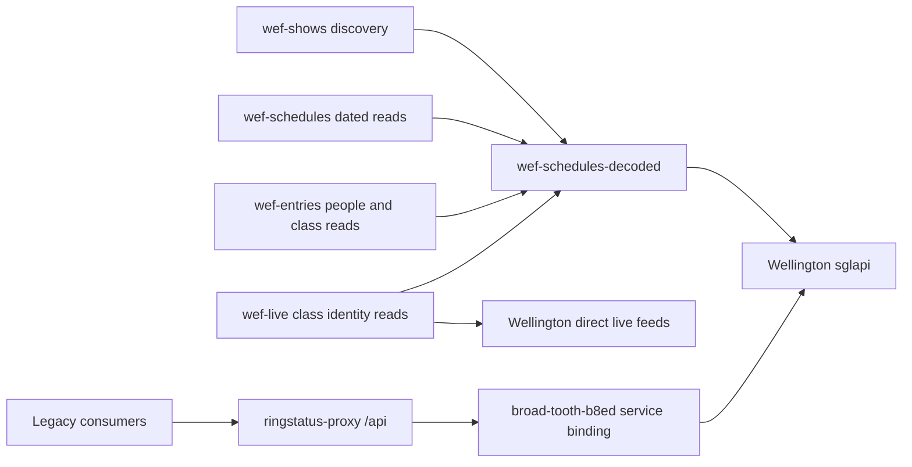

# WEF Cloudflare proxies, Workers and decoding

Route-by-route follow-up: [Endpoint decoding need and module consumers](wef-endpoint-decoding-assessment-20261023.md). Additional route availability is not proof of protected payloads or a current consumer requirement.

Checked 23 October 2026 using local sources, existing release evidence and read-only Cloudflare management APIs. No public Worker or Wellington endpoint was invoked. No collector, deployment, configuration or record was changed. This document is a source-access reference for wef-data-boundaries-working.md and wef-records-owner-acknowledgments-20261023.md.

## How these connect

These are request dependencies, not execution triggers. Each collector recurs independently. Schedules, entries and live read canonical show context from wef-shows records. Cloudflare supplies source access and protected-field decoding; it does not own Airtable participation, roster membership or tenant visibility.

## Deployments verified through Cloudflare

Account ringstatus: dce50dddf8a92d48664f0089f8f5da22. Latest deployments returned at 100 percent:

| Worker | Deployment | Version |
|---|---|---|
| wef-schedules-decoded | fb3269d8-e190-4b9b-b8bf-4564c0a6dcea | 817d56e7-59ba-4deb-8c50-63d196a2808d |
| broad-tooth-b8ed | 8d671fb4-bfa1-4294-8d0a-b30cf736b1e1 | 291feca0-f686-4276-b44d-3b1b21f30f38 |
| ringstatus-proxy | 0263a897-f45e-4d89-8503-0d8953ea151c | de38179f-b130-41bb-9f78-f14ca179bf11 |

These match the retained decoder correction/restoration records. Deployed script bytes were not downloaded this turn; no new source-byte equivalence claim is made. Inspected local decoder SHA256: 278964744a614b4cde037a6852c99d54b614cb722b7ff4a1565bf6b32b62ddcc.

Current settings confirm ringstatus-proxy binding SGL_API targets broad-tooth-b8ed, environment production. Decoder SGL_TOKEN/SGL_COOKIE are secret_text bindings. Legacy broad-tooth SGL_TOKEN/SGL_COOKIE/WORKER_KEY are typed plain_text; no values were printed or saved and no conversion was attempted. Binding type alone does not establish inbound access policy.

## Isolated WEF decoder

Base URL: https://wef-schedules-decoded.gombcg.workers.dev

Source: [worker.js](../../workers/wef-schedules-decoded/worker.js). Config: [wrangler.jsonc](../../workers/wef-schedules-decoded/wrangler.jsonc). GET-only; fixed upstream https://sglapi.wellingtoninternational.com; no Airtable writes or scheduled handler in this source.

| Route | Allowed parameters | Purpose |
|---|---|---|
| /health | No source fetch | Worker identity only, not decoding/workflow proof |
| /ring | customer_id | Default-show discovery with no supplied show/date |
| /schedule | date, show_id, customer_id | Default context using date=00/00/00, or dated schedule |
| /people/:id | pid, show_id, customer_id | Person-associated participation; pid must equal path ID |
| /classes and /classes/:id | show_id, customer_id, cgid | Class/participation/trip identities and enrichment |

customer_id must equal 15. Non-ring source routes require numeric show_id. Schedule dates accept YYYY-MM-DD or 00/00/00. Unexpected query fields are rejected. Current class-detail callers use cgid=-1.

The Worker constructs upstream Authorization from Bearer plus SGL_TOKEN; optionally includes SGL_COOKIE, with Wellington Origin/Referer and sgl-request-origin headers. Consumers do not need the upstream bearer for this lane. This source has no per-user/tenant visibility enforcement.

Upstream fetch has a 25-second timeout, cache disabled and manual redirects. Successful responses have Cache-Control: no-store and X-RS-Decoded: 1. That header confirms decoder processing, not show/date validity, freshness, complete collection or correct joins. Models still validate those conditions.

## Decoding algorithm and protected fields

The implementation records Wellington's public React bundle inspected on 21 October: https://sglapp.showgroundslive.com/static/js/main.js. This investigation inspected the existing implementation/evidence, not a newly fetched bundle.

1. Parse an object JSON payload; reject top-level token-refresh marker _t. No automatic credential refresh or guessed replacement key.
2. Recursively visit objects and arrays. An underscore field (_) holds a base64 protected blob.
3. Decode bytes: eight-digit minute string in the first eight bytes, twelve-byte AES-GCM IV next, then ciphertext/authentication tag. Blobs shorter than 36 bytes fail.
4. Derive the AES key with SHA-256 over public bundle salt + vertical bar + exact upstream Authorization header + vertical bar + embedded minute. The Bearer prefix is part of that material. Imported keys are reused per minute within this invocation only.
5. AES-GCM decrypt; strictly decode UTF-8 and parse an object field map. Reject arrays and reserved keys __proto__, constructor, prototype, _, _t.
6. Merge recovered fields and continue recursively. /schedule retains underscore blobs for existing source-monitor/key evidence; other supported source routes remove decoded blobs.

Pinned public salt: 5874a2ec29e1d30258abe7a00220fd5d. This is public key-derivation material, not a credential. Source supports SGL_BUNDLE_SALT override; no such binding was listed in current settings. Do not record bearer/cookie values or derived keys.

Decoding restores source fields such as class_id, entry_id, horse_id, rider_id and trip identity where present. It does not infer identity from names, equate horse/entry/trip, prove trainer identity from feed association, or establish helper ownership. Existing underscore evidence and operational keys must be preserved.

## Failures, retries and live matching

- Missing token: 503; invalid method/route/parameters: 405/404/400. Upstream errors retain their status with sanitized bodies.
- Redirects are blocked with 502 without forwarding credentials. The initial unsupported redirect setting was corrected under separate approval on 21 October.
- Timeout, bad JSON, _t, corrupt blob, wrong key or decoding failure returns sanitized 502. A 502 alone does not identify the cause. One later observed 502 was diagnosed as timeout; that does not explain every 502.
- Worker does not retry. [lib/wef-source-read.js](../../lib/wef-source-read.js) gives entries/live one bounded retry inside an existing scheduled collection for HTTP 502/503/504 or specified timeout/reset exceptions, after 500ms. It does not start another collector run. Invalid JSON/missing decode header are not retried by that helper.
- Live reads raw getLiveClassData alongside decoded class data, validates class/show/date and matches raw trip ID to decoded trips. Missing identity allows one fresh paired read, archiving both attempts. Persistent mismatch fails; no synthetic binder identity is created.
- Error continuation, completion and skip policy belong to the live collector/wrapper, not the decoder. Control-plane metadata is not normal-run proof.

## Current consumers

| Module | Source access and ownership |
|---|---|
| wef-shows | collector.js calls /ring then /schedule default context and requires decode receipt. Owns canonical show records/archives. |
| wef-schedules | settings.js defaults SGL_DATA_BASE_URL to this decoder, with namespaced overrides supported. Owns dated schedules, stage keys, class IDs and linked rings/shows. |
| wef-entries | source.js calls /people/:id and /classes/:id through transport adapter/shared retry helper. Owns selected participation/provenance, with further identity validation. |
| wef-live | source.js uses decoded /classes/:id for exact identities. Groups ListAjax, LiveScoreWidget and getLiveClassData remain DIRECT Wellington live reads. Class detail includes a time cache-buster. |
| wef-tenant-cwf | Old people source still exists in wef-tenants/source.js; approved synced consumer mode stops duplicate people fetching. Existing source code is not evidence it is executing. |

Windows transport adapters choose request transport; they do not decrypt AES payloads. wef-schedules/token-utils.js base64 prefix/fingerprint handling is source-monitor metadata, not a second protected-payload decoder.

## Legacy proxies and wider Workers

ringstatus-proxy.gombcg.workers.dev serves /api through its verified SGL_API binding, repository data under /docs and /items, Airtable-backed /rider and /horse lookups, WEC print context and GitHub commit-bulk write routes. It is not the new participation linking module. Its existing horse/rider lookups do not establish integration with shared wef-entries helpers. Local source: lib/cloudflare/ringstatus-proxy/worker.js; historical copies also exist under utils/workers. Repository and deployed copies have differed; never replace deployment from an arbitrary copy.

broad-tooth-b8ed.gombcg.workers.dev is the existing authenticated Wellington API proxy. The temporary decode=1 people-route modification was ROLLED BACK on 21 October. Exact restoration baseline: wef-tenants/evidence/proxy-decode-20261021/broad-tooth-before.js. Tracked utils/workers/broad-tooth-b8ed/worker.js is not that exact deployed baseline. Do not describe the superseded shared-proxy decode option as current.

Live inventory also confirms horseshowing-proxy, ringstatus-lp-history-enrichment, ringstatus-pdf, ringstatus-sms and youtube-videos. Their existence was verified; deployed source/bindings/runtime were not audited here. Local SMS sources reference legacy rider/horse/data lookups. Local PDF/history sources exist under workers/. None is established as an additional WEF decoder by this investigation.

## Evidence, verification and remaining boundaries

- Inspected worker source/config/test definitions and consumer sources; no tests or public endpoints executed for this documentation task.
- Live management reads: account inventory, deployment lists, binding names/types and service target. No credential values retained.
- Historical shared-proxy attempt: [wef-proxy-decode-release-20261021.md](wef-proxy-decode-release-20261021.md); restoration: [wef-isolated-decoder-release-20261021.md](wef-isolated-decoder-release-20261021.md); successful correction/repeat proof: [wef-isolated-decoder-redirect-fix-20261021.md](wef-isolated-decoder-redirect-fix-20261021.md) and workers/wef-schedules-decoded/evidence/final-verification.json.
- Historical paired proof established restored class IDs, preserved schedule keys/record IDs, tenant joins and archive hashes. It does not prove today's endpoint health. Keep initial failures and later successes distinct.
- Helper/roster ownership, tenant permissions and wider downstream joins remain subject to the owner acknowledgment record. Decoding supplies the exact identifiers those joins need; it does not complete those connections.
- The working document could not be safely patched because it contains invalid UTF-8 bytes. It was left unchanged; this separate reference avoids rewriting its encoding or concurrent content.
