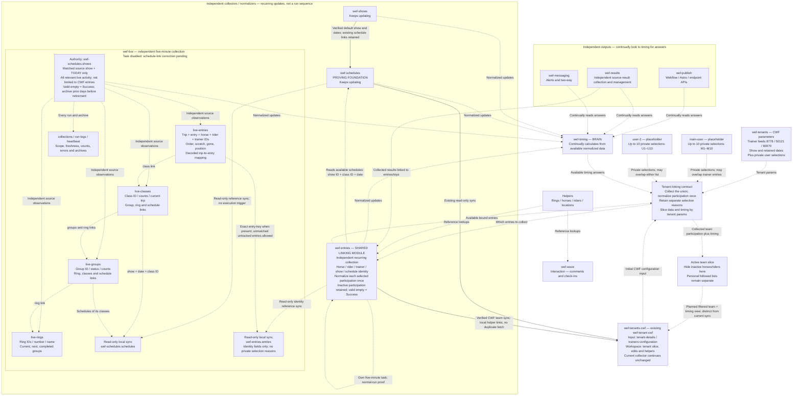

> Earlier Entries build boundary - retained context; superseded by current wiring and proposed lanes below: wef-entries ONLY links accepted Data/Season records to schedules and stops at wef-entries. It performs no direct source collection and has no tenant input, output, integration or acceptance gate. This supersedes conflicting historical descriptions below. Documentation only; no code, Airtable or task changes.
> Current ownership update (26 October 2026): [Six-component records workflow](wef-records-workflow-ownership-20261026.md) governs shows, all-show Data acquisition, cross-show Season stewardship, and operational schedules/selected entries/live. Existing implementations and historical evidence below are preserved; new roles do not authorize reader migrations or production changes.

# WEF data boundaries — working document

Updated: 29 October 2026, America/New_York.
Status: documentation only. Entries is linking-only. Current wiring is separate from the proposed two lanes. Season is retention-only and never a current collection prerequisite.

## Owner-reviewed mapping and approval plan - 29 October 2026

Status: proposed bounded release, NOT implementation authorization. Records coordinated reviews with Shows, Schedules, Live, Entries and the local Season coordinator. All five confirmed their owned boundaries; Live and Entries confirmed the bounded first release, and the Data owner confirmed this mapping and retirement isolation with the pre-mutation and Runner.tick clarifications recorded below. The current wiring below remains live until separately approved changes pass acceptance. Historical evidence and the earlier strict-arrow proposal do not certify a cutover.

### Decision to approve: separate schedule collectors, common participation evidence

Keep Shows -> Schedules and Shows -> Data as separate collection alternatives for schedule comparison. Schedules collects occurrences, not an independent participant directory. Both schedule comparisons therefore use the existing accepted Data participation evidence. This is not two independent entry-acquisition pipelines. If accepted Data participation is unavailable, retain supported historical facts; do not invent fresh participation for lane A.

Preserve multi-day accepted participation directly into Entries. Live adds optional TODAY observations and is never the passage required for future-date linking. This explicitly revises the earlier strict Shows -> Schedules/Data -> Live -> Entries arrows. Season retains history/entities alongside collection, never current readiness. Approval of this recommended boundary does not authorize an independent lane-A participation collector or expansion of Live dates.

### Existing wiring and exceptions

Shows supplies canonical context to Schedules, Data, Live and Entries. Entries currently filters accepted Data class observations through its local Schedules scopes, coupling the alternatives. Live reads both local synced Schedules and Entries references. The first release keeps those Live readers, qualification and native links unchanged. Entries ignores Live's Entries-derived fields, preventing circular validation without deleting the reference.

Data already supplies count evidence directly to Shows and verified retained handoffs to Season. Season is not a required intermediary. Current Data retirement/backoff can nevertheless precede and defer acquisition while awaiting Season archive acknowledgment. The target must separate retirement waiting from current acquisition without weakening archive/deletion safeguards or bypassing existing Source holds.

### Exact source-to-consumer mapping

| Source | Existing fields / scoped key | Consumer and proposed handling |
| --- | --- | --- |
| Shows `appCaSmL819KK7UFJ`, `shows` / `tblJA5CUon5s1sWib` | `show-key`, `show_id`, `customer_id`, canonical dates/default and original context evidence | Existing canonical validation in all collectors; no independent discovery or count/Season gate. No Shows runtime change. |
| Schedules `appUq5Qz9kARqFija`, `schedules` / `tblqiTFqqO3zk2KJC`; Entries-local sync `tblVcbGJHhzLYZRxn`; Live-local sync `tblGPXIUnD0sfTEIX` | Published `stage-key`, `show-id`, `date`, `ring`, `class-id`, `status`. Source additionally has `group-id`, `class-number`, `dataset-id`, `row-json`; do not assume these are synced. | Lane `schedules`. Copy the existing occurrence key, never reconstruct it from a Data key. Only Entries-local sync record IDs enter Entries `schedules` native links. No sync expansion or new source parity/health gate. |
| Schedules source `show-collection` / `tblvGpwxGjXXNLKAU`, dated `rings` / `tbliUwvXYdMhvJ3Fm` | Dated collection scope, `dataset-id`, fingerprint/context and accepted source times; published dated `ring-key`, ring ID distinct from ring number | Retain existing collection/archive evidence; source class-to-group membership does not prove entry/trip-to-group attribution. No new reader or permission in the first release. |
| Data `appdl16HJ5ETm8N69`, `runs` / `tblSxcmUcmB0W9Vhu` and `collections` / `tbl8fQXTGJmv5esNj` | `run-key`, `status`, `state-json`; `collection-key`, `status`, `retained-json`, `retained-sha256`, exact record IDs and observation references | Existing `wef-entries/data-input.js` -> inert `retained-input.py` validates completed revision chain, hashes and canonical fence. Reuse common class/trip participation and original request-completion times; no mutable-table snapshot substituted for revision proof. |
| Accepted retained Data graph `schedules`; schema counterpart `tbl6KKlYuMIPHEJWe` | `schedule-key`, `show`, `day`, `ring`, `group`, `class`, `kind`, `source-position`, `source-id`, `name`, `start-time`, `end-time`, `source-json`, `last-success` | Lane `data`. Extend inert projection through bootstrap and later accepted graph updates; resolve graph-local show/day/ring/group/class keys within the same verified revision. Actual Data key is customer|show|date|ring-number|source-occurrence-ID, with the producer's existing position fallback. Copy it unchanged. Source observation time comes from attributable inventory request completion, not projection last-success; bootstrap without an attributable receipt gains no invented freshness. Resolve graph record-map IDs within that accepted revision. Never use it as a Schedules `stage-key` or native link ID. |
| Live `appgzosUcVqA4vZdf`: `live-entries` / `tblf7550e7UGT8ZSF`, `live-classes` / `tblNaM9ehOJFsrveV`, `collections` / `tble6fwMDBbeeGxly` | `live-entry-key`, `entry-key`, customer/show/date, trip/entry/horse/rider IDs, `class`, `collection`, `scope-status`, original observation times and `source-json`; class ID and collection identity/status/fingerprint/archive path | Add exactly three GET-only targets in Entries. Direct read plus verified existing normalized local class archive; no native Live sync. Ignore `entry` and all `participation-link-*` fields. Optional TODAY class-level enrichment only, not operational group attribution. |
| Live normalized archive under `wef-live/runtime/history` | Existing class dataset archive, collection `archive-file`, decompressed fingerprint and exact scoped trip membership | Constrain resolved path to existing archive root, verify hash and member identity, then reread/fence collection evidence. Reject changed, missing or conflicting evidence for enrichment only; no force sync, source fetch or cleanup. |
| Data retained day-count summaries -> Shows `show-days` / `tbl14MaCCDw6dAywH` | `day-key` -> `show-day-key`; date -> date; canonical Shows-local record -> `show`; `unique-entry-count` -> same; `proven-trip-count` -> `trip-count`; `coverage` -> `count-coverage`; `policy-version` -> `count-rules-version`; `accepted-as-of` -> `count-observed-at`; `verified-at` -> `count-verified-at`; revision/hash/ref -> `data-evidence-ref`; compact summary/digest -> `accepted-summary` | Existing `day-source.js` / `day-replay.py` / `show-days.js`; Data -> Shows count evidence, not Season -> Shows. Unknown/Stale/Verified retain source-time semantics. Count failure preserves discovery; do not add or sum lane counts. These source registration counts are not attendance or whole-day activity; scratches remain separately identified. No Shows change. |
| Verified Data retained handoff -> Season horse/rider/trainer/ring bases | Existing accepted revision/archive/checkpoint and original entity/member keys | Existing retention only. Season acknowledgment remains mandatory before eligible deletion, not a current-collection readiness decision. No Season schema/entity writer changes. |

### Additive publication contract; no new Airtable fields

Keep `source-json.format = wef-entry-link-v1` and every existing top-level evidence property. Add the following JSON properties, not Airtable fields:

- `laneAssociations.schedules`: producer=`wef-schedules`, actual published stage keys, scoped show/date/class/ring, matching basis/status and existing evidence. Existing `schedule-key`, `schedule-keys`, `schedule-link-status`, `schedule-link-basis`, `group-link-status` and native `schedules` remain Schedules-only for consumer compatibility.
- `laneAssociations.data`: producer=`wef-data`, actual Data schedule keys, scoped show/date/class/ring, matching basis/status, accepted revision and collection/hash references. Data-only associations do not rewrite Schedules status as linked. A missing Schedules match must not discard valid Data-lane participation. Preserve prior native links as historical where required; never relabel a retained link as current without evidence.
- Optional `liveEvidence`: actual `live-entry-key`, class collection identity/fingerprint/archive member reference, original observation time and enrichment qualification. Missing/rejected current enrichment is recorded independently; retained old evidence must not appear current.

Participation keeps show|date|entry|class and its existing record ID. Live keeps one show|date|class|trip observation, even if both lanes reference it. A show entry ID, participation key, trip ID and schedule occurrence are different identities. Match each lane independently by canonical customer/show/date/class/ring. Multiple candidates need attributable occurrence evidence; ambiguous associations stay Conflict, missing stay unresolved. Class-to-group references alone never fan a trip out across operational groups.

Live qualification: exact scoped trip and participation identities, consistent horse/rider identity, matching complete class collection, verified normalized archive membership and unchanged evidence after read. Reuse the existing 30-minute original-observation freshness threshold for this proposed enrichment; publication or syncing never refreshes source time. Establish ring from accepted evidence or leave its association unresolved. Missing, stale, empty, failed or unresolved Live skips enrichment and preserves multi-day facts/links; it cannot retire Entries or suppress independent observations. Only exact applicable class attempts affect the class; unscoped/global attempts remain audit evidence.

### One bounded implementation release, after explicit approval

| Owner | Exact proposed change boundary | Preserved behavior |
| --- | --- | --- |
| Entries | `wef-entries/retained-input.py` exposes accepted Data schedule graph, including bootstrap/updates; `model.js` computes separate associations; new `live-input.js` validates optional three-table/archive enrichment; `collector.js` publishes additive evidence without the Schedules-only participation filter; `settings.js` adds Live base/archive root; `airtable.js` adds only three GET targets; focused existing/new tests | `data-input.js` needs no planned change: accepted projection/head already returned. No direct collection, tenant gate, rekey, sync change, foreign native IDs or record repair. |
| Data, owned by local Season coordinator | `wef-data/data_runner.py` (run wrapper AND outgoing archive-readiness branch in `Runner.tick`), `retirement.py`, `wef-data/tests/test_retirement.py` and `wef-data/tests/test_rollover_and_dependencies.py`: isolate retirement readiness/backoff from the independent current acquisition path | Season acknowledgments, archive verification, exact-ID authorization, dynamic current/shared protections, worker lock and post-retirement reload remain mandatory. No new deletion approval or current Source recovery. |
| Shows / Schedules / Live / Season retention modules | No production edits or deployments in this first release; owners review their consumer compatibility | Current collectors/cadence, count replay, Entries-to-Live reference and native links, archival history and deletion safeguards remain. |

Order: freeze this contract -> prepare scoped code and offline tests under approval -> independently review -> deploy Entries and Data through each owner's existing route without task/cadence changes -> observe two normal scheduled runs of each affected collector. These are independent patches within one coordinated release; one blocked verification does not permit substitute execution or block unrelated authorized preparation.

Only a positively identified PRE-MUTATION retention wait (absent Season acknowledgment, archive readiness or its bounded backoff) may log and preserve rows while current acquisition remains eligible under its own existing guards. Include the outgoing archive-readiness branch in Runner.tick as well as the wrapper; do not overwrite checkpoints. Unknown DELETE outcome, unresolved partial mutation, failed fresh reload or unsafe identity/reference state is a safety failure, not a soft readiness wait: stop the affected execution path and report. Do not weaken these safeguards to force collection, retry a failed workflow, clear a pending Source POST, repair records or override existing Source backoff.

Acceptance: two normal runs per changed collector; a naturally populated TODAY class for enrichment; repeated identities/native links and original timestamps unchanged; Data-lane participation outside Schedules coverage retained; missing/conflicting Schedules association isolated; future-date Entries preserved during empty/stale/unavailable Live; lane failure does not overwrite the other lane's evidence; no operational group claim without proof. Offline focused tests cover unavailable inputs, malformed/archive-conflicting evidence, same-trip dual associations, retirement waiting and indeterminate deletion safety. Data tests explicitly cover missing Season acknowledgment, unavailable archive readiness, retirement backoff, unchanged Source unknown-POST/backoff files, exact-ID/shared protections, pending DELETE intent, reload failure and repeat execution. Normal runs must show Data is not gated by retention and eligible retirement still requires every safeguard. Do not manufacture failures or run collectors manually. If natural runs lack populated cases or current Source is held, report that acceptance as pending, not passed. Natural rollover/multi-group proof remains separate.

Rollback: restore reviewed prior deployed code through existing routes after applicable authorization; disable additive readers, preserve collected data and evidence/native links. Never roll back by deleting records or clearing links. A failed approved runner path stops and follows the fresh-approval rule.

### Exact approval requested; not granted by this planning request

Approve the schedule-comparison/common-participation boundary and optional TODAY bypass, then code edits, focused offline tests, independent review, established deployment and two normal scheduled verifications for the named Entries and Data files above. Approve three GET-only Live tables and read-only existing normalized archives; existing source-json gains additive lane/enrichment evidence only. No additional Airtable fields, tables, views, syncs, task/cadence changes, manual runs, repairs or deletion scope are included.

Not in this release: independent lane-A participation acquisition; mandatory Data -> Live -> Entries routing; Live production changes; removal of Entries -> Live qualification/reference; native Data/Live cross-base relationships; optional Shows/Schedules browsing syncs/lookups; permanent browsable history or archive-catalog implementation. Reverse-dependency removal needs a separately mapped replacement and approval after first-release acceptance. These are explicit exclusions, not claims of completed implementation.

## Shows / Schedules tables and TODAY Live views - 29 October 2026

Documentation proposal only. Inspect and reuse prepared tables before any build. Nothing here creates tables, syncs, links, history projections or retirement jobs, or changes the existing collectors or cadence. Existing archive behavior is described separately from proposed browsing views.

### Table responsibilities

| Base | Table | Responsibility |
| --- | --- | --- |
| wef-shows | shows | Canonical show identity, name, dates and default selection. Retain the show index across show changes. |
| wef-shows | show-days | One canonical record per show/date; publish verified daily summaries from accepted current Data evidence; Season retains history and is not a publication prerequisite. These records survive the end of the live day. |
| wef-shows | sources | Discovery and supporting source evidence. |
| wef-shows | heartbeat / run-logs / err-logs | Latest health, collection attempts/results, errors and archive evidence. |
| wef-schedules | shows | Reuse the existing local show reference and schedule archive catalog; canonical authority stays in wef-shows. |
| wef-schedules | schedules | Keep each operational schedule occurrence across every date of the current show, preserving existing stage-keys and record identities. |
| wef-schedules | rings | Reuse existing dated ring records. Ring identity uses source/customer/facility and source ring ID; dated schedule references also retain show/date/ring number. Do not rekey the existing table or substitute ring ID, number and name for each other. |
| wef-schedules | groups (proposed reference table) | Show-scoped source group ID, with dated ring context and links to schedule occurrences. |
| wef-schedules | classes (proposed reference table) | Show-scoped source class ID as identity; class number/name for display and lookup. A class can belong to multiple groups; preserve separate schedule occurrences. |
| wef-schedules | types / sequence-types / statuses (proposed lookup tables) | Reference actual source values and defined status meanings. Separate collected class/live status from collector success and historical/dropped state. |
| wef-schedules | show-collection | Collection result and health per show/date, not a substitute for canonical show-day counts. |
| wef-schedules | heartbeat / run-logs / err-logs | Latest health, attempts/results, errors and archive events. |

Existing rings-helper/static owner data remains protected. The proposed references reuse or link prepared tables where suitable; they do not duplicate all-show acquisition, replace Data acquisition or Season retention, or authorize a new entity writer.

### TODAY Live links - proposed read-only sync views

wef-live owns current-day live-rings, live-groups, live-classes and live-entries. Read-only synced copies of these four tables may be exposed inside wef-shows and wef-schedules for browsing. They do not transfer collection ownership or extend Live's collection to all show dates. These inbound sync views are not claimed to be configured yet.

| Destination | Link context |
| --- | --- |
| wef-shows | Match the canonical customer/show/date to the corresponding show-day, then browse its live rings/groups/classes/entries. |
| wef-schedules | Match customer/show/date and source ring/group/class identities to the existing dated schedule records and actual stage-keys. Ring number must be validated against the dated ring; do not compare it directly with ring ID. |

Identifiers remain distinct: entry-id identifies a show entry; the participation entry-key is show|date|entry|class; trip-id identifies a trip and is scoped as show|date|class|trip in Live's live-entry-key. None is interchangeable with a schedule occurrence or its stage-key. Multiple classes/groups/occurrences require attributable evidence; do not guess links from a name or class number. Ambiguous schedule associations are Conflict, missing links remain unresolved, and only dependent live views are affected. Missing, stale or conflicting Live data never stops Shows, Schedules or Entries. Entries remains linking-only; existing reverse dependencies and proposed forward handoffs are distinguished above. These browsing views add no Entries-owned integration.

### Existing Entries reference and Live qualification

Live already consumes the read-only wef-entries.entries reference. Alongside identities, original observation times and scalar/plural schedule keys, that reference includes schedule-link-status, schedule-link-basis, group-link-status, link-issues and source-json evidence. This is an existing data handoff, not a job trigger or an Entries-owned downstream workflow. Entries remains linking-only and stops at its own publication; Live owns qualification and consumption. See wef-live/evidence/entries-contract-20261029/release.md for dated acceptance.

Live logging uses the actual existing table name errs-log alongside heartbeat, run-logs and collections. Heartbeat stamps each invocation; run-logs records the overall run outcome; errs-log records individual errors. This does not rename it to the err-logs tables used in Shows or Schedules.

Proposed browsing views must filter by canonical customer/show/date, current-versus-historical scope and appropriate observation qualification; retained historical rows are not TODAY activity merely because they remain in Live. Observation freshness and participation-link qualification are separate. Validate the latter only when using linked participation/group answers; unresolved, Conflict or stale participation links do not suppress otherwise valid independent observations. The implementation and acceptance of these destination browsing filters remain proposed.

### Day end: what stays and what is archived

- No midnight delete is introduced. Live changes current/historical labeling by its validated show/date scope; the collectors do not use a clock change alone as permission to discard records.
- Shows retains the show and its dated show-day record. Schedules retains that day's operational schedule as part of the current show's multi-day projection; a day ending does not trigger old-show retirement.
- Existing Live behavior archives prior observations before eligible retirement. Only a later clean qualifying populated collection can retire eligible earlier-date rows or same-date rows belonging to another valid show. Archives are compressed local files verified by readback/hash before removal. Empty, skipped, failed or unresolved runs do not authorize this cleanup; current-scope and future-date records are protected.
- Read-only Live syncs follow the source table and sync configuration. When Live retires source records, their continued presence or native links in destination syncs must not be assumed. These synced views are not permanent history, and Shows/Schedules records must not depend on their survival.
- Local verified Live archives preserve the prior observations. A permanent browsable Airtable history or durable archive index in a destination base would require a separately agreed retention/sync implementation; merely adding a sync does not provide it. Live's separately discussed archive-index work is not certified deployed by this document.
- On a later new-show rollover, Schedules waits for all new-show dates to succeed, archives/verifies the exact old schedule and show-collection records, then retires them from active tables. The local shows archive catalog and run-logs retain file references/counts/verification; archived content remains in wef-schedules/runtime/history/retired. That show rollover is separate from Live's daily rollover.

The diagram labels proposed read-only Live browsing arrows separately from the existing read-only Entries reference handoff. Data handoffs are not execution triggers. Existing source ownership, keys, archives and failure protections remain controlling.

## Historical working notes and dated evidence

Everything below is retained historical material. Conflicting source-collection, tenant integration, reader-migration or acceptance requirements are superseded by the current boundary above and are not part of this Entries build.

## Show authority, zero-entry evidence and schedules open work - 29 October 2026

Current schedules contract; documentation only. This supersedes older references
below, including historical diagram labels, that made wef-schedules.shows the
show-discovery authority. It does not authorize implementation or reader changes.

### Sole authority

**wef-shows is the sole canonical show authority.** It discovers new/default
shows and publishes canonical customer/show identity, dates and source-selected
context. All WEF agents consume that authority rather than independently
rediscovering shows. Schedules' shows table is a local linked mirror.

Data owns acquisition and daily count computation/evidence; Shows alone owns
the proposed canonical show-days publication. Season owns cross-show stewardship,
not duplicate acquisition or a second canonical day writer. See the
[29 October ownership amendment](wef-records-workflow-ownership-20261026.md)
and [show-days plan](wef-show-days-plan-20261029.md). Publication and consumer
zero gates remain proposed, not deployed/proven by this schedules work.

### Verified zero-entry day: required evidence

A suppression-eligible zero requires explicit accepted **complete dated evidence**
with matching source/customer/show/date, an approved count-policy version and
coverage, all required child scopes/pagination reconciled, and no unresolved
identity or required schooling/classless coverage gap. The accepted daily
unique-entry count must explicitly be numeric zero; missing/null/blank, stale,
partial, failed, uncollected or ambiguous evidence is never zero. Unique entries,
class participation, trips and horses are distinct measures; summing class trip
counts cannot establish unique-entry counts.

Data must supply a reproducible accepted completed revision, observation time,
coverage and verifiable evidence reference/digest. Shows must validate/publish
and read back the same valid revision, fresh under an approved threshold.
Publication/failed-attempt timestamps cannot refresh old source observations.
Count policy, count freshness, revision storage and the recheck/resume policy
still need implementation/acceptance; existing schedule-health freshness is not
an approved count threshold.

Only acquisitions covered by that evidence may be skipped. Tenant-selected
empty feeds, zero trips or no competition classes cannot suppress the whole
Live lane or uncovered schooling/classless activity. Keep canonical show-context/
readiness rechecks separate from costly source polling. New producer revisions,
added entries or corrections must resume acquisition through the approved
recheck policy. No permanent day shutdown or consumer disabling is authorized.
**Schedules must still collect schedule changes on a zero-entry day.**

### October 29: zero reported trips is not verified zero-entry readiness

Show 200000076 has **24 schooling sessions, two breaks, zero competition classes
and zero source-reported trips** in the saved normal source. Each of the 26
source group objects explicitly supplies numeric total_trips=0; none was inferred
from a missing field. This does not enumerate entries or measure schooling
attendance. **Complete daily unique-entry count and schooling attendance remain
unknown**, so this evidence cannot activate a whole-day zero gate. October 29
is not an empty schedule day. The source header total_trips_count=26 is excluded
from the trip sum; its meaning as a participant count is not established.

The existing wef-shows chat received this evidence and limitation. Delivery is
not proof of a readiness publisher/gate. See [method and per-block counts](../../wef-schedules/evidence/schedule-blocks-20261029/today-entry-counts.md)
and [all 26 exact field paths/values](../../wef-schedules/evidence/schedule-blocks-20261029/today-trip-count-evidence.json).

### Schedules: completed versus open

| Area | Existing / verified | Remaining gap |
| --- | --- | --- |
| Canonical input | Reads wef-shows with identity/freshness checks; no independent default discovery. | Preserve authority during any later reader handoff. |
| Schooling and breaks | Completed release: 139 offline tests; normal 08:30/08:35 Eastern runs on October 29 succeeded. All 471 prior class record IDs/show/ring links survived; all 504 schedule IDs stayed stable on repeat. Today has 26 blocks and no empty-day warning. | No attendance or complete daily entry-zero claim. This is dated acceptance, not a fresh health audit. |
| Counts/readiness | Data computation and Shows sole-publication ownership agreed; schedules retains operational show-collection/date-health. | Complete dated coverage, approved policy/freshness, reproducible Data revision, canonical Shows publication/readback and consumer normal-run acceptance remain unproven here. No gate or polling reduction implemented. |
| Schedule collection | Existing five-minute workflow continues across show dates. | A zero-entry gate does not cover schedule-change collection. Agree exact lane-specific reuse/skip behavior before any future change. |
| Natural rollover | Existing new-show collection and archive-before-delete safeguards remain. | **Natural all-consumer rollover remains OPEN:** entries/CWF/live sync/link effects, old-row retirement, retained history and applicable Data/Season readiness need combined evidence. Do not fabricate a transition. |
| Portable handoff | Shows-to-schedules currently depends on the same-machine hash-verified payload archive. | Airtable-only/portable retained-data handoff requires separately approved implementation and acceptance; do not remove existing archives. |
| Downstream associations | Stable schedule keys and destination-local native-link rules remain. | Natural participation-specific multi-group eligibility and consumer handling remain with entries/live and the coordinator. No guessed joins or repairs. |

[Schedules release evidence](../../wef-schedules/evidence/schedule-blocks-20261029/release.md)
records the completed block/empty-day delta. Earlier detailed rollover gaps below
remain open unless later exact acceptance closes them. This working-doc update
makes no code, Airtable, task, cadence, source-call or manual-run changes.

## Canonical show-day readiness and entries handoff - 29 October 2026

Planning amendment only. This section supersedes older undecided all-show ownership wording below. Existing acceptance remains dated evidence; no reader migration, count gate or production change is implemented by this document. See the [canonical show-days plan](wef-show-days-plan-20261029.md) for proposed fields and the [ownership contract](wef-records-workflow-ownership-20261026.md).

### Working versus planned

| Area | Working / evidenced | Still missing |
| --- | --- | --- |
| Show authority | Entries reads canonical wef-shows without independent discovery. | Consume canonical show-day readiness. Shows alone owns discovery/default selection and canonical show/day publication. |
| Acquisition | Entries collects CWF feeds 8778, 50121 and 80970 and configured private follows. | Consume accepted retained Data acquisition instead of duplicate source fetching. |
| CWF / schedules | CWF consumes entries sync; stable participation keys and local schedule/ring/helper links have normal-run proof. | Prove the same identities and relationships survive the future input switch. |
| Multiple schedules | Plural fields/readers work; production requires one unambiguous eligible schedule. | Validate and consume saved live group-entry evidence. Repeated shared-class lists and inconsistent group context are not automatic eligibility. |
| Season / entities | Source horse/rider IDs and CWF local rosters exist. | Accepted cross-show identity/history references, exact table mapping and conflict handling. Shared entity authority is not activated. |
| Privacy | Private selection ownership is separate from common participation; personal-only entries stay out of team sync. | Populated private delivery/access remains unproven; the two placeholder follow lists were empty in the last checked receipts. |

Latest receipts inspected October28: entries completed at 19:00:00 Eastern with three participations and no errors; CWF completed at 19:00:01 with three synced entries, three verified schedule links and zero people fetches. This is dated saved evidence, not an October29 operational audit. See also [two-run entries/CWF acceptance](../../wef-entries/evidence/multiple-schedules-20261024/release.md).

### Canonical readiness rules

- Shows is the sole canonical show/show-day publisher. Data computes counts and supplies retained, verified acquisition evidence. Season consumes accepted revisions for cross-show history and reconciliation; it is not another canonical day writer.
- Only explicit accepted complete zero-entry evidence may suppress eligible dated acquisition: matching source/customer/show/date, approved count policy and coverage, fresh valid revision, and coverage of the entry types this lane needs.
- Missing, stale, partial, failed or ambiguous evidence is never zero. Tenant-selected zero, trip-count zero or no competition classes cannot prove an empty day. Unknown schooling/classless attendance prevents whole-lane suppression. Scheduled-class coverage alone cannot suppress uncovered entry types.
- Unknown counts remain blank. Preserve prior accepted counts/evidence on failure with non-current status. Publication or failed-attempt timestamps cannot refresh source observation time. Incomplete or failed acquisition cannot remove entries or clear links.
- Continue canonical context/readiness checks separately from costly source polling. Added entries and corrections must resume acquisition through producer revisions and the approved recheck policy. No permanent day shutdown.
- Count inclusion rules, freshness threshold, recheck cadence and first-consumer acceptance remain pending in the show-days plan. The existing 30-minute schedule-health check is not an approved new count policy. Existing schedule parity/date-health checks remain intact.

### Required Data and Season handoff

These are logical inputs, not a request for new duplicate tables. Reuse prepared tables after exact field mapping is accepted. Proposed fields in the show-days plan are not deployed fields.

| Producer / input | Required information | Entries responsibility |
| --- | --- | --- |
| Shows: canonical show-days | Customer/show/date, show-day-key, nullable unique-entry-count, count-coverage, count-rules-version, count-observed-at, publication/latest-attempt status, accepted data-revision and evidence reference. | Validate authority and apply only an approved lane-appropriate readiness gate. |
| Data: retained entries/participations | Source/customer/show, entry-id, horse-id, rider-id, evidenced trainer identity distinct from feed association, class/date, proven trip IDs when supplied, source status, observation time and accepted revision membership. | Normalize/select participation while preserving existing entry-key and CWF identity. No invented IDs or date allocation. |
| Data: schedules/group evidence | Exact existing schedule key, show/date/class/group/ring, source status and accepted collection/revision; attributable entry/class/trip-to-group evidence where available. | Match operational wef-schedules keys and validate membership. Retained Data rows do not automatically replace current schedule links. |
| Data: accepted collections/revisions | Expected and accepted child scopes, pagination/coverage, explicit valid-empty evidence, observation window, identity gaps, result/errors and reconstructible Airtable evidence. | Reject partial/mixed/changing revisions. A count or fingerprint alone does not establish completeness. |
| Season: entity/history references | Source-scoped entity IDs, accepted mapping/revision, retained show/entry/participation references, provenance and unresolved conflicts. Exact tables remain to be agreed. | Reuse evidenced relationships without replacing CWF helpers, name-based merges or duplicate acquisition. |

New durable handoff/evidence belongs in Airtable. Existing local archives remain evidence; migration is separate scope. Cross-base relationships use business keys resolved to destination-local native records, never foreign Airtable record IDs. Season does not become a prerequisite for unrelated valid entry collection merely because its identity stewardship is unfinished.

### Preserve CWF and privacy during a future switch

Keep CWF's existing entries sync. Preserve entry keys and record IDs, local schedule/horse/rider links, nicknames and helpers. Continue collecting inactive horses/riders while excluding them only from the active-team slice. Shared acquisition excludes private follow owners and selection reasons. Private trainers remain visible to the tenant admin and chosen users; each user's follows remain private, including the main user's. These are required boundaries, not proof that all user-specific access/delivery exists.

Next: agree exact prepared table/field mappings, accepted revision/completeness rules, identity/conflict handling and readiness/recheck policy. A separately approved implementation must verify normal scheduled runs and repeat identity/link/privacy preservation before stopping duplicate acquisition. No code, Airtable, source calls, manual runs, tasks or automations changed for this documentation update.

## Schedules rollover responsibilities and open acceptance - 24 October 2026

**Natural new-show verification remains OPEN.** Responsibility acceptance,
fixture rollover, old ESP Fall II archives and repeated runs of the same show
are not proof of a naturally occurring default-show transition across shows,
schedules, entries/CWF and live. No transition is to be fabricated or triggered.

This section reconciles schedules' existing scope with the coordinator's
[rollover acceptance assignments](wef-rollover-acceptance-assignments-20261024.md).
It records source behavior and acceptance gaps only; it authorizes no implementation,
host migration, retention change, source calls, manual runs or record repairs.

### Accountable schedules responsibilities

| Responsibility | Existing behavior / remaining gap |
| --- | --- |
| Canonical show input | Read wef-shows, requiring exactly one customer-15 default, valid show key, matching source metadata and authority freshness within 30 minutes. Missing/stale/ambiguous authority is a failure, not a valid empty show. Schedules does not rediscover a default or trigger the producer. |
| Same-machine producer archive | show-source.js reads default-payload-file and default-payload-sha256, requires the file under wef-shows/runtime/history, decompresses it and verifies SHA256 before using its payload. Airtable metadata alone is insufficient: producer and schedules must have the expected local archive available. Missing/unreadable/hash-invalid archives block consumption. No portable/cloud archive handoff is implemented or authorized here. |
| New-show collection | Collect and validate the discovered show's dates; preserve exact show/date/source stage keys and date-specific completion evidence. New-show readiness must be shown through the actual scheduled collector, not inferred from old archives or a changed default flag. |
| Old-show retirement | Existing current-store.finalize retires old-show schedules and show-collection rows only after all new-show dates succeed, with verified archive-before-removal. The call precedes final reference synchronization and terminal run reporting. There is no downstream acknowledgment gate; archive safety does not itself prove preservation of downstream native links. No retention change is authorized. |
| Downstream native references | Assess and document actual effects of old source rows disappearing from local syncs/native links in entries, CWF and live. Stable string keys or retained prior participation do not prove native-link preservation. Do not invent replacement links, repair records or represent historical links as current eligibility. Entries/live own their consumer handling. |
| Schedule acceptance evidence | Provide exact old/new show keys, relevant-date collection completion/dataset evidence, source/local sync readiness, archived prior state, retirement effects and terminal run-log/heartbeat outcome. Coordinator combines this with other owners' independent evidence. |

### Remaining gaps and next evidence

- **Same-machine dependency remains:** no host-independent archive transfer or
  relocation acceptance is established. Any future hosting change needs explicit
  scope and proof that schedules can read the correct verified producer payload.
- **Natural retirement/link effects remain unverified:** successful new-show dates
  can precede old-row removal without entries/CWF/live acknowledgment. Actual
  source-sync lag, native-link loss/preservation and historical/current labeling
  must be observed; no speculative code or retention correction is approved.
- **All-four natural rollover proof remains OPEN:** at a genuine default change,
  capture old/new customer/show keys; producer discovery/publication run IDs and
  times; exactly one canonical default; independent schedules/entries/live run
  IDs and relevant-date health/readiness; CWF consumption; preserved archive,
  record/helper/private relationships; failures/Partial scopes; and actual
  retirement effects, including other-show rows on the same date. Observe two
  normal repeats where the approved acceptance gate requires them.
- Shows owns its non-atomic default-publication and returned-identity validation
  gaps. Entries owns current-show filtering, new-show parity/dated health/sync lag
  and CWF handling. Live owns TODAY/transition guards, participation history and
  its retirement behavior. The coordinator owns combined acceptance tracking.
  None of these gaps may be marked resolved by schedules' same-show run proof.

A missing/stale/ambiguous upstream scope must stay explicit and must not stop
unrelated authorized work. Keep participation-specific multi-group evidence and
live's class identity disagreement separate from rollover acceptance. Source
timezone/UTC offset remain unknown; selected_date does not establish TODAY.

Source references inspected for this update: wef-schedules/show-source.js,
wef-schedules/current-store.js and the coordinator assignment record. Existing
call order is recorded in wef-schedules/store.js. No new tests, production reads,
collector runs, task changes or record repairs were performed for this update.

## Verified entries/CWF rollout and schedules open work - 24 October 2026

This update supersedes the proposal-only status below for entries/CWF plural
transport and consumer support. It does not claim natural multi-group collection,
shared entity migration or full downstream acceptance. Evidence was reviewed from
saved release/readback files; no new collector runs or Airtable requests were made
for this documentation update.

### Entries/CWF: verified scope

The entries owner deployed schedule-keys transport, observation-status metadata,
successful observation handling, dated schedule-health checks, retained historical
relationships and compatible CWF consumption. Local schedules/rings resolve exact
keys against each destination's own synced records. Safe fields propagate through
the existing CWF/live export views. Entries reads relevant-date
show-collection.status/completed with a 30-minute freshness check; full source/sync
parity retains dropped rows while current eligibility excludes dropped schedules.
This is verified for entries/CWF, not a claim that every future timing consumer
already implements the rule.

| Normal pair (24 October, Eastern) | Entries completion | CWF completion | Verified result |
| --- | --- | --- | --- |
| 1 | 13:04:01-13:04:31 | 13:07:02-13:09:45 | 9 current participation, 1 historical; 9 current local links verified; zero CWF people-endpoint fetches. |
| 2 | 13:09:02-13:09:36 | 13:12:05-13:15:18 | Same identities, relationships and slices; 9 current local links verified; zero CWF people-endpoint fetches. |

Both pairs have successful heartbeat/run-log and GET-only Airtable readback
proof. Repeat comparison confirms stable record IDs, schedule/ring/helper links,
statuses and active slices. CWF nicknames, notes, aliases, disabled flags and
retired original entry records were preserved; private selection ownership and
provenance were not exported. All 110 offline tests passed. No manual runs,
record repairs, endpoint/decoder/task/shared-entity/permission changes occurred.
Schedules producer code/schema/stage keys/task were untouched by this rollout.

Evidence: [entries/CWF release](../../wef-entries/evidence/multiple-schedules-20261024/release.md),
[normal pair 1](../../wef-entries/evidence/multiple-schedules-20261024/run-pair-1.json),
[normal pair 2](../../wef-entries/evidence/multiple-schedules-20261024/run-pair-2.json),
and [repeat comparison](../../wef-entries/evidence/multiple-schedules-20261024/repeat-comparison.json).

### Still open: source-supported multiple groups and downstream scope

Actual runs had zero multi-schedule participation. Retained people payloads lack
attributable participation-specific group eligibility. Production preserves unique
singleton selection and rejects ambiguity. The plural selector/serializer and
consumers are fixture-proven; a source adapter and natural multi-group proof
remain open under entries ownership, coordinated with live. Class membership
alone must not be promoted to participation eligibility. No schedules key/schema
change is required or approved by this documentation.

The entries release cites separate live-owner proof for two participation-link
passes (13:07-13:08 and 13:12-13:13 Eastern), preserving six prior native links.
It also reports live overall remained Partial for its pre-existing class 429
identity issue. This is a separate live-owner limit, not an entries/CWF failure
or a schedules-owned repair. Populated private follows remain fixture-only;
shared entity ownership/migration, private delivery/permissions and broader tenant
parameterization retain their separate owner decisions and acceptance gaps.

### What remains open for this wef-schedules chat

| Item | Owner / next action / limit |
| --- | --- |
| Schedules producer contract | Accepted and supplied: exact stage-key, class/group/ring/date facts and relevant-date health. Keep these stable. No producer change is pending for the verified entries/CWF transport. Participation eligibility remains entries' source responsibility. |
| Routine review | Next planned Monday 26 October, 9:00 a.m. Eastern. Review existing code/evidence; no automatic fixes, deployment or manual collection. |
| Desktop isolation | Last checked 24 October: task still Interactive with five-minute cadence. Running outside the desktop session remains unverified/unresolved; hidden arguments alone do not establish isolation. Any change needs the applicable authorized administrator action. No task changes in this update. |
| Historical 11:20 interruption | Exact runtime/network trigger remains unproven. False-success behavior was corrected and verified through normal 12:00/12:05 runs (134 offline tests); do not reopen it as an unimplemented fix or repair the old Running record. Further root-cause work requires new evidence, not speculative patches. |
| Timing handoff | Schedules accepted direct canonical reads and a proposed 30-minute relevant-date health rule for timing. Timing owner must implement/prove its consumer. Source actual starts/ends, clock and timezone are unknown unless explicit source evidence establishes them; estimates must not become invented actuals. |

Confirmed empty October 22 for show 200000075 is already owner-accepted and
recorded in schedules README/run-logs. Its empty_show_day Warning is not an open
collection failure. Schedules' own completion-guard proof is retained in
wef-schedules/runtime/incomplete-run-release-20261024/. No fresh operating-health
claim is made beyond those dated saved observations.

Schedules remains responsible for stable normalized schedule facts, daily rings,
archive protection and collection/heartbeat/run-log evidence. Entries owns
participation and CWF consumption; live owns live observations and its class
identity issue; coordinator owns cross-chat acceptance; tenant owner decides
shared entities/privacy. Broader timing/results/messages/Waze/publish work must
stay with its owners. This update authorizes no production changes.

## Relationship contract accepted for plan - 24 October 2026

Schedules explicitly ACCEPTED FOR PLAN the coordinator's consolidated seven-point
relationship contract. The coordinator reports that entries and live also explicitly
accepted. This settles the proposed records-module contract; it does not establish
implementation, tenant-owner acceptance or approval to change production.
This section supersedes earlier descriptions of these contract points as undecided;
earlier implementation and failure evidence remains intact.

### Agreed responsibilities

| Owner | Agreed responsibility |
| --- | --- |
| wef-shows | Canonical show identity, dates and authority freshness; independent readers do not trigger its collector. |
| wef-schedules | Exact dated schedule/class/group/ring facts, unchanged stage-key values, and relevant-date completed collection/status evidence. Schedule class/group membership does not prove participation-specific eligibility. |
| wef-entries | Unchanged participation entry-key; source-supported participation group eligibility; schedule-keys transport and successful observation/status evidence; compatible CWF local-link consumption. |
| wef-live | Compatible identity/freshness validation through its synced entry reference; independent live class/group observations and their schedule links; historical/unresolved treatment without blocking unrelated observations. |
| Tenant owner (acceptance pending) | Audit existing shared entity tables, source crosswalks, writers, records and permissions; decide shared identity ownership while preserving CWF helpers/manual fields/roster. |
| wef-records-coordinator | Record acceptances, pending tenant/owner decisions, consumer readiness and normal-run evidence; coordinate one plan without inferring implementation approval. |

### Agreed relationship rules

- Keep entry-key = show|date|entry|class and every producer stage-key unchanged.
  One eligible active schedule keeps its exact current scalar schedule-key.
  Multiple schedules require participation-specific source group evidence and
  exactly one active schedule for each supported group. Class membership alone
  is insufficient; never infer all groups or choose the first match.
- Proposed schedule-keys is text containing a sorted, unique JSON array of exact
  stage-key values. If present it must be valid. Use legacy scalar fallback only
  when the array field is absent. For a singleton the scalar must agree; for
  multiple keys the scalar is blank. Malformed/conflicting values are unresolved.
  Upgrade all readers before enabling array production; preserve singleton
  behavior until those readers are ready. No new fields are created by this plan.
- Central entries and CWF use their existing plural native schedules fields,
  resolving keys to destination-local synced record IDs. Never transfer central
  record IDs as native destination links. Live reads participation schedules
  through its existing synced entry reference; no redundant live-entry schedules
  field is proposed. Live class/group schedule links remain independent facts.
  CWF derives ring links from resolved schedules; a scalar ring number must not
  pretend to represent several rings.
- Entries should publish per-participation successful source observation time
  and status, refreshed only after validated successful collection, not an edit
  or failed collection. Safe identity/status/observation fields pass to live.
  Proposed participation and relevant-date schedule freshness is 30 minutes;
  existing show authority freshness is 30 minutes. This is a planned consumer
  requirement, not a claim that all current consumers enforce it. Schedule
  freshness uses completed/status for the relevant date, not row changed-at.
- Distinguish identified valid empty data from missing, stale, partial or failed
  input. Partial acceptance requires proof for that participation/source/date;
  do not infer global health. Keep dropped rows for full source/local sync parity,
  but exclude them from current eligible matches. Missing/duplicate/ambiguous
  eligibility or references stay unresolved. Retained previous verified links
  are historical, not evidence of current eligibility.
- Live validates show/date/class/entry and nonmissing source horse/rider IDs
  against participation identity, status and freshness. Out-of-tenant-scope trips
  remain explicitly unmatched. Conflicting/stale/dropped/malformed links retain
  previously verified relationships as historical and log Partial/unresolved;
  unrelated observations continue. No whole-show entries expansion, identity
  fabrication, decoder change or resurrection of stale source eligibility.
- Each separately approved delta needs fixtures plus two normal scheduled runs
  proving stable identities/local links, preserved helpers/privacy/cadence and
  readable health/log evidence. Fixtures cover multiplicity, group eligibility,
  ambiguity, dropped/missing references, malformed arrays and stale/partial input.
  Natural source-supported multi-group proof remains separate if no eligible
  example occurs. No manual runs or record repairs count as normal-run proof.

### Shared entity recommendation - awaiting tenant-owner audit and approval

Use prepared tables in tenants (app7BXcw801n19QKF): horses tbljPvAk5EezdCQME,
riders tbllUlTlcEMgZiW3h, sources tblRswgKjA9dt3PED and tenant-roster
tblwcczj8lFhVcbyt. This is a recommendation only. Validate current schema,
existing writers/records, duplicates/conflicts and the meaning of identity fields
before implementation. Source crosswalks use source system, customer/scope,
entity type and external ID with explicit target relationships; do not invent
an entity_uid convention or match by name alone. Preserve existing IDs and CWF
roster/helper keys, edits, nicknames and reciprocal links. Owner-created entities
may lack external IDs. Rider, people and trainer identities remain distinct
unless source evidence relates them; feed association is not trainer proof.

### Remaining gaps and rollout order

1. Tenant owner must accept or amend shared entity ownership after auditing the
   prepared tables/crosswalks. Records chats cannot grant that acceptance.
2. Entries/CWF plural transport, observation/status and relevant-date health
   consumption are now verified for the scope in the rollout section above.
   Separate live participation-link proof is recorded by its owner; this does
   not prove natural multi-group eligibility or all downstream consumers.
3. Natural multiple-group acceptance still needs genuine participation-specific
   source evidence; fixture coverage cannot substitute for that live proof.
4. Broader tenant parameterization, inactive-team exclusion, private user delivery,
   permissions, helper history and timing/results/messages/Waze/publication
   connections retain their previously documented gaps and owner decisions.
   Continue tenant-based collection; whole-show scope remains undecided.
5. Any new production delta needs its own owner-approved scope and verification.
   This documentation update authorizes no code, Airtable or task changes.

## Owner direction - 24 October 2026: continue the tenant-based path

Whole-show versus tenant-selected collection remains undecided. Continue using
**tenants -> tenant-cwf -> wef-entries -> tenant consumption** as the working
collection path. Do not expand collection to every show entry or treat the
current CWF proof as a final decision on long-term collection scope.

Complete the agreed relationships end to end using this scope:

| Stage | Established proof / remaining acceptance |
| --- | --- |
| Tenant parameters -> collection | CWF trainer feeds and empty private lists implemented. Preserve the current three-trainer configuration; broader tenant parameterization is not yet proven. |
| Collected participation -> identities and schedules | Entries and local schedule links proven. Multiple valid group schedules, standalone trip/result relationships and complete source-supported trainer relationships still need explicit acceptance. |
| Participation -> horse/rider roster | CWF helper growth and reciprocal links proven. Shared persistent roster ownership remains to be agreed; do not build duplicate helper directories. |
| Participation -> tenant slices | CWF team sync proven. Inactive exclusion is not wired into its current consumer, and private user delivery/visibility is not proven. Keep collection inclusive while completing the separate slices. |
| Participation -> live | Coordinate identity/link acceptance with the live owner. Its current class-error continuation work is separately owned; do not duplicate that implementation here. |
| Linked data -> timing -> outputs and interaction | Timing, results, messages, publication and Waze retain their agreed responsibilities. Complete each connection with the owning chat and evidence; these connections are not made complete by the CWF sync. |

The collection-scope decision must not block finishing these relationships.
Entry work remains owned by this chat; the coordinator manages cross-chat
handoffs. Preserve working collectors, local helpers and historical evidence.
This direction does not authorize unrelated changes in another owner's module
or substitute manual runs for normal scheduled verification.

## Linking-module responsibility and owner acknowledgments - 23 October 2026

This is the current responsibility statement. Earlier dated implementation and
source-repair reports below remain evidence of their own releases, not a claim
that every downstream connection is ready. Legacy supplies references only;
the new wef-schedules implementation and the agreed downstream use cases are
the foundation. No new base is required merely because it has been named.

**wef-entries owns the shared participation linking module.** It independently
collects tenant-selected participation, identifies the horse involved, connects
its rider and source-supported trainer relationships, and supplies stable links
to show, date, class, ring and schedule. Its responsibility includes deriving
horse-roster membership and rider associations from participation and tenant
parameters. Persistent helper identity, aliases, inactivity and history must
survive changes of show; their final shared-table owners still need agreement.

A horse identity, an entry in a show/class, and a trip are distinct. Keep the
proven entry-key (show/date/entry/class), horse-id, rider-id, source entry-id,
class-id and schedule-key. Do not assume one trip per entry or identify horses
by name alone. trainer-ids currently means feed association; a confirmed trainer
relationship requires source evidence. Never relabel a feed owner as trainer
merely because their feed supplied a ride.

Each downstream module owns its observations, calculations or output records
and references the shared identities. Every relationship need not be a physical
field in wef-entries. Cross-base native links target a local synced record,
resolved by source identity; Airtable record IDs are not portable across bases.
All modules recur independently. Missing or stale dependencies are explicit;
a valid identified empty collection is success, not a reason to manufacture rows.

### What is working, and what is not yet proven

| Capability | Evidence / limit |
| --- | --- |
| Independent entries collection | Trainer feeds 8778, 50121 and 80970; dated collections, source IDs, native schedule links, archives, run-logs and heartbeat. Original 08:19/08:24 proof is retained below. |
| Canonical show input | Reads wef-shows.shows directly. Source-repair history belongs to wef-shows; this chat does not independently edit overlapping source paths. |
| CWF consumer migration | COMPLETE for the approved scope. Shadow runs at 13:12 and 13:17 passed. Cutover at 13:19:54 Eastern; normal 13:22 and 13:27 runs passed with 9 synced entries and zero CWF people-endpoint fetches. Five-minute task unchanged. |
| CWF helpers and relationships | Native synced entries link to existing horses, riders, trainers and synced shows/rings/schedules, with reciprocal links verified. Preserved 76 horses, 37 riders, trainer settings, helper edits and 11 original entry records. The old entries table is retained and no longer refreshed after cutover. |
| Private follows and inactivity | main-user/user-2 collections were empty; non-empty and overlapping follows tested offline only. Inactive horses/riders remain collected; active-team filtering is a separate projection. Private-only follows and collection ownership are excluded from the CWF team sync. This sync does not itself implement per-user visibility for private trainers. |
| Broader shared roster and downstream linking | Responsibility agreed; complete cross-base roster ownership, timing/results/messages/Waze contracts and end-to-end acceptance are NOT established by the CWF migration. |
| Live integration | Existing live identity-reference work is recorded below. Its historical source-failure/disabled status must be confirmed by the live owner before readiness is claimed. No new live acceptance is asserted here. |

Latest operational snapshot checked in this chat at **14:16 Eastern**: entries
14:14:02-14:14:18 succeeded with 9 rows; CWF 14:12:02-14:14:00 succeeded in synced
mode with 9 rows and zero people fetches. Both tasks were enabled/Ready with exit
result 0. These are existing local receipt/task observations, not a fresh Airtable
readback or an assurance of future runs. Detailed migration readback is the
13:22/13:27 proof in [CWF migration evidence](../../wef-tenants/evidence/entries-consumer/README.md).

### Bases used by the proven connection

| Base | Current role |
| --- | --- |
| wef-entries - appSxF4pYMBaxpTZd | Canonical participation; entries tblqkWmrsYMs2hyQ6; dated selection collections and independent audit tables. |
| wef-tenant-cwf - appxKPBtdl2Rdq7CS | tenant-details/trainers supply CWF parameters; wef-entries.entries tbl7ychn5HELB3HTr consumes the team sync and links local helpers. |
| wef-shows - appCaSmL819KK7UFJ | Canonical show identity/context. |
| wef-schedules - appUq5Qz9kARqFija | Schedule/class/date/ring relationships; read-only local syncs resolve native links. |
| tenants - app7BXcw801n19QKF | Existing favorites supply owner-key/entry-key selections. Final persistent membership/parameter ownership remains to reconcile with CWF. |

### Acknowledgments required from module owners

This chat acknowledges the wef-entries responsibility below. Other owner rows
are **pending explicit acknowledgment recorded by the coordinator**.
This table assigns the requested contract discussion; it does not claim those
chats received or accepted it. No messages are sent by this documentation update.
Where no dedicated chat exists, the coordinator must identify the owner.

| Owner chat/module | What it must acknowledge before its connection is accepted |
| --- | --- |
| wef-entries (this chat) | Own shared participation identity and the CWF migration; publish available keys, selection provenance, freshness/status and unresolved relationships. Collection is tenant-derived; privacy reasons remain separate from common entries. This chat acknowledges this responsibility; external consumers still need acceptance. |
| wef-shows (upstream) | Own show identity/date/source-selected context and cross-consumer source-repair history. Entries reads its authority; agree missing/stale-show behavior without triggering another collector. |
| wef-schedules (upstream/consumer) | Own schedule/group/class/ring/date keys. Confirm show/class/date matching, group-specific keys and how multiple valid schedule associations are represented. Any future participation summaries must preserve schedule ownership. |
| wef-live | Link live rings/groups/classes/entries and individual trips using source-backed identities and local synced entry references. A live entry outside tenant-selected collection can remain unmatched explicitly; do not fabricate binder rows or limit all live collection to CWF. Confirm fresh normal-run proof separately. |
| wef-timing | Consume participation, schedules and live observations; own continuous calculations and answer freshness. Agree join keys and treatment of missing, stale, dropped and inactive participation. Entries supplies relationships, not calculated answers. |
| wef-results | Independently collect/manage results and attach them to the correct show/class/entry/trip. Confirm multiple trips, corrections and history without overwriting participation identity or treating timing estimates as official results. |
| wef-messages / wef-messaging | Own alerts and two-way messages. Resolve entry/horse/rider/class/ring/tenant context and timing answers; keep recipient subscriptions/private follows separate from shared participation. Confirm actual base name before implementation. |
| wef-waze | Own comments, check-ins and interaction context, linked to the relevant user/tenant and entry/horse/rider/ring/location. Confirm visibility and retention; interactions do not rewrite source participation. |
| Tenants / tenant-cwf | Own tenant selection parameters and private sharing. Confirm the synced participation slice, local helper ownership, inactive-team filtering and per-user follows; do not restart duplicate source entry collection. CWF is the proven example, not proof for every tenant. |
| Horse/rider/trainer/location/ring helper owners | Agree the prepared authoritative tables and identity/alias/history rules. Entries derives roster associations; owners must confirm where persistent membership and helper edits live without duplicating directories or conflating feed association with confirmed trainer. |
| wef-publish | Own Webflow, Astro and API presentation. Consume agreed participation context and timing answers with tenant scope and freshness; do not become another collector or publish private selection reasons. |
| wef-records-coordinator | Record each acknowledgment, exact base/table/keys, writer versus reader, freshness/empty/failure behavior, privacy boundary, evidence and unresolved dependency. Reconcile historical protected-file drift with the approved CWF edit list; do not erase failed checks. |

Next handoff: the coordinator gathers these acknowledgments and returns gaps to
the owning module. Definitions can be settled without changing Airtable or
blocking the already proven CWF collection. New production changes require their
own approved scope; do not infer that this document authorizes implementation.

## Initial collection implementation - 23 October 2026 (historical scope)

This update supersedes the proposal-only status in the retained design sections
below. The owner approved the independent recurring CWF entries function.
`wef-entries-cwf-collector` is a separate five-minute Windows task, first scheduled
start 08:19 Eastern. It uses its own hidden launcher and private runtime. It
requires the Windows user signed in and this computer awake.

Configured in wef-entries: entries, collections, run-logs, heartbeat and a native
read-only wef-schedules.schedules sync. The existing meta table is preserved.
The four writable tables reuse the prepared CWF field types; native links target
destination records only. The sync includes changed-at for source comparison.
The two documented tenants.favorites fields, owner-key and entry-key, are added.
No favorites, memberships or placeholder user records were seeded.

CWF configuration supplies main trainer 8778, slot 2 50121 and slot 3 80970.
main-user and user-2 currently have no selected entry keys. Their empty
collections succeed with zero entries. A future explicit follow uses the class
entries source and exact show/date/entry/class key; up to ten per owner.
Private-only and overlapping selections are covered by offline tests.

The central collector retains inactive participation. Its active-team projection
applies roster inactivity only when slicing. No public export, permissions UI,
timing/results implementation or CWF consumer switch was included in that initial release. The later approved CWF switch is verified above. Existing CWF
and schedules code, tasks and table schemas are protected. No manual collector
runs or record repairs are part of this implementation.

See [implementation and verification evidence](../../wef-entries/README.md).
Normal runs at 08:19 and 08:24 Eastern both passed: 7 entries, 20 dated
collections and 24 verified archive events each. Entry and collection IDs stayed
stable, with no duplicate creation. Heartbeat, run logs and all seven native
schedule links were read back successfully. Sixteen offline tests passed and
the existing 65 CWF tests passed. The existing CWF collector recovered from its
earlier source HTTP 502 on its own 08:22 scheduled run; it was not edited.
Non-empty private follow lists remain offline-tested only until actual owner
selections are supplied. No manual collector runs or record repairs occurred.

## Foundation and scope

### Default-show ownership — approved 23 October

wef-shows now owns the two existing discovery requests: `/ring?customer_id=15`,
then `/schedule?date=00/00/00&show_id={discovered-id}&customer_id=15` through the
unchanged decoded Worker. It has its own hidden five-minute task, starting at
10:34 Eastern, independent of schedules and without dispatching downstream jobs.

wef-schedules reads the verified canonical show record and hash-verified full
default response. The existing schedules shows table remains a local linked
mirror: record IDs, native links, schedule archive details and downstream CWF
references are preserved. No native sync conversion or consumer migration is
included. Missing, stale or inconsistent authority data stops that collection;
there is no fallback to a new discovery request from schedules.

The full response is supplied by a local compressed archive referenced by the
canonical record, preserving the existing normalizer without a truncated text
field or reconstructed payload. This handoff currently requires the same machine.
Source-selected date remains distinct from TODAY for live collection.

See [shows implementation](../../wef-shows/README.md) for scope and evidence.
Verified 23 October: wef-shows normal runs at 10:34 and 10:39 Eastern passed.
Schedules normal runs at 10:35 and 10:40 read that authority and completed all
four show dates with zero failed days. Existing empty-October-22 Warning remains.
All 449 schedule IDs/show/ring links, 24 ring IDs and the existing local show ID
were preserved. CWF/schedules schemas and existing task definitions were unchanged.
No manual collector runs or record repairs. Exact receipts and archive checks:
wef-shows/evidence/release-verification.json.

The new wef-schedules and the owner's downstream vision are the foundation.
wef-schedules is the proving foundation for independent, continuously updating
components. This is not a sequential pipeline where each stage must finish
before another may run. That distinction from the coupled legacy model is a
central design requirement, not merely a deployment detail.
Design outward from its working shows, dates, rings and schedules and the tenant
experience we need. Legacy stages, scripts, cadence and table layout are
reference material only. They are not a blueprint, execution contract or a list
of stages to reproduce.

Use only the bases needed for an agreed use case. A base being available or
having an owner-assigned number does not require us to use it. Prepared tables
are candidates where they fit; do not force data into blank tables, create
parallel all-* tables, or reshape the new design around older structures.

Preserve the current new schedules/CWF behavior while preparing approved
changes. Preserving these working systems does not require adopting the legacy
architecture. Permissions must be documented but need not delay unrelated
approved schema work; private data must not be exposed in the meantime.

## Independent continuous operating model

| Component | Operating rule |
| --- | --- |
| Collectors/normalizers | Shows, schedules, entries and live each operate independently on their own appropriate scope and continue maintaining normalized data for timing. They do not wait for an entire upstream cycle to finish. |
| Timing | Continually calculate from available normalized data and observations. A producer update supplies new input; it is not permission for a single shared dispatcher to start the whole system. |
| Outputs | Publish, results and messaging continually look to timing for answers relevant to their work. Their own work is independent; wef-results also independently finds and manages source results. |
| Tenant | Slice the relevant data and timing answers using tenant parameters, including its roster/trainer associations, show/date scope and permitted access. The exact parameter contract is the current design question. |
| Interaction/helpers | Interactions and reference lists support the relevant records without becoming mandatory steps every collector must wait for. |

Independence does not mean ignoring missing dependencies or presenting old inputs
as current. One component's delay should not stop unrelated updates. A consumer
must distinguish available, missing and stale inputs for the affected answer;
specific freshness and recalculation rules remain to be agreed. Continual means
recurring independent operation; exact intervals are not assigned by this draft.
No new event bus, scheduler or infrastructure is implied.

## Current stage: entries — implementation approved

We are at wef-entries. It is similar to schedules/classes in collecting and
normalizing source records, but its collection scope must be derived from a
tenant. It is not an unbounded global entry collector with a tenant filter added
only after collection.

The CWF collection parameters below are implemented for this proof. main-user
and user-2 are sufficient placeholders, with no actual selections supplied.
Non-empty private selection behavior is tested offline; its live proof awaits
real owner selections. Existing schedules/CWF collectors keep their normal
updates. CWF now consumes the verified team sync; its duplicate entry fetching is stopped.

## Independent recurring entries function

This function has its own recurring execution, independent of a completed
schedules run, timing cycle or output job. It reads the available schedule data
on each refresh; no manual collector run is part of the operating model. Its
cadence is every five minutes on its own Windows task. The existing CWF
collector keeps its five-minute task unchanged.

| Boundary | How the function uses it |
| --- | --- |
| CWF configuration input | Use the prepared wef-tenant-cwf tenant-details and trainers configuration as the initial CWF example, together with the agreed main-user/user-2 follow selections. Private selection fields and class lookup are implemented; actual lists are empty. Do not require a new tenant base before proving this contract. |
| Persistent tenant relationships | Prepared tenants membership/roster relationships are available for the linking design. Reconcile their identities with CWF configuration before selecting a single parameter owner; do not let conflicting configurations independently control collection. |
| Collection owner | The independent function collects and normalizes the tenant-derived participation into wef-entries. It is not another writer to CWF's existing entries during preparation. |
| Schedule source | Read the new wef-schedules using show ID + class ID + date to identify the participation's schedule, then retain schedule-key and a valid linked reference. |
| CWF consumer | The existing wef-tenant-cwf remains the tenant workspace: relevant entry slice, local helpers, edits and schedule references. Its scheduled task now consumes wef-entries.entries and maintains local helpers/links; duplicate entry fetching stopped after verified cutover. |

### Schedule matching and local links

The semantic match is show ID + class ID + date. A class number or horse name
alone is not a sufficient match. CWF's existing entry schedule-key corresponds
to the schedule stage-key; preserve these source identities. Resolve any missing
or ambiguous match explicitly and report it for the affected collection. It is
not a confirmed empty source response. Do not guess a link, repair records or
trigger a schedules run to manufacture the match. Unrelated collections can
continue updating with their own valid inputs.

The prepared CWF entries.schedules field links to the local synced table
wef-schedules.schedules, not directly to a record in another Airtable base.
Entries also link to local synced shows/rings. When implementing the central
binder, resolve local references through the retained source keys; never place
a schedules-base Airtable record ID into a linked field targeting another table.
The approved local sync/link schema is configured; normal-run verification is recorded in the implementation update.

The link to schedules is a data relationship, not the execution trigger. The
link to CWF is scoped consumption, not permission to run both the current and
central collectors against the same CWF entry records. The CWF transition has
passed normal recurring and repeat checks; old entry records remain preserved.
Any further retirement still requires consumer/history accounting and approval.

## CWF collection parameters — agreed example

| Parameter | Value / behavior |
| --- | --- |
| Tenant | CWF |
| Show | The relevant source-selected show in the new wef-schedules |
| Dates | Retained dates for that show. Live processing separately uses TODAY only. |
| Main trainer | 8778: collect all entries returned for the show/date scope |
| Additional trainers | 50121 and 80970: collect all returned entries in the same scope |
| main-user | Placeholder user with up to 10 explicitly selected private entries, M1–M10 |
| user-2 | Placeholder established user with up to 10 explicitly selected private entries, U1–U10 |
| Inactive horses/riders | Keep collecting their entries; hide them from the active team slice |
| Empty collections | A valid, confirmed empty collection is Success with zero entries |

M1–M10 and U1–U10 are illustrative labels, not real source IDs, fabricated
production records or a requirement to fill all ten slots. User follows may
select entries outside the three trainer feeds, within the agreed show/date
scope for this proof. Exact follow IDs and retrieval mapping remain to be supplied
and verified; no new direct source endpoint is assumed here.

Collection scope is the union of entries selected by trainer feeds 8778, 50121
and 80970, main-user's selected entries, and user-2's selected entries. Normalize
each participation once using its show/date/entry/class identity. Retain each
selection reason separately so trainer membership and private following do not
become duplicate entry records or disclose personal selections.

| Illustrative participation | Selection reasons | Slice/list behavior |
| --- | --- | --- |
| A | 80970 feed | Relevant team slice, subject to its existing sharing rules |
| B | 50121 feed and main-user follow | Team slice and main-user personal list; one collected participation |
| C | main-user follow only | main-user personal list; not a team entry solely because CWF collected it |
| D | user-2 follow only | user-2 personal list |
| E | Both users follow it | One collected participation, with two separate private follow associations |
| F | Trainer feed, horse or rider inactive | Still collected and updated; hidden from active team slice |

An inactive horse/rider can remain on a user's personal list when explicitly
followed. Inactivity is a team-slice filter, not a collection exclusion. No team
horse-count limit is inferred from the earlier 30/20 examples.

Role definitions and permission implementation are deferred and are not blockers
for proving collection with placeholders. Preserve the agreed private ownership
of follow associations; use no broad personal-list export or real-user exposure
as part of proof. This deferral does not change those privacy requirements.

### Empty collection behavior

A successfully read, validated response containing zero entries is Success.
Record the timestamp, selected show/date/trainer or follow scope, zero row count
and empty outcome. A zero-entry trainer must not block the other trainer or
user-follow collections, timing refreshes or unrelated updates. Report selection
counts separately from the deduplicated combined participation count.

An HTTP/request failure, unreadable payload, unresolved identity or incomplete
response is not confirmed empty and must be reported as a failure for that
collection. Do not convert unknown outcomes into zero or use zero as permission
for unsafe cleanup. Existing archive and record-preservation safeguards remain.

## Owner-defined responsibilities

This grouping is the current design, replacing earlier tentative assignments.
The new wef-schedules remains the working foundation. Base/stage numbers are
reference labels, not a fixed execution sequence or permission to activate bases.

| Group | Bases | Responsibility |
| --- | --- | --- |
| Collect and normalize | wef-shows, wef-schedules, wef-entries, wef-live | Independently maintain normalized source data. Entries are derived from tenant parameters and bind schedules, horses, riders, trainers, trips and results. Live operates only on TODAY's schedules. |
| Brain | wef-timing | Continually calculate and interpret timing for rings, groups, classes and entries using available normalized data and observations. Formulas/eligibility remain to be agreed. |
| Outputs | wef-publish | Own Webflow, Astro and APIs that populate downstream endpoints. |
| Outputs | wef-results | Independently look for, collect and manage results; link them to the relevant classes, entries and trips. Being in outputs does not make it dependent on timing or tenant collection. |
| Outputs | wef-messaging | Own alerts and two-way messaging, respecting user access and individual opt-ins. |
| Interaction | wef-waze | Comments, check-ins and related user interaction. It is not limited to route/walking calculations. |
| Tenant linking | wef-tenants -> wef-tenants-cwf | Define the linking module connecting persistent tenant relationships to tenant-specific show work. |
| Helpers | Rings, horses, riders, locations and other appropriate lookup lists | Supply identities, static helpers, lookup/fallback and history. Exact owners/base placement depend on need and prepared data. |

Naming: wef-messaging, wef-tenants and wef-tenants-cwf are the owner's latest
design labels. Earlier inspected Airtable names were wef-messages, tenants and
wef-tenant-cwf. No rename, new base or schema is implied. References to those
inspected names below describe actual prepared tables; reconcile names before
implementation rather than silently changing collector targets.

wef-shows is now explicitly part of collection/normalization. Current shows and
rings in wef-schedules continue to work; the future collection boundary does
not require moving those records during discussion. Helpers are supporting
references, not additional required processing stages.

Outputs continually consult timing for answers and combine them with the source
facts and context needed for their output. This does not make their execution
dependent on a completed timing cycle: results collection remains independent,
publication may need schedule facts, and two-way replies may need identity/helper
lookups. Source facts, estimates and interactions retain their respective owners.

Keep existing example barn-to-ring walking minutes until measured paths are
available. Path planning is a possible interaction/helper use, not the complete
definition of wef-waze. Exact interaction visibility, retention and links still
need discussion.

The [base reference catalog](wef-base-reference-catalog.md) preserves earlier
supplied numbers and inspected naming context. It does not override this grouping
or require using every listed base. agents.bases remains the actual base directory.

## Prepared tables to evaluate and use first

Schema evidence from 22 October: [prepared inventory](evidence/prepared-tables-20261022/inventory.md)
and [metadata snapshot](evidence/prepared-tables-20261022/schemas.json).
The earlier inspection covered 32 bases; domains was ambiguous. This inventory
is reference material, not the active design scope. Schema existence alone does
not prove populated records, valid keys, working collectors or enforced privacy.

| Existing tables | Fit in this design | Keep / gap |
| --- | --- | --- |
| wef-schedules: shows, show-collection, rings, schedules | Working show/date/schedule graph supplying downstream references | Keep current ownership. schedules.stage-key and class-id help identify participation. |
| wef-schedules: rings-helper, tenants, wef-tenant-index | Existing ring helpers, tenant location/context and tenant/show/base directory | Preserve until an approved change is justified. No move required for this design. |
| CWF: entries, horses, riders, trainers, collections | Proven new-system participation and roster links | Reuse its proven entry-key/source IDs and helper links. Current entries arrive through the verified native sync; original entry records remain retained. |
| CWF: wef-schedules.shows, .rings, .schedules | Existing local synced references linked from entries | Keep read-only schedule data; preserve local synced record IDs. |
| CWF: rings-helper, ring-walks | Tenant ring helpers and barn-based walking minutes | Preserve tenant edits and example-data labels. |
| tenants: tenants, people, tenant-memberships, roles | Paying container, users, memberships and roles | Native links exist. people.recognition_person_uid is a possible identity bridge, not a verified integration. |
| tenants: trainers, tenant-trainers, horses, riders, tenant-roster | Persistent trainer associations and horse/rider activation | Use where records and semantics fit. Additional-trainer privacy/slot rules are not proven by the schema. |
| tenants: tenant-assignments, locations, tenant-locations | Existing assignment/location relationships | Evaluate against sharing and barn needs before adding tables. |
| tenants: favorites, optins, optin-options | Personal follows and notification preferences | Starting structures only. favorites lacks an entry link; ten-entry limits and owner-only privacy remain to implement/verify. |
| horses.horses, riders.riders | Existing helper/history lookup candidates | Not selected as canonical owners yet. Their identity references are mostly scalar fields, not native links. |

Keep persistent identity, tenant relationship and show participation distinct.
Shared helpers/history may be consulted first or used as fallback as appropriate
per field. Current source participation/live status must not be overwritten by
stale fallback. Preserve existing horse/rider helper and uniqueness policies.
A physical ring location may be shared; CWF barn-to-ring minutes are tenant
specific. These ownership needs do not force a separate base for each identity.

## Exact tables and fields for the CWF entries proof

The owner-approved specification was checked against live schemas on 23 October.
Destination fields reuse the prepared CWF types; local links target destination
records. wef-entries originally had only meta, which remains preserved. Exact
schema IDs and evidence are in the entries implementation folder.

### Prepared inputs — read only

| Existing base/table | Exact fields to read | Purpose |
| --- | --- | --- |
| wef-tenant-cwf.tenant-details | tenant-key, tenant-id, active | Confirm the active CWF configuration. |
| wef-tenant-cwf.trainers | trainer-key, trainer-id, slot, role, active | Main 8778; additional 50121 in slot 2 and 80970 in slot 3. This is the agreed example, not a fresh runtime readback. |
| wef-schedules.shows | show_id, customer_id, start_date, end_date, selected_date | Show/source/date context. Existing show-key, is_default and last_checked are also available for identity/default/freshness validation; do not weaken existing source safeguards. |
| wef-schedules.schedules | stage-key, show-id, class-id, date, ring, class-name, status | Resolve show ID + class ID + date and retain the schedule key. |
| wef-tenant-cwf.horses | horse-key, horse-id, disabled, source-inactive | Existing identity/activation evidence for the active team slice, never an entry-collection exclusion. Preserve distinct owner-disabled and source-inactive meanings. |
| wef-tenant-cwf.riders | rider-key, rider-id, disabled, source-inactive | Same slice-only treatment; keep collecting participation regardless of roster inactivity. |

Do not write collection status, timestamps, new entry links or configuration back
to these CWF source tables as part of preparing the central function. Read the
existing tenant/show/base index when resolving a future CWF destination; that
does not require changing it for this documentation or preparation design.

### Five destination tables — configured in wef-entries

| Destination table | Exact proof fields | What is reusable / what is new |
| --- | --- | --- |
| entries | entry-key, show-id, date, entry-id, class-id, horse-id, horse-name, rider-id, rider-name, trainer-ids, class-name, ring-number, status, source-json, schedule-key, last-seen, schedules | All named fields exist in CWF entries. Reuse its participation model and compatible field types; schedules is a native link that must target the destination's own synced schedules table. trainer-ids retains feed-association meaning. |
| collections | collection-id, show-id, date, started, completed, status, row-count, dataset-id, fingerprint, message, archive-file | Reuse CWF collections' existing fields/types. Additional tenant/source and entry-link fields are specified below. |
| run-logs | run-id, started, completed, result, show-id, rows, summary, errors, archive-count, archives | Reuse CWF run-logs' existing field structure for independent central run evidence. Do not write proof logs into CWF's collector log. |
| heartbeat | heartbeat-key, checked-at, selected-date, show-id, result, summary, errors | Reuse CWF heartbeat's field structure for central function state; preserve CWF's existing heartbeat independently. |
| wef-schedules.schedules | stage-key, show-id, class-id, date, ring, class-name, status | Native read-only schedules sync is configured using the established CWF pattern; changed-at is included for comparison. |

Keep source identities in scalar ID/key fields for the proof. This minimum does
not require separate copied horse/rider/trainer directory tables in wef-entries,
nor new native links to their tables in another base. It does not yet implement
trip/result collections; their eventual relationships remain part of the binder
vision. No fake IDs or blank helper tables are prerequisites for collection proof.

### Exact approved additions

| Where | Field | Proposed type | Reason |
| --- | --- | --- | --- |
| wef-entries.collections | tenant-key | Single-line text | CWF ownership/context of this collection. |
| wef-entries.collections | source-kind | Single-line text | Distinguish trainer-feed collection from user-follow collection. These are text labels, not select options. |
| wef-entries.collections | source-id | Single-line text | Trainer 8778/50121/80970 or placeholder owner main-user/user-2. Text supports both identity forms without conflating them. |
| wef-entries.collections | entries | Native linked records -> destination entries | Successful collection membership; one participation may belong to several collections. |
| wef-entries.entries | collections | Reciprocal native link from collections.entries | The inverse of the same relationship, not a separate selection copy or second module. Name/configuration must be verified during approved schema work. |
| tenants.favorites | owner-key | Single-line text | Proposed collection-proof placeholder owner: main-user or user-2. Reconcile with existing Membership before real-user use. |
| tenants.favorites | entry-key | Single-line text | Explicit show/date/entry/class participation selection. The prepared table currently has no entry link. |

Prepared tenants.favorites already has Name, Membership, Target type, Horse,
Rider, Trainer, Status and optins. Reuse Membership, Target type and Status where
appropriate rather than replacing the table. Actual option values have not been
chosen or validated here. The two fields are configured. No favorite, membership or placeholder user record
was created. Explicit selections use the class entries source and exact
show/date/entry/class match. The proof uses up to 10 selected entries per placeholder, not ten
required records. Role design is not a blocker for specifying this collection.

### Collection records, overlap and empty success

Use separate collection identities for tenant + show + date + source kind +
source ID; finalize their serialized collection-id format against existing keys
before implementation. Preserve entries' show/date/entry/class entry-key. Do not
reuse trainer-only collection identities for user-follow data.

For example, one participation selected by the 50121 feed and main-user links to
both collection records, but exists once in entries. A participation selected by
both users also exists once, with two owner-specific collection associations.
These associations are private information; do not export collections or its
reciprocal entries.collections field in general team/public shared views.
Unrestricted base access is not made private simply by this link structure.
Permission implementation remains deferred, not permission to expose user lists.

For a validated empty collection, record row-count = 0, started/completed
timestamps, a successful collection status, message and archive reference using
the established collection/archive pattern. Run logs/heartbeat report success
for valid zero-entry outcomes. Preserve the reusable distinction between
collections.status (currently a completion field) and run-logs.result rather
than forcing an unverified literal status value into every table.
Failed requests or unresolved matches are not empty success and must not erase
the last verified data. Inactive horse/rider entries stay collected; apply the
inactive filter only to the active team slice.

### CWF boundary

All five destination tables belong to the independent central wef-entries function.
CWF supplies configuration and consumes the approved native team sync. Its task
maintains helpers, local links, audit collections, run-logs and heartbeat without
duplicate people-endpoint entry fetching. Original entries and links are retained.
Private-only selections are not team exports. Migration is verified above; further
deprecation is not authorized by this document.

## wef-entries stage and tenant-entry linking module

wef-entries binds schedules, horses, riders, trainers, trips and results with
show/date/class context and tenant-derived collection scope. It preserves entry
history beyond TODAY. An entry is
not a horse directory row. CWF's current entry-key contains show, date, entry and
class; retain that proven participation identity unless a demonstrated need
requires an approved change. Do not assume one trip per entry.

The tenant-entry linking module is a design reference, not an existing filename
or executable module. Its relationship is:

Tenant parameters -> entry scope/collection; available data and timing answers
+ the same tenant parameters -> tenant slice -> wef-tenants-cwf.

These are two responsibilities to specify in the linking contract, not two
already implemented modules or a sequential runner chain. Entry identity can be
shared while tenant relevance and access remain separate relationships.

Use the prepared tenants / wef-tenant-cwf structures as the current reference;
the latest design names above do not rename those Airtable bases.

| Input / output | Intended behavior |
| --- | --- |
| Tenant-derived entry scope | Union trainer feeds 8778/50121/80970 with main-user and user-2 private selections in the agreed show/date scope; do not exclude inactive horse/rider participation. Exact user-follow lookup remains open. |
| Bound entry | Normalize the selected participation and preserve schedule/show/date/class and horse/rider/trainer/trip/result references. |
| Tenant slice | Hide inactive horses/riders from the active team slice while continuing collection. Keep private user lists separate; select relevant timing answers using the tenant parameters. |
| Target | Read CWF's existing tenant-details/trainers for the initial configuration and use the tenant/show/base directory to confirm the destination; do not guess target identity from trainer ID alone. |
| Schedule link | Match show ID + class ID + date; retain schedule-key and resolve a valid local native reference. Missing/ambiguous matches are explicit outcomes, not empty success. |
| CWF output | Verified: CWF consumes read-only wef-entries.entries; its task updates only local helper links and retained CWF functions. Original entries are preserved; broader private/user slices remain unverified. |
| Personal follows | Keep each user's private selection separate from shared team entries. Do not expose follows to the admin through a general sync. |

Appearing in a person's source feed does not by itself confirm a trainer
relationship. The inspected Taylor Cowles 80970 feed named Daniel Zetterman on
its trips but had no explicit trainer field. Preserve the difference between
feed-derived, owner-maintained and source-confirmed associations.

The entries function runs on its separate five-minute task with a local read-only
schedules sync, as recorded above. No legacy stage sequence is required. Live
collection has its own five-minute task; normal-run acceptance is recorded below.

## wef-live — independent TODAY collection

Implementation update: 23 October 2026. The owner approved the independent
collector. Its seven collection/operating tables and two read-only native
references are configured in wef-live (appgzosUcVqA4vZdf). Existing meta is
preserved. A separate hidden five-minute task, wef-live-collector, is deployed;
the first normal run collected 6 rings, 17 groups, 30 classes and 195 trips,
with 68 verified archives and 4 tenant-entry links. Full schedule-link verification
failed: 9 classes were unlinked because the new matcher included dropped rows
and did not accommodate one class in two active groups. Only wef-live is disabled
pending separately approved correction; no records were repaired. See [implementation evidence](../../wef-live/README.md).

The owner selected existing wef-schedules.shows as the show authority for this
build; creating wef-shows is separate work. Read its current default show,
customer, selected date, available dates and date range. Source live payloads
must match that show and date. New York date equality guards against treating
an upcoming selected day as TODAY; it does not select the show independently.

The owner also approved the narrow entries exception: add wef-live-reference,
a read-only sync source view containing the eight documented identity fields.
No entries records, collector, table fields or task were changed. Schedules and
CWF remain unchanged by this implementation. Two schedules test files changed
outside this work during preflight; protected runtime hashes remain unchanged.

wef-live owns its recurring collection of TODAY's rings, groups, classes and
live trips. It reads available schedules and entry references without waiting
for either collector to complete. CWF trainer feeds and private follow lists do
not limit the live collection: collect the relevant show's TODAY activity,
then let tenants slice the observations. Its own task repeats every five minutes.

### TODAY and preservation rules

- Require an explicit source show/date match for the current live day. An
  upcoming source-selected schedule date must never silently become TODAY.
  The authoritative schedules show/date must match the live source; a local
  calendar date alone does not prove the source is serving that day's activity.
- Collect only that validated day's rings, groups, classes and live entries.
  Preserve the source show ID, date and timestamps together; never attach one
  show's live payload to another show's schedule or date.
- A validated empty collection succeeds with zero rows. HTTP errors, unreadable
  data, mismatched show/date and unresolved identities are not empty success.
  Preserve the last verified collection on failure and expose its freshness.
- Archive prior-day data before retiring it from the current tables. Document
  every run and archive in run-logs; failed archival must prevent deletion.
- Missing schedule/binder links do not stop source observation collection or
  unrelated updates. Report ambiguous or expected-but-missing matches. A live
  entry outside tenant-derived wef-entries scope can legitimately have no binder
  link. Do not create a tenant selection or guess identity to fill that link.
- Keep source observations here. Predictions, delays and time calculations
  belong to wef-timing, which continually reads the available normalized data.

### Collection tables and fields

Common fields on all four tables: `show-id`, `customer-id`, `date`, `last-seen`,
`source-updated-at`, `source-json`, `collection`.
`collection` links to the local collections table; timestamps retain source
freshness separately from collection time. Keep unavailable source values empty,
not invented. Preserve the raw response for score, fault and phase details.

| Proposed table | Additional fields |
| --- | --- |
| live-rings | ring-key, ring-id, ring-number, ring-name, current-group, next-group, completed-groups |
| live-groups | group-key, class-group-id, group-name, ring, group-sequence, status, is-live, has-json, estimated-start-time, total, gone, jo-total, jo-gone, r2-total, r2-gone, classes, schedules |
| live-classes | class-key, class-id, class-number, class-name, groups, ring, schedules, detail-available, total, gone, jo-gone, r2-gone, current-trip-id |
| live-entries | live-entry-key, trip-id, entry-id, entry-number, horse-id, horse-name, rider-id, rider-name, trainer-id, trainer-name, class, entry-key, entry, order-of-go, actual-order, scratch, gone, position |

Use native local links for ring, groups/classes, current/next/completed groups,
class, schedules, entry and collection. Source IDs and semantic keys remain
separate scalar fields. Ring ID and ring number are distinct. One entry can
have several trips; live-entry-key must retain trip identity in its show/day/
class context. Final key serialization and field types are implementation
checks, not permission to change existing entry or schedule keys.

### Operating tables and fields

| Proposed table | Fields |
| --- | --- |
| collections | collection-id, show-id, date, source-kind, source-id, endpoint, started, completed, status, row-count, fingerprint, archive-file, message, errors |
| run-logs | run-id, started, completed, result, show-id, date, summary, errors, ring-count, group-count, class-count, entry-count, archive-count, archives |
| heartbeat | heartbeat-key, checked-at, show-id, date, result, summary, errors |

Reuse the new schedules/entries collection, logging and archive pattern where
it fits. Heartbeat reports latest health; run-logs retains every run and archive
with timestamps, results, counts, errors and file locations. These are configured
local tables, not another writer to schedules or CWF.

### Read-only references and linking

| Local synced reference in wef-live | Fields to expose | Relationship |
| --- | --- | --- |
| wef-schedules.schedules | stage-key, show-id, date, ring, class-id, class-name, status, changed-at | Match show-id + date + class-id; live-classes.schedules links to local synced records. live-groups.schedules contains the matched schedules for its classes. |
| wef-entries.entries | entry-key, show-id, date, entry-id, class-id, horse-id, rider-id, status | live-entries.entry links to the matching local synced participation; retain its exact entry-key. |

The existing binder key is `show|YYYY-MM-DD|entry-id|class-id`. Resolve source
trip-id to entry-id through the decoded class response's trips array, then
match this participation key. Live detail row id is a trip ID, not an entry ID.
Do not join by horse/rider names or entry number alone. Source-confirmed IDs
can populate observations even when no tenant binder row exists yet.

Native links must target local synced records, never foreign-base Airtable IDs.
Share only the listed binder identity fields; do not sync collections, private
follow owners or selection reasons into common live data. The syncs are read-only
inputs, not execution triggers, and missing references must not trigger a manual
schedules/entries run. CWF remains untouched.

### Source guide, not legacy replication

The inspected public LiveScoreWidget and ListAjax feeds supply ring/group
activity; group ClassStatus supplies group detail; getLiveClassData supplies
class/trip observations. The existing decoded classes endpoint supplies explicit
trip-to-entry IDs. Public readable feeds need no decoding merely because they
are live feeds. Confirm each response's scope and required mapping during
implementation. Existing proxy route support differs by endpoint; this proposal
does not add or change routes.

Legacy Live state, traces and scripts are reference evidence only. Do not copy
its shared dispatcher, watch-trip eligibility gate, name-based joins or mixed
show/day behavior. The new function collects independently and supplies timing.

## Working diagram

Solid arrows: established schedules-to-CWF and entries-to-CWF read-only syncs. Dashed arrows
describe proposed reads, updates and tenant-scope relationships as labeled, not
implemented links or execution dependencies. Each collector operates independently;
outputs read timing rather than wait to be launched by it. Schedules/CWF and the independent entries collector are established; the live
tables and syncs are configured, with full link verification incomplete and the live task disabled. The
broader continuous architecture remains a design.
Legacy is intentionally outside the diagram.

## Sharing and CWF transition

- Keep the existing schedules -> CWF sync. CWF now consumes the verified
  wef-entries.entries sync; do not restore duplicate collection.
- Establish tenant-derived entry scope before implementing the central entries
  collector/linking contract; an output-only tenant filter is insufficient.
- Share relevant schedule references read-only with the binder and live consumers
  when those connections are approved and verified.
- Keep common live observations shared across tenants, with tenant relevance and
  private sharing applied when serving each tenant.
- Feed relevant live status, calculated times and results back to schedule/tenant
  consumers through linked references; do not make each tenant maintain its own
  independent live collector.
- Verify target identity, keys, local links, repeat-run duplicate prevention,
  archive protections and normal scheduled behavior before a CWF ownership switch.
- Deprecate a table only after the finished flow is verified and its data,
  helpers, historical links and consumers are accounted for. No active table is
  confirmed safe to deprecate merely from schema overlap.

CWF retired-show-details and retired-rings already preserve historical links;
this design does not require deleting them. Existing all-* terminology means
persistent lists, not a requirement to build new tables bearing those names.

## Tenant model — agreed

The tenant is the paying container. It includes one main trainer, up to five
additional private trainers and 20 users. The main user is a record in users,
not a separate user type or table. Main trainer and main user are separate
relationships; they may refer to the same person.

Example loading behavior, not horse/rider limits:

- The main trainer loads 30 related horses; horses load their related riders.
- These main-trainer relationships default to active and can be inactive.
- Additional trainers load related horses and riders; 20 horses is an example.
- Additional-trainer relationships and associated horses/riders are private,
  with explicit tenant-controlled sharing.

Tenant membership and roster activation persist independently of show entries.
An inactive roster relationship, no current-show entries and a dropped show
entry are different states and must not be conflated.

## Users, access and personal following — agreed

The tenant can deactivate users. Roles and permissions control viewing and
changes, including access to screens and records. Exact roles remain to be
defined. Visibility and notification subscription are separate decisions.

| Data or action | Agreed boundary |
| --- | --- |
| Private trainers and their related horses/riders | Visible to the tenant admin and users the admin chooses to share with. |
| Tenant-shared team entries | Available to users granted access by the tenant. |
| Personal followed entries | Every user may add up to 10 additional entries to follow. Each user's list is visible only to that user. |
| Main user's personal followed entries | Same privacy as every other user; no special exception. |
| Tenant admin access to another user's personal followed list | Not permitted. |
| Alerts and notifications | Each user may opt in for their personal followed entries and accessible tenant-shared entries, by class or entry. |

An entry may be a common source record while the fact that a particular user
follows it remains private. The limit concerns additional followed entries, not
the tenant's shared team entries. Subscription never grants viewing permission.

## Legacy reference boundary

engine.stages and lanes were read on 23 October: 11 stages and 26 documented
lanes. They can supply examples of normalization, source keys, OOG, timing,
results and audit behavior. RingStatus's trip/live/result tables and the separate
WEC model are also references only. Their stage count, priorities, scripts,
DAY/NIGHT modes and A/B/C/D cadence do not define the new architecture.

Consult a legacy path only for a specific requirement or useful proven behavior.
Do not recreate its stages, copy its tables wholesale, mandate its calculators,
or add a base because a legacy lane mentions a similarly named project.
A legacy label is not proof of a new base/table/deployment or current operation.
The [superseded stage draft](evidence/prepared-tables-20261022/superseded-stage-design-20261023.md)
is retained only as discussion history; its legacy-driven requirements are withdrawn.

## Decisions before implementation and locking

| Decision | What remains |
| --- | --- |
| TODAY | Use the current default wef-schedules.shows record as authority, match live source show/date, and guard against upcoming dates. No new wef-shows build is required. |
| Current stage: CWF entries collection proof | Implemented: three trainer feeds plus empty main-user/user-2 lists, inactive participation retained and valid empties successful. Non-empty private lists still need actual owner selections for live proof. User-role design is not a prerequisite. |
| Binder and linking contract | Separate five-minute Windows task and read-only local schedule sync configured. Initial params come from existing CWF configuration and tenants.favorites. CWF migration is complete; broader downstream acknowledgment and shared roster ownership remain open. |
| Persistent helpers | Choose owners based on actual shared lookup/history needs and prepared data, not matching base names. |
| Time estimates | Define ring/group/class/entry inputs, formulas and refresh behavior from the new use cases. Legacy calculators are optional references. |
| Continuous operation | Define independent refresh cadence and missing/stale-input behavior per consumer; outputs continually consult timing while unrelated producers keep updating. |
| Results | wef-results independently finds, collects and manages results. Confirm source, class/entry/trip identity, refresh and retention. |
| Retained scope | Keep show dates in schedules/CWF; live operates on TODAY. Define exact current/archive boundaries. Previously discussed current-only/archive intent for waze/engine does not require activating those bases. |
| Privacy and roles | Define permitted viewing/editing and implement the agreed private-trainer and private-follow rules. |
| Messaging | wef-messaging owns alerts and two-way; agree triggers, replies, delivery and logging while preserving individual access and opt-ins. |
| Publication | wef-publish owns Webflow, Astro and APIs that populate endpoints; agree destination fields, tenant/date scope, updates and output verification. |
| Interaction | wef-waze owns comments/check-ins and related interaction; agree entry/ring links, visibility and retention. Paths remain a later detail. |
| Lock criteria | Agree protected fields, ownership and verification requirements after the downstream discussion. |

## Change boundary

The implementation update records the owner-approved entries-only changes.
The approved CWF migration is now complete. Schedules and unrelated CWF
functions remain protected. Other downstream changes, additional consumer
migrations and table retirement still require separate approval. No manual collector runs
or record repairs are permitted.

### 23 October 2026 � direct canonical authority for entries and live

This update supersedes earlier references to reading `wef-schedules.shows` for
these two collectors. Both now read `wef-shows.shows` directly, independently
on their existing five-minute schedules. No collector triggers another.
Entries continues to read CWF parameters and bind to its existing local synced
schedules. Live retains its local schedules and entries syncs. Neither writes
to the canonical shows, schedules or CWF bases.

The owner separately approved correcting the stopped live matcher and
re-enabling its existing task: only active schedules match, using the existing
show/date/class and group-specific stage keys. A class may link to multiple
valid group schedules; each group links only to its own schedules.
All 35 offline tests pass. Normal-run acceptance is blocked by source HTTP 502
errors. Entries read the canonical record in its 12:09 Eastern run, retained
all seven entry IDs and schedule links, and recorded Failed in heartbeat and
run-logs. The 12:07 live run also encountered source HTTP 502 errors; further
live task starts were disabled. That run finished Failed at 12:11 Eastern. No source patch,
manual retry or record repair was performed.
Evidence: `wef-shows/evidence/consumer-connection/`. No manual collector runs
or record repairs are part of this change.

Final readback for this change: both consumers used canonical show record
`rec4En9UWd6lkT1Oh` directly during their first normal post-deployment run.
Live's 30 classes have 31 correct active schedule links across 17 groups;
all 248 pre-existing live identities and seven entries identities were retained.
This is partial verification, not two successful runs. Live failed on six HTTP
502 class responses and missing decoded identity for trip 200398019 in class
200030319. Entries failed on trainer 50121 HTTP 502. Both wrote Failed to
heartbeat/run-logs. Live remains disabled with its original five-minute trigger;
entries and the other existing task configurations remain unchanged. Source
investigation/correction and renewed normal-run acceptance remain outstanding.

Final acceptance at 13:11 Eastern: entries completed normal runs at 13:04 and
13:09, with seven and nine entries respectively. Both had no source errors and
passed record/link/archive checks. The first full verification passed. The
second full verification was blocked by concurrent changes to
wef-tenants/airtable.js, collector.js and settings.js at 13:07, outside this
task's deployment file list. Those changes were left untouched; expected hashes
were not changed to hide the drift.
Live's 13:02 normal run ended Failed with persistent class 200030347 HTTP 502;
no missing-trip identity error remained and 68 archives verified. Live is disabled.
No production patch or manual retry followed that failed gate. Overall work is
incomplete: persistent 502, concurrent protected drift, and two live runs remain.
Full evidence: wef-live/evidence/source-fix/release-status.json.

### Historical source-repair report reconciliation

The preceding 13:11 report is retained unchanged as that release's evidence.
Its protected-file drift includes the separately approved CWF migration edits
to wef-tenants/airtable.js, collector.js and settings.js. The migration's later
13:22/13:27 acceptance is documented above; it does not overwrite or retroactively
pass the other release's hash gate, and does not resolve live's failed acceptance.
The coordinator and source-repair owner must reconcile those scopes.

## CWF active slices - 24 October 2026

The approved CWF slice uses its existing native wef-entries.entries sync.
Collection remains tenant-scoped (8778, 50121, 80970 plus separately owned
personal follows); whole-show collection remains undecided. Inactive horses
and riders continue to be collected and refreshed. The Active team view
requires current trainer participation and neither participant to be disabled
or source-inactive. Active roster views apply the same inactivity rules to
horses and riders. Original Grid views preserve the inclusive records.

CWF maintains only local active-team, team-status and team-checked-at fields
in the sync. Source entry facts and existing links remain protected. Its
normal heartbeat and run-logs report slice counts. The existing five-minute
task is unchanged. No manual runs or record repairs are used.

Personal-only entries and follow ownership stay out of the shared CWF sync.
An entry may also be a team entry without disclosing who follows it.
main-user and user-2 remain empty placeholders; user-specific authenticated
delivery is a separate downstream responsibility, not a permission supplied
by an Airtable filtered view. Do not grant shared-base access to personal lists.

Release evidence and current verification status:
[tenant slice acceptance](../../wef-tenants/evidence/tenant-slices-20261024/release.md).
