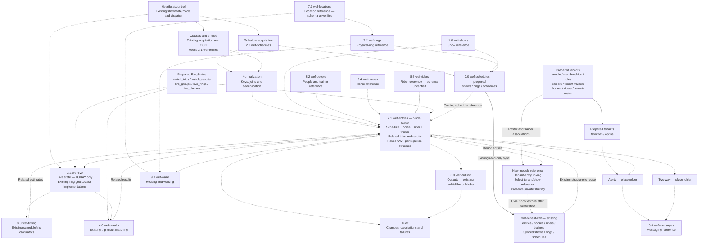

# WEF data boundaries — working document

Updated: 23 October 2026, America/New_York.
Status: discussion draft. This document records agreed requirements and separates
them from proposed placement and open decisions. It does not authorize changes
to bases, tables, collectors or schedules.

Prepared schemas inspected read-only on 22 October 2026 at
6:21 p.m. Eastern. The verified reuse assessment below takes precedence over
earlier conceptual all-* table names and placement proposals. Use prepared
tables/fields/keys/links first; do not reshape data to fit placeholder bases.
Latest revision: follows engine.stages and its linked lanes, inspected read-only
23 October at 6:27 a.m. Eastern: 11 stages, 26 lanes. These records document
responsibilities and code paths, not fresh proof of live execution. They
supersede the earlier proposed calculator ownership assigned to wef-engine.
Owner added wef-entries as a stage in this working design, plus a separate
tenant-entry linking module reference. The design now has 12 stages: the 11
inspected engine stages and this addition. No Airtable stage/lane record or
executable module has been created by this documentation change.
The owner's base/stage references below are the controlling design labels.
They are separate from the historical engine lane priorities and from the count
of process stages. Neither changes runner order or cadence.

## Owner-assigned base and stage references

Use these exact references in the design and linking-module documentation.
Do not fill numbering gaps, substitute another base, or interpret the numbers
as execution priorities.

| Stage reference | Base | Design responsibility |
| --- | --- | --- |
| 1.0 | wef-shows | Show context and directory references |
| 2.0 | wef-schedules | Show/date schedules |
| 2.1 | wef-entries | Binder for schedules, horses, riders, trainers, trips and results |
| 2.2 | wef-live | TODAY's live rings, groups, classes and entries |
| 3.0 | wef-timing | Timing calculations and related outputs, using existing implementations |
| 4.0 | wef-results | Results linked to entries/trips |
| 5.0 | wef-messages | Messaging reference for alerts and two-way use; operational paths still require verification |
| 6.0 | wef-publish | Publication/output reference; preserve existing approval boundaries |
| 7.1 | wef-locations | Location reference |
| 7.2 | wef-rings | Ring reference |
| 8.2 | wef-people | Sporting people reference, including trainer identities |
| 8.4 | wef-horses | Horse reference |
| 8.5 | wef-riders | Rider reference |
| 9.0 | wef-waze | Routing/walking reference |

wef-locations and wef-riders are newly supplied base references in this discussion;
their base IDs and prepared schemas have not been inspected. They are not claimed
as verified destinations. Existing tenants.locations, tenants.riders and other
prepared identity tables remain the reuse baseline until a separately approved
adaptation. The original 33-base inventory below is historical and does not
include these two additions. No base is created or deprecated by this map.

Heartbeat/control, normalization, audit and the tenant-entry linking module remain
cross-cutting responsibilities, without an additional owner-assigned base number.
Existing engine.stages/lanes document their implementation. The module connects
2.1 wef-entries plus prepared tenants relationships to wef-tenant-cwf; no new
stage number is assigned to the tenant target.

## Purpose

Establish the responsibilities, shared references and tenant boundaries before
locking wef-schedules and wef-tenant-cwf. Keep the design practical for a small
business. Access rules must be documented, but unresolved access implementation
does not block identifying or building approved bases, tables and shared links.
Sharing an entire table must not expose private relationships or preferences.

## Agreed responsibilities

| Area | Responsibility |
| --- | --- |
| wef-schedules | Show-specific schedules across the dates represented by the show. |
| wef-tenant-* | Tenant-specific working data for the show and dates represented. CWF example: wef-tenant-cwf. |
| wef-live | Existing base for live-groups, live-rings, live-classes and live-entries. Collection operates only on schedules for TODAY. Live data supports schedules and tenant consumers. |
| all-* | Persistent tenants, trainers, rings, horses, riders and users: shared identities, static helpers, lookup values and historical lists. These are independent of a particular show base. |

The all-* names describe persistent lists, not a proposed new base. Use the
existing bases below. A global identity does not make a tenant relationship,
user identity or private list broadly visible. The agents base contains
agents.bases, the central directory documenting all bases.

## Existing base inventory and proposed table ownership

Inventory supplied by the owner in screenshots and discussion. A subsequent live
metadata inspection covered 32 of the 33 bases; domains had two exact-name
matches and was left unresolved. Names preserve screenshot spelling, including
wef-engine (singular). The purpose map below remains conceptual where it names
tables not present. See the verified assessment for actual available tables.
An unconfirmed purpose is left open rather than inferred from its name.

| Existing base | Tables that belong here / proposed responsibility | What to share |
| --- | --- | --- |
| domains | Existing purpose/tables not discussed. | No new sharing proposed. |
| Colleges | Existing purpose/tables not discussed. | No new sharing proposed. |
| RingStatus | Existing application purpose/tables not inventoried here. | Preserve existing integrations. |
| rscom | Existing purpose/tables not discussed. | No new sharing proposed. |
| WEC | Existing purpose/tables not discussed. | Separate from this WEF design pending discussion. |
| lainey | Existing purpose/tables not discussed. | No new sharing proposed. |
| agents | agents.bases is the established directory. Document base purpose, ownership, retained scope, archive location and sharing destinations here. Exact fields remain open. | Directory information for administration; no business-record replication. |
| gpt | Existing purpose/tables not discussed. | No new sharing proposed. |
| recognize | Existing identity/access implementation; tables not inventoried here. Candidate owner for users, subject to its existing design. | Only approved user identity references; no broad user-table sync. |
| messages | Existing purpose/tables not inventoried. Relationship to wef-messages remains open. | Preserve existing integrations; no new sharing yet. |
| rsco | Existing purpose/tables not discussed. | No new sharing proposed. |
| webflow | Existing purpose/tables not inventoried here. | Preserve existing publishing boundaries. |
| engine | Existing stages, lanes, traces, trace-evidence, trace-status and endpoints document coordination and evidence across the WEF stages. | Use the existing stage/lane map to guide responsibilities; do not replace it with a new engine. |
| tenants | all-tenants; persistent tenant-trainers, tenant-horses, tenant-riders, tenant-users, sharing and tenant-ring-walks. Tenant-specific helper overrides belong on these relationships. | Scoped CWF configuration/roster references into wef-tenant-cwf; minimal active tenant index into wef-schedules. Private relationships are not general reference exports. |
| horses | all-horses: maintained horse identities, common helpers and links to source horse identities. Tenant-specific nicknames/activation remain tenant-owned. | Relevant horses read-only into tenant and live consumers. |
| riders | all-riders: maintained rider identities, common helpers and source-person links. Tenant-specific overrides remain tenant-owned. | Relevant riders read-only into tenant and live consumers. |
| ringwaze | Existing purpose/tables not inventoried. Relationship to wef-waze remains open. | No new sharing until existing responsibilities are checked. |
| publish | Existing purpose/tables not inventoried. Relationship to wef-publish remains open. | Preserve existing publication approval rules. |
| wef-schedules | Current schedules, show-collection and show/date rings; current shows and operational tables remain established until any separately approved migration. | Read-only show/ring/schedule references into wef-tenant-cwf and TODAY's references into wef-live. |
| wef-entries | Agreed binder connecting schedules, horses, riders, trainers, trips and results, with show/date context and persistent entry history. | Relevant bound entry references to tenant/live and downstream consumers; identity records remain with their designated owners. |
| wef-people | Persistent all-people from the people endpoint, past and present. Trainer and rider roles/views reference the same person identity. | Source identities to riders and tenant-trainers; relevant references to tenant/live consumers. |
| wef-live | live-rings, live-groups, live-classes, live-entries. Current working state only; archive everything outside the agreed current scope. | Relevant live records read-only into schedules, CWF, timing, engines and downstream consumers. |
| wef-timing | Intended timing destination; engine Timing lanes already identify schedules_calculatorv2.js, trips_calculatorv2.js and trips_tagger.js. Destination currently has meta only. | Relevant calculated-time references after approved adaptation of existing implementations. |
| wef-results | Proposed collected results keyed to source show/class/entry identities. Retention not yet agreed. | Relevant results to tenant/live/publishing consumers when those uses are agreed. |
| wef-alerts | Proposed WEF alert events and delivery outcomes. Subscription ownership and existing messaging integration must be agreed first. | Scoped notification work to messaging; authorized delivery status only. |
| wef-waze | Current routing/walking work and results; archive everything outside the agreed current scope. | Relevant route/walk outputs to authorized tenant/user consumers. |
| wef-horses | Proposed persistent Wellington source-horse directory. wef-entries links to these horse identities; it is the participation binder, not a second horse directory. Exact source collection path remains open. | Source horse identities to horses and the entry binder; relevant references to tenant/live consumers. |
| wef-rings | Persistent all-rings: source ring identities/history, locations and common ring helpers. | Relevant physical-ring references to schedules, tenant, live and waze consumers. |
| wef-shows | Proposed persistent all-shows directory, show dates and archive manifests/locations/counts. | Relevant show references to schedules, tenant and live consumers. Existing schedules shows are not moved by this proposal. |
| wef-messages | Proposed WEF-specific notification content and delivery work; boundary with messages remains open. | Delivery outcomes to alerts and authorized user consumers. |
| wef-publish | Proposed WEF publication-ready views and publication records; boundary with publish remains open. | Approved output only to existing publication workflows. |
| wef-tenant-cwf | Show-specific collections/entries, local tenant work, synced references and operational history. Persistent CWF membership/roster ownership is proposed for tenants. | Consume shared references read-only; keep tenant-owned edits and private lists out of general exports. |
| wef-engine | Reserved WEF working base; current-only/archive policy agreed, but no calculation ownership established. Contains meta only. Existing engine stages remain the responsibility baseline. | No new engine or calculator lane proposed. Purpose beyond the established stages requires a decision. |

Do not create or rename tables just to match all-* names. Prepared tenants.trainers
and tenants.people already exist and must be evaluated in place. recognize.people
already supplies a person identity structure; tenants.people has a
recognition_person_uid field. This is an available key bridge, not a verified
cross-base sync. No broad sync of users or personal followed lists is proposed.

## Verified prepared-table assessment — 22 October 2026

Evidence: [schema snapshot](evidence/prepared-tables-20261022/schemas.json) and
[prepared table/link inventory](evidence/prepared-tables-20261022/inventory.md).
Read-only metadata GETs only; no collector execution, record repair, Airtable
schema edits or sync actions. Schema availability does not prove records are
populated, keys unique, permissions enforced or a workflow currently running.
No business record values were retrieved for this schema assessment.

### Tables to use as the starting point

| Existing base/table | Available structure | Recommended use / limitation |
| --- | --- | --- |
| agents.bases | Name, base-id, base-link, active; links to projects, base-lanes, threads and activity | Use the existing directory. No replacement registry. |
| tenants.tenants | tenant_id, tenant_active, names; links to memberships, trainers, roster, locations | Persistent paying tenant container. Preserve existing relationships. |
| tenants.people | entity_uid, recognition_person_uid, name; memberships, roles, associated horses and rider links | Tenant-facing users/people. Connect to recognition by existing UID after record validation. |
| recognize.people | person_uid, names and recognition/session links | Existing identity reference. Do not merge with sporting people solely by name. |
| tenants.tenant-memberships | Person -> people; Tenant -> tenants; Roles -> roles; Status; favorites/optins/assignments links | Tenant membership, role and activation starting point. Main user remains a normal person/membership. |
| tenants.trainers and tenant-trainers | trainers has trainer_id/people_id; tenant-trainers links Tenant and Trainer, with Association and Status | Existing trainer identities and tenant association. Slot limits, sharing and main/additional semantics require checking before use. |
| tenants.horses, riders and tenant-roster | Native horse/rider/trainer relationships; roster links Tenant, Horse, Rider and Trainer association, plus Status | Start here for persistent tenant rosters rather than adding tenant-horses/tenant-riders tables. Preserve helper data and source_record_id fields. |
| tenants.roles and tenant-assignments | Membership roles; assignments link Membership and Horse | Reuse role/assignment relationships. Schema does not prove agreed private sharing is implemented. |
| tenants.locations and tenant-locations | Tenant/Location native links; Show-week reference text | Reuse barn/location relationships. No new location table needed. |
| tenants.favorites | Membership, Target type, Horse, Rider, Trainer, Status and optins | Starting point for personal follows. No entry link exists; not yet sufficient for ten private entry follows or their privacy/limit enforcement. |
| tenants.optins and optin-options | user_uid, target_uid, target_type, status, consent fields; Membership, Managed by, Selected favorites, Notification scope | Reuse consent/subscription structure. Confirm class/entry target values and owner-only access before implementation. |
| horses.horses / riders.riders | Source identity/helper fields; no native record-link fields in either table | Keep as existing lookup/history candidates. References named rider_list, trainers or active_tenants are text/numbers, not verified native links. Do not replace the linked tenant roster with these tables merely because base names match. |
| wef-schedules.shows, show-collection, schedules, rings | Existing native show/ring/schedule graph; schedules has stage-key and class-id | Preserve working schedule references and collections. Some link labels still say show-details but point to shows; labels alone do not justify migration. |
| wef-schedules.rings-helper, tenants, wef-tenant-index | Existing helper/tenant links and show-to-tenant directory | Preserve current helper/walking and index behavior until an approved replacement is verified. |
| wef-tenant-cwf.entries | entry-key, source IDs, schedule-key; native shows, synced-rings, schedules, horses, riders, trainers links | Best existing WEF entry binder baseline. Keep in place now; reuse this proven structure for the agreed wef-entries destination. Trips/results are not linked here yet. |
| wef-tenant-cwf.horses, riders, trainers, collections, rings-helper, ring-walks | Existing entry/roster/horse-rider and helper links | Preserve working collector and tenant edits. Do not retire these just because persistent tables also exist. |
| wef-tenant-cwf.wef-schedules.shows / .rings / .schedules | Native local synced reference graph; entries link to each | Continue using these prepared references. Cross-base source record IDs must not be substituted for their local synced IDs. |
| RingStatus.watch_trips | trip_id, entry_id, class_id, rider_id, show_id; native watch_schedule, ww_horses, ww_riders, ww_trainers, watch_results and live links | Existing trip/result relationship model to inspect against its working code before adaptation. Not authorization to move or rewrite legacy workflows. |
| RingStatus.live_groups, groups_live, live_classes, live_rings | Prepared show/group/class/ring keys and native relationships to trips/schedules | Use these implementations as the live-data baseline for later approved work. Similar names do not prove duplicate behavior. |
| WEC.entries and class_results | Existing entry/horse/rider/trainer/result graph, using entry_no/class_no and WEC context | Useful existing model for comparison; not a drop-in WEF source-key contract. Leave WEC untouched. |
| engine.stages, lanes, traces, trace-evidence, trace-status, endpoints | Prepared coordination map, workflow tracing and endpoint structures | Use existing 11 stages/26 lanes as the baseline. Links to traces/status are evidence pointers; they do not prove current execution. |
| messages.rs_sms_requests / rs_sms_events | Prepared messaging request/event tables | Keep existing messaging structures as the starting point; no new parallel delivery lane proposed. |
| ringwaze and publish | Existing observations/checkins/session tables and publish-index | Keep existing domain work separate; inspection does not authorize moving WEC observation tables into WEF. |

### Placeholder destinations, not prepared business schemas

The following 13 bases each expose only meta, with one field and no native links:
wef-entries, wef-people, wef-live, wef-timing, wef-results, wef-alerts, wef-waze,
wef-horses, wef-rings, wef-shows, wef-messages, wef-publish and wef-engine.
This is a schema finding, not a record-count claim. They cannot currently supply
the business relationships proposed earlier. Existing base names remain useful
destination decisions; use the available implementations above before adapting
any destination schema under separate approval.

### How the existing structure links through wef-entries

The owner-selected destination is wef-entries. Its binder is not implemented yet.
The existing CWF entry table is the baseline, with current paths:

| Binder connection | Actual prepared path / key | Gap before central use |
| --- | --- | --- |
| Schedule | CWF entries.schedules -> local wef-schedules.schedules; schedule-key matches stage-key | Preserve show/date/class identity and local sync mapping. No destination link exists in wef-entries. |
| Show and ring | CWF entries.shows and synced-rings -> existing local synced tables | Preserve the complete graph; use source IDs as matching evidence, not cross-base Airtable record links. |
| Horse | CWF entries.horses -> local horses, matched by horse-id | Reconcile with existing tenants.horses / horses.horses identities and helper ownership before choosing an export. |
| Rider | CWF entries.riders -> local riders, matched by rider-id | Reconcile sporting IDs with tenants.riders and any person identity bridge; do not match solely by name. |
| Trainer | CWF entries.trainers -> local trainers; trainer-ids records feed association | Map to tenants.trainers and tenant-trainers without treating feed membership as confirmed trainer authority. |
| Trips | RingStatus.watch_trips already has trip_id plus entry/class/show IDs and native schedule/horse/rider/trainer links | No trip table/link in CWF entries or wef-entries. Preserve existing operational keys and verify source mapping before adapting. |
| Results | RingStatus.watch_trips.watch_results; WEC.class_results.entries is a separate WEC model | No prepared WEF result binder link exists in the destination. Verify result grain/key and existing code before adaptation. |

The present CWF entry-key includes show, date, entry and class. It is therefore a
participation record, not a horse identity or a guaranteed one-row-per-horse
entry header. Keep that baseline. Decide whether the central binder needs a
header plus participation rows only when the source and downstream uses require
it; do not impose a new grain to fit a blank table.

Sharing recommendation: preserve schedules -> CWF's established read-only sync;
use scoped tenant roster/user relationships from prepared tenants tables; once
implemented and verified, expose relevant central bound entries to CWF and live
consumers. Trips/results remain linked observations, not copied into every
consumer as independently maintained lists. No new sync is created by this plan.

### Possible later deprecation — no removal now

| Candidate | Condition before deprecation |
| --- | --- |
| CWF retired-show-details / retired-rings | Already labeled retired; preserve historical records/links. Deleting them is not required by this design. |
| CWF-local reference/helper copies versus persistent references | Only after canonical ownership, tenant overrides, unique keys, all links and normal-run behavior are verified. Keep CWF working data. |
| horses.horses / riders.riders versus linked tenants equivalents | Candidate overlap only. Check records, helpers, consumers and write owners before any choice; schema alone cannot identify the redundant copy. |
| RingStatus.groups_live versus live_groups | Similarity warrants dependency/code review, not deprecation now. Preserve both until their actual roles are established. |
| Placeholder meta tables | Review contents and dependencies when a destination is finished; a minimal schema is not permission to delete notes or whole bases. |
| tenants ___* tables and legacy copies | Prefixes alone prove nothing. Preserve source/identity bridges until references, stored information and all consumers are accounted for. |

No active prepared table is confirmed safe to deprecate by metadata inspection.
Do not create duplicate all-* tables, mass-rename prepared tables, or retire an
existing workflow to fit the earlier conceptual map.

## Existing engine stages — responsibility baseline

Source: [engine.stages](https://airtable.com/appnOAk2pW8JawiuP/tblALw5TndjvOxlW2)
and [engine.lanes](https://airtable.com/appnOAk2pW8JawiuP/tblahQaNEwKKys0qP),
read on 23 October 2026. The lane priorities below reproduce the documented
grouping; they do not specify a new execution order or cadence. Existing
DAY/NIGHT and A/B/C/D gates remain unchanged. Several stages share a script.

| Existing stage | Priority / lanes | Documented implementation and prepared tables | Where wef-entries fits |
| --- | --- | --- | --- |
| Heartbeat/control | 1 / 1 | run_tagger_heartbeat_lane.ps1 -> tagger.js -> heartbeat_patterns.js -> heartbeat_task_cadence.js -> heartbeat_slot_orchestrator.js. Existing control implementation; engine stages/lanes document it. | Uses established show/date/mode selection; binder does not introduce another scheduler. |
| Schedule acquisition | 2 / 2 | schedules_dailyv2.js and sgl_browser_enrichment.js. Preserve wef-schedules shows, rings, schedules and show-collection; legacy watch_schedule is also prepared. | Supplies the owning schedule reference. No acquisition logic belongs in a new binder merely because it needs a schedule link. |
| Normalization | 3 / 2 | schedules_dailyv2.js normalizes scope/date/keys and class IDs; trips_dailyv2.js joins schedules, deduplicates and handles dropped scope. | Establishes valid schedule/entry/trip identities for the binder. Preserve existing operational keys. |
| Classes and entries | 4 / 3 | trips_dailyv2.js collects people payload -> ww_riders -> ww_horses -> watch_trips. trips_tagger.js matches entries/OOG; sgl_browser_enrichment.js supplies rendered OOG. Prepared CWF entries/horses/riders/trainers supply the current WEF binder baseline. | Primary fit for the agreed central binder. Link the existing participation structure rather than invent another source collector. |
| wef-entries — owner-added design stage | New; runner priority/cadence not assigned | Bind normalized schedules, horses, riders, trainers, trips and results using the existing CWF participation structure. Destination has meta only; no replacement acquisition or calculation logic. | Own the central bound entry reference. A separately documented linking module selects tenant-relevant entries and connects them to tenant show work. |
| Live state | 5 / 4 | live_groups_daily.js, live_rings_daily.js, live_class_detail.js. Prepared RingStatus live_groups, groups_live, live_rings, live_classes and their trip/schedule links. | TODAY's live observations reference bound entries; do not replace persistent entry identity. Preserve both group tables until actual roles are checked. |
| Timing | 6 / 3 | schedules_calculatorv2.js, trips_tagger.js, trips_calculatorv2.js calculate class timing, remaining trips, order position and estimated go time. | Attach calculated outputs to the relevant bound schedule/entry/trip. Intended timing destination is wef-timing, not an assumed new wef-engine calculator. |
| Results | 7 / 1 | trips_tagger.js -> live trip match updates scores, faults, times, placing, gone and verification. Prepared RingStatus watch_results is linked from watch_trips; WEC class_results is a separate source model. | Bind related results to entry/trip identity. No prepared central WEF result link exists yet. |
| Outputs | 8 / 2 | publisher.js -> bulk / differ. Existing complete-dataset and changed-field output paths. | Consume the relevant bound data; changing the binder is not publication approval. |
| Audit | 9 / 6 | Prepared live_group_changes, live_classes, schedule_logs, trip_logs, automation_errs and publish_queue; current WEF bases also have run-logs, heartbeat and code-reviews. | Trace binder source changes and failures using established evidence patterns. Audit is cross-cutting, not an extra serial collector. |
| Alerts | 10 / 1 | Explicit SMS alerts placeholder; actual implementation/cadence/handoffs not established by this lane. Prepared tenants optins/favorites and messages request/event tables are relevant starting points. | Future authorized alert targeting uses bound class/entry IDs and individual opt-ins. Placeholder does not mean working delivery. |
| Two-way | 11 / 1 | Explicit SMS two-way placeholder; implementation/cadence/handoffs remain TBD. | Future replies may identify bound entries; no new lane or operational claim yet. |

Lane final-list values include project labels such as
rs-projects-git-repos-wef-classes, wef-normal, wef-heartbeat and wef-output.
They are not evidence of corresponding Airtable bases and do not authorize new
bases. Map responsibilities to prepared data, preserving the source workflow.

### Module reference: tenant-entry linking

Status: new design reference requested by the owner. This is not an existing
script name, deployed module or approved runner change.

Purpose: connect the wef-entries stage to persistent tenants and then to each
tenant's show-specific working base. First target: wef-tenant-cwf.

| Reference | Prepared inputs / intended output |
| --- | --- |
| Bound participation | wef-entries supplies show/date/entry/class identity and related schedule, horse, rider, trainer, trip and result references once implemented. Reuse CWF's proven keys. |
| Tenant relevance | tenants.tenants -> tenant-trainers and tenant-roster, with their existing trainer/horse/rider links and association/status fields. These relationships determine relevance; a feed-derived trainer association is not source-confirmed authority. |
| User access | tenants.people -> tenant-memberships -> roles and tenant-assignments, subject to the agreed private-trainer sharing rules. These inputs are not broad exports to the entry binder. |
| Target lookup | Existing wef-schedules.wef-tenant-index identifies the tenant/show/base target. Match CWF's configured identity, show and base; do not guess a base name or target from trainer ID alone. |
| First output | Relevant bound entry references into wef-tenant-cwf, preserving its local record links, helpers and tenant edits. Until an approved switch is verified, the existing collector remains the working owner. |
| Private follows | Keep personal favorites/opt-ins outside the shared team export. Entry-level following is still a schema gap; the module must not make personal lists visible to the tenant admin. |
| Verification | Check target identity, show/date/class/entry matching, missing/ambiguous references, repeat-run duplicate prevention and preservation of existing CWF links before migration. |

Logical relationship: wef-entries -> tenant-entry linking module <- tenants;
then linking module -> wef-tenant-cwf. The module reads tenant relationships;
it does not move tenant ownership into wef-entries or replace acquisition,
normalization, live state, timing or results. File location, invocation and exact
write contract remain to be agreed against the proven code before implementation.

### Working diagram — stages and prepared data

The arrows below describe responsibility/data relationships, not a newly
approved runner sequence. Solid arrows show inspected native links or the
established schedules-to-CWF sync. Dashed arrows show documented stage
relationships and proposed binder connections. No dashed connection is claimed
to be implemented in the wef-entries destination.
Numbered base labels follow the owner-assigned map. Prepared source tables stay
in their existing locations until approved adaptation; numbered labels do not
claim their business tables are already populated or their workflows deployed.

### First use without disrupting CWF

1. Keep the present schedules -> CWF synced graph, collector, keys, helper edits
   and task cadence. CWF continues to own its working entries until separately
   approved migration is verified.
2. Use prepared tenants.tenants, people, tenant-memberships, roles, trainers,
   tenant-trainers, horses, riders and tenant-roster for persistent relationships.
   Do not add parallel all-* tables to imitate the conceptual names.
3. Reuse CWF entries' existing source IDs, participation key and native-link
   structure when implementing the central binder under separate approval.
   wef-entries currently has meta only; no central native links exist yet.
4. Adapt trip/result links from the existing source implementations only after
   checking their keys and code. The stage map already identifies those paths;
   it does not require replacement collectors or manual production runs.
5. Verify central relationships and approved normal-run behavior before any CWF
   consumption switch. Only then assess duplicates for later deprecation.

## Tenant model — agreed

The tenant is the paying container. It includes one main trainer, up to five
additional private trainers and 20 users. The main user is a record in users,
not a separate user type or table. Main trainer and main user are separate
relationships; they may refer to the same person.

Example loading behavior, not horse/rider limits:

- The main trainer loads 30 related horses; horses load their related riders.
- These main-trainer relationships default to active and can be inactive.
- Additional trainers load related horses and riders; 20 horses is an example.
- Additional-trainer relationships and associated horses/riders are private,
  with explicit tenant-controlled sharing.

Tenant membership and roster activation persist independently of show entries.
An inactive roster relationship, no current-show entries and a dropped show
entry are different states and must not be conflated.

## Users, access and personal following — agreed

The tenant can deactivate users. Roles and permissions control viewing and
changes, including access to screens and records. Exact roles remain to be
defined. Visibility and notification subscription are separate decisions.

| Data or action | Agreed boundary |
| --- | --- |
| Private trainers and their related horses/riders | Visible to the tenant admin and users the admin chooses to share with. |
| Tenant-shared team entries | Available to users granted access by the tenant. |
| Personal followed entries | Every user may add up to 10 additional entries to follow. Each user's list is visible only to that user. |
| Main user's personal followed entries | Same privacy as every other user; no special exception. |
| Tenant admin access to another user's personal followed list | Not permitted. |
| Alerts and notifications | Each user may opt in for their personal followed entries and accessible tenant-shared entries, by class or entry. |

An entry may be a common source record while the fact that a particular user
follows it remains private. The limit concerns additional followed entries, not
the tenant's shared team entries. Subscription never grants viewing permission.

## Proposed table placement — not yet locked

Names below identify responsibilities; exact table names and fields require
agreement before implementation. Keep existing working implementations until
their replacements and links are verified through the approved workflow.

| Owner/location | Tables or relationships | Sharing direction |
| --- | --- | --- |
| Existing persistent reference bases | tenants, horses, riders, wef-people, wef-rings, wef-entries, wef-horses, wef-shows | One maintained owner per identity or source list; scoped read-only references to consumers. Source history and maintained business helpers have different ownership. |
| tenants, proposed | Tenant-trainer membership, tenant horse/rider roster and activation, tenant-user membership, roles/permissions and explicit sharing | Tenant-owned edits; expose only relationships needed by authorized consumers. |
| Existing user owner, to identify | User identities, personal followed entries and individual alert preferences | Only the owning user's authorized access to personal lists. Do not publish these through general shared syncs. |
| wef-schedules | shows, show-collection, schedules and show/date ring references | Schedule references flow read-only into tenant and live consumers. |
| wef-tenant-* | Show-specific collections, entries and links to shared identities, shows, rings and schedules | Tenant working edits stay in the tenant base; common schedule fields remain read-only. |
| wef-live | live-rings, live-groups, live-classes, live-entries; references to calculated-time outputs | One live source serves relevant schedule and tenant consumers. Avoid collecting separate copies per tenant. |

## Proposed sharing into the three working bases

Share only the relevant records and fields. This is a logical map, not a promise
that Airtable sync alone enforces per-user permissions. Use the proven native
linked-record sync pattern where supported and verify links before migration.

| Owner | wef-schedules receives | wef-tenant-cwf receives | wef-live receives |
| --- | --- | --- | --- |
| wef-shows | Current show references | Relevant shows through established schedules sync initially | Current live show reference |
| wef-rings | Physical-ring identities/helpers | Relevant ring helpers; daily ring references through schedules | Physical-ring identities plus TODAY's ring references from schedules |
| wef-people | Nothing initially | CWF-related person/trainer references | People referenced by live entries |
| horses / riders | Nothing initially | CWF-related horse/rider identities and common helpers | Horses/riders referenced by live entries |
| wef-entries | No new sync initially; entries link to the owning schedule records | Relevant entries binding schedules, horses, riders, trainers, trips and results | Relevant bound entry references for TODAY |
| wef-horses | Nothing initially | Relevant source horse references through roster/entries | Horses referenced by live entries |
| tenants | Existing minimal active tenant index | CWF details and scoped trainer/horse/rider/user memberships | Nothing initially; live collection is common across tenants |
| User identity owner | Nothing | Minimum authorized user references through tenant membership; personal lists not in shared syncs | Nothing |
| wef-schedules | Owns working schedules | Existing synced shows, rings and schedules | TODAY's schedules and related show/date rings |
| wef-live | Relevant live status references | Relevant live status linked to tenant entries | Owns current live state |
| Existing Timing lanes / intended wef-timing destination | Relevant calculated times after adaptation | Relevant calculated times after adaptation | Relevant calculated times after adaptation |

Ownership and read-only consumption are the first decision. Do not automatically
create every suggested sync: use the smallest set needed by an agreed consumer.
Avoid reciprocal writes to the same source fields. Existing CWF synced references
stay in place while persistent-source ownership is discussed.

The existing CWF synced show, ring and schedule references are the established
pattern to preserve. This discussion does not authorize moving persistent data
or replacing a proven collector. Sync scope and access controls must be checked
before any private data is exposed, even though other schema work can proceed.

## Identity and helper ownership

### wef-entries binder — agreed 22 October 2026

wef-entries is the binder for schedules, horses, riders, trainers, trips and
results. It connects participation to the related show, date and class/schedule.
It preserves entry history across shows; it is not limited to TODAY.

| Connection | Responsibility |
| --- | --- |
| Schedule | Link participation to its show/date/class schedule. Schedule ownership stays in wef-schedules. |
| Horse | Link the entry to its persistent horse identity. |
| Rider | Link the entry to its participating rider identity. |
| Trainer | Link the entry to its trainer association, retaining whether that association is source-confirmed, owner-maintained or feed-derived. |
| Trips | Link the entry to its related trips; do not assume a single trip per entry. |
| Results | Link the entry/trips to their related results. Result ownership remains proposed for wef-results. |

The binder provides the common entry reference used by tenant, live, timing and
other downstream consumers. Tenant sharing, user follows and notification opt-ins
remain separate relationships. Binding an entry does not grant access to it.
Exact table names, source keys, relationship cardinalities and cross-base link
mechanics must be verified before implementation; this decision does not replace
the proven collector keys or create new tables.

- Persistent identity: a horse, rider, trainer, user, tenant or physical ring.
- Tenant relationship: membership, activation, private sharing and tenant-specific
  helper values attached to that identity.
- Show participation: entry, class, date and show-specific ring or group links.
- Live observation: status and timing observed for the selected live day.

Shared helper and historical lists are consulted first or used as fallback where
appropriate. Exact precedence is still to be agreed per field. Preserve owner
helper edits and identify historical fallback; do not let stale history replace
current source participation or live status.

A physical ring's location can be shared. Walking minutes from a tenant's barn
belong to that tenant's relationship with the ring. Whether nicknames are global
or tenant-specific remains open. Existing example walking minutes remain examples.

Existing horse/rider uniqueness rules and helper fields must be inventoried and
preserved when agreeing the shared identity design; this draft does not replace
them with a new uniqueness policy.

## Source relationship limitation

The collected 80970 people payload identifies Taylor Cowles in its person heading
and includes trips explicitly naming Daniel Zetterman as rider. The inspected
payload contains no explicit trainer ID, trainer name or relationship field.
The current collector associates these trips with configured feed 80970.

Keep feed membership distinct from an explicitly source-confirmed trainer
relationship. Do not describe Taylor as confirmed trainer of those rides solely
because they appear in that feed. This distinction matters when populating the
persistent trainer/horse/rider relationships; no correction is authorized here.

## Time calculators

Required subjects: rings, groups, classes and entries. Entries include horse and
rider references. Follow the existing engine Timing lanes and their calculators:
schedules_calculatorv2.js, trips_tagger.js and trips_calculatorv2.js. The earlier
proposal to make wef-engine their execution owner is withdrawn. wef-timing is
the documented lane destination label, but its Airtable base currently has meta
only. Verify existing code/data contracts before adapting any destination.
The proposed outputs should distinguish source times from calculated estimates
and retain when an estimate was calculated and which observation it used.
No calculator has been specified or authorized for implementation by this draft.

## Decisions to resolve before locking

| Decision | Current position |
| --- | --- |
| TODAY for live collection | User requires TODAY-only schedules. Exact source/date/time-zone rule remains open; an upcoming source-selected day must not silently be treated as an active live day. |
| Persistent base placement | Use existing bases, not a new all-data base. Review the proposed ownership above; identify existing user ownership and confirm tenants owns persistent membership. |
| Entry binder implementation | wef-entries binds schedules, horses, riders, trainers, trips and results. Verify source keys and relationship cardinalities; horse identities belong in the horse directory, not a duplicate entry-owned directory. |
| Existing general versus WEF bases | engine.stages/lanes are the established coordination map. Do not assign a new execution role to wef-engine. Resolve remaining ringwaze/wef-waze, messages/wef-messages and publish/wef-publish boundaries against existing implementations. |
| Current scope and archives | wef-live, wef-waze and wef-engine keep current working data and archive the rest, as instructed. Define current scope precisely; do not assume identical retention for timing/results/alerts/messages/publish. |
| Shared lookup fields | Inventory existing IDs, keys, names, nicknames, rider first/last names and helper uniqueness rules; decide lookup precedence. |
| Relationship authority | Agree which source or owner action confirms trainer-horse-rider relationships and how feed-only associations are represented. |
| Roles and sharing | Define roles, permitted changes and sharing granularity. The agreed privacy boundaries above remain controlling. |
| Live links and retention | Agree identities connecting schedule rows, groups, classes, entries and live observations; determine end-of-day retention/archive behavior. |
| Calculator behavior | Inspect/reuse the existing Timing-lane calculators and gates; agree only the necessary adaptations and missing ring/group outputs. |
| Lock criteria | Define protected fields, allowed edits and verification requirements after downstream use cases are discussed. |

## Implementation boundary

This request updates documentation only. No Airtable base/table/schema changes, collector
changes, record repairs, deployment, manual sync or manual collector runs are
authorized by this document. Future approved work must preserve links, helper
values, archive protections and existing workflow cadence, and use normal
scheduled runs for operational proof where required.
