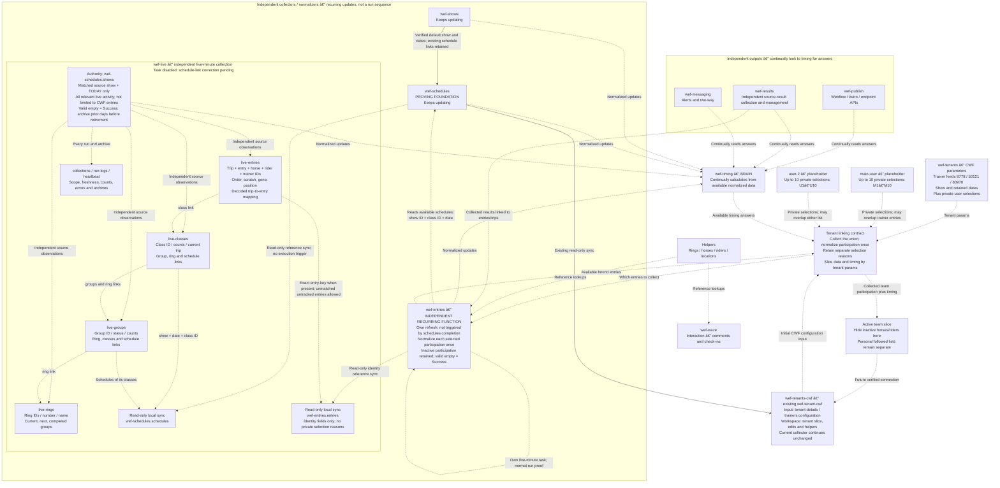

# WEF data boundaries — working document

Updated: 23 October 2026, America/New_York.
Status: CWF entries implemented and verified through two normal scheduled runs; other downstream components remain design only.

## Implementation update — 23 October 2026

This update supersedes the proposal-only status in the retained design sections
below. The owner approved the independent recurring CWF entries function.
`wef-entries-cwf-collector` is a separate five-minute Windows task, first scheduled
start 08:19 Eastern. It uses its own hidden launcher and private runtime. It
requires the Windows user signed in and this computer awake.

Configured in wef-entries: entries, collections, run-logs, heartbeat and a native
read-only wef-schedules.schedules sync. The existing meta table is preserved.
The four writable tables reuse the prepared CWF field types; native links target
destination records only. The sync includes changed-at for source comparison.
The two documented tenants.favorites fields, owner-key and entry-key, are added.
No favorites, memberships or placeholder user records were seeded.

CWF configuration supplies main trainer 8778, slot 2 50121 and slot 3 80970.
main-user and user-2 currently have no selected entry keys. Their empty
collections succeed with zero entries. A future explicit follow uses the class
entries source and exact show/date/entry/class key; up to ten per owner.
Private-only and overlapping selections are covered by offline tests.

The central collector retains inactive participation. Its active-team projection
applies roster inactivity only when slicing. No public export, permissions UI,
timing/results implementation or CWF consumer switch is included. Existing CWF
and schedules code, tasks and table schemas are protected. No manual collector
runs or record repairs are part of this implementation.

See [implementation and verification evidence](../../wef-entries/README.md).
Normal runs at 08:19 and 08:24 Eastern both passed: 7 entries, 20 dated
collections and 24 verified archive events each. Entry and collection IDs stayed
stable, with no duplicate creation. Heartbeat, run logs and all seven native
schedule links were read back successfully. Sixteen offline tests passed and
the existing 65 CWF tests passed. The existing CWF collector recovered from its
earlier source HTTP 502 on its own 08:22 scheduled run; it was not edited.
Non-empty private follow lists remain offline-tested only until actual owner
selections are supplied. No manual collector runs or record repairs occurred.

## Foundation and scope

### Default-show ownership — approved 23 October

wef-shows now owns the two existing discovery requests: `/ring?customer_id=15`,
then `/schedule?date=00/00/00&show_id={discovered-id}&customer_id=15` through the
unchanged decoded Worker. It has its own hidden five-minute task, starting at
10:34 Eastern, independent of schedules and without dispatching downstream jobs.

wef-schedules reads the verified canonical show record and hash-verified full
default response. The existing schedules shows table remains a local linked
mirror: record IDs, native links, schedule archive details and downstream CWF
references are preserved. No native sync conversion or consumer migration is
included. Missing, stale or inconsistent authority data stops that collection;
there is no fallback to a new discovery request from schedules.

The full response is supplied by a local compressed archive referenced by the
canonical record, preserving the existing normalizer without a truncated text
field or reconstructed payload. This handoff currently requires the same machine.
Source-selected date remains distinct from TODAY for live collection.

See [shows implementation](../../wef-shows/README.md) for scope and evidence.
Verified 23 October: wef-shows normal runs at 10:34 and 10:39 Eastern passed.
Schedules normal runs at 10:35 and 10:40 read that authority and completed all
four show dates with zero failed days. Existing empty-October-22 Warning remains.
All 449 schedule IDs/show/ring links, 24 ring IDs and the existing local show ID
were preserved. CWF/schedules schemas and existing task definitions were unchanged.
No manual collector runs or record repairs. Exact receipts and archive checks:
wef-shows/evidence/release-verification.json.

The new wef-schedules and the owner's downstream vision are the foundation.
wef-schedules is the proving foundation for independent, continuously updating
components. This is not a sequential pipeline where each stage must finish
before another may run. That distinction from the coupled legacy model is a
central design requirement, not merely a deployment detail.
Design outward from its working shows, dates, rings and schedules and the tenant
experience we need. Legacy stages, scripts, cadence and table layout are
reference material only. They are not a blueprint, execution contract or a list
of stages to reproduce.

Use only the bases needed for an agreed use case. A base being available or
having an owner-assigned number does not require us to use it. Prepared tables
are candidates where they fit; do not force data into blank tables, create
parallel all-* tables, or reshape the new design around older structures.

Preserve the current new schedules/CWF behavior while preparing approved
changes. Preserving these working systems does not require adopting the legacy
architecture. Permissions must be documented but need not delay unrelated
approved schema work; private data must not be exposed in the meantime.

## Independent continuous operating model

| Component | Operating rule |
| --- | --- |
| Collectors/normalizers | Shows, schedules, entries and live each operate independently on their own appropriate scope and continue maintaining normalized data for timing. They do not wait for an entire upstream cycle to finish. |
| Timing | Continually calculate from available normalized data and observations. A producer update supplies new input; it is not permission for a single shared dispatcher to start the whole system. |
| Outputs | Publish, results and messaging continually look to timing for answers relevant to their work. Their own work is independent; wef-results also independently finds and manages source results. |
| Tenant | Slice the relevant data and timing answers using tenant parameters, including its roster/trainer associations, show/date scope and permitted access. The exact parameter contract is the current design question. |
| Interaction/helpers | Interactions and reference lists support the relevant records without becoming mandatory steps every collector must wait for. |

Independence does not mean ignoring missing dependencies or presenting old inputs
as current. One component's delay should not stop unrelated updates. A consumer
must distinguish available, missing and stale inputs for the affected answer;
specific freshness and recalculation rules remain to be agreed. Continual means
recurring independent operation; exact intervals are not assigned by this draft.
No new event bus, scheduler or infrastructure is implied.

## Current stage: entries — implementation approved

We are at wef-entries. It is similar to schedules/classes in collecting and
normalizing source records, but its collection scope must be derived from a
tenant. It is not an unbounded global entry collector with a tenant filter added
only after collection.

The CWF collection parameters below are implemented for this proof. main-user
and user-2 are sufficient placeholders, with no actual selections supplied.
Non-empty private selection behavior is tested offline; its live proof awaits
real owner selections. Existing schedules/CWF collectors keep their normal
updates. No CWF consumer switch is included.

## Independent recurring entries function

This function has its own recurring execution, independent of a completed
schedules run, timing cycle or output job. It reads the available schedule data
on each refresh; no manual collector run is part of the operating model. Its
cadence is every five minutes on its own Windows task. The existing CWF
collector keeps its five-minute task unchanged.

| Boundary | How the function uses it |
| --- | --- |
| CWF configuration input | Use the prepared wef-tenant-cwf tenant-details and trainers configuration as the initial CWF example, together with the agreed main-user/user-2 follow selections. Private selection fields and class lookup are implemented; actual lists are empty. Do not require a new tenant base before proving this contract. |
| Persistent tenant relationships | Prepared tenants membership/roster relationships are available for the linking design. Reconcile their identities with CWF configuration before selecting a single parameter owner; do not let conflicting configurations independently control collection. |
| Collection owner | The independent function collects and normalizes the tenant-derived participation into wef-entries. It is not another writer to CWF's existing entries during preparation. |
| Schedule source | Read the new wef-schedules using show ID + class ID + date to identify the participation's schedule, then retain schedule-key and a valid linked reference. |
| CWF consumer | The existing wef-tenant-cwf remains the tenant workspace: relevant entry slice, local helpers, edits and schedule references. Its existing collector/entries remain the working owner until a separately approved switch is verified. |

### Schedule matching and local links

The semantic match is show ID + class ID + date. A class number or horse name
alone is not a sufficient match. CWF's existing entry schedule-key corresponds
to the schedule stage-key; preserve these source identities. Resolve any missing
or ambiguous match explicitly and report it for the affected collection. It is
not a confirmed empty source response. Do not guess a link, repair records or
trigger a schedules run to manufacture the match. Unrelated collections can
continue updating with their own valid inputs.

The prepared CWF entries.schedules field links to the local synced table
wef-schedules.schedules, not directly to a record in another Airtable base.
Entries also link to local synced shows/rings. When implementing the central
binder, resolve local references through the retained source keys; never place
a schedules-base Airtable record ID into a linked field targeting another table.
The approved local sync/link schema is configured; normal-run verification is recorded in the implementation update.

The link to schedules is a data relationship, not the execution trigger. The
link to CWF is scoped consumption, not permission to run both the current and
proposed collectors against the same CWF entry records. A future transition must
verify normal recurring runs, links, helpers and repeat behavior before changing
the established writer or retiring duplicates.

## CWF collection parameters — agreed example

| Parameter | Value / behavior |
| --- | --- |
| Tenant | CWF |
| Show | The relevant source-selected show in the new wef-schedules |
| Dates | Retained dates for that show. Live processing separately uses TODAY only. |
| Main trainer | 8778: collect all entries returned for the show/date scope |
| Additional trainers | 50121 and 80970: collect all returned entries in the same scope |
| main-user | Placeholder user with up to 10 explicitly selected private entries, M1–M10 |
| user-2 | Placeholder established user with up to 10 explicitly selected private entries, U1–U10 |
| Inactive horses/riders | Keep collecting their entries; hide them from the active team slice |
| Empty collections | A valid, confirmed empty collection is Success with zero entries |

M1–M10 and U1–U10 are illustrative labels, not real source IDs, fabricated
production records or a requirement to fill all ten slots. User follows may
select entries outside the three trainer feeds, within the agreed show/date
scope for this proof. Exact follow IDs and retrieval mapping remain to be supplied
and verified; no new direct source endpoint is assumed here.

Collection scope is the union of entries selected by trainer feeds 8778, 50121
and 80970, main-user's selected entries, and user-2's selected entries. Normalize
each participation once using its show/date/entry/class identity. Retain each
selection reason separately so trainer membership and private following do not
become duplicate entry records or disclose personal selections.

| Illustrative participation | Selection reasons | Slice/list behavior |
| --- | --- | --- |
| A | 80970 feed | Relevant team slice, subject to its existing sharing rules |
| B | 50121 feed and main-user follow | Team slice and main-user personal list; one collected participation |
| C | main-user follow only | main-user personal list; not a team entry solely because CWF collected it |
| D | user-2 follow only | user-2 personal list |
| E | Both users follow it | One collected participation, with two separate private follow associations |
| F | Trainer feed, horse or rider inactive | Still collected and updated; hidden from active team slice |

An inactive horse/rider can remain on a user's personal list when explicitly
followed. Inactivity is a team-slice filter, not a collection exclusion. No team
horse-count limit is inferred from the earlier 30/20 examples.

Role definitions and permission implementation are deferred and are not blockers
for proving collection with placeholders. Preserve the agreed private ownership
of follow associations; use no broad personal-list export or real-user exposure
as part of proof. This deferral does not change those privacy requirements.

### Empty collection behavior

A successfully read, validated response containing zero entries is Success.
Record the timestamp, selected show/date/trainer or follow scope, zero row count
and empty outcome. A zero-entry trainer must not block the other trainer or
user-follow collections, timing refreshes or unrelated updates. Report selection
counts separately from the deduplicated combined participation count.

An HTTP/request failure, unreadable payload, unresolved identity or incomplete
response is not confirmed empty and must be reported as a failure for that
collection. Do not convert unknown outcomes into zero or use zero as permission
for unsafe cleanup. Existing archive and record-preservation safeguards remain.

## Owner-defined responsibilities

This grouping is the current design, replacing earlier tentative assignments.
The new wef-schedules remains the working foundation. Base/stage numbers are
reference labels, not a fixed execution sequence or permission to activate bases.

| Group | Bases | Responsibility |
| --- | --- | --- |
| Collect and normalize | wef-shows, wef-schedules, wef-entries, wef-live | Independently maintain normalized source data. Entries are derived from tenant parameters and bind schedules, horses, riders, trainers, trips and results. Live operates only on TODAY's schedules. |
| Brain | wef-timing | Continually calculate and interpret timing for rings, groups, classes and entries using available normalized data and observations. Formulas/eligibility remain to be agreed. |
| Outputs | wef-publish | Own Webflow, Astro and APIs that populate downstream endpoints. |
| Outputs | wef-results | Independently look for, collect and manage results; link them to the relevant classes, entries and trips. Being in outputs does not make it dependent on timing or tenant collection. |
| Outputs | wef-messaging | Own alerts and two-way messaging, respecting user access and individual opt-ins. |
| Interaction | wef-waze | Comments, check-ins and related user interaction. It is not limited to route/walking calculations. |
| Tenant linking | wef-tenants -> wef-tenants-cwf | Define the linking module connecting persistent tenant relationships to tenant-specific show work. |
| Helpers | Rings, horses, riders, locations and other appropriate lookup lists | Supply identities, static helpers, lookup/fallback and history. Exact owners/base placement depend on need and prepared data. |

Naming: wef-messaging, wef-tenants and wef-tenants-cwf are the owner's latest
design labels. Earlier inspected Airtable names were wef-messages, tenants and
wef-tenant-cwf. No rename, new base or schema is implied. References to those
inspected names below describe actual prepared tables; reconcile names before
implementation rather than silently changing collector targets.

wef-shows is now explicitly part of collection/normalization. Current shows and
rings in wef-schedules continue to work; the future collection boundary does
not require moving those records during discussion. Helpers are supporting
references, not additional required processing stages.

Outputs continually consult timing for answers and combine them with the source
facts and context needed for their output. This does not make their execution
dependent on a completed timing cycle: results collection remains independent,
publication may need schedule facts, and two-way replies may need identity/helper
lookups. Source facts, estimates and interactions retain their respective owners.

Keep existing example barn-to-ring walking minutes until measured paths are
available. Path planning is a possible interaction/helper use, not the complete
definition of wef-waze. Exact interaction visibility, retention and links still
need discussion.

The [base reference catalog](wef-base-reference-catalog.md) preserves earlier
supplied numbers and inspected naming context. It does not override this grouping
or require using every listed base. agents.bases remains the actual base directory.

## Prepared tables to evaluate and use first

Schema evidence from 22 October: [prepared inventory](evidence/prepared-tables-20261022/inventory.md)
and [metadata snapshot](evidence/prepared-tables-20261022/schemas.json).
The earlier inspection covered 32 bases; domains was ambiguous. This inventory
is reference material, not the active design scope. Schema existence alone does
not prove populated records, valid keys, working collectors or enforced privacy.

| Existing tables | Fit in this design | Keep / gap |
| --- | --- | --- |
| wef-schedules: shows, show-collection, rings, schedules | Working show/date/schedule graph supplying downstream references | Keep current ownership. schedules.stage-key and class-id help identify participation. |
| wef-schedules: rings-helper, tenants, wef-tenant-index | Existing ring helpers, tenant location/context and tenant/show/base directory | Preserve until an approved change is justified. No move required for this design. |
| CWF: entries, horses, riders, trainers, collections | Proven new-system participation and roster links | Use its entry-key/source IDs and native links as the binder baseline. Do not switch its working owner during design. |
| CWF: wef-schedules.shows, .rings, .schedules | Existing local synced references linked from entries | Keep read-only schedule data; preserve local synced record IDs. |
| CWF: rings-helper, ring-walks | Tenant ring helpers and barn-based walking minutes | Preserve tenant edits and example-data labels. |
| tenants: tenants, people, tenant-memberships, roles | Paying container, users, memberships and roles | Native links exist. people.recognition_person_uid is a possible identity bridge, not a verified integration. |
| tenants: trainers, tenant-trainers, horses, riders, tenant-roster | Persistent trainer associations and horse/rider activation | Use where records and semantics fit. Additional-trainer privacy/slot rules are not proven by the schema. |
| tenants: tenant-assignments, locations, tenant-locations | Existing assignment/location relationships | Evaluate against sharing and barn needs before adding tables. |
| tenants: favorites, optins, optin-options | Personal follows and notification preferences | Starting structures only. favorites lacks an entry link; ten-entry limits and owner-only privacy remain to implement/verify. |
| horses.horses, riders.riders | Existing helper/history lookup candidates | Not selected as canonical owners yet. Their identity references are mostly scalar fields, not native links. |

Keep persistent identity, tenant relationship and show participation distinct.
Shared helpers/history may be consulted first or used as fallback as appropriate
per field. Current source participation/live status must not be overwritten by
stale fallback. Preserve existing horse/rider helper and uniqueness policies.
A physical ring location may be shared; CWF barn-to-ring minutes are tenant
specific. These ownership needs do not force a separate base for each identity.

## Exact tables and fields for the CWF entries proof

The owner-approved specification was checked against live schemas on 23 October.
Destination fields reuse the prepared CWF types; local links target destination
records. wef-entries originally had only meta, which remains preserved. Exact
schema IDs and evidence are in the entries implementation folder.

### Prepared inputs — read only

| Existing base/table | Exact fields to read | Purpose |
| --- | --- | --- |
| wef-tenant-cwf.tenant-details | tenant-key, tenant-id, active | Confirm the active CWF configuration. |
| wef-tenant-cwf.trainers | trainer-key, trainer-id, slot, role, active | Main 8778; additional 50121 in slot 2 and 80970 in slot 3. This is the agreed example, not a fresh runtime readback. |
| wef-schedules.shows | show_id, customer_id, start_date, end_date, selected_date | Show/source/date context. Existing show-key, is_default and last_checked are also available for identity/default/freshness validation; do not weaken existing source safeguards. |
| wef-schedules.schedules | stage-key, show-id, class-id, date, ring, class-name, status | Resolve show ID + class ID + date and retain the schedule key. |
| wef-tenant-cwf.horses | horse-key, horse-id, disabled, source-inactive | Existing identity/activation evidence for the active team slice, never an entry-collection exclusion. Preserve distinct owner-disabled and source-inactive meanings. |
| wef-tenant-cwf.riders | rider-key, rider-id, disabled, source-inactive | Same slice-only treatment; keep collecting participation regardless of roster inactivity. |

Do not write collection status, timestamps, new entry links or configuration back
to these CWF source tables as part of preparing the central function. Read the
existing tenant/show/base index when resolving a future CWF destination; that
does not require changing it for this documentation or preparation design.

### Five destination tables — configured in wef-entries

| Destination table | Exact proof fields | What is reusable / what is new |
| --- | --- | --- |
| entries | entry-key, show-id, date, entry-id, class-id, horse-id, horse-name, rider-id, rider-name, trainer-ids, class-name, ring-number, status, source-json, schedule-key, last-seen, schedules | All named fields exist in CWF entries. Reuse its participation model and compatible field types; schedules is a native link that must target the destination's own synced schedules table. trainer-ids retains feed-association meaning. |
| collections | collection-id, show-id, date, started, completed, status, row-count, dataset-id, fingerprint, message, archive-file | Reuse CWF collections' existing fields/types. Additional tenant/source and entry-link fields are specified below. |
| run-logs | run-id, started, completed, result, show-id, rows, summary, errors, archive-count, archives | Reuse CWF run-logs' existing field structure for independent central run evidence. Do not write proof logs into CWF's collector log. |
| heartbeat | heartbeat-key, checked-at, selected-date, show-id, result, summary, errors | Reuse CWF heartbeat's field structure for central function state; preserve CWF's existing heartbeat independently. |
| wef-schedules.schedules | stage-key, show-id, class-id, date, ring, class-name, status | Native read-only schedules sync is configured using the established CWF pattern; changed-at is included for comparison. |

Keep source identities in scalar ID/key fields for the proof. This minimum does
not require separate copied horse/rider/trainer directory tables in wef-entries,
nor new native links to their tables in another base. It does not yet implement
trip/result collections; their eventual relationships remain part of the binder
vision. No fake IDs or blank helper tables are prerequisites for collection proof.

### Exact approved additions

| Where | Field | Proposed type | Reason |
| --- | --- | --- | --- |
| wef-entries.collections | tenant-key | Single-line text | CWF ownership/context of this collection. |
| wef-entries.collections | source-kind | Single-line text | Distinguish trainer-feed collection from user-follow collection. These are text labels, not select options. |
| wef-entries.collections | source-id | Single-line text | Trainer 8778/50121/80970 or placeholder owner main-user/user-2. Text supports both identity forms without conflating them. |
| wef-entries.collections | entries | Native linked records -> destination entries | Successful collection membership; one participation may belong to several collections. |
| wef-entries.entries | collections | Reciprocal native link from collections.entries | The inverse of the same relationship, not a separate selection copy or second module. Name/configuration must be verified during approved schema work. |
| tenants.favorites | owner-key | Single-line text | Proposed collection-proof placeholder owner: main-user or user-2. Reconcile with existing Membership before real-user use. |
| tenants.favorites | entry-key | Single-line text | Explicit show/date/entry/class participation selection. The prepared table currently has no entry link. |

Prepared tenants.favorites already has Name, Membership, Target type, Horse,
Rider, Trainer, Status and optins. Reuse Membership, Target type and Status where
appropriate rather than replacing the table. Actual option values have not been
chosen or validated here. The two fields are configured. No favorite, membership or placeholder user record
was created. Explicit selections use the class entries source and exact
show/date/entry/class match. The proof uses up to 10 selected entries per placeholder, not ten
required records. Role design is not a blocker for specifying this collection.

### Collection records, overlap and empty success

Use separate collection identities for tenant + show + date + source kind +
source ID; finalize their serialized collection-id format against existing keys
before implementation. Preserve entries' show/date/entry/class entry-key. Do not
reuse trainer-only collection identities for user-follow data.

For example, one participation selected by the 50121 feed and main-user links to
both collection records, but exists once in entries. A participation selected by
both users also exists once, with two owner-specific collection associations.
These associations are private information; do not export collections or its
reciprocal entries.collections field in general team/public shared views.
Unrestricted base access is not made private simply by this link structure.
Permission implementation remains deferred, not permission to expose user lists.

For a validated empty collection, record row-count = 0, started/completed
timestamps, a successful collection status, message and archive reference using
the established collection/archive pattern. Run logs/heartbeat report success
for valid zero-entry outcomes. Preserve the reusable distinction between
collections.status (currently a completion field) and run-logs.result rather
than forcing an unverified literal status value into every table.
Failed requests or unresolved matches are not empty success and must not erase
the last verified data. Inactive horse/rider entries stay collected; apply the
inactive filter only to the active team slice.

### CWF boundary

All five destination tables belong to the independent central wef-entries function.
CWF supplies configuration and a proven reference structure; its collector,
records, helpers, links, run-logs and heartbeat remain untouched. No dual writer
to CWF entries, no copying private lists into team exports and no migration or
deprecation happens until separately approved and verified through normal runs.
The separate five-minute task is deployed; see the implementation update for acceptance status.

## wef-entries stage and tenant-entry linking module

wef-entries binds schedules, horses, riders, trainers, trips and results with
show/date/class context and tenant-derived collection scope. It preserves entry
history beyond TODAY. An entry is
not a horse directory row. CWF's current entry-key contains show, date, entry and
class; retain that proven participation identity unless a demonstrated need
requires an approved change. Do not assume one trip per entry.

The tenant-entry linking module is a design reference, not an existing filename
or executable module. Its relationship is:

Tenant parameters -> entry scope/collection; available data and timing answers
+ the same tenant parameters -> tenant slice -> wef-tenants-cwf.

These are two responsibilities to specify in the linking contract, not two
already implemented modules or a sequential runner chain. Entry identity can be
shared while tenant relevance and access remain separate relationships.

Use the prepared tenants / wef-tenant-cwf structures as the current reference;
the latest design names above do not rename those Airtable bases.

| Input / output | Intended behavior |
| --- | --- |
| Tenant-derived entry scope | Union trainer feeds 8778/50121/80970 with main-user and user-2 private selections in the agreed show/date scope; do not exclude inactive horse/rider participation. Exact user-follow lookup remains open. |
| Bound entry | Normalize the selected participation and preserve schedule/show/date/class and horse/rider/trainer/trip/result references. |
| Tenant slice | Hide inactive horses/riders from the active team slice while continuing collection. Keep private user lists separate; select relevant timing answers using the tenant parameters. |
| Target | Read CWF's existing tenant-details/trainers for the initial configuration and use the tenant/show/base directory to confirm the destination; do not guess target identity from trainer ID alone. |
| Schedule link | Match show ID + class ID + date; retain schedule-key and resolve a valid local native reference. Missing/ambiguous matches are explicit outcomes, not empty success. |
| CWF output | Eventually serve CWF's relevant slice while retaining local helpers, edits and native links. Its existing collector remains the working writer until a separately approved and verified switch. Exact sync/write contract is not decided. |
| Personal follows | Keep each user's private selection separate from shared team entries. Do not expose follows to the admin through a general sync. |

Appearing in a person's source feed does not by itself confirm a trainer
relationship. The inspected Taylor Cowles 80970 feed named Daniel Zetterman on
its trips but had no explicit trainer field. Preserve the difference between
feed-derived, owner-maintained and source-confirmed associations.

The entries function runs on its separate five-minute task with a local read-only
schedules sync, as recorded above. No legacy stage sequence is required. Live
collection has its own five-minute task; normal-run acceptance is recorded below.

## wef-live — independent TODAY collection

Implementation update: 23 October 2026. The owner approved the independent
collector. Its seven collection/operating tables and two read-only native
references are configured in wef-live (appgzosUcVqA4vZdf). Existing meta is
preserved. A separate hidden five-minute task, wef-live-collector, is deployed;
the first normal run collected 6 rings, 17 groups, 30 classes and 195 trips,
with 68 verified archives and 4 tenant-entry links. Full schedule-link verification
failed: 9 classes were unlinked because the new matcher included dropped rows
and did not accommodate one class in two active groups. Only wef-live is disabled
pending separately approved correction; no records were repaired. See [implementation evidence](../../wef-live/README.md).

The owner selected existing wef-schedules.shows as the show authority for this
build; creating wef-shows is separate work. Read its current default show,
customer, selected date, available dates and date range. Source live payloads
must match that show and date. New York date equality guards against treating
an upcoming selected day as TODAY; it does not select the show independently.

The owner also approved the narrow entries exception: add wef-live-reference,
a read-only sync source view containing the eight documented identity fields.
No entries records, collector, table fields or task were changed. Schedules and
CWF remain unchanged by this implementation. Two schedules test files changed
outside this work during preflight; protected runtime hashes remain unchanged.

wef-live owns its recurring collection of TODAY's rings, groups, classes and
live trips. It reads available schedules and entry references without waiting
for either collector to complete. CWF trainer feeds and private follow lists do
not limit the live collection: collect the relevant show's TODAY activity,
then let tenants slice the observations. Its own task repeats every five minutes.

### TODAY and preservation rules

- Require an explicit source show/date match for the current live day. An
  upcoming source-selected schedule date must never silently become TODAY.
  The authoritative schedules show/date must match the live source; a local
  calendar date alone does not prove the source is serving that day's activity.
- Collect only that validated day's rings, groups, classes and live entries.
  Preserve the source show ID, date and timestamps together; never attach one
  show's live payload to another show's schedule or date.
- A validated empty collection succeeds with zero rows. HTTP errors, unreadable
  data, mismatched show/date and unresolved identities are not empty success.
  Preserve the last verified collection on failure and expose its freshness.
- Archive prior-day data before retiring it from the current tables. Document
  every run and archive in run-logs; failed archival must prevent deletion.
- Missing schedule/binder links do not stop source observation collection or
  unrelated updates. Report ambiguous or expected-but-missing matches. A live
  entry outside tenant-derived wef-entries scope can legitimately have no binder
  link. Do not create a tenant selection or guess identity to fill that link.
- Keep source observations here. Predictions, delays and time calculations
  belong to wef-timing, which continually reads the available normalized data.

### Collection tables and fields

Common fields on all four tables: `show-id`, `customer-id`, `date`, `last-seen`,
`source-updated-at`, `source-json`, `collection`.
`collection` links to the local collections table; timestamps retain source
freshness separately from collection time. Keep unavailable source values empty,
not invented. Preserve the raw response for score, fault and phase details.

| Proposed table | Additional fields |
| --- | --- |
| live-rings | ring-key, ring-id, ring-number, ring-name, current-group, next-group, completed-groups |
| live-groups | group-key, class-group-id, group-name, ring, group-sequence, status, is-live, has-json, estimated-start-time, total, gone, jo-total, jo-gone, r2-total, r2-gone, classes, schedules |
| live-classes | class-key, class-id, class-number, class-name, groups, ring, schedules, detail-available, total, gone, jo-gone, r2-gone, current-trip-id |
| live-entries | live-entry-key, trip-id, entry-id, entry-number, horse-id, horse-name, rider-id, rider-name, trainer-id, trainer-name, class, entry-key, entry, order-of-go, actual-order, scratch, gone, position |

Use native local links for ring, groups/classes, current/next/completed groups,
class, schedules, entry and collection. Source IDs and semantic keys remain
separate scalar fields. Ring ID and ring number are distinct. One entry can
have several trips; live-entry-key must retain trip identity in its show/day/
class context. Final key serialization and field types are implementation
checks, not permission to change existing entry or schedule keys.

### Operating tables and fields

| Proposed table | Fields |
| --- | --- |
| collections | collection-id, show-id, date, source-kind, source-id, endpoint, started, completed, status, row-count, fingerprint, archive-file, message, errors |
| run-logs | run-id, started, completed, result, show-id, date, summary, errors, ring-count, group-count, class-count, entry-count, archive-count, archives |
| heartbeat | heartbeat-key, checked-at, show-id, date, result, summary, errors |

Reuse the new schedules/entries collection, logging and archive pattern where
it fits. Heartbeat reports latest health; run-logs retains every run and archive
with timestamps, results, counts, errors and file locations. These are configured
local tables, not another writer to schedules or CWF.

### Read-only references and linking

| Local synced reference in wef-live | Fields to expose | Relationship |
| --- | --- | --- |
| wef-schedules.schedules | stage-key, show-id, date, ring, class-id, class-name, status, changed-at | Match show-id + date + class-id; live-classes.schedules links to local synced records. live-groups.schedules contains the matched schedules for its classes. |
| wef-entries.entries | entry-key, show-id, date, entry-id, class-id, horse-id, rider-id, status | live-entries.entry links to the matching local synced participation; retain its exact entry-key. |

The existing binder key is `show|YYYY-MM-DD|entry-id|class-id`. Resolve source
trip-id to entry-id through the decoded class response's trips array, then
match this participation key. Live detail row id is a trip ID, not an entry ID.
Do not join by horse/rider names or entry number alone. Source-confirmed IDs
can populate observations even when no tenant binder row exists yet.

Native links must target local synced records, never foreign-base Airtable IDs.
Share only the listed binder identity fields; do not sync collections, private
follow owners or selection reasons into common live data. The syncs are read-only
inputs, not execution triggers, and missing references must not trigger a manual
schedules/entries run. CWF remains untouched.

### Source guide, not legacy replication

The inspected public LiveScoreWidget and ListAjax feeds supply ring/group
activity; group ClassStatus supplies group detail; getLiveClassData supplies
class/trip observations. The existing decoded classes endpoint supplies explicit
trip-to-entry IDs. Public readable feeds need no decoding merely because they
are live feeds. Confirm each response's scope and required mapping during
implementation. Existing proxy route support differs by endpoint; this proposal
does not add or change routes.

Legacy Live state, traces and scripts are reference evidence only. Do not copy
its shared dispatcher, watch-trip eligibility gate, name-based joins or mixed
show/day behavior. The new function collects independently and supplies timing.

## Working diagram

Solid arrow: the established schedules-to-CWF read-only sync. Dashed arrows
describe proposed reads, updates and tenant-scope relationships as labeled, not
implemented links or execution dependencies. Each collector operates independently;
outputs read timing rather than wait to be launched by it. Schedules/CWF and the independent entries collector are established; the live
tables and syncs are configured, with full link verification incomplete and the live task disabled. The
broader continuous architecture remains a design.
Legacy is intentionally outside the diagram.

## Sharing and CWF transition

- Keep the existing schedules -> CWF sync and working entry collector in place.
- Establish tenant-derived entry scope before implementing the central entries
  collector/linking contract; an output-only tenant filter is insufficient.
- Share relevant schedule references read-only with the binder and live consumers
  when those connections are approved and verified.
- Keep common live observations shared across tenants, with tenant relevance and
  private sharing applied when serving each tenant.
- Feed relevant live status, calculated times and results back to schedule/tenant
  consumers through linked references; do not make each tenant maintain its own
  independent live collector.
- Verify target identity, keys, local links, repeat-run duplicate prevention,
  archive protections and normal scheduled behavior before a CWF ownership switch.
- Deprecate a table only after the finished flow is verified and its data,
  helpers, historical links and consumers are accounted for. No active table is
  confirmed safe to deprecate merely from schema overlap.

CWF retired-show-details and retired-rings already preserve historical links;
this design does not require deleting them. Existing all-* terminology means
persistent lists, not a requirement to build new tables bearing those names.

## Tenant model — agreed

The tenant is the paying container. It includes one main trainer, up to five
additional private trainers and 20 users. The main user is a record in users,
not a separate user type or table. Main trainer and main user are separate
relationships; they may refer to the same person.

Example loading behavior, not horse/rider limits:

- The main trainer loads 30 related horses; horses load their related riders.
- These main-trainer relationships default to active and can be inactive.
- Additional trainers load related horses and riders; 20 horses is an example.
- Additional-trainer relationships and associated horses/riders are private,
  with explicit tenant-controlled sharing.

Tenant membership and roster activation persist independently of show entries.
An inactive roster relationship, no current-show entries and a dropped show
entry are different states and must not be conflated.

## Users, access and personal following — agreed

The tenant can deactivate users. Roles and permissions control viewing and
changes, including access to screens and records. Exact roles remain to be
defined. Visibility and notification subscription are separate decisions.

| Data or action | Agreed boundary |
| --- | --- |
| Private trainers and their related horses/riders | Visible to the tenant admin and users the admin chooses to share with. |
| Tenant-shared team entries | Available to users granted access by the tenant. |
| Personal followed entries | Every user may add up to 10 additional entries to follow. Each user's list is visible only to that user. |
| Main user's personal followed entries | Same privacy as every other user; no special exception. |
| Tenant admin access to another user's personal followed list | Not permitted. |
| Alerts and notifications | Each user may opt in for their personal followed entries and accessible tenant-shared entries, by class or entry. |

An entry may be a common source record while the fact that a particular user
follows it remains private. The limit concerns additional followed entries, not
the tenant's shared team entries. Subscription never grants viewing permission.

## Legacy reference boundary

engine.stages and lanes were read on 23 October: 11 stages and 26 documented
lanes. They can supply examples of normalization, source keys, OOG, timing,
results and audit behavior. RingStatus's trip/live/result tables and the separate
WEC model are also references only. Their stage count, priorities, scripts,
DAY/NIGHT modes and A/B/C/D cadence do not define the new architecture.

Consult a legacy path only for a specific requirement or useful proven behavior.
Do not recreate its stages, copy its tables wholesale, mandate its calculators,
or add a base because a legacy lane mentions a similarly named project.
A legacy label is not proof of a new base/table/deployment or current operation.
The [superseded stage draft](evidence/prepared-tables-20261022/superseded-stage-design-20261023.md)
is retained only as discussion history; its legacy-driven requirements are withdrawn.

## Decisions before implementation and locking

| Decision | What remains |
| --- | --- |
| TODAY | Use the current default wef-schedules.shows record as authority, match live source show/date, and guard against upcoming dates. No new wef-shows build is required. |
| Current stage: CWF entries collection proof | Implemented: three trainer feeds plus empty main-user/user-2 lists, inactive participation retained and valid empties successful. Non-empty private lists still need actual owner selections for live proof. User-role design is not a prerequisite. |
| Binder and linking contract | Separate five-minute Windows task and read-only local schedule sync configured. Initial params come from existing CWF configuration and tenants.favorites; keep CWF's current writer unchanged until separately approved migration. |
| Persistent helpers | Choose owners based on actual shared lookup/history needs and prepared data, not matching base names. |
| Time estimates | Define ring/group/class/entry inputs, formulas and refresh behavior from the new use cases. Legacy calculators are optional references. |
| Continuous operation | Define independent refresh cadence and missing/stale-input behavior per consumer; outputs continually consult timing while unrelated producers keep updating. |
| Results | wef-results independently finds, collects and manages results. Confirm source, class/entry/trip identity, refresh and retention. |
| Retained scope | Keep show dates in schedules/CWF; live operates on TODAY. Define exact current/archive boundaries. Previously discussed current-only/archive intent for waze/engine does not require activating those bases. |
| Privacy and roles | Define permitted viewing/editing and implement the agreed private-trainer and private-follow rules. |
| Messaging | wef-messaging owns alerts and two-way; agree triggers, replies, delivery and logging while preserving individual access and opt-ins. |
| Publication | wef-publish owns Webflow, Astro and APIs that populate endpoints; agree destination fields, tenant/date scope, updates and output verification. |
| Interaction | wef-waze owns comments/check-ins and related interaction; agree entry/ring links, visibility and retention. Paths remain a later detail. |
| Lock criteria | Agree protected fields, ownership and verification requirements after the downstream discussion. |

## Change boundary

The implementation update records the owner-approved entries-only changes.
CWF and schedules remain protected. Other downstream work, consumer migration
and table retirement still require separate approval. No manual collector runs
or record repairs are permitted.

### 23 October 2026 — direct canonical authority for entries and live

This update supersedes earlier references to reading `wef-schedules.shows` for
these two collectors. Both now read `wef-shows.shows` directly, independently
on their existing five-minute schedules. No collector triggers another.
Entries continues to read CWF parameters and bind to its existing local synced
schedules. Live retains its local schedules and entries syncs. Neither writes
to the canonical shows, schedules or CWF bases.

The owner separately approved correcting the stopped live matcher and
re-enabling its existing task: only active schedules match, using the existing
show/date/class and group-specific stage keys. A class may link to multiple
valid group schedules; each group links only to its own schedules.
All 35 offline tests pass. Normal-run acceptance is blocked by source HTTP 502
errors. Entries read the canonical record in its 12:09 Eastern run, retained
all seven entry IDs and schedule links, and recorded Failed in heartbeat and
run-logs. The 12:07 live run also encountered source HTTP 502 errors; further
live task starts were disabled. That run finished Failed at 12:11 Eastern. No source patch,
manual retry or record repair was performed.
Evidence: `wef-shows/evidence/consumer-connection/`. No manual collector runs
or record repairs are part of this change.

Final readback for this change: both consumers used canonical show record
`rec4En9UWd6lkT1Oh` directly during their first normal post-deployment run.
Live's 30 classes have 31 correct active schedule links across 17 groups;
all 248 pre-existing live identities and seven entries identities were retained.
This is partial verification, not two successful runs. Live failed on six HTTP
502 class responses and missing decoded identity for trip 200398019 in class
200030319. Entries failed on trainer 50121 HTTP 502. Both wrote Failed to
heartbeat/run-logs. Live remains disabled with its original five-minute trigger;
entries and the other existing task configurations remain unchanged. Source
investigation/correction and renewed normal-run acceptance remain outstanding.

Final acceptance at 13:11 Eastern: entries completed normal runs at 13:04 and
13:09, with seven and nine entries respectively. Both had no source errors and
passed record/link/archive checks. The first full verification passed. The
second full verification was blocked by concurrent changes to
wef-tenants/airtable.js, collector.js and settings.js at 13:07, outside this
task's deployment file list. Those changes were left untouched; expected hashes
were not changed to hide the drift.
Live's 13:02 normal run ended Failed with persistent class 200030347 HTTP 502;
no missing-trip identity error remained and 68 archives verified. Live is disabled.
No production patch or manual retry followed that failed gate. Overall work is
incomplete: persistent 502, concurrent protected drift, and two live runs remain.
Full evidence: wef-live/evidence/source-fix/release-status.json.
