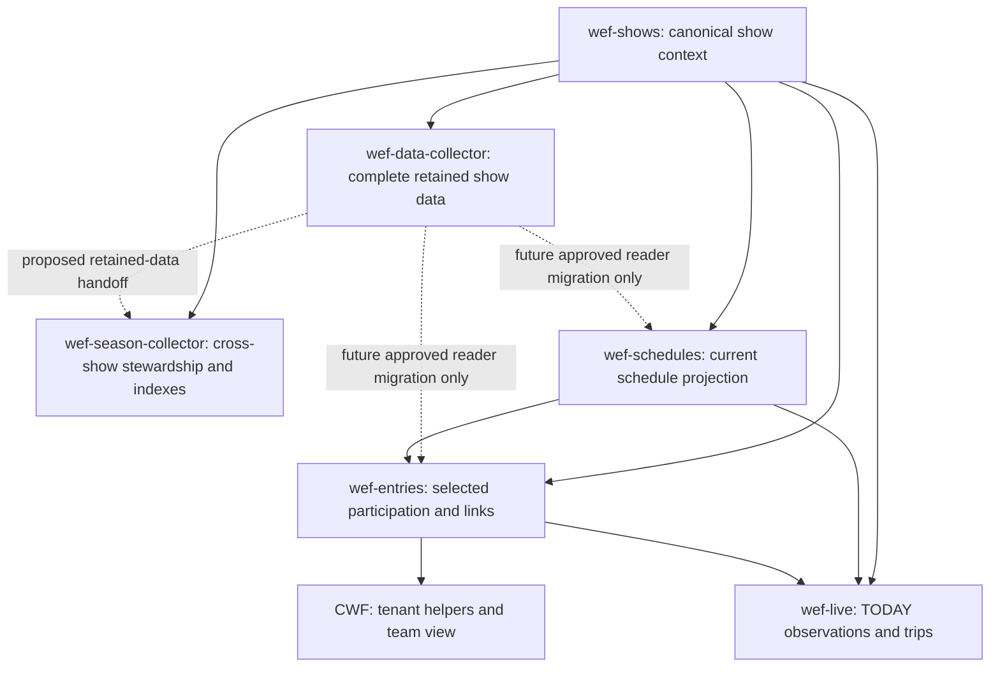

# WEF records workflow and ownership — 26 October 2026

Owner-defined expansion of the records workflow. This document governs responsibility, not implementation authorization. It supersedes earlier four-chat-only ownership descriptions and proposals that made season responsible for duplicate all-show source acquisition. Historical releases and failures remain evidence of their own scope. No code, Airtable, task, automation, endpoint or reader changes are made by this update.

## Six owners

| Component | Accountable chat / identity | Owns | Does not own | Implementation state at this reconciliation |
|---|---|---|---|---|
| wef-shows | wef-shows / 01a16976-f0a6-72a1-a75f-75de7f19a815 | Canonical show/customer identity, dates, source-selected context, validated discovery and health | Whole-show enumeration, downstream execution, tenant membership, timing | Existing verified collector/base appCaSmL819KK7UFJ. New show200000076 identified October26. Full downstream rollover still separate acceptance. |
| wef-data-collector | wef-data-coordinator / 6adbb542-32f8-83e9-af94-23b83d138d1a | Complete schedules and entries for each included show; retained source identities/observations/history; paging, completeness, repeat collection, acquisition errors and checkpoints | Default-show rediscovery, tenant privacy/selection decisions, shared entity merges, timing/live predictions | Data owner reports an existing bounded isolated trial: Airtable wef-data appdl16HJ5ETm8N69, 19 populated tables, source/plan in its separate cloud workspace. Preserve/inspect that baseline before code planning. No implementation folder in this checkout or verified recurring retained-data workflow established here. |
| wef-season-collector | wef-season-coordinator / 01a169c8-a4cc-7f52-b9f9-ef0a769aab58 | Maintain previously collected cross-show WEF data; source-backed additions/merges/deduplication, show associations, history and optional derived indexes | A second canonical show writer, duplicate routine acquisition, writing Data-owned records, unilateral resolution of identity conflicts | Proposed workflow, not current verified collector/exporter. Earlier 60h/90h collection sweeps and 5min collector/30min export cadences are proposals requiring reconciliation with Data ownership. |
| wef-schedules | wef-schedules / 01a14082-b22f-73b1-bba7-16781892a55d | Current operational dated schedules/rings/groups/classes, stage keys, links, relevant-date collection health | Durable all-show source archive as the new Data responsibility; whole-show entries; participation eligibility | Existing collector/base appUq5Qz9kARqFija. Existing source and retention behavior unchanged until an approved/proven handoff. |
| wef-entries | wef-entries / 01a1691d-3bd7-7eb2-af17-b9ba39a7501e | Tenant/follow-selected participation, entry-key, source-ID links, exact schedule-keys, observation status, CWF consumer/helper projection within its approved boundary | Full-show inventory, shared entity authority by assumption, live facts, results/timing | Existing collector/base appSxF4pYMBaxpTZd; CWF appxKPBtdl2Rdq7CS. Plural transport/reader rollout verified; natural participation multi-group eligibility still missing. |
| wef-live | wef-live / 01a16902-240a-7280-8661-90b0d8d7325a | TODAY observations/rings/groups/classes/trips, raw paired evidence, current/historical participation validation, scoped errors/Partial continuation | Default discovery, all-show participation acquisition, entity merging, official results readiness or timing calculation | Existing collector/base appgzosUcVqA4vZdf. Broader live scope may remain unmatched to tenant-selected entries. |

**wef-records-coordinator** / 01a169bc-e58a-7de0-94c6-5d3931fcf745 coordinates all six: source contracts, sole-writer boundaries, acceptance, handoffs and cross-show rollover. Coordinator does not execute the business process. Native agent children are optional bounded workers, not conversions of these existing chats.

## Data flow and writer boundaries

Arrows mean read contracts, never execution triggers. Existing operational collectors still read their existing source lanes. Do not silently replace them or make them wait for a complete all-show pass. Data-to-operational reuse is a target boundary, not an implemented connection.

Data retains show-specific acquisition; Season maintains cross-show derived/curated records in separately owned tables. Every output table must have exactly one accountable writer in the implementation plan. Season should reference Data's retained records and acquisition evidence rather than copying another full raw history without need. Data remains authoritative for what was captured; Season's identity decisions must preserve provenance and unresolved conflicts.

## Shared identity, storage and privacy

- Preserve source/customer context, horse/rider IDs, show-entry identity, show/date/entry/class participation and class/trip identity separately. Do not merge by name, feed membership or display number.
- Retain exact producer stage-key and existing entry-key. A class in multiple groups does not prove a participation is eligible for all groups; missing eligibility remains unresolved.
- Shared horse/rider authority is still CONDITIONAL after tenant audit: tenants.horses/riders are candidates, not activated masters. Duplicate horse ID138724, missing identities, human/writer ownership and source/customer scope require resolution. Tenants.sources currently has application-specific rs-inputs-native mappings; external_id is not a blank provider-ID namespace to repurpose.
- Season owns the proposed stewardship process, not an automatic transfer of Tenants identity/permission authority. CWF local roster/helper/manual edits remain intact. No shared entity migration is implied.
- All NEW durable business data, checkpoints, completion state and merge/index revisions belong in Airtable. No local durable database/checkpoint is introduced. Optional fast derived indexes belong only in ringstatus-data Git repository; verify destination/content/access/writer/freshness before use. Git is not a transaction/claim queue.
- Existing local archives remain historical/runtime evidence under current implementations. The shows-to-schedules local hash-verified payload dependency is real. Airtable-only handoff/retention migration needs separate approved scope; do not delete archives or claim that dependency has disappeared.
- Complete show entry data is not tenant membership, private follows or publication permission. Keep private owners/selection reasons out of shared acquisition and indexes. Define permitted fields/access before exporting.

## Scope and completeness to settle before building

1. Data show scope: use canonical current default as the initial proposed included show; any historical/additional included shows require an explicit inclusion contract. Default discovery does not enumerate all shows. Owner's 'all schedules/all entries' means complete coverage within included shows, not automatic unbounded provider collection.
2. Define existing/proposed Airtable destinations and their exact sole writers. No unverified table IDs or activation of blank season bases. Avoid duplicate participation authority between Data acquisition and selected Entries links.
3. Data must prove pagination, exact required fields, page/pass completeness, successful observation time, idempotent repeat writes and failure preservation. Partial passes never imply deletion/absence. Proxy routes/allowlists and decoding support must be established per endpoint before use.
4. Season must define source-scoped identity matching, add/update/merge rules, aliases/manual edits, unresolved conflicts and history links. No automatic repair of current conflicts. Implement resumable Airtable progress before considering index export.
5. Assign exact cadence/budget separately. Existing operational task configurations remain unchanged. Shows/schedules/entries previously had five-minute cadence; live owner reports separately verified three-minute scheduling on October25. Do not overwrite newer task settings from old documents; this reconciliation did not freshly audit task cadence. Earlier season sweep/export intervals and discovery watches are not approved by this document. Notification-only watches should eventually consume shows authority; adjustments remain pending and no automation was changed here.
6. Define retained-data readiness for any later operational reader transition. Current schedules retires old operational rows after verified local archives and new-show completion; Data/Season readiness and downstream link preservation must be proven before changing that boundary.

## Acceptance and status recording

For each later approved delta: source-backed fixtures plus independent review where required, two normal scheduled-run proofs of stable keys/links/helpers/privacy/completion/error reporting, and complete-pass reconciliation for paginated collection. Distinguish fixture-only multi-group cases from natural evidence. For Data/Season, verify repeat passes do not duplicate records or overwrite prior-show history. Index publication, if needed, requires actual authorized push/readback and consumer proof; it is not implied by a document or local file.

Source failures preserve prior verified data and remain logged. Unrelated valid scopes continue. No manual runs, fabricated rollover, record repairs or retry-until-state-changes. New show200000076 discovery is verified; a full all-six workflow is not, because Data/Season are not yet implemented/accepted collectors.

## Owner responses

- Shows: ACCEPTED for its locked canonical scope; included-show selection and local archive migration remain open.
- Schedules: ACCEPTED for current operational scope; Data/Season retention and replacement of local archive dependency require separate proof.
- Data: ACCEPTED. Existing isolated trial/19 populated tables are owner-reported bounded proof, not independently re-audited or recurring workflow proof. Its cloud-workspace plan/source must be retrieved and preserved before implementation; a cloud path does not transfer access.
- Season: updated its own full plan with the Data-to-Season boundary, retains identity/approval/handoff gaps. Coordinator accepts that responsibility split; exact retained-data contract and cadence approval remain pending. Plan inspected: C:/Users/gombc/Documents/Codex/2026-10-23/find-all-docs-discussing-wef-people-4/outputs/wef-season-full-plan-review.md. This is documented adoption, not collection acceptance.
- Entries: ACCEPTED, with explicit clarification that it owns participation linking across horses/riders/trainers/shows/schedules and downstream consumers, not merely filtering. Reading Data instead of current feeds remains proposed; CWF scope/privacy/keys stay intact.
- Live: ACCEPTED, preserving independent TODAY observation/reference ownership. Earlier class429 evidence is historical, not a fresh October26 failure claim.

## Next bounded delivery

First map the existing wef-data trial's 19 tables and its source implementation to Data-owned acquisition/retention, preserving proven code. Define the Data-to-Season handoff with exact keys, completeness/freshness, revisions, conflict handling and sole writers; then define optional Data-to-operational read boundaries. Resolve entity authority with the tenant owner before any cross-show merge activation. Bring one scoped plan with tables, cadence, approval and normal-run/full-pass gates; do not initialize parallel collectors or seed/repair records to demonstrate progress.

## References

- wef-shows/README.md and runtime/last-run.json: canonical authority/observed show discovery.
- wef-data-boundaries-working.md: historical operational contracts, including later amendments.
- wef-entry-relationship-map-20261024.md: exact operational tables, candidate entity tables and source-key boundaries.
- wef-records-owner-acknowledgments-20261023.md; wef-rollover-acceptance-assignments-20261024.md: owner acceptance and rollover gates.
- wef-cloudflare-proxies-and-decoding-20261023.md; wef-endpoint-decoding-assessment-20261023.md: route/source/decoder compatibility and evidence limits.
