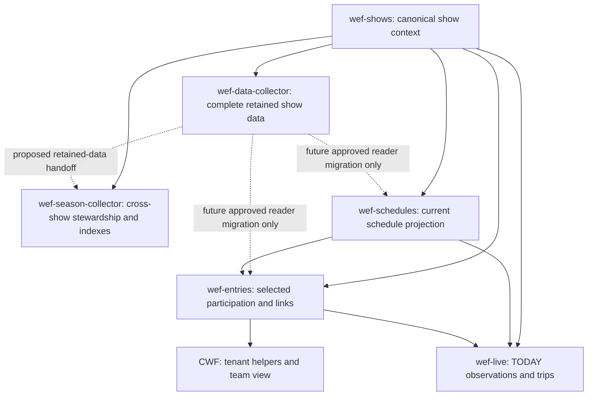

# WEF records workflow and ownership — 26 October 2026

## Controlling owner correction — closed collection workflow, 29 October 2026

Shows current scope is **v1.4** under verified owner decision01a18900-9e79-76f0-ad3f-1b2ff04aa68d. Existing same-PC local archive handoff is ACCEPTED; portability is DEFERRED and is not a present workflow/acceptance blocker. Preserve local files and path/hash/show-date verification; real missing/invalid required files still block their dependent consumption. No count-replay removal/weakening, archive migration or task changes are authorized. This supersedes older local-archive 'OPEN/blocker' language below. Five-minute cadence and expected Sunday rollover remain as decided in v1.3; Data/Season broader archival stays separate.

Live archive alignment evaluated and instruction sent: [verified baseline and smallest Live plan](wef-live-archive-alignment-20261029.md). Live already verifies compressed snapshots before retirement. Proposed gaps are operational collections retirement, a permanent catalog using existing collections fields, exact deletion-ID acknowledgment and explicit partial cleanup state; preserve TODAY/empty/future safeguards. No Live code/schema/deletion occurred in this evaluation; no new Schedules or canonical Shows writes are requested.

Data → all four Season domains → Entries scheduled handoff VERIFIED at approximately2:50p.m. Eastern, October29: two normal Data cycles after final directory-isolation correction, accepted Season first/repeat plus sequences16/17 in all four bases, and Entries18:49 natural run on verified sequence17. IDs, native links and original source times preserved; one entry identity remains held/logged and reconciliation partial while unaffected updates continue. See [bounded scheduled acceptance](wef-data-season-scheduled-acceptance-20261029.md). No manual business/source runs, task changes, record repairs or deletions in this verification. Older pending/failed status below is historical where this evidence supersedes it. Physical old-show retirement, unresolved identity/group decisions, populated Live acceptance and downstream Timing/tenant changes remain separate; no new authority is implied.

Shows cadence RESOLVED by direct owner decision 01a188df-0283-7c10-b400-30ae33c46a62: current scope wef-shows/scope.md **v1.3** retains the existing five-minute task throughout the week and after discovery. Sunday 4–8 p.m. America/New_York (DST-aware) is the expected rollover window, not an exclusive or guaranteed discovery window. This supersedes the earlier stop-after-discovery/no-five-minute restriction and older 'cadence unresolved' wording below. No extra six-hour safeguard or downstream execution trigger is introduced. Local archive handoff remains separately OPEN. Ownership/count replay protection is unchanged; replay removal or weakening is not approved. Documentation only; no task/code/Airtable changes.

Live consumer/sync transition delivered under its separate owner approval: wef-live/evidence/entries-contract-20261029/release.md records five evidence/status fields added to the existing automatic read-only native sync and simplified producer-contract consumption with local identity/freshness/reference checks retained. Two normal runs 5836813d-2ea6-4c87-a939-3338af39729c (17:50 UTC) and 2ddf2667-0617-47b0-bab3-4eab37bde314 (17:53 UTC) passed, both with valid EMPTY activity; 397 existing Live records/fields/links preserved, 127 synced Entries records, 54 offline checks. This supersedes earlier missing-sync-field status below. It does NOT prove populated fresh participation or multi-group linking; those remain separate. Versioned Live scope/HANDOFF v1.3. Records verified direct owner handoff request 01a188cf-8207-7f90-b58d-6e5349e2e63d and read the release evidence; documentation only, no new consumer permission or change.

Shows fetch/heartbeat correction COMPLETE within its bounded scope: release wef-shows/evidence/fetch-heartbeat-fix-20261029/release.md records deployment 17:46:08 UTC, 45 offline/deployed checks and two successful normal runs c64f3c9a-7981-474a-9ab1-be43e661ce33 (17:49 UTC) and ebee16e8-5df0-4a04-ae88-48b65e68c867 (17:54 UTC), both task exit 0 with source/run/heartbeat readback and stable four canonical show-day IDs/native links. Fixes are schema-compatible null failure date and bounded transient GET recovery on the same decoded proxy. Prior failure history remains. Scope v1.2/count replay, 19 protected module files and task definition preserved; count replay is NOT approved for removal. Original network cause remains unproven; failure/retry behavior fixture-tested, not manufactured in production. Counts remain Stale/Unknown, not fresh Data acceptance. Discovery-cadence reconciliation and local archive handoff remain SEPARATE OPEN items. Recorded under direct owner documentation-only request 01a188cf-4f00-78a3-9f1a-b01b2c903331; no code/Airtable/task changes by Records.

Entries switch release verified: deployed 29 October at 17:27:23 UTC through the existing task route, 13 scoped files and exactly five approved Entries fields. Independent 36-check offline review passed; deployed hashes and task XML matched. Two new natural runs f53bcd48-c4ad-421b-b911-101f7fa3bb25 (17:29:02–17:30:15 UTC) and b92abdb6-5503-430e-a88e-b420937bd066 (17:34:02–17:34:36 UTC) completed task exit 0, business ok, Partial for unresolved/historical evidence: each 117 accepted rows across 160 scopes, zero direct source/tenant reads, no collection errors. All 13 preexisting record IDs and inspected identity/native links were preserved. All 127 stored records retained IDs, inspected links, source provenance and observation timestamps across the repeat; zero duplicate keys. No fresh-Data or complete group-eligibility claim: both consumed accepted Data head 14:11:18 UTC without refreshing source times. Automatic absence retirement remains disabled. See wef-entries/evidence/data-input-switch-20261029/verification-1.json and verification-2.json. CWF compatibility is explicitly outside Entries release gates per later verified owner correction; its unchanged consumer remains incompatible and separate. Timing compatibility is with its proposed contract only, not deployed consumer proof. Live's missing native sync evidence fields remain a separately authorized consumer/sync transition; its existing checks stay intact.

Shows scope reference and acknowledgment: wef-shows/scope.md **v1.3, 29 October 2026**, retaining the v1.2 ownership split. Shows owns canonical show identity/dates and show-day publication. Data collects and normalizes details and determines counts, completeness and original source timestamps. Season owns cross-show history and the verified daily-summary handoff; local wef-season-coordinator owns both Data and Season functions. Existing count replay is only a simplification candidate: **removal or weakening is not approved**. Preserve replay until a verified replacement handoff and separate explicit owner implementation approval. Cadence is resolved by the decision above; fetch/heartbeat correction is complete within its separately verified scope. Local archive handoff remains independently open.

CWF is removed from all WEF workflows, responsibilities, dependencies and acceptance gates. Historical CWF evidence below is retained as history only; it is not a current workflow requirement. Entries is a linking module only, not an independent source collector or tenant-selection module.

| Module | Current responsibility |
|---|---|
| wef-shows | Sole canonical show discovery and show/day authority; publishes day readiness and evidenced counts supplied by Data. |
| wef-schedules | Collects and maintains operational schedules with existing stable keys. |
| wef-data, owned by local wef-season-coordinator | Collects and retains schedules, entries and source evidence; supplies accepted revisions and count evidence. |
| wef-season-*, owned by local wef-season-coordinator | Maintains retained Season entities and history through the approved mappings, merges, deduplication and indexing. |
| wef-entries | Links accepted collected participation and entity identities to schedules and destination-local records; flags uncertain links while preserving supported facts. No separate source acquisition or CWF dependency. |
| wef-live | Independently collects current live observations using Shows authority and links available validated schedules/Entries identities without waiting for uncertain links. |
| wef-records-coordinator | Coordinates these owners, tracks handoffs and evidence, and reports gaps and approval boundaries. |

These are data handoffs, not a requirement to stop unrelated collectors when another stage fails. Errors must be recorded and isolated to their affected scope; existing failed-runner execution controls still apply to Codex. Missing evidence is unknown, never a verified zero day.

Runtime removal remains to be inspected and verified: identify every CWF acquisition, configuration, import, export, task and test dependency in these WEF modules; prepare the smallest removal/decoupling delta without deleting historical evidence or repairing records. This scope correction does not claim runtime migration is complete or authorize task termination, manual runs, data deletion or unreviewed deployment. Existing specific build approvals retain their bounds.

## Ownership amendment — 29 October 2026

**Separate later full-correction approval:** directly verified local Season owner reply01a18888-bbaa-7722-8823-99da089485b3 authorizes recovering Data, archiving non-current records across all Data tables, implementing all four prepared Season transfers, deployment and normal scheduled verification. Preserve all keys/records; no manual runs or Airtable deletions. This supersedes earlier 'approval pending' statements only for that bounded correction, not for Entries input switching, tenant-reader changes, Live gates or task/cadence changes. Local Season reports four transport-recovery offline checks passed; implementation underway, not deployed/accepted by that report. Current reported Data inventory23tables must be reconciled by exact schema and current/shared/old-only membership before archive proof; historical19table first-release evidence remains its original scope. Independent source/schema review and actual scheduled repeat proof are still required.

**Later Entries scope correction:** direct owner instruction in Entries removes CWF/tenant configuration as a prerequisite for this stage. Entries' core responsibility is linking schedules, rings, groups, classes, horses, riders and trainers using accepted source evidence; tenants select their own data downstream. Messages/results/waze remain optional and nonblocking. Existing CWF lifecycle acceptance is a separately retained operational issue, not a gate on the revised core scope. Runtime migration is not yet verified. Preserve existing keys/history/private links and downstream access boundaries: provider trainer identity must not silently replace legacy trainer-feed association in trainer-ids/team exports. Local Season supplies the retained adapter/revision and attributable dated participation/source-to-schedule evidence; missing coverage/eligibility and legacy export compatibility must be resolved before any input switch. No task disabling, record repair or broad consumer change is authorized by this documentation correction.

**First-release implementation evidence:** Data frozen day-count summaries and Shows canonical show-days are now deployed under explicit owner approval. Shows table tbl14MaCCDw6dAywH links existing shows locally; two normal Shows runs 5ba1dfd2-88bb-4b6e-93e3-8a78e2b01a3e and f725bbdc-2df5-4045-b7f8-e3eeccfa9bd2 consumed distinct accepted Data revisions with independent replay/readback and stable four day IDs/links. See [release acceptance](evidence/show-days-20261029/acceptance.md). Earlier 'proposed/unbuilt' wording below is historical for this deployed first-release subset. Coverage remains competition-class only; schooling/classless whole-day attendance unknown; no Live/Entries suppression or input switch implemented. Entries/CWF protection verification is separate: observed task termination with later same-run business success, exact cause unproven; owner approved resuming read-only normal pair checks, no fixes or task changes.

**Resumed protection result:** read-only snapshot confirms all13CWFentries/76horses/37riders and existing native/helper fields preserved (refresh timestamps excluded). However task termination recurred on the10:12ET CWF task with later same-run business success; acceptance stopped again. Two clean task/business pairs remain unaccepted. TaskSchedulerOperationalhistory is disabled, so rootcause is not established. No task/code repair or blind timeout change. A separate diagnostic authorization is required to enable existing task history temporarily and inspect one natural run. Completed Data/Shows proof remains valid within its own scope.

**Versioned module references:** wef-shows/scope.md v1.2 (October29) supersedes its earlier v1.0 reference; Entries and Live versions in this historical paragraph were v1.0, with later owner amendments above controlling. Shows' older discovery-window/stop-on-change instruction conflicts with later five-minute README/runtime and remains a separate open reconciliation; this release preserved existing task configuration rather than deciding that policy. No new discovery cadence is adopted here.

**Next bounded implementation plan:** [Smallest release and exact approval scope](wef-smallest-implementation-plan-20261029.md), accepted for planning by local Season, Shows and Entries. First release is retained typed day-count evidence plus canonical show-days/unknown-or-scoped-count publication; Entries/CWF unchanged. Separate later Live gate approval/acceptance. Do not bundle Season entity migration or Entries input switching into this release. Approved count policies stand; code/schema/deployment approval has not been granted here.

**Entries field contract:** [Exact local Data/Season mapping](wef-entries-data-season-mapping-20261029.md) records actual table IDs/fields, Show-entry versus participation/trip distinctions, retained revision evidence, unresolved Season destinations, schedule eligibility and private-selection gaps. Local Season is accountable producer for both distinct functions; Entries owns destination linking/CWF/privacy acceptance; Shows owns canonical readiness. Current readers remain unchanged until separately approved and proven migration.

**Owner acknowledgments October29:** local Season accepts the existing Data field/retained revision handoff; Entries independently accepts the saved-schema mapping with explicit migration gaps; Shows accepts canonical field/evidence mapping. Season confirms four target bases but no established domain table IDs/mapping revision/conflict-provenance fields. No standalone Data participation table or proven participation-to-group/schedule crosswalk exists. Before a reader switch: Season supplies source/identity/coverage/frozen membership; Entries proves dated participation, feed/private selection equivalence and destination-local links; Shows proves canonical publication; each consumer proves its skip/resume scope. Approved policy does not close these technical gaps or grant implementation approval.

**Count policy APPROVED:** owner approval verified directly in Shows chat October29: include scratches in dated registrations, exclude verified drops from current counts with history retained, keep undated entries at show level, and expire zero readiness five minutes from accepted source as-of. These choices are no longer pending. Unknown schooling/coverage remains unknown. No build approval accompanies policy approval.

Current accountable Data supplying owner is **wef-season-coordinator** (01a169c8-a4cc-7f52-b9f9-ef0a769aab58), following the owner's explicit takeover and implementation approvals. It owns Data acquisition/retention/count evidence as well as Season stewardship. The former cloud wef-data-coordinator is a historical source handoff. Earlier six-chat division and 'no local implementation' descriptions below are historical, superseded by the inspected `wef-data/` implementation. Shows owns canonical discovery and show-days publication; every consumer uses Shows authority. Verified-zero consumer suppression remains proposed until producer/consumer acceptance.

Owner direction: **wef-shows owns canonical shows AND canonical show-days publication**. **Data owns daily unique-entry/trip count computation, acquisition freshness/completeness and evidence**. Shows is the sole writer of the proposed canonical show-days table; Data remains sole writer of its retained acquisition tables. Season, Schedules, Entries and Live retain their existing boundaries. Show-days is proposed, not built; no current daily count is certified by this amendment.

Exact proposed fields, local and portable links, null/zero and failure rules, revision handoff, decisions and verification are in [wef-show-days-plan-20261029.md](wef-show-days-plan-20261029.md). This supersedes earlier descriptions limiting Shows ownership to show-level records. Existing Data days and Schedules show-collection/date-health are preserved; no discovery replacement, reader migration or runtime change is authorized.

Owner-defined expansion of the records workflow. This document governs responsibility, not implementation authorization. It supersedes earlier four-chat-only ownership descriptions and proposals that made season responsible for duplicate all-show source acquisition. Historical releases and failures remain evidence of their own scope. No code, Airtable, task, automation, endpoint or reader changes are made by this update.

## Module owners — current local assignment

| Component | Accountable chat / identity | Owns | Does not own | Implementation state at this reconciliation |
|---|---|---|---|---|
| wef-shows | wef-shows / 01a16976-f0a6-72a1-a75f-75de7f19a815 | Canonical show/customer identity, dates, source-selected context, validated discovery and health | Whole-show enumeration, downstream execution, tenant membership, timing | Existing verified collector/base appCaSmL819KK7UFJ. New show200000076 identified October26. Full downstream rollover still separate acceptance. |
| wef-data-collector | **LOCAL wef-season-coordinator** / 01a169c8-a4cc-7f52-b9f9-ef0a769aab58 | Per-show acquisition/retention, all included schedules and entries, paging, completeness, counts, acquisition checkpoints and completed revision evidence | Canonical discovery/publication, tenant membership, unapproved global identity merges | Existing local wef-data/ implementation and approved Windows scheduled route; current acceptance remains scoped/incomplete until verified. Former cloud wef-data-coordinator is historical source/evidence only. |
| wef-season-collector | **LOCAL wef-season-coordinator** / 01a169c8-a4cc-7f52-b9f9-ef0a769aab58 | Cross-show retained history, source-backed reconciliation, deduplication and optional derived indexes; also coordinates the distinct Data acquisition responsibility above | Canonical show/day publication, duplicate discovery, unapproved global entity authority | One local accountable chat for two separate modules. Season consumes accepted Data revisions; sharing a coordinator does not merge table writers or imply downstream acceptance. |
| wef-schedules | wef-schedules / 01a14082-b22f-73b1-bba7-16781892a55d | Current operational dated schedules/rings/groups/classes, stage keys, links, relevant-date collection health | Durable all-show source archive as the new Data responsibility; whole-show entries; participation eligibility | Existing collector/base appUq5Qz9kARqFija. Existing source and retention behavior unchanged until an approved/proven handoff. |
| wef-entries | wef-entries / 01a1691d-3bd7-7eb2-af17-b9ba39a7501e | Tenant/follow-selected participation, entry-key, source-ID links, exact schedule-keys, observation status, CWF consumer/helper projection within its approved boundary | Full-show inventory, shared entity authority by assumption, live facts, results/timing | Existing collector/base appSxF4pYMBaxpTZd; CWF appxKPBtdl2Rdq7CS. Plural transport/reader rollout verified; natural participation multi-group eligibility still missing. |
| wef-live | wef-live / 01a16902-240a-7280-8661-90b0d8d7325a | TODAY observations/rings/groups/classes/trips, raw paired evidence, current/historical participation validation, scoped errors/Partial continuation | Default discovery, all-show participation acquisition, entity merging, official results readiness or timing calculation | Existing collector/base appgzosUcVqA4vZdf. Broader live scope may remain unmatched to tenant-selected entries. |

**wef-records-coordinator** / 01a169bc-e58a-7de0-94c6-5d3931fcf745 coordinates all six modules (Data and Season now share one local coordinator): source contracts, sole-writer boundaries, acceptance, handoffs and cross-show rollover. Coordinator does not execute the business process. Native agent children are optional bounded workers, not conversions of these existing chats.

## Data flow and writer boundaries

Arrows mean read contracts, never execution triggers. Existing operational collectors still read their existing source lanes. Do not silently replace them or make them wait for a complete all-show pass. Data-to-operational reuse is a target boundary, not an implemented connection.

Data retains show-specific acquisition; Season maintains cross-show derived/curated records in separately owned tables. Every output table must have exactly one accountable writer in the implementation plan. Season should reference Data's retained records and acquisition evidence rather than copying another full raw history without need. Data remains authoritative for what was captured; Season's identity decisions must preserve provenance and unresolved conflicts.

## Shared identity, storage and privacy

- Preserve source/customer context, horse/rider IDs, show-entry identity, show/date/entry/class participation and class/trip identity separately. Do not merge by name, feed membership or display number.
- Retain exact producer stage-key and existing entry-key. A class in multiple groups does not prove a participation is eligible for all groups; missing eligibility remains unresolved.
- Shared horse/rider authority is still CONDITIONAL after tenant audit: tenants.horses/riders are candidates, not activated masters. Duplicate horse ID138724, missing identities, human/writer ownership and source/customer scope require resolution. Tenants.sources currently has application-specific rs-inputs-native mappings; external_id is not a blank provider-ID namespace to repurpose.
- Season owns the proposed stewardship process, not an automatic transfer of Tenants identity/permission authority. CWF local roster/helper/manual edits remain intact. No shared entity migration is implied.
- All NEW durable business data, checkpoints, completion state and merge/index revisions belong in Airtable. No local durable database/checkpoint is introduced. Optional fast derived indexes belong only in ringstatus-data Git repository; verify destination/content/access/writer/freshness before use. Git is not a transaction/claim queue.
- Existing local archives remain historical/runtime evidence under current implementations. The shows-to-schedules local hash-verified payload dependency is real. Airtable-only handoff/retention migration needs separate approved scope; do not delete archives or claim that dependency has disappeared.
- Complete show entry data is not tenant membership, private follows or publication permission. Keep private owners/selection reasons out of shared acquisition and indexes. Define permitted fields/access before exporting.

## Scope and completeness to settle before building

1. Data show scope: use canonical current default as the initial proposed included show; any historical/additional included shows require an explicit inclusion contract. Default discovery does not enumerate all shows. Owner's 'all schedules/all entries' means complete coverage within included shows, not automatic unbounded provider collection.
2. Define existing/proposed Airtable destinations and their exact sole writers. No unverified table IDs or activation of blank season bases. Avoid duplicate participation authority between Data acquisition and selected Entries links.
3. Data must prove pagination, exact required fields, page/pass completeness, successful observation time, idempotent repeat writes and failure preservation. Partial passes never imply deletion/absence. Proxy routes/allowlists and decoding support must be established per endpoint before use.
4. Season must define source-scoped identity matching, add/update/merge rules, aliases/manual edits, unresolved conflicts and history links. No automatic repair of current conflicts. Implement resumable Airtable progress before considering index export.
5. Assign exact cadence/budget separately. Existing operational task configurations remain unchanged. Shows/schedules/entries previously had five-minute cadence; live owner reports separately verified three-minute scheduling on October25. Do not overwrite newer task settings from old documents; this reconciliation did not freshly audit task cadence. Earlier season sweep/export intervals and discovery watches are not approved by this document. Notification-only watches should eventually consume shows authority; adjustments remain pending and no automation was changed here.
6. Define retained-data readiness for any later operational reader transition. Current schedules retires old operational rows after verified local archives and new-show completion; Data/Season readiness and downstream link preservation must be proven before changing that boundary.

## Acceptance and status recording

For each later approved delta: source-backed fixtures plus independent review where required, two normal scheduled-run proofs of stable keys/links/helpers/privacy/completion/error reporting, and complete-pass reconciliation for paginated collection. Distinguish fixture-only multi-group cases from natural evidence. For Data/Season, verify repeat passes do not duplicate records or overwrite prior-show history. Index publication, if needed, requires actual authorized push/readback and consumer proof; it is not implied by a document or local file.

Source failures preserve prior verified data and remain logged. Unrelated valid scopes continue. No manual runs, fabricated rollover, record repairs or retry-until-state-changes. New show200000076 discovery is verified; a full all-six workflow is not, because Data/Season are not yet implemented/accepted collectors.

## Historical owner responses — original split, superseded by local assignment above

- Shows: ACCEPTED for its locked canonical scope; included-show selection and local archive migration remain open.
- Schedules: ACCEPTED for current operational scope; Data/Season retention and replacement of local archive dependency require separate proof.
- Data: ACCEPTED. Existing isolated trial/19 populated tables are owner-reported bounded proof, not independently re-audited or recurring workflow proof. Its cloud-workspace plan/source must be retrieved and preserved before implementation; a cloud path does not transfer access.
- Season: updated its own full plan with the Data-to-Season boundary, retains identity/approval/handoff gaps. Coordinator accepts that responsibility split; exact retained-data contract and cadence approval remain pending. Plan inspected: C:/Users/gombc/Documents/Codex/2026-10-23/find-all-docs-discussing-wef-people-4/outputs/wef-season-full-plan-review.md. This is documented adoption, not collection acceptance.
- Entries: ACCEPTED, with explicit clarification that it owns participation linking across horses/riders/trainers/shows/schedules and downstream consumers, not merely filtering. Reading Data instead of current feeds remains proposed; CWF scope/privacy/keys stay intact.
- Live: ACCEPTED, preserving independent TODAY observation/reference ownership. Earlier class429 evidence is historical, not a fresh October26 failure claim.

## Next bounded delivery

First map the existing wef-data trial's 19 tables and its source implementation to Data-owned acquisition/retention, preserving proven code. Define the Data-to-Season handoff with exact keys, completeness/freshness, revisions, conflict handling and sole writers; then define optional Data-to-operational read boundaries. Resolve entity authority with the tenant owner before any cross-show merge activation. Bring one scoped plan with tables, cadence, approval and normal-run/full-pass gates; do not initialize parallel collectors or seed/repair records to demonstrate progress.

## References

- wef-shows/README.md and runtime/last-run.json: canonical authority/observed show discovery.
- wef-data-boundaries-working.md: historical operational contracts, including later amendments.
- wef-entry-relationship-map-20261024.md: exact operational tables, candidate entity tables and source-key boundaries.
- wef-records-owner-acknowledgments-20261023.md; wef-rollover-acceptance-assignments-20261024.md: owner acceptance and rollover gates.
- wef-cloudflare-proxies-and-decoding-20261023.md; wef-endpoint-decoding-assessment-20261023.md: route/source/decoder compatibility and evidence limits.
