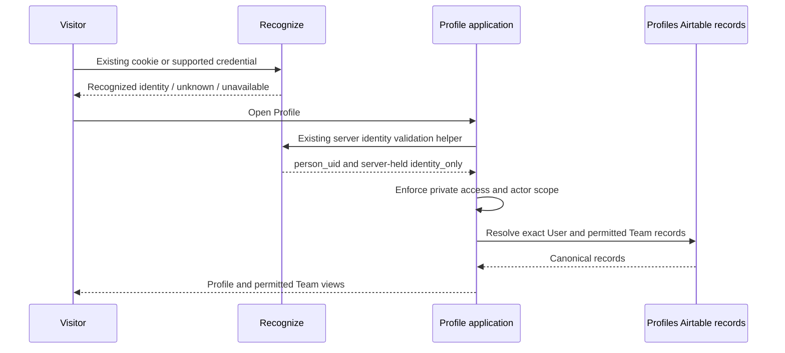

# RingStatus Profiles — ownership and operating guide

Version: **1.3.0**  
Dated: **3 November 2026 — America/New_York**  
Owner: **rs-profile-coordinator**  
Chat: `01a12690-0e9d-71f0-bb85-000d02307e8d`

This README describes Profile's responsibilities, existing implementation, specialist roles and connections. It is documentation, not authorization to run workflows, change code or records, deploy, publish, or activate agents. Current owner instructions remain controlling. The owner authorized the existing Profile controls, required data additions and app-only deployment on 2 November 2026. Live acceptance is tracked in the evidence below; authorization alone does not establish completion.

## 1. What Profiles does

Profiles is the application that lets an identified User view and manage their own application profile and their permitted Team information. Recognize answers **who is here**. Profile answers **which application records belong to this person, what may they see or change, and was their change saved**.

The coordinator owns the complete Profile outcome: current toolbar and panels, User loading/editing, Team screens, memberships, roles, consumer permissions, save confirmation, downstream compatibility and acceptance evidence. It coordinates the capabilities needed for that outcome without taking over other domains.

An independent User does not need a Team to have a Profile. Team membership is a separate relationship. A Team role is not the same thing as a User level, descriptive tag or recognition credential.

Profile responsibilities include:

- Match the server-validated `person_uid` to exactly one canonical User through `recognition_person_uid`.
- Load the correct User and permitted Team records, using actual record links rather than matching names or selecting the first ambiguous result.
- Apply consumer permissions before returning private data or accepting a change.
- Preserve the approved current Profile design and its visible interaction patterns.
- Save approved User changes through the existing application route and confirm the designated saved records.
- Retain uncertain changes and stable operation identifiers so a lost reply is not silently treated as success or repeated as a new operation.
- Keep another person's data and pending edits out of the current User's screen and saves.
- Maintain useful source, review and acceptance evidence, with the remaining gaps stated honestly.

## 2. What Profiles does not do

Profile does not identify a visitor, build a replacement sign-in system, issue recognition cookies, validate phone/PIN credentials itself, maintain the recognition device index, retire devices, or own recognition sessions and footprints. Those are Recognize responsibilities.

Profile does not grant Team access merely because recognition succeeded. It does not create Team membership from a recognized identity, infer permission from a photo/tag/favorite, or treat a browser-supplied UID as authority.

Profile does not own WEF collection, timing, results, RingWaze serving or Messages delivery. It may supply approved records or permission information through an agreed interface; each receiving domain retains its own rules and acceptance. Editing a Profile does not imply notification consent or activate an alert.

Profile does not automatically create missing Users, Teams, schemas, credentials, storage services or new integrations. It does not repair production records, substitute manual calls for the approved runner, or publish a website because a build passed. A plugin or specialist role does not enlarge authorization.

## 3. The Recognize → Profile handoff

The existing public entry is `https://ringstatus.com/recognize`. Successful credential entry or **Open profile** opens `https://ringstatus.com/profile`. Silent recognition stays on the current public page.

The browser's existing `recognitionAdapter.current()` returns a `person_uid`, null, or an unavailable error. It does **not** return a newly designed trust envelope. Profile's service sends the cookie and expected `X-RS-Actor-Scope` to `/test/rs-profile/data`.

The Profile server independently calls the existing `remembered(request, env)` helper. It rejects missing identity, a changed actor, and `identity_only` access to private Profile data. An IP-only recognized visitor can use the existing Recognize phone/PIN confirmation. Profile does not invent a second credential panel or turn an IP match into permission.

The recognition cookie is `__Host-rs_recognition_device`. Recognize owns its creation, renewal, expiry and retirement. Profile consumes the validated principal; it does not alter recognition state when a Team operation is denied. Sign-out belongs to Recognize; Profile must clear its own private display and actor state when identity changes.

## 4. Information shared with Recognize

| Information | Purpose and ownership |
| --- | --- |
| `person_uid` | Recognize-owned stable identity consumed by Profile. |
| `recognition_person_uid` on the User | Profile-owned link to that identity; exactly one matching User is required. |
| Credential-change coordination | Profile requests an approved phone/PIN change through existing Recognize-owned helpers; the existing refresh path must update the identity index. Credential authority stays with Recognize. |
| `/profile` destination | Shared navigation agreement, not a permission grant. |
| User status/phone, memberships, Team active status and roles | Existing shared refresh reads these for the separate Inputs-access projection. They are downstream permission inputs, not prerequisites for identifying a person. |

Recognize does not need Profile photos, tags, preferences or the entire Team roster to identify someone. Shared refresh dependencies still exist in the working code; an ownership document does not remove them. Interface changes require coordination with the affected owner and one designated writer.

Recognize coordinator: `01a1268e-253f-7fb1-bdc9-e6b6bd3e29a5`. Existing chat tools can read status and, with human authorization, send a scoped message. A message is coordination, not automatic acceptance or execution authority.

## 5. Records and the new Teams table

The existing base was renamed from Tenants to **profiles**. Its stable ID remains `app7BXcw801n19QKF`.

| Table | ID | Current meaning |
| --- | --- | --- |
| people | `tblyTBgrgdhT3Tcg7` | Canonical application User records, identity link and Profile fields. |
| tenants | `tbled1saw01Thffs1` | Existing Team records used by the deployed application. |
| tenant-memberships | `tblFf4aWQYA2RRsWo` | Existing User–Team relationship, status and roles. |
| roles | `tblRqRbjmqmNfJtIP` | Existing role records used by membership permissions. |
| teams | `tblaczX2otacXkA9w` | Newly created at owner request, currently with a Name field. Not connected to the deployed application. |
| team-invitations | `tblOmDd6CDOBkf7Fh` | Explicit Owner invitation and recipient accept/decline records; separate from recognition invitations and consent. |
| code-review | `tblggsFkWZ53LtkmJ` | Review date, files/language, source version, reviewer, findings, result and evidence. Creating it does not mean a review has run. |

The new `teams` table has not replaced `tenants`. No records or links have been migrated. Moving the application to it requires an explicit, bounded mapping and compatibility assignment; do not create competing Team masters silently. The owner requested a Teams table in this base; no standalone Teams base has been created.

Recognize's own People table remains in base `app9kOZdIaGyKk5uG`, table `tbly1PM5iFYqVzKSm`. Existing first/last names and credentials are accessed through the established coordinated interface. Do not duplicate or move them merely to simplify a screen.

The base also contains preferences, shared directories, processing records and administration tables. Their retention is being reviewed. A current dependency or unsettled intended use is not evidence that a table is disposable.

### Deprecation marker

Owner policy: `___` marks a table for deprecation after 90 days. On 2 November 2026, the following 24 tables had that marker and a description recording **31 January 2027**:

`___agents`, `___fails`, `___activity`, `___development`, `___workflow`, `___changes`, `___contacts`, `___locations`, `___exercisers`, `___grooms`, `___rs-input-riders`, `___profiles`, `___rs-input-horses`, `___entities`, `___trainers`, `___rings`, `___horses`, `___locations-directory`, `___tenant-level`, `___tenant-locations`, `___tenant-trainers`, `___tenant-assignments`, `___favorites`, `___onboarding-stages`.

Records and links are retained. No automatic deletion job exists or is authorized by the marker. Historical references must remain inspectable while dependencies and final disposition are reviewed.

## 6. User and Team rules

The agreed model distinguishes User levels **Independent / Preferred** from Team roles **Owner / Member**. These labels must not be mapped to existing unrelated access values without an approved decision. Descriptive tags such as owner are not membership permissions.

The model calls for explicit invitations and acceptance, Owner management of Member active status, and at most one membership in V1. It does not include browsing, selecting or switching Teams. Personal hide/show affects that viewer's display only. A User with any existing Team membership cannot create another Team or accept another membership. Disabled membership still counts. A Preferred User without membership can create a Team and become its Owner; acceptance is explicit, never automatic.

The approved implementation connects User levels, Team creation/invitations, photo uploads and actual modified-date sorting through existing records and saves. User level is assigned explicitly, not upgraded by the User. Live acceptance remains a separate check. PIN is set-only and never returned. Multiple memberships are not resolved by picking the first.

## 7. Three Profile specialist responsibilities

Profile uses three specialist capabilities under its coordinator. **These are defined responsibilities, not a claim that three Profile agents have been created or are running.** Recognize's internal specialists remain Recognize-only and were not transferred. A concrete assignment must identify the actual worker, source, approved delta and evidence required.

| Specialist | Owns within an authorized Profile assignment | Does not own |
| --- | --- | --- |
| Data-staging | Inspect canonical tables/links, map real records, prepare approved validation and data changes, trace revisions/request IDs/readback and consumer permissions, identify schema gaps and downstream effects. “Staging” does not mean an automatic new base or copied database. | Recognition identity decisions, arbitrary record repair, unapproved migrations or schemas, UI redesign, production workflow substitution. |
| Astro / publish | Profile routes, module packaging and application delivery preparation; confirm the established app/branch/environment, exact release contents and downstream callers; perform only an authorized deployment and its required proof. | Independent publication rights, shared configuration ownership by default, permission redesign, unrelated runtime/dependency upgrades. “Publish” in the role name is not authorization. |
| UI | Current Profile toolbar/panels, Team views and interactions, clear save states, actor-safe rendering, responsive and accessibility checks applicable to the assignment; preserve the approved design. | Credentials, canonical data authority, invented Team policies or fake success/sample data in production. |

The coordinator keeps requirements and later corrections together, sequences shared changes, reconciles results and owns downstream acceptance. Use one writer per shared mutable resource. Independent review remains separate where required. No specialist may authorize its own scope expansion or treat a passing local test as live completion.

## 8. Connected tools and how information moves

The coordinator can use available connectors and skills for a scoped task. A plugin is a tool connection or guidance package, not another application domain or an automatic data-sharing channel. Tool availability does not establish current account access, permission to write, a deployed integration or an approved transfer of private data.

| Connection | Profile use | Boundary |
| --- | --- | --- |
| Airtable | Inspect schemas and real records; perform specifically approved table/record changes; read back the saved result. | Airtable remains canonical for application records. No guessed identities, blind retries, record repair or duplicate stores. |
| Cloudflare | Available tools can search documentation/API capabilities and access resources within their actual connected permissions. Coordinate any required Profile runtime/binding work with the shared app and Recognize owners. | Existing D1 identity data belongs to Recognize; shared claims/helpers remain protected. No new Worker, D1, R2, scheduled process or data export is implied. No new direct Cloudflare deployment route is established here. |
| Webflow | Inspect or, when authorized, maintain the existing Profile page/custom-code loader and Cloud application metadata through the production Webflow connector. | Website publication and Cloud application deployment are separate actions. The current app route is reused; a saved page is not published and a local build is not deployment proof. |
| RingStatus Operating Skills 0.2.9 | Request Router, Instruction Loader, Rebalancer, Handoff, Code Review, Context Compact and Complaint Reporting supply their applicable operating procedures. | All seven were read in this chat. Reading does not launch every procedure, activate a workflow mode, spawn agents or prove a review/continuity check. Preserve explicit invocation requirements. |
| OpenAI Developers | Available connection supports the actual exposed dashboard/key-setup capabilities. Relevant guidance can support a separately authorized agent/API integration. | No Profile runtime OpenAI integration, AI agent, key setup or private-data transfer is established by this README. An installed plugin does not prove API access or authorize sending User/Team data to a model. |

The currently implemented runtime path is browser → existing Astro Profile route → server identity validation → canonical Airtable records → permission-filtered response. This is distinct from coordinator tool calls used to inspect or maintain the system. Sharing a README, chat message or record ID does not create an API or transfer access.

Keep credentials, PINs, device tokens and raw private chat histories out of documentation and review records. Return only the consumer data required by the authorized operation. Record the source, contract and actual result rather than assuming every connector shares a common session or database.

## 9. Source and delivery boundary

Verified implementation checkout:

`C:/Users/gombc/.codex/worktrees/profile-proactive-20261103/ringstatus`

Current verified application release: `7fda82691e4c41f8b7f44bc5dd4f183e3210991d`, deployment `aff9e411-570e-4e0a-9ddc-d8072fe8adbe`, succeeded on 3 November 2026 at 14:47:21 UTC. It preserves the existing design and sibling changes through baseline `0cfe8b0dd7e281a126d636f2696a0306a34c0bcf`. No website publication occurred. This is dated release evidence, not continuous monitoring.

Profile source, relative to that checkout:

- `webflow-cloud-test/src/assets/rs-profile/client.js`, `profile.css`, shared `rs-ui/screen.css` and recognition `widget.css`: consumer presentation.
- `webflow-cloud-test/src/assets/rs-profile/service.js`: browser identity/data/pending-save adapter.
- `webflow-cloud-test/src/lib/rs-profile.js`: canonical records, permissions and saves.
- `webflow-cloud-test/src/pages/rs-profile/client.js.ts`, `service.js.ts`, `data.js`, `index.astro`: assets, API and standalone entry.

Public paths are `/profile`, `/test/rs-profile/client.js`, `/test/rs-profile/service.js`, `/test/rs-profile/data` and standalone `/test/rs-profile/`. The service script is shared by the existing public consumer and Profile; it is not another data backend.

Existing Cloud app: `d7d97751-20e1-4148-a5cf-ee58671c128a`; environment: `110f06dd-c1ea-4839-98af-d829cbe77941`; mount: `/test`. The existing GitHub branch `work/inputs-crm-20261006` auto-deploys on push. A push is therefore a release action, not a harmless way to save this README.

Recognize widget/IAM/credential/refresh code, D1 claim/save helpers, `rs-tenant-barn.js` and Cloud configuration are protected shared dependencies. Coordinate their callers, designated writer and release before changing them. Preserve unrelated owners' work.

## 10. What has been proved and what remains

The existing core flow was tested through the live /profile controls: real User save/readback/reload, retained interrupted requests, sign-in/out/account isolation, roster and Owner enable/disable. The original test Owner was corrected to one membership under explicit owner instruction; temporary test values were restored. Evidence: `.git/ringstatus-control/recognize-model-correction-20261101/profile-e2e-live-results-20261102.json`.

The earlier completion candidate was `a3a07e80655865eafa40f6aea75e7ba24df1e760`. Independent feature tests22/22, the two reproduced review regressions, one-Team concurrency and shared-call compatibility passed. Its separate upstream display release was preserved, and its build passed. Historical review evidence is in `.git/ringstatus-control/profile-completion-20261102/review-corrected/` and `review-final/`; code-review record `recPoGRbBzhiRmH8n` indexes it. Previous failed-review evidence remains in `review/`.

The owner explicitly authorized manual preparation of two disposable registered Test Users without memberships. This is test setup, not automated registration. Existing User memberships are preserved. Deployment and live control acceptance are recorded in `.git/ringstatus-control/profile-completion-20261102/live-acceptance.json`; the approved controls passed live browser/canonical readback/reload checks. Both disposable Users and their Team were deactivated, temporary values restored, and the original memberships/session preserved. Manual fixture preparation is separate from the tested application flow.

Alerts, Alarm, Checkin, external Opt-ins/Schedules and the preset Agent panel are separate unconnected services. This change does not build those engines, change consent, migrate Team tables or replace Recognize. Full offline page reopening and the broader IndexedDB/cache plan are not established by retained localStorage drafts.

### Five designated pages — 2 November 2026

Actual Member and Owner Profile flows were subsequently tested from Home, Ring Status, About RingStatus, Recognize and Profile. Each reached the correct Profile; Member edits saved, read back, survived reload and were restored; Owner membership changes saved and were restored. Team permissions and one membership per User remained correct. Fresh phone/sign-out entry was checked. Test fixtures were deactivated and the original session/memberships preserved.

Historical finding: the a3 release had a startup interaction issue. Later owner releases already corrected that interaction before the 3 November work; the old one-expression proposal is superseded and must not be applied. Original evidence remains in `.git/ringstatus-control/profile-completion-20261102/all-pages-e2e-20261102.json` and `all-pages-launcher-review/`.

### Approved proactive UX — 3 November 2026

The owner approved early permitted preparation, immediate prepared display, immediate local Save/end editing, quiet existing-endpoint persistence and error handling, preserving the design, recognizer and one-Team rule. Three independently reproduced review findings were separately approved and corrected before release. Source review14/14 delayed-response gates and6/6 service regressions passed; unchanged backend16/16 checks passed. The app build and served service hash match the deployed commit.

Live controls passed: Team creation; invitation, decline, re-invitation and acceptance; exactly one membership per User; Member/Owner separation; immediate Profile field update/editor close and next edit while the POST was deliberately held; ordered tag/email canonical saves and reload; prepared Profile visible with GET deliberately held; Home, Ring Status, About, Recognize and Profile handoffs; mobile roster search; photo upload/readback/reload/removal; Owner member disable/enable; and lost successful member-save reply followed by normal reload replay of the identical request ID/body. The server remained authoritative; pending invitation acceptance granted no premature membership.

Preparation uses existing actor-scoped device storage and the server-resolved device fingerprint, bound to a previously successful Profile response. A replaced identity/device cannot reuse old private memory or in-flight work. It adds no TTL, offline authorization, polling, background service or replacement recognizer. Pending same-record writes remain ordered; newer local edits and unrelated work remain usable. PIN remains excluded from persisted drafts and normal cached fields.

The older disposable Users could not be reused for a second Team creation because their permanent one-Team claims correctly rejected it before a Team write. They were restored to their original inactive state and membership links. A fresh disposable pair with unique test phones completed the live flow under the existing manual test-setup approval; both are now inactive in Profiles and Recognize, their Test Team is inactive, temporary values/photo are empty, and each retains exactly one membership as test evidence. Original User revisions13/2 and memberships were unchanged; original User1 session and normal viewport were restored. No claims were deleted or production records repaired.

Evidence: `.git/ringstatus-control/profile-proactive-20261103/` contains `live-steps.json`, `live-pages.json`, `live-readbacks.json`, `live-lost-reply.json`, `final-cleanup-readbacks.json`, `served-source.json`, `release-build.log` and independent `review-corrected/`. Code-review record `recWDCTu6SDzLVkOw` indexes the reviewed source. Live phone/PIN credential changes were not performed; existing credential helpers and PIN persistence were checked offline, and original phone/PIN sign-in remained working. Full offline private display and disconnected services remain outside this correction.

## 11. Review records and working standard

Use the new `code-review` table when an authorized JS/Python review is actually performed. Record exact files/source version, review date, reviewer, findings, result and inspectable evidence. A row is an index to evidence, not a substitute for the review, required independent checks or live acceptance. No historical review row was fabricated when the table was created.

Keep explanations short and human unless the owner requests detail, as for this README. Keep code small, simple and maintainable. Preserve proven source; do not layer patches, redesign working behavior, add speculative infrastructure or upgrade dependencies outside the approved delta.

## Version history

| Version | Date | Change |
| --- | --- | --- |
| 1.3.0 | 2026-11-03 | Approved proactive Profile UX deployed; delayed-response, Team/invitation, canonical, mobile/photo and lost-reply live acceptance; fixtures and original session restored. |
| 1.2.0 | 2026-11-02 | Five-page live flows and restored test data; confirmed startup launcher correction pending approval. |
| 1.1.0 | 2026-11-02 | Settled one-Team rule, current table markers, approved controls and versioned review/live acceptance evidence. |
| 1.0.0 | 2026-11-02 | Initial owner-requested detailed Profile guide; documents domain cut, specialist capabilities, tool boundaries, new tables, deprecation policy and evidence limits. |

Future revisions should update this header and history, retain exact proof dates, and distinguish a documented decision from an implemented or verified change.
