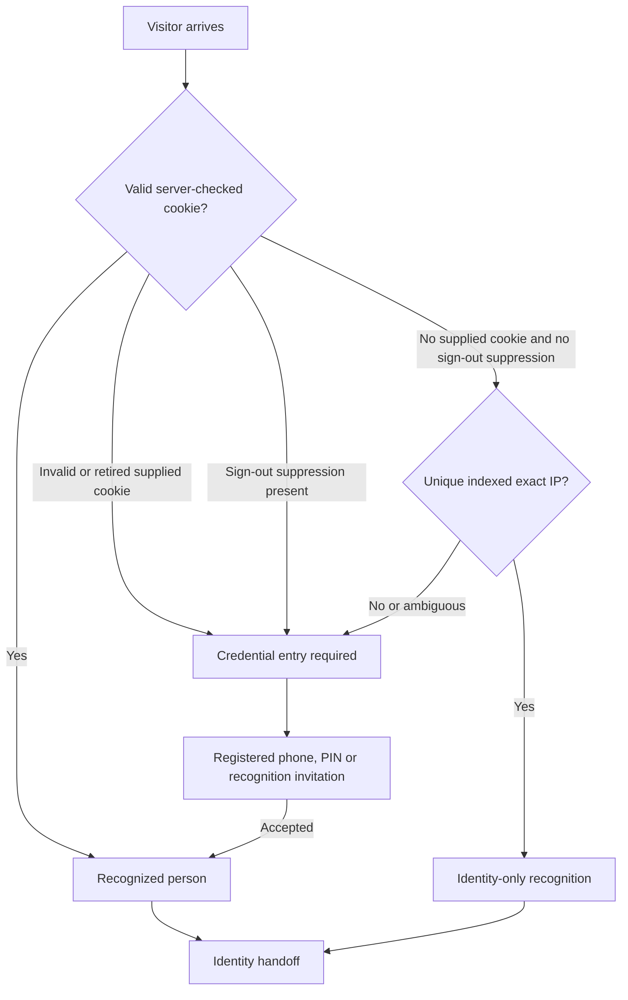

# RingStatus Recognize

Current implementation and evidence: **2 November 2026**. This README describes Recognize specifically. It does not authorize implementation, a workflow run, schema changes, deployment or website publication.

## Purpose

Recognize identifies a returning visitor with minimal interruption, remembers the browser, maintains visit/session continuity and supplies a stable identity to the next application.

The expected experience is: arrive, check silently, continue if known; otherwise enter an existing registered phone number or PIN. Recognize identifies an existing person. An unknown number does not create a User, Team or membership.

**Owner: rs-recognize-coordinator. This domain stops at the identity handoff.** Recognize owns silent cookie/IP lookup, registered phone/PIN/recognition-invitation entry, recognition devices, sign-out, session continuity and recognition history. Its UI, data and Astro specialists work only on that scope.

Profile screens, User editing, Teams, memberships, roles and consumer permissions belong to rs-profile-coordinator. WEF and Messages enforce their own policies. A downstream denial must not clear recognition or retire a device. The documentation/ownership cut does not change the deployed implementation.

## Visitor workflow

1. A supported page loads the current Recognize widget.
2. The widget asks the server to check recognition. Browser-local display state is insufficient.
3. The server validates the recognition cookie against D1. A valid cookie identifies the person without a geographic comparison.
4. If there is no supplied recognition cookie and no explicit sign-out suppression, the server can try the existing indexed exact network-address match.
5. A unique network match supplies identity-only recognition. No match or an ambiguous match leaves the visitor unknown.
6. If needed, the visitor opens the single-input panel and enters a registered phone, explicit four-digit PIN or supported recognition invitation.
7. A successful credential match establishes a browser recognition token/cookie and clears sign-out suppression.
8. Silent recognition leaves the visitor on the current public page. Successful credential entry or clicking **Open profile** in the public widget navigates to `/profile`.
9. Recognize hands identity to the destination. The destination owns everything after that handoff.

An unavailable service is a separate outcome from an unknown visitor. Neither outcome may be presented as successful recognition.

## Cookie recognition

The server cookie is `__Host-rs_recognition_device`. Its random token refers to a D1 device entry associated with `person_uid`; the cookie is not a complete Profile. D1 stores the device-token hash and checks expiry, retirement and the indexed person.

The cookie uses `HttpOnly`, `Secure`, `SameSite=Lax` and root path `/`. The current configured lifetime is 365 days. Successful recognition renews the browser cookie and D1 device expiry together. Browser deletion, retirement, expiry or removal of the indexed identity can end recognition sooner.

The browser also retains supporting cache, session and retry values. The server cookie validation remains authoritative; a locally stored User ID cannot grant private access. Cookie protection does not mean that the whole browser client contains no token-related state.

## What “GeoIP” means here

The current route uses the exact public IP observed by Cloudflare in `CF-Connecting-IP`. It does not infer a person from a city, region or country, does not request browser GPS permission, and does not call a separate geolocation provider for this identity match.

The existing index learns the association from credential-backed identity. The lookup uses a keyed hash of the exact address. Only one matching indexed person is accepted; a shared address associated with several people remains ambiguous. The implementation never selects the first person from multiple matches.

An IP match is marked `identity_only`. Consumers receive that trust distinction through server validation and decide whether confirmation is needed for their private data. Recognition does not require a cookie-versus-IP comparison or grant consumer permissions.

A supplied invalid, expired or retired cookie cannot fall through to IP recognition. Explicit sign-out sets a suppression cookie using the same configured one-year lifetime; while it remains present, IP recognition is suppressed. Explicit sign-in clears that suppression.

## Single-input sign-in

| Input | Current behavior |
| --- | --- |
| Registered phone | Normalize the supported US number format and look up the existing indexed person. |
| Four-digit PIN | Match the explicitly stored PIN. It is not a phone-number suffix. Preserve leading zeroes. |
| Recognition invitation | Use the existing supported seven-digit, expiring, single-use invitation path. It is not a Team-membership invitation. |

Duplicate phone identities are not accepted as a guessed match. Ambiguous PINs retain the existing known-device resolution or associated-phone requirement. Invalid and unmatched credentials do not create identities. Existing attempt limiting and request replay handling remain in place.

The active widget sign-in path sends no SMS or OTP. Matching an entered registered phone number identifies the indexed record; it does not prove current possession of the phone. A successful match therefore must not be described as SMS verification or stronger identity proof than the implemented phone/PIN workflow provides.

## Identity, device and session

| Item | Meaning |
| --- | --- |
| `person_uid` | Stable recognized person identity shared with consumers. |
| Recognition device token | Server-validated browser recognition relationship. |
| `session_uid` | Visit/browser-session continuity used by the current client and history path. |
| History event ID | Identifies a recognition, sign-in or retirement event for retained export/retry. |

A new visit/session is not a new person. A remembered browser does not automatically acquire Team or WEF permissions.

Recognition and sign-out use D1 and do not make Airtable calls for the identity decision. History is retained separately in the existing claims/outbox path and exported through the existing session operation. Export failure does not turn an accepted identity into an unknown visitor. Retained work is not a promise that the browser executes while closed.

## Sign-out and account changes

Sign-out clears Recognize's visible identity and browser recognition context, retires the current server token, clears its recognition cookie and sets the secure sign-out suppression cookie. A reload must not immediately sign the visitor back in through the indexed IP. Consumers must clear their own private screens when identity changes.

The widget retains an uncertain sign-out operation and coordinates browser actions so retirement responses do not race a later sign-in. Another application's permission denial must not trigger these sign-out effects.

## Authoritative records and the D1 index

| Store | Responsibility |
| --- | --- |
| Recognize base `app9kOZdIaGyKk5uG`, People `tbly1PM5iFYqVzKSm` | Existing canonical identity, credentials and identity names. |
| Existing D1 binding `RS_RECOGNITION_CONTROL_DB` | IAM person/key projections, device validation, claims and supporting retained operations. It is not a replacement canonical User/Team database. |
| Browser storage | Supporting visit/retry/display state; never authoritative permission. |

Existing application saves queue the IAM refresh separately. The existing shared refresh also consumes Profile-owned access inputs; changing those inputs requires coordination with that owner and does not transfer ownership to Recognize. Direct Airtable edits require the established refresh path; do not assume immediate index freshness or add a visitor-triggered Airtable fallback. Codex is not the runner and must not use manual refresh/repair commands as workflow proof.

## Identity handoff contract — end of Recognize ownership

- Browser: existing `recognitionAdapter.current()` returns `person_uid`, null, or an unavailable error. It does not return a new invented trust payload.
- Server: the existing `remembered(request, env)` helper validates the cookie and supplies the principal plus `identity_only`. Consumers must validate server-side; a browser UID is not permission.
- Navigation: the current public widget opens `/profile` after credential success or **Open profile**. Silent recognition stays on the current page.
- After this point, rs-profile-coordinator owns Profile loading, User data, Teams, permissions and saves. Its interface may request credential changes through existing Recognize-owned helpers; that does not move credential ownership or authorize a new API.
- Source ownership and pending acceptance for that consumer are in the [Profile coordinator handoff](../coordination/rs-profile-coordinator-handoff-20261102.md). No Profile backlog is owned by this README.

## Current widget and source map

Paths below are relative to `webflow-cloud-test/`.

| Surface | Source / public endpoint |
| --- | --- |
| Shared widget adapter | `src/assets/rs-recognition/widget.js` |
| Current fingerprint/single-input presentation | `src/assets/rs-recognition/widget-view.js`, `widget.css` |
| Shared silent-check/history helpers | `src/assets/rs-recognition/native-client.js` |
| Recognize module packaging | `src/pages/rs-recognition/widget.js.ts` -> `/test/rs-recognition/widget.js` |
| D1 identity implementation | `src/lib/rs-recognition-iam.js` |
| IAM refresh/history integration | `src/lib/rs-recognition-iam-connections.js` |
| Widget API | `/test/rs-inputs/native-recognition`, existing recognize/action/session operations |

The current public Recognize widget is mounted on Home `/`, `/ring-status`, `/about-ringstatus` and `/recognize`. Other applications can consume its existing adapter. Their presentation, data routes and private-data policies are owned downstream.

Use the current dark fingerprint launcher and single-input panel. Legacy `/rs-recognize`, historical native controllers, older loader/test HTML and unrelated `lp-profile` code are not substitutes for this current entry. The fingerprint icon is a launcher, not biometric fingerprint authentication.

## Deployment and evidence

The verified application release is `89abf609f816b6c9d10f05d301027c991a33280a`, deployed on 2 November 2026 at 12:11:26 UTC through the existing Cloud app `d7d97751-20e1-4148-a5cf-ee58671c128a`, environment `110f06dd-c1ea-4839-98af-d829cbe77941`, mount `/test`.

The configured GitHub branch `work/inputs-crm-20261006` automatically deploys the shared app on push. Coordinate exact release contents and neighboring work before any push. App deployment and Webflow website publication are separate actions. This README grants neither. Documentation-only changes should not cause an unnecessary application deployment.

The owner published the five-page demo-code cleanup. The old browser-local demo model is absent from the five current published pages. Existing test records in the real databases were not deleted and must not be mistaken for embedded demo code.

Live evidence from 2 November establishes existing secure-cookie recognition, recognized **Open profile** navigation to the published destination and successful recognition/session responses. The downstream consumer's read/reload evidence is preserved in its own handoff. Codex deployed the app but did not publish the website or edit business records during that verification.

That browser used an existing real **test User**. It does not prove that another visitor's sign-in matched their personal record. Check the actual displayed/returned User identity.

Fresh phone/PIN entry, live IP-based recognition/confirmation behavior and mobile Recognize acceptance were not all reverified in this release. Earlier scoped tests, source review and fixture checks are separate evidence, not replacements for those live checks. Downstream consumer acceptance is owned by that consumer's coordinator.

Private evidence is under the approved main checkout's `.git/ringstatus-control/recognize-model-correction-20261101/`: `live-acceptance-20261102.json`, `deployed-http-20261102.json`, `source-review.md` and test/build logs. The earlier `published-check-20261102.json` records the pre-deployment failure, now resolved. Private evidence/history is not copied into this README.

## Ownership and change discipline

Coordinator: **rs-recognize-coordinator**, chat `01a1268e-253f-7fb1-bdc9-e6b6bd3e29a5`. Existing scoped subagents: `widget_ui` for Recognize presentation/interactions, `widget_data_staging` for Recognize identity/index/history, `widget_astro_publish` for Recognize routes/packaging. They do not own Profile. The primary coordinates Recognize work and negotiates shared files/releases with the other owners. These roles do not create automatic write or publish authority.

Preserve the proven recognizer, current designs, source consumers and owner changes. No replacement authentication system, extra provider, new schema, dependency upgrade or patch layering is implied by a request to finish an integration. Verify the exact approved delta and its affected downstream behavior.

Related current sources: [Recognize specialist boundaries](../coordination/recognize-profile-widget-specialists-20261102.md) and [Recognize isolation boundary](../coordination/recognize-isolation-20261101.md). Current owner instructions and dated live evidence take precedence over historical handoff imperatives.
