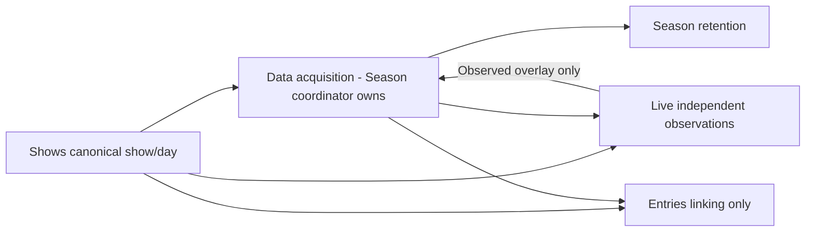

# WEF Data-only retirement readiness plan

> **For agentic workers:** After separate implementation approval, use superpowers:executing-plans task by task. This document itself authorizes no execution or delegation.

**Goal:** Prepare existing consumers to use the existing Data base before separately retiring the Schedules collector.

**Architecture:** Shows remains canonical show/day authority. Data supplies collected schedule/participation/entity evidence; Live supplies observed facts and publishes its permitted Data overlays; Entries only links accepted records. Season retains Data through its established transfers. No replacement collector or new ownership split is proposed.

**Tech Stack:** Existing Node/Python collectors, Airtable, verified local archives, existing Windows scheduled tasks.

**Spec:** Owner request in wef-records-coordinator on October 30: prepare Shows, Live, Season and Entries to retire Schedules and use the Data base; Data remains owned by Season until stable and a later owner-approved split.

## Global constraints

- PREPARATION ONLY. Schedules remains running; no task/cadence, reader, code, schema, sync, record, deployment or stop-control changes from this plan.
- Data base is `appdl16HJ5ETm8N69`; Schedules base is `appUq5Qz9kARqFija`.
- Local `wef-season-coordinator` retains Data acquisition and separately Season retention. The forked Data ownership transfer was reversed.
- Entries remains linking-only: no collection, Live enrichment, collector comparison/selection or producer readiness gate.
- Preserve native IDs/links, portable keys, source timestamps, historical evidence and current approvals/stops. No manual runs or record repairs.
- Collector retirement is separate from deleting a base, synced tables, code folder, archives, helpers or source Workers. None of those deletions is proposed.
- `wef-schedules-decoded` remains a working source service; its name is not proof of dependence on the Schedules collector.
- Existing incomplete/failed verification paths stay stopped as applicable; preparation cannot authorize repairs, retries or resumption.

## Review focus

1. Data rows are not interchangeable with Schedules rows: different keys, fields and native link targets.
2. A mutable row or `last-success` alone cannot establish accepted current schedule membership.
3. A class may have multiple group/occurrence relationships; do not invent trip-group attribution or duplicate class totals.
4. Native Airtable links require destination-local reference records; never insert cross-base native IDs or retarget old links destructively.
5. Retiring the collector must not break consumers of shared code, source Workers, archives or historical links.

## Current wiring versus proposed wiring

| Owner | Current verified/source-backed dependency | Proposed minimal change |
| --- | --- | --- |
| Shows | Locked v1.4 directly reads Data runs `tblSxcmUcmB0W9Vhu` and collections `tbl8fQXTGJmv5esNj`; no scheduled Schedules-base dependency | Leave collector unchanged; preserve replay/helpers/archive paths. Adjust historical verification utilities only if later acceptance requires it. |
| Live | Own sync `wef-schedules.schedules` / `tblGPXIUnD0sfTEIX`; group/class native schedule links; Schedules overlay publisher | Establish accepted Data-backed local references and adapter, preserve historical links, then publish only to Data. |
| Entries | Own sync `tblVcbGJHhzLYZRxn` selects active Schedules classes; accepted Data supplies participation/entities | Replace schedule eligibility/mapping input with accepted Data evidence and local Data references, preserving the accepted participation/linking contract. |
| Data / Season | Existing Data acquisition and four Season transfers; shared Data validation helpers physically under `wef-schedules/tests` | Keep ownership together. Confirm Data schedule coverage/membership/retirement semantics and stable existing handoff; keep shared helpers in place initially. |

Proposed future information flow (not execution triggers):

Data is the collected schedule/detail source, not a replacement for canonical Shows discovery. The current two collector paths remain unchanged until an approved cutover passes.

## Data reference contract to settle before any build

| Existing Data table | Table ID | Existing portable identity |
| --- | --- | --- |
| rings | `tblhKkfYXppW3TbTq` | customer/show/date/ring-number; validate ring-id separately |
| groups | `tblQObOvktufkyq54` | dated ring key + source group ID |
| classes | `tbl0IFf067w4wUBj5` | dated ring key + class ID |
| schedules | `tbl6KKlYuMIPHEJWe` | dated ring key + existing source occurrence ID or existing position fallback |
| trips | `tblt0GvQ39bHIu930` | class key + entry ID + existing UUID/trip suffix |

Data schedules have linked show/day/ring/group/class, `kind`, `source-id`, `source-json`, `schedule-key` and `last-success`. They do not provide Schedules' flat `status=active`, `stage-key`, `show-id/date/class-id/ring` contract. A source-supported adapter must resolve actual linked identities and accepted membership, not rename fields or synthesize old keys.

Entries participation remains `show|date|entry|class`; Data show registration remains `show|entry`; trips and schedule occurrences remain distinct. Source evidence must establish group attribution. Missing evidence stays unresolved; contradictory/multiple candidates remain Conflict.

Open contract decisions, owned by existing Data producer and accepted separately by Live/Entries:

- Exact accepted revision and occurrence-membership/eligibility evidence, including removed/dropped occurrences and source age.
- Relationship of Data occurrence IDs to existing Schedules stage-key evidence where any crosswalk is actually supported.
- Existing or proposed destination-local Data reference tables/views and additive link fields; exact IDs/fields must be approved before configuration. Availability is not yet proven.
- Preservation of prior Schedules links as history without their continued use as an operational fallback after cutover.

## Task 1: Producer contract and stability gate - Data/Season owner

**Files/interfaces inspected:** `wef-data/data_runner.py`, `data_contract.py`, `retained_feed.py`, `retirement.py`, `season_projection.py`; existing shared Data helpers and four Season destinations. No producer edits are preapproved.

- [x] Reconcile separately approved recovery: Data generations 76/77 and all four Season consumers PASS; source/receipt references are in the producer findings below. This does not pass the membership/consumer cutover gates.
- [ ] Specify exact accepted schedule inventory, original source times, linked identities and dropped/removed handling from saved evidence.
- [ ] Prove required dates/rings/occurrences and participation/entity evidence coverage; distinguish incomplete/unknown from verified empty.
- [ ] Prove two normal archive-backed Data generations and all four Season consumption/readback acknowledgements; preserve collection/record/link/history baselines.
- [ ] Live and Entries accept the contract without acquiring producer ownership. Only then prepare exact implementation edits/schema permission scope.

## Task 2: Live-only consumer switch - Live owner

**Expected edit boundary after separate approval:** `wef-live/collector.js`, `model.js` matching boundary, `airtable.js`, `settings.js`, `schema.js`, `verify.js`, `publication-api.js`, `publication.js`, `publication-journal.js`, relevant existing/new focused tests. Confirm actual file delta before coding.

- [ ] Test saved Data identities/linked-reference normalization, repeated occurrences, ambiguous groups, missing/stale evidence and old-link preservation.
- [ ] Reuse a verified suitable local Data schedule reference inside Live if available; otherwise separately approve that one reference plus additive schedule-link fields on `live-classes` and `live-groups`. Preserve existing `schedules` fields/targets as history. Extra local ring/group/class reference tables are not established as necessary.
- [ ] Replace active Schedules reference consumption and remove Schedules publication only after existing uncertain intents have a recorded disposition; retain all audit history.
- [ ] Preserve canonical Shows, independent TODAY collection, source services, archives and logging; no Entries dependency. Prove zero operational Schedules-base/sync reads AND writes, including old-lane pending reconciliation. Preserve journal/audit history without retaining an active dependency.
- [ ] Address separately scoped implementation defects under explicit approval, including lane budget exhaustion and `has_JSON`/`has_json` mismatch. Ambiguous matches are not automatically defects: preserve withholding rather than force matches; missing destinations/decoded identities need source-backed evidence. Required populated coverage must be stated explicitly; do not count incomplete publication as full acceptance.
- [ ] Independent actual-change review and focused offline suite; then established guarded deployment and two naturally populated NORMAL runs with Data-only reads/publication, exact PATCH/readback, protected fields/links and repeat behavior. No manual proof.

## Task 3: Entries linking-only consumer switch - Entries owner

**Expected edit boundary after separate approval:** `wef-entries/settings.js`, `collector.js`, `model.js`, `airtable.js`, schedule-reference/matcher boundary and applicable focused tests. `data-input.js`/`retained-input.py` evidence fences remain protected; edit only if exact compatibility requires it.

- [ ] Test accepted Data schedule eligibility and source-supported occurrence/group links, including multiple trips per participation and multiple classes per group.
- [ ] Reuse accepted Data participation/entity input, bounded payload/readback/log safeguards and original source times.
- [ ] Reuse an existing compatible local Data schedule reference if verified; otherwise separately approve one local reference table and an additive Entries link field, with exact names/IDs/configuration still unverified. Preserve existing `schedules`, `schedule-key` and `schedule-keys` as historical references; never substitute cross-base native IDs.
- [ ] Independently review actual changes; guarded deployment and two NORMAL scheduled runs must retain participation IDs, helper fields, history, native links and original timestamps, with heartbeat/run-log readback. Test verified-empty input, missing evidence and duplicate occurrence keys. Ordinary unresolved/Conflict relationships may remain Partial; processing errors do not pass. This is Entries acceptance, never a producer-wide gate.
- [ ] Demonstrate zero operational Schedules-base/sync dependency after cutover. No acquisition, Live enrichment or comparison work is assigned to Entries.

## Task 4: Shows preservation and broader consumer gate - Records with owners

- [ ] Keep Shows locked release `count-replay-fix-20261030` and its two accepted 08:44/08:49 normal replay runs unchanged. Any affected verification-only adapter needs separate exact approval.
- [ ] Preserve Data evidence replay and physical shared dependencies. `wef-shows/day-replay.py` and `wef-entries/retained-input.py` load `day_counts.py`/`data_contract.py` from `wef-data` and chain validation `wef_data_handoff.py` from `wef-schedules/tests`; preserve both locations. Deleting the Schedules directory is prohibited by this plan.
- [ ] Confirm remaining consumers before retirement. Source-backed references exist in `wef-timing/runner.js`, `class-schedules-source.js`, `api.js` (including archived schedule paths), and `wef-tenants/collector.js`, `settings.js`, `configure-synced-references.js`, `model.js`. These owners have not been assigned migration by this preparation. Their active deployment/task/sync status and replacement contracts remain unverified gates.
- [ ] Inventory Airtable synced-table consumers and historical archive/index references. Source search alone cannot prove there are no external consumers.

## Task 5: Separate retirement approval - owner decision only after gates pass

- [ ] All active consumers have accepted Data-only contracts and normal-run evidence; no unknown/active Schedules publication intent remains unaccounted for.
- [ ] Existing Schedules records, sync targets, old-show archives/catalogs, helper files and source Workers are preserved. Keep exact current task definition/route available as evidence.
- [ ] Bring the owner a concrete retirement action for the existing Schedules task only; do not bundle deletions, renames or ownership splits.
- [ ] Only after explicit retirement approval, stop future Schedules collection by the exact approved task action. Verify Data/Shows/Live/Entries/Season/downstream continuity through normal schedules.
- [ ] Failed verification stops the affected path. No automatic rollback, task restart, record repair or manual collection; any rollback requires applicable owner authorization and preserves new/old evidence.

## Later Data/Season ownership split - explicitly deferred

Only after the owner considers operation stable: assign an existing or owner-created Data chat the exact proven producer contract/release, obtain acceptance, then release Data duties from Season. Do not repeat the reversed fork assignment. Stability requires agreed current coverage/freshness, required normal-run repeat proof, resolved required integrity/publication failures, accepted archive/handoff behavior and one writer per module. No arbitrary stability period or new resident monitor is introduced here.

## Approval boundaries

This is a readiness plan, not executable approval. Required later decisions are: exact producer compatibility fixes if any; additive sync/link schema and consumer switches; separately scoped Live defect corrections; and finally retirement of the existing Schedules task. Data/Season ownership does not change now. No approval is requested until remaining mappings and independent preparation make each action concrete and reviewable.

## Evidence / preparation status

- Shows, Live and Entries supplied current dependency maps in their existing owner chats on October 30; their statements do not prove a switched runtime.
- Shows current lock/review: `wef-shows/evidence/count-replay-fix-20261030/README.md`.
- Live populated publication limitations: `wef-live/evidence/publication-v1-20261029/populated-verification-20261030.md` and exact JSON report.
- Entries protected linking baseline: `wef-entries/evidence/linking-only-restoration-20261029/release.md`.
- Data/Season producer report is now available: `C:/Users/gombc/Documents/Codex/2026-10-23/find-all-docs-discussing-wef-people-4/outputs/data-season-schedules-retirement-readiness.md` and its exact source inventory. Its current-eligibility gap below prevents treating this plan as approval-ready for migration/retirement.

### Bounded owner review acknowledgements

Shows confirmed no reader/schema/link change is needed. Live and Entries confirmed their respective plan sections, with the additive-reference, ambiguity, zero-operational-dependency and linking-acceptance clarifications incorporated above. These are preparation acknowledgements, not implementation approvals or operational cutover proof. Data/Season reviewed its bounded sections and confirmed ownership/stability findings; producer contract corrections have been incorporated below. All four preparation reviews are recorded; none authorizes implementation.

## Data/Season producer findings - incorporated October 30

The separate archive recovery is PASS at source commit `741ed4f5a916fac648e39dc5b028b48114be8a29`, with normal Data generations 76 and 77 accepted by all four Season workflows. Source: `outputs/archive-recovery-acceptance.md` in the local Season workspace. Baselines preserved: 4,333 collections, 12,955 Data records, 1,967 Season records and 4,149 links. This recovery proof does not establish consumer migration readiness or authorize retirement.

Saved Data generation 77 provides a concrete baseline: **405 current occurrences versus 519 retained schedule rows** (114 retained rows absent from current inventory). Current inventory includes 320 distinct classes, 34 breaks and 32 dated rings over October 29-November 1; occurrence counts by date are 26/43/199/137. Exact membership and original source acquisition evidence are in the Season workspace `outputs/accepted-data-schedule-membership-20261030.json`. These figures describe that saved generation, not permanent live counts.

**Confirmed migration blocker:** Data replays/merges retained historical rows; absence from a later source inventory does not remove schedule rows. Its `active-classes` list is acquisition control, not occurrence/break eligibility. Reading all Data schedule rows or filtering by `last-success` would expose removed occurrences as current.

The smallest proposed producer contract is exact membership of existing `schedule-key` values from the latest COMPLETE accepted `dated-inventory`, with accepted revision, source scope and original observation time. That inventory covers canonical dates/rings and breaks and already contains the full occurrence graph with retained-page references. Failed/partial acquisition cannot replace the accepted membership. Removed occurrences become ineligible, not deleted; reappearance reuses identity. Detail status/freshness remains separate.

For operational base-only access, Data owner proposed an index in existing `runs.state-json`. This is a proposed contract addition, not an existing field value or approved implementation. Exact shape, payload bound, immutable revision/hash compatibility, count replay and all existing reader acceptance must be reviewed before requesting implementation approval. Never modify an already accepted historical state-json/hash/head to add an index. An archive-backed projection is an alternative delivery choice; do not silently substitute it for the owner's requested Data-base interface.

Additional parity requirements:

- Data occurrence key suffix is existing `class_groupxclasses_id`, otherwise existing `position-{pos}`; no verified old-stage-key/native-ID crosswalk exists. Positional fallback movement/collision needs proof; never infer identity from class/name/position alone.
- Source `class_group_sequence` is not Data `source-position`. Source `class_type` and `schedule_sequencetype` are not Data `kind` (class/break).
- Data start-time coalesces estimated/default source values; Schedules uses its own normalization/inheritance. Prove provenance/time/count parity, preserving null versus zero and no false actual-time claims.
- Data class competition status is not occurrence retention eligibility. Class/group/occurrence trip totals are not interchangeable.
- Existing Data schedules business rows alone do not prove current-membership exclusions because future raw evidence is archived. Required sync/reference availability is unverified, not established absent.
- Preserve Schedules-only datasets/attempts/removed/retired/current-index history. Data's archive success does not prove that separate history was copied.
- Data/Season launchers also use `wef-schedules/collect.js` lock/report helpers, and Data uses its `lib/sgl_fetch_adapter.js` transport. These and the trial/validation modules stay physically intact for first collector retirement; relocation is deferred.

Current conclusion: preparation complete enough to identify the smallest next design gate, but consumer cutover and retirement remain BLOCKED pending the exact accepted current-membership contract, schema/sync verification, field parity, and all-consumer normal-run acceptance. No extra owner split is needed now.

### Final producer-owner review reconciliation

Source: `C:/Users/gombc/Documents/Codex/2026-10-23/find-all-docs-discussing-wef-people-4/outputs/data-season-producer-contract-review-20261030.md`.

- Source age must resolve original dated-inventory-page HTTP metrics through retained page pointers; normalization, publication/replay or checkpoint acceptance time is not source time.
- Verified four-date inventory is not proof of fresh completion of all 320 class details, the whole entry directory or every consumer field. Live/Entries accept required per-scope coverage separately.
- Latest complete membership requires its accepted revision and repeated canonical fence. Later failed/partial inventory preserves accepted membership while reporting stale/partial scope honestly.
- Recovery and ownership review are complete. Exact membership delivery, source-supported occurrence crosswalk, time/count parity, local reference schemas and other-consumer acceptance remain BLOCKED design/implementation gates.

**Next authorized action after this preparation:** owner chooses whether to commission the exact Data current-membership contract and consumer-schema specification. No existing runtime is changed by the plan. Any implementation approval must name its concrete files/fields/targets and normal scheduled verification; Schedules retirement and later Data/Season ownership split remain separate decisions.
