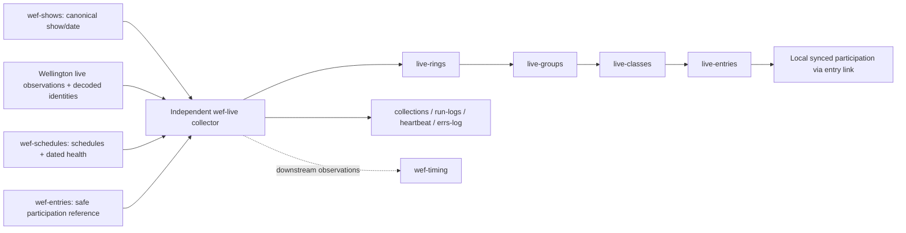

# wef-live workflow handoff

Prepared 24 October 2026. Operational evidence verified through the 13:12 ET scheduled run, completed 13:13:05 ET. This is a handoff document, not authorization for further changes.

Updated 24 October 2026 with entries/CWF acceptance through 13:15:18 ET and the agreed live-to-timing planning boundaries. This documentation update did not refresh live operational status or run any collectors.

## Status and responsibility

The independent TODAY-only live collector is deployed. The participation-link contract passed 40 offline tests, independent review, and two normal scheduled runs. Existing native links were preserved. No manual collector runs or record repairs were used.

Own only wef-live: live observations, local reference links, archives, collections and operational logs. Shows supplies canonical show/date authority; schedules supplies schedule identity and dated collection health; entries supplies tenant-selected participation identity and eligible schedule references. CWF remains tenant-owned. Do not edit those collectors or the shared decoding/source modules as part of live work.

Timing is a downstream consumer, not implemented here. It must distinguish current validated observations from retained historical data. Live does not infer timing predictions, official result readiness or participation group eligibility.

## Where it runs

- Checkout and deployed task directory: `C:\Users\gombc\OneDrive - Sport Dog Food\github\repos\ringstatus\wef-live`.
- Windows task: `wef-live-collector`, every five minutes, hidden WScript launcher -> `run-hidden.vbs` -> `run.ps1` -> `entry.js`. It is not a Codex heartbeat.
- Task inspection at handoff: Ready, last trigger 13:12:12 ET, last result 0, next trigger 13:17:11 ET. This is a dated observation, not a permanent status claim.
- Source checkout HEAD: `28ddf2815d487dbb28144dde34452fdcb38a72d3`. Deployed working files include changes beyond HEAD; use [deployment file hashes](evidence/participation-deployment.json), not HEAD alone, to identify this release. No commit was made for this work.
- Private environment file: `runtime/collector.env`. Never print or copy its credentials into a handoff.

**Documentation warning:** `README.md` contains superseded task-disabled, halt-file and original test-count statements. Current `entry.js` retains older halt receipts as history but does not use them to stop future scheduled execution. Use this handoff, current code and dated evidence below for present behavior.

## Airtable and ownership

| Base | ID | Use by live |
|---|---|---|
| wef-live | appgzosUcVqA4vZdf | Own destination |
| wef-shows | appCaSmL819KK7UFJ | Read canonical shows |
| wef-schedules | appUq5Qz9kARqFija | Read schedules and show-collection health |
| wef-entries | appSxF4pYMBaxpTZd | Receive restricted native entry sync |
| wef-tenant-cwf | appxKPBtdl2Rdq7CS | Protected; no live writes |

[Open wef-live](https://airtable.com/appgzosUcVqA4vZdf).

Owned tables: `live-rings`, `live-groups`, `live-classes`, `live-entries`, `collections`, `run-logs`, `heartbeat`, `errs-log`. Exact field definitions/native links are in `schema.js`; table and field IDs are in `evidence/schema-configured.json`.

Read-only native reference tables:

- `wef-schedules.schedules` (`tblGPXIUnD0sfTEIX`). Groups/classes link to local synced schedule records.
- `wef-entries.entries` (`tblfj77GmXxuiAoB4`). Live entries link through the native `entry` field to these local synced records.
- Entry source view: `wef-live-reference` (`viwRwdJi7CR0zBMEL`) in source entries table `tblqkWmrsYMs2hyQ6`.
- Explicit safe entry fields: entry-key, show-id, date, entry-id, class-id, horse-id, rider-id, status, schedule-key, schedule-keys, last-seen, observation-status. Source editing remains Off; sync is automatic. No private follows or collection provenance are exported.

## Collection and continuation

Read the canonical default show and selected date from shows; require fresh authority and a match to the current New York date before TODAY collection. An upcoming selected date is not live activity today. Do not replace this with independent show discovery.

`source.js` defines public ListAjax, LiveScoreWidget and getLiveClassData sources. Exact class/trip identities use `wef-schedules-decoded.gombcg.workers.dev/classes/...` through the existing shared `lib/wef-source-read` module. These are runner inputs, not permission for manual source calls.

Five-minute checks continue. If live status is false or all nonempty TODAY groups are completed, detailed collection is skipped and the skip is logged. Empty collections are valid outcomes, not failures by themselves.

Class/source identity errors retain affected observations and links, log the error and allow other classes to continue. An unresolved class is not current validated data merely because the overall run completed. Logging failures are isolated from collection, with local evidence where writable. Mandatory archive/data-integrity failures may still fail a run; subsequent scheduled invocation is not permanently halted by that receipt.

Prior-state/source archives are compressed, hashed and verified before relevant updates/retirement. Unresolved class/participation errors prevent retirement. Do not bypass archive-before-delete protection.

## Participation-link contract

- Stable participation identity: `show|date|entry|class`; preserve existing schedule stage-keys.
- Exact show/date/entry/class/horse/rider IDs must agree. No name-based matching or historical identity substitution.
- Require active participation, `observation-status=successful`, and source observation `last-seen` within 30 minutes.
- `schedule-keys` is sorted, unique JSON. Singleton scalar `schedule-key` must agree; multiple keys require blank scalar. Scalar fallback applies only when the plural field is absent, not when it is present but empty/malformed.
- Require complete fresh dated `show-collection` health, using completion time rather than schedule changed-at. Compare full active source/local stage-key sets for the date; listed keys must each resolve uniquely to active matching schedules. Dropped rows are historical, not eligible.
- Consume participation schedules through the existing synced entry reference. No redundant live-entry schedules link. Do not infer that every class group is eligible for every trip.
- `participation-link-status`: current, historical, unresolved or unmatched. A failed check preserves a previous native link as historical; a rejected candidate without a prior link is unresolved; out-of-tenant-scope unlinked observations are unmatched.
- Audit fields: `participation-link-reason`, `participation-checked-at`, `participation-verified-at`. A failed check does not erase the prior verified timestamp. Consumers must require current status and appropriate freshness, not timestamp presence alone.

Implementation: `participation.js`, integrated by `collector.js`; error delivery is in `entry.js`. Destination write restrictions/read targets are in `airtable.js`. Metadata setup is `configure.js`; do not rerun setup merely to inspect status.

## Verified scheduled evidence

| Run (24 October, ET) | Run ID | Participation result |
|---|---|---|
| 13:07:13-13:08:03 | d66f6c2e-6dd4-4ea8-b93d-ffb5699e840e | Both TODAY links current; six existing links preserved |
| 13:12:13-13:13:05 | 5257eecc-cbfe-4cb6-93bc-e37e3856b472 | Same result; verification timestamps refreshed |

Each run collected 5 rings, 26 groups, 59 classes and 287 live entries. Both had `ok=true`, no participation errors and no logging errors. Airtable run-logs/heartbeat recorded **Partial**, because the separate class identity error below remained. Do not describe overall collection as error-free.

- [Run 1 evidence](evidence/participation-run-1.json)
- [Run 2 evidence](evidence/participation-run-2.json)
- [Release explanation](evidence/participation-link-release.md)
- [Transition evidence](evidence/participation-transition.json): before the upstream fields populated, links became historical, errors reached errs-log and collection continued.
- [Saved automatic/read-only sync settings](evidence/participation-sync-settings.png)
- Prior continuation baseline: `evidence/logging-isolation-release.md`, `logging-isolation-run-1.json`, `logging-isolation-run-2.json`.

## Upstream entries/CWF verification

The entries/CWF owner's saved release records two successful ordinary scheduled pairs. These are separate upstream acceptance results, not additional live runs. All times below are America/New_York on 24 October 2026.

| Pair | Entries run | CWF consuming run | Verified result |
|---|---|---|---|
| 1 | 13:04:01-13:04:31 | 13:07:02-13:09:45 | 9 current, 1 historical; 9 local links verified; zero duplicate people fetches |
| 2 | 13:09:02-13:09:36 | 13:12:05-13:15:18 | Same identities, links and counts; zero duplicate people fetches |

Repeat comparison confirms stable record IDs, schedule/ring/helper links, statuses and active slices. Nicknames, notes, aliases and disabled flags were preserved; retired CWF entry records were unchanged. No private owner/source provenance was exported. Array/status fields arrived through automatic sync. Task definitions remained unchanged. No manual collector runs or record repairs were used.

Evidence owned by entries/CWF:

- [Release](../wef-entries/evidence/multiple-schedules-20261024/release.md)
- [Pair 1](../wef-entries/evidence/multiple-schedules-20261024/run-pair-1.json)
- [Pair 2](../wef-entries/evidence/multiple-schedules-20261024/run-pair-2.json)
- [Repeat comparison](../wef-entries/evidence/multiple-schedules-20261024/repeat-comparison.json)

This proves plural transport/consumer compatibility with the naturally available singleton records. It does not prove participation-specific multi-group eligibility. Both private follow lists remained empty; populated private-follow behavior is fixture-only.

## Agreed timing-input boundaries - accepted for plan

These boundaries describe existing supply and proposed normalization, not authorization to add fields or implement timing. [model.js](model.js) and [schema.js](schema.js) define current mappings.

| Classification | Supply and limits |
|---|---|
| Current ring fields | `current-group`, `next-group`, `completed-groups`: source-reported group links, not inferred actual start/end times. |
| Current group fields | `status`, `is-live`, `has-json`, `estimated-start-time`, `total`, `gone`, `jo-total`, `jo-gone`, `r2-total`, `r2-gone`. These preserve source status/counts and estimates. |
| Current class fields | `total` is live row count; `gone`, `jo-gone`, `r2-gone` count IDs in the respective source lists; `current-trip-id` is source-reported. Separate class JO/R2 totals are not currently exposed. Do not treat counts from different phases as interchangeable. |
| Current trip fields | Exact source identities and native links; `order-of-go`, `actual-order`, `scratch`, `gone`, `position`. Position maps `ActualPos`, falling back to `Pos`; this is not verified official placing. |
| Raw-only values | `source-json.identity.estimated_go_time`; raw live phase start/done values such as `r1_start`, `r1_done`, `jo_start`, `jo_done`; source score/time/place values. Retention does not validate their business semantics. |
| Proposed normalization | Expose `estimated_go_time` explicitly as a source estimate with raw value and provenance preserved. It is not a collector prediction or actual start. No normalized field name or schema change is approved here. |
| Unknown / unverified | Authoritative current source clock; actual group/class start and end anchors; complete phase timestamp/count semantics, including blanks/zeros; verified official-results readiness. |

Retained [class 200030399 payload](runtime/history/class-200030399/551d561fb987eee4c4f88673638121b9d59e8a056aa7423a6a9e474d2e7f2cb7.json.gz), referenced by the 13:07 live run, actually contains `estimated_go_time` values such as `09:03:00`, GMT-labelled `jo_start` values, blank phase start/done fields, and `curr_updated_at = "24oct2026 13:27:24"` without an explicit timezone. GMT-labelled values can be parsed, but their phase meaning, applicability and blank/zero semantics remain unvalidated. This archive does not establish a reliable current source clock, actual group/class anchors or official-results readiness. Do not convert time-only values into absolute timestamps by guessing a date or timezone.

Keep the three clocks distinct:

- Live `last-seen`: collector observation time. A recent observation is not proof the upstream content changed recently.
- `source-updated-at`: retained upstream update label, potentially old or lacking timezone semantics; not a current clock.
- Timing evaluation clock: owned by timing. Show `selected_date` selects scope; it does not replace that clock or independently mean TODAY.

For a Partial run, timing may consume only validated, fresh observations within the relevant show/date/class scope. Use per-class collection/error evidence; do not promote an unresolved class's retained data to current merely because another class succeeded. Participation-dependent calculations must require `participation-link-status=current`, appropriate freshness and the reason/checked-at/verified-at audit fields. The two live runs above establish actual current-link proof for the two TODAY records, not universal readiness for all classes.

Live supplies observations, raw evidence and validated identity links. Timing owns phase-consistent remaining counts, effective order, entries ahead, waits, pace, projections, countdowns, drift/conflicts, freshness/unavailable reasons, provenance and condition-transition events. Results owns official score/fault/time/placing, readiness, corrections and history. `Completed`, `gone`, raw scores or source `place` alone do not establish results readiness. Messaging owns recipients, consent, templates, delivery deduplication and outcomes. These downstream responsibilities are planning boundaries, not implementation acceptance or approval on those owners' behalf.

## Remaining issues and next-owner instructions

1. **Existing unresolved source identity:** class `200030429`, trip `200398240`, error `No decoded identity for trip 200398240`. Last verified in both runs above. Existing observations/links preserved; errs-log populated; other classes continue. No fix is authorized by this documentation request. Investigate retained evidence first if requested; never substitute historical decoded identity as current proof.
2. **Natural multi-group proof unavailable:** reader handles valid plural arrays and fixtures pass, but entries has no proven participation-specific multi-group source mapping. Producer currently uses unique singleton eligibility and rejects ambiguity. Do not claim natural multi-group acceptance or guess group membership.
3. **Next status check:** read task state, normal receipts, heartbeat/run-logs/errs-log and participation audit fields. Compare timestamps and local link IDs against the evidence above. No new implementation is required by this handoff.
4. **Downstream planning:** timing may consume validated observations; raw source timing values are not automatically normalized actual starts/ends or ready-to-use predictions. Further timing semantics require a separate source-backed agreement.

Normal receipts: `runtime/last-run.json` and `runtime/<run-id>.json`; source/prior-state archives: `runtime/history/`; local errors: `runtime/errs-log.jsonl`; launcher output: `runtime/collector-YYYY-MM-DD.log`.

Offline test command (does not run the collector): `node --test wef-live/test/collector.test.js wef-live/test/entry.test.js wef-live/test/participation.test.js` from repository root. Forty tests passed for this release; do not treat tests as a replacement for required scheduled proof.

**Operating boundaries:** Codex is not the runner. Never invoke `entry.js`, `run.ps1`, a task trigger or alternative production endpoints to obtain proof. No record repairs. A failed verification does not authorize another patch; obtain fresh edit authorization for corrections. Preserve unrelated working-tree changes and other collectors. A handoff file or thread link does not itself transfer credentials or authorize messaging another chat.
