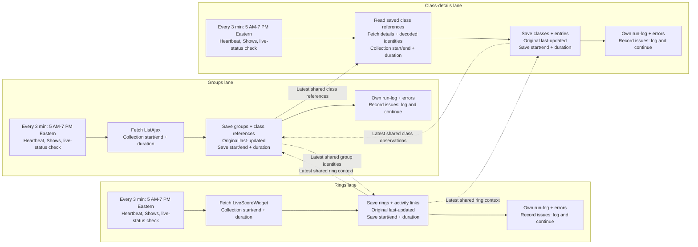

# wef-live

Documentation version: **2026.11.01.4**  
Updated: **November 1, 2026**. Documentation only; not a runtime release.

## Current release - November 1, 2026, 09:54 Eastern

Three-lane collection is deployed through the existing hidden task, every three minutes from 05:00 to 19:00 America/New_York. Owner explicitly permits errs-log-only failures for now; immediate Records-chat delivery remains deferred. Stages 8 (cross-base publication) and 9 (retirement/cleanup, including log cleanup) are ON HOLD and are not invoked by the new entry path. No prior stop/evidence file was cleared; no records were repaired or removed. Older publication/retirement sections below are historical and do not authorize resuming those paths.

Two populated normal invocations at **09:51 and 09:54 Eastern** completed all three lanes without stage or logging failures. Latest coverage: 25 groups, 5 rings, 41 class records and 145 entries. Six unresolved trip identities are recorded individually in errs-log; valid records continue. Source identity completeness is therefore Partial, not a claim those six identities were resolved. Normal source collection/save times at 09:54: Groups 0.65s/2.36s, Rings 0.12s/0.80s, Class details 3.68s/3.70s; core lane totals 3.27-11.14s. These totals end before final log writes; Windows task completion/result separately confirms the full invocation finished before the next trigger.

Changed-only repeat proof: 22 group records, 3 ring records and 165 class/entry records were successfully recollected without business writes; last-success coverage advanced and last-changed was preserved. All changed-field reports remain in run-logs and the lane receipt. Heartbeat/run-logs and six individual errs-log rows were read back for both populated invocations. Exact IDs, scopes, receipt hashes and limits: [normal-run acceptance](evidence/three-lanes-20261101/normal-run-acceptance.json); [release](evidence/three-lanes-20261101/release.md). No manual runs, source calls, forced failure, observers or record repairs. Rollback was not needed; saved baseline and rollback script remain available. Natural whole-stage failure and future day rollover under this release were not forced or claimed verified.

## Deployed three-lane collection - November 1, 2026, 09:45 Eastern

Owner approved errs-log-only stage failures temporarily while immediate Records-chat delivery remains deferred. The prepared four-file delta is installed in the existing hidden task route; 21 installed file hashes match the candidate/protected baseline. The task now has a daily local-time 05:00 start, three-minute repetition and 14-hour window; the action/account remain unchanged. Stages 8 and 9 (publication and cleanup) are excluded from this new execution path. Prior stop/evidence files and all existing records/links remain untouched. 18 offline checks pass. Normal scheduled-run verification is in progress; no manual invocation or record repair. [Release and deployment evidence](evidence/three-lanes-20261101/release.md).

## November 1 implementation preparation

Historical preparation checkpoint before the 09:45 deployment: the candidate was prepared separately and 18 targeted offline checks passed. The production baseline was preserved until the owner approved temporary errs-log-only alerts. [Prepared release, exact blocker and rollback](evidence/three-lanes-20261101/release.md), [author review](evidence/three-lanes-20261101/review.md), [actual offline output](evidence/three-lanes-20261101/offline-tests.json).

Immediate failure alerts to the Records chat have no installed runner delivery route. This requirement is not satisfied by local logs or an injected test callback. This hold was superseded by the explicit owner decision above. Current production still follows its prior path, including publication/retention behavior; stages 8 and 9 are held in the candidate, not retroactively disabled in production. No manual runs, record repairs, source calls or stop clears were performed.

## Current Live design: three independent lanes

Documentation version: **2026.11.01.4**. Updated **November 1, 2026**.

Owner-directed design only; not deployed. No code, Airtable, task, cadence or deployment changes are authorized by this documentation update. This section supersedes conflicting older Live design statements below; their implementation evidence remains historical.

**Mission:** collect and save Live source data as quickly as possible. Three separate lanes run every three minutes between **5 AM and 7 PM Eastern (America/New_York)**. Each stamps its own heartbeat, checks live status and reads canonical show/day context from wef-shows. False live status is logged as a skip. Use wef-shows show-day priority for past/current/upcoming context, rather than adding a historical marker. Planning-day advance alone does not establish tomorrow's live activity.

| Lane | Source and shared reads | Own writes in wef-live |
| --- | --- | --- |
| Groups | ListAjax; latest shared ring/class context | Groups, statuses, counts and class references |
| Rings | LiveScoreWidget; latest shared group identities | Rings and current/next/completed group links |
| Class details | Latest saved class references; getLiveClassData and existing decoded class Worker; shared ring context | Classes and entries, including decoded identities |

**Sharing:** use the latest successfully collected saved data for the matching show/day and supported identity, based on its original **last-updated** timestamp. Reading or sharing does not renew that timestamp. Each lane writes its own fields, preserves existing links and finishes independently. Missing shared data is logged; collection continues without waiting for another lane. Class details uses the latest saved class list. No new age cutoff, guessed link, timestamp renewal or cross-lane completion gate is agreed here. Exact physical timestamp/field mapping remains implementation work, not schema approval.

**Completed groups:** save final source Completed statuses before skipping further detail; the existing early exit does not yet do this.

**Collection success, changes and field diffs - all three lanes:**

| Lane | Compare the lane-owned collected values |
| --- | --- |
| Groups | Group status, counts, sequence, class references and other collected group values |
| Rings | Ring values and current/next/completed group identities |
| Class details | Class observations and entry identities, order, scratch, gone, position and other collected detail values |

- **Last successful collection:** the original time a valid collection succeeded, even when no business values changed. This is collection evidence, not a business-change timestamp. A failed attempt does not advance it. Preserve which records were successfully covered; a successful response does not prove every record was valid.
- **Last changed:** advances only when the lane's collected business values differ from the previously saved values. An unchanged successful collection leaves it unchanged.
- **Field diffs - complete business-field coverage:** report diffs for ALL collected business fields owned by each lane, not a selected subset. Exclude timestamps and logging metadata from diff reporting and change detection. Identify the lane, run, stable record identity, field, previous value and new value. Preserve types and changes to/from zero or false. Missing/failed/unresolved input is not an instruction to clear an existing value. A newly discovered record is an initial creation, not a fabricated previous value.
- **Only save changed values:** compare with the saved record and write only changed lane-owned business fields. Create new valid records as needed. If unchanged, make no business-record update solely to refresh a timestamp; keep successful collection/coverage evidence in the lane's existing run logging. Last-changed metadata travels with an actual change. Collection-success evidence remains available without rewriting unchanged rows.
- **Compare business values, not bookkeeping:** collection timestamps, run IDs, publication metadata and changing response tokens do not themselves constitute a business diff. Shared reads do not become fresh source collections or create changes. Preserve source evidence and original clocks; no new archive/cleanup policy is agreed here.
- **Shared freshness:** use the original last successful collection evidence for the matching lane/show/day/identity when deciding which shared observation is latest. Last changed describes when values changed, not whether unchanged data was recently recollected. A read does not advance either clock.

These are logical meanings, not approval to add/rename physical fields or a new diff table. Existing Data `last-success` and Live `last-seen` must not be assumed interchangeable; physical mapping and coverage storage remain implementation details to settle within a separately approved change. Requirements only; no changed-only writer or new instrumentation is claimed deployed.

**Separate measurements per lane:** collection start/end and elapsed time (first source request to last response); save start/end and elapsed time (first Airtable write to last confirmed write); total invocation-to-completion time; source-response-to-corresponding-save delay. Logs identify lane/run and counts. These are required measurements for evaluating the three-minute cadence, not currently verified instrumentation.

**Checks and errors:** individual check/record issues go to the error log and do not fail the stage or stop other records/classes/lanes. Preserve unresolved evidence and existing links. Actual stage failures are logged and immediately alerted to **wef-records-coordinator**; independent work continues. Automatic coordinator alert delivery is not currently installed. The existing physical error table is errs-log; no rename or additional log tables are authorized. Each lane has separate heartbeat, run-log and error attribution.

**Stage 8 - cross-base updates: ON HOLD.** Destination, fields and method remain unfinalized. Must not delay or block revised collection.

**Stage 9 - archiving/removal: ON HOLD.** Cutoff, timing and removal rules remain unfinalized. Must not delay or block revised collection. Log cleanup rules also remain pending within log handling, not a duplicate stage.

These design holds do not disable the existing publisher/archiver or clear the retained log-retention stop. Existing failed-path boundaries remain. No implementation changes have been made.

Dotted arrows are saved-data reads, not run dependencies. No common completion node. Stages 8 and 9 are intentionally outside the collection lanes.

## Earlier implementation and historical decisions

### October 31 implementation checkpoint

Live independently collects calendar TODAY's rings, groups, classes and entries using canonical Shows identity and existing Schedules references. Entries reads Live; Live has no reverse Entries or CWF dependency. The established scheduled task checks every three minutes.

Source calls, in order:

| Purpose | Endpoint | When called |
|---|---|---|
| Activity gate | `https://sglapi.wellingtoninternational.com/homepage/getLiveClassStatus?customer_id={customer-id}&datetimestamp={timestamp}` | Once per eligible run |
| Groups | `https://sgl.wellingtoninternational.com/iphonev2/index.php/esp/liveclassv2/ListAjax?from_wp_api=true` | If activity is true |
| Ring activity | `https://sgl.wellingtoninternational.com/iphone.php/esp/webservice/LiveScoreWidget` | If TODAY's returned groups are not all completed |
| Class detail | `https://sgl.wellingtoninternational.com/iphonev2/index.php/esp/liveclassv2/getLiveClassData?show_id={show-id}&cid={class-id}&t={timestamp}` | Per selected class during detailed collection |
| Decoded identities | `https://wef-schedules-decoded.gombcg.workers.dev/classes/{class-id}?show_id={show-id}&customer_id={customer-id}&cgid=-1` | Per selected class during detailed collection |

The first four use direct source URLs; decoded identities use the existing Worker. The source reader permits one bounded retry for specified transient failures within the scheduled run.

Live publishes approved observations to existing Schedules/Data records through `live-observation-json`, preserving acquisition fields and native links. Verified zero/false values are retained. The overlap includes ring group context, group status/counts/start estimates, class counts/current trip and trip identity/order/scratch/gone/position. Class and group counts have different scopes; observed position is not verified official results. Actual start/finish and `results_verified` have no published Live equivalent. Complete destination coverage and downstream effective-value selection are not established merely by this mapping.

Latest inspected normal receipt: `runtime/d47ae184-519e-4f23-b386-6fca2021c583.json`, completed **October 31 at 20:45:53 Eastern**, `ok=true`: **5 rings, 30 groups, 59 classes, 245 entries**. Collection date remained October 31 while Shows selected planning date was November 1. Data publication correctly reported **Skipped**, zero writes, because October 31 was no longer canonical `day-priority=0`. Shows' saved priority checkpoint confirms the November 1 anchor at October 31 19:04:07 Eastern. Planning-day advance does not authorize tomorrow's Live collection before calendar rollover.

Outstanding limits: populated publication previously remained Partial because of lane budgets and identity/matching issues; no full-overlap acceptance is claimed. The latest receipt still reports **24-hour log retention Blocked** by the prior timeout stop. Unresolved classes can also withhold old business-record retirement. Same-date old-show cleanup and multi-group natural proof remain separate acceptance gaps. No stop was cleared and no manual collection or repair was performed for this documentation update.

Logs retain separate purposes: `heartbeat` records invocation cadence/outcome; `run-logs` records collection/publication/archive results; `errs-log` records individual errors; `collections` catalogs collected datasets and immutable archive evidence. Archive catalogs and archive-before-delete protections remain required. Existing business observers remain removed.

The dated sections below retain historical evidence. This checkpoint supersedes older statements that populated activity has not occurred or that log retention is currently healthy.

## Day-priority and overlap validation — October 31, 2026

Data publication requires the exact canonical `show-days.day-priority = 0` before inventory and dispatch; Live collection remains TODAY. Existing approved `live-observation-json` mapping preserves verified zero/false and leaves Data acquisition fields/native links intact as fallback. No runtime replacement was needed: installed guard reviewed, 43 targeted publication checks passed. Two existing normal runs at 07:56 and 08:02 Eastern verified 57 Data overlay writes with links/logs preserved. Operational result remains Partial due publication budget/identity issues and the separate blocked log-retention stop; no repairs or stops cleared. External consumer effective selection is not proved by overlay writes. [Exact evidence and limits](evidence/day-priority-precedence-20261031/release.md).

## Shows calendar policy companion - deployed October 30, 2026

Shows now selects tomorrow at 19:00 Eastern within show dates and checks new shows Sunday 22:00, then every three hours until changed. Readers validate authority_checked_at with their original 30-minute/future-clock tolerances; last_checked remains the original source timestamp and must be valid/non-future. Legacy rows retain the prior fallback until normal publication. All unrelated source/count freshness checks remain. Live and Timing use TODAY independently while preserving the canonical Data fence and original retirement guards. [Release and normal-run evidence](../wef-shows/evidence/calendar-discovery-20261030/README.md).

## Canonical Shows authority - approved October 30 discovery windows

The approved companion check now follows Shows' daily 16:00-20:00 America/New_York discovery window. A successful check from the closing 30 minutes remains valid until the next daily 16:30 deadline; other checks retain the existing 30-minute allowance. Original source timestamps, exact show identity/links and all non-authority freshness limits remain unchanged. This does not restart a stopped workflow, retire a source, or change any task cadence. [Shows release and normal-run acceptance](../wef-shows/evidence/discovery-windows-20261030/README.md).

## Current Live status — 30 October 2026, 13:03 Eastern

Latest read-only check: October30 at13:35Eastern. All19 deployed/protected runtime hashes still match. Eleven postdeployment receipts contain no populated activity. Latest completed run4bfd1122-90b5-47a0-90bf-cdf822a84379 (13:32:13–13:32:29Eastern) is ok=true, all-today-groups-completed, with zero collection/logging errors. Two naturally populated runs remain the only acceptance blocker; no code/retention/workflow edits or new approval needed for the already-deployed corrections.

The approved journal/count, cursor and exact-group corrections are implemented, reviewed and deployed. [Release and task evidence](evidence/publication-continuation-20261030/release.md), [independent review](evidence/publication-continuation-20261030/review.md), [deployed hash](evidence/publication-continuation-20261030/deployed.json), [first normal receipt](evidence/publication-continuation-20261030/first-normal-skip.json).112 offline tests pass; independent review includes real-journal restart/failure and deadline cases. Only publication.js changed;18 other runtime files are preserved.

- **Completed:** journal-save failures are logged with accurate remaining counts; unsafe writes without durable intent are deferred, not dispatched. Other safe records/lanes, collection and future invocations continue. Pending intents survive failures and reconcile before retry. Outcome/log failures do not create a global halt. No immediate retry loops.
- **Completed:** first budget-deferred item remains the next cursor; attempted writes including uncertain responses respect the unchanged cap. Exact known show/date/ring/group/native links are filtered before uniqueness, resolving the six false ambiguities. Actual multi-group or duplicate exact matches remain logged and withheld. No new matching rules, fallbacks, fields or budget/freshness relaxation.
- **Normal execution verified:** run6a729be2-fbb4-481b-803b-b6a70f197e6b at13:02Eastern completed safely,0 publication writes,0 errors, retention Success. All18 source groups were completed; both publication lanes correctly Skipped.
- **Only remaining acceptance blocker:** no current populated activity. Two populated postdeployment runs plus ring6 and the six exact class-occurrence writes cannot be proved from skipped runs. Existing collector checks continue every3minutes; inspect saved evidence within authorized work/on request. No manual source runs, repairs, forced joins or observers. Offline injected failures are not claimed as production events.
- **Preserved:** prior24-hour log-retention acceptance, archive catalogs and links, source authority, independent lanes, Entries linking-only, existing Monday review. All business observers remain removed. Scope/code may be locked to this reviewed release; populated operational acceptance remains pending without adding new work.

Earlier checkpoints below are historical where superseded. The prior failed-gate approval request was superseded by the owner's explicit direction to correct these paths.

## Current publication blocker — 30 October 2026, 12:45 Eastern

Publication is not complete. The has_JSON and concurrent-acquisition corrections now have normal-run proof. Deferred counts still underreport when journal-save EPERM escapes the item loop. One eligible Data ring remains70m16s behind its fresh source because an unprocessed budget-boundary item advances the cursor. Six occurrence errors are false ambiguities: each has one exact source-group match; class200030671 remains genuinely multi-group. Prior missing trip200399568 is resolved. See [exact evidence and smallest corrections](evidence/publication-fixes-20261030/current-blocker-20261030.md). This failed verification gate permits no further code patch/retry without separate approval. No observers or workflow changes.

## Current release and scope-lock status — 30 October 2026

Owner approved exactly three publication corrections in Records. They are implemented, independently reviewed, offline-tested (99 PASS) and deployed at 11:42:28 Eastern. [Release/task evidence](evidence/publication-fixes-20261030/release.md), [review](evidence/publication-fixes-20261030/review.md), [exact runtime hashes](evidence/publication-fixes-20261030/deployed.json), [two-run acceptance summary](evidence/publication-fixes-20261030/acceptance-summary.json). Only publication.js and the collector summary changed;17 other Live runtime JS files remain at the protected baseline, including retention and class-error/audit behavior.

- **Completed corrections:** actual has_JSON spelling with true/false/missing preserved; accurate deferred and separate uncertain counts with readback-before-retry; stable identity/matching/link/overlay validation that permits unrelated acquisition metadata updates. Full row audits, one-field external PATCH, original freshness and budgets remain intact.
- **Verified normal runs:** 3d7a24cd-ed6d-4c5f-b0ba-e1ec503c0dbe at11:44 and c8d1fe08-1c80-4097-a1f5-79120c1d258b at11:47 Eastern each collected196 entries. Schedules35+35 writes; Data37+38;145 archived/current readbacks preserve identity/native links and original freshness. Data deferred230 in each; uncertain1 then0 with NotApplied reconciliation before continuation. Both business outcomes remain Partial, not full coverage.
- **Pending acceptance:** natural has_JSON publication into a Data group and positive concurrent-metadata exercise were not encountered in this two-run pair; both behaviors have independent offline regression proof. Full timely publication remains unproved due existing budgets/withheld matches. Same-date rollover and multi-group natural proof remain separate. Inspect saved evidence during authorized work/on request; no forced runs or guessed joins.
- **Complete and protected:** completed-log24-hour retention accepted separately on b7a9e822-461a-42e2-bf25-dd601a268b1e and853114e5-fe5b-4c97-8999-ba0133a0a38c (1,424 archived/deleted, seven show catalogs and protected baseline retained). This is not publication proof.
- **Continuing scope:** independent TODAY Live observations using canonical Shows and current Schedules references; Live tables plus approved single-field Schedules/Data overlays. No reverse Entries dependency or acquisition ownership transfer. Existing three-minute collector, recurring archives, logs and Monday review continue.
- **Removed:** all business observers; do not recreate/replace hourly verify-live-natural-same-date-rollover, daily watch-wef-default-show-changes or wef-running-lanes-october-15-observation. Records context bookkeeping is separate. No task/cadence changes or record repairs.
- **Lock readiness / next action:** reviewed scope/code baseline can be locked with pending acceptance explicitly recorded; full operational lock/acceptance cannot yet be claimed. A scope/code lock never disables collectors or independently approved work. No new corrections are authorized by verification; actual new failed gates retain the owner approval boundary. Existing Airtable review record is dated pre-fix evidence owned administratively by Records; this release receipt is local and no tracker was created.

Earlier status below is historical wherever superseded by this checkpoint.

## Approved 24-hour log retention — 30 October 2026

Owner approved recurring archival/removal of completed heartbeat, run-logs and errs-log records older than24hours. This narrow release does not fix publication defects or change cadence/source collection. Existing normal entry workflow calls retention only after collection ok=true (Partial class/publication outcomes can still be ok=true); failed collection skips it. No manual runs/record repairs.

Retention accepts terminal Success/Skipped/Partial/Failed completion older than24hours; active/incomplete/current invocation and non-run control rows are preserved. Error rows additionally require older completed parent evidence from existing run-logs or saved local receipts. At most250 rows per table per invocation, with four-minute request deadline and a60-second reserve before starting another table; initial backlog drains across normal runs.

Exact immutable gzip batches are verified before deletion. Three fixed collections rows (`log-archive|heartbeat`, `log-archive|run-logs`, `log-archive|errs-log`, source-kind log-archive-catalog) point to immutable chained manifests, retaining previous references/hashes and full original row IDs/fields. Existing seven show archive catalogs and business collections are untouched. Manifest row-count counts archived records. No local archive TTL/purge is introduced.

Every deletion batch rereads unchanged eligible rows, validates exact DELETE acknowledgements and verifies absence. Durable runtime/log-retention-stop.json is created before work, removed only on successful completion or safe deferral before a new table, and retained on failure/interruption. That marker blocks retention without stopping independent collection; no automatic retry/repair of uncertain deletion. Failure requires owner review/approval. Current run logs/heartbeat summarize retention and retain archive descriptions. Local receipts/logs and publication journals/control state are never deleted.

Evidence: evidence/log-retention-20261030/{baseline.json,review.md,tests.txt,deployed.json}.91offline tests passed; independent11retention tests passed. Normal-run acceptance BLOCKED: first postdeployment10:41run failed with source ListAjax HTTP504; retention correctly skipped, no log deletion. Two successful normal retention runs remain unverified (evidence/log-retention-20261030/release.md). Existing3P2publication findings and populatedPartial acceptance remain separate.

# Live operating reference — 30 October 2026

This is the current module orientation; dated sections below are historical evidence, not competing authorization. Actual workspace: `C:/Users/gombc/OneDrive - Sport Dog Food/github/repos/ringstatus/wef-live`. No separate private coordinator workspace was identified or configured for this task. [Local instructions](AGENTS.md) load the physically available [canonical owner instruction block](../docs/coordination/wef-owner-operating-instructions.md), actually read in this checkout.

## Responsibility and source authority

Owner approves; Records coordinates. Canonical Shows → independent Data acquisition → separate Season retention. LOCAL Season coordinator retains both distinct Data/Season responsibilities; the temporary Data fork was reversed. Live independently collects TODAY observations, validates source identity and publishes only `live-observation-json` to approved existing destinations. Entries is linking-only, not a Live input, enrichment assignment or readiness gate. Schedules still runs independently; Data-only switching/retirement is preparation only. Retained rows, successful invocations and group completion are not universal proof of current membership, completeness or whole-class completion.

## Exact owned base and tables

Base **wef-live / appgzosUcVqA4vZdf**. IDs below are saved configured schema plus Records' verified review-table handoff; no new schema inspection or changes are implied.

| Table | ID | Responsibility |
|---|---|---|
| live-rings | tblw8bodkRbCItxIH | Dated observed ring state |
| live-groups | tblMhQtjpvyODEUSn | Dated group state/counts |
| live-classes | tblNaM9ehOJFsrveV | Validated class progress |
| live-entries | tblf7550e7UGT8ZSF | Observed trips and decoded identities |
| collections | tble6fwMDBbeeGxly | Source datasets and permanent archive catalog |
| heartbeat | tbl1K0KT8A2kZEJgS | Invocation/completion stamps |
| run-logs | tblwne646pQi5KlXA | Run outcome/counts/archive evidence |
| errs-log | tblMzOaTvWus2pM4I | Separate error rows |
| code-reviews | tbl1jEtJusopJGC6O | Administrative review evidence; Records writes for this request |

Existing reference tables are not owned acquisition: `wef-schedules.schedules` / tblGPXIUnD0sfTEIX is actively read for group/class schedule links; `wef-entries.entries` / tblfj77GmXxuiAoB4 is retained for historical links, with runtime reads forbidden. Saved schema also includes meta / tblwBvigcmqRlSYUb; it is not a collection authority or active runtime table.

## Interfaces and boundaries

- Upstream authority: Shows appCaSmL819KK7UFJ / shows supplies canonical show/date with its existing freshness guard. Calendar equality prevents collecting an upcoming date as TODAY; it does not select the show.
- Sources: public ListAjax, LiveScoreWidget, getLiveClassData and live-status; decoded class identities through existing wef-schedules-decoded Worker. Keep that service despite its name. Shared bounded source reader is `../lib/wef-source-read.js`.
- Current Schedules base appUq5Qz9kARqFija: active local schedule sync, plus publication to rings tbliUwvXYdMhvJ3Fm and schedules tblqiTFqqO3zk2KJC.
- Data base appdl16HJ5ETm8N69: publication to rings tblhKkfYXppW3TbTq, groups tblQObOvktufkyq54, classes tbl0IFf067w4wUBj5, schedules tbl6KKlYuMIPHEJWe, trips tblt0GvQ39bHIu930.
- Only the additive JSON overlay may be patched externally; no acquisition fields, native links, create/delete, names-based joins or ownership transfer. Downstream timing/outputs must consume original observation timestamps/provenance; Live does not promise whole-class completion or forecasts.

## Actual cadence, archives and semantics

Registered Windows task `wef-live-collector`, inspected 30 October: repetition PT3M, no duration/end boundary configured. Action: wscript.exe //B //Nologo → this module's run-hidden.vbs → run.ps1 → entry.js. This task runs the business process; Codex messages/reviews are separate and may wake this chat. There is no overnight task stop. Do not manually invoke it.

Every normal invocation stamps/logs and reads canonical scope. For an active TODAY date, live-status false or a nonempty all-completed group list skips detailed collection; the three-minute checks continue. Explicit empty activity succeeds without clearing current observations or renewing publication. Missing/invalid/failed responses are not verified empty. Class identity errors preserve prior observations/links and allow other classes; publication errors remain separate per lane and do not invalidate successful collection. Task exit 0 can accompany Partial business results.

Source and class snapshots are content-hashed gzip archives under runtime/history, created/reused during normal collection. Publication source/intent/before-after is durable before PATCH; outcome/readback follows; unknown writes retain journal state for later scheduled reconciliation. There is no separate timed archival job or inferred retention TTL.

Recurring old-data retirement is evaluated after successful valid collection including empty/skipped results, provided no unresolved classes. Failed collection or unresolved class input does not authorize retirement. Publication-only errors do not cancel otherwise eligible retirement. Exact old owned rows are archived and catalog-verified before child-first deletion; current/future protection remains. Permanent catalog rows remain in collections. Seven catalogs/550 historical records were verified in prior retirement proof; see evidence/retirement-20261029/release.md. This dated evidence is not a fresh audit claim.

Publication freshness: original validated observation ≤6 minutes, ≤1 minute future tolerance, same TODAY scope. New actual observations may advance time; replay cannot. Successful class detail is required for class counters; discovery refresh is insufficient. Missing phase counts remain distinct from zero. Ambiguous groups/occurrences and contradictory identities are withheld. No synthetic end time or weaker freshness is permitted.

## Deployment, review and next action

Current deployment includes the October 30 log-retention release, which supersedes entry.js and airtable.js from publication-v1-20261029 and adds log-retention.js. Exact hashes and independent review are in evidence/log-retention-20261030; unchanged publication behavior retains its October 29 evidence. Existing guarded deployment uses this checkout between registered invocations with no collector lock and adequate time before the next trigger, only with applicable approval. No task changes or manual proof.

Recurring log retention archives completed heartbeat, run-logs and errs-log records strictly older than 24 hours after successful collection. It preserves active/incomplete/control rows, existing archive catalogs and links; errors need completed parent evidence. Verified immutable batches and chained catalog manifests precede deletion, with fresh eligibility checks and absence readback. Work is bounded to 250 records per table per invocation and a four-minute request deadline. A durable failure marker stops retention, not independent collection. Local archive files have no purge policy.

Retention acceptance remains BLOCKED: the first postdeployment scheduled run b09174d2-e4a0-49db-9798-c089cf45a1c6 at 10:41 Eastern on October 30 failed with ListAjax HTTP 504 and correctly skipped retention. No two successful scheduled retention runs are claimed. The 91 passing offline tests do not replace that proof. Preserve this stopped verification path; do not retry collectors, repair state or fix the source under documentation authorization. See evidence/log-retention-20261030/release.md.

Code review: [report](evidence/code-review-20261030/review.md), [hash manifest](evidence/code-review-20261030/manifest.json). Three confirmed P2 findings remain: has_JSON casing; early abort deferred-count underreport; unrelated acquisition changes interrupting publication. 80 offline tests PASS; populated operational acceptance PARTIAL, with budget/matching/source-identity limits. No fix authorization. Exact populated audit report: evidence/publication-v1-20261029/populated-verification-20261030.json.

Airtable review: appgzosUcVqA4vZdf / tbl1jEtJusopJGC6O / rec5fLj3xEqkYBpxA; Records reported exact GET readback PASS. Review FAIL3P2 is separate from tests PASS and populated PARTIAL.

Periodic review: Records confirmed ACTIVE configuration and readback on October 30 for automation `wef-live-monday-code-review`, targeting this chat `01a16902-240a-7280-8661-90b0d8d7325a`, Mondays at 10:00 America/New_York, first November 2, 2026, with a 20-minute bound. Routine record `recYUERW7D8RF2OXS` in `appgzosUcVqA4vZdf/tbl1jEtJusopJGC6O` remains Pending first review; configuration verification is not execution proof. Prior release review `rec5fLj3xEqkYBpxA` remains separate. Records owns scheduling; do not create another automation. Reviews are best effort host/app dependent and do not trigger collectors. Review material changes before deployment and failures when observed; reuse unchanged review evidence appropriately, not once per collector invocation.

## Instructions, skills and continuity

Actually READ in full October 30: canonical owner block; common review standard; installed Operating Skills **0.2.0** instruction-loader, context-compact, code-review, rebalancer at `C:/Users/gombc/.codex/plugins/cache/created-by-me-remote/ringstatus-operating-skills/0.2.0/skills/<name>/SKILL.md`. Also read legacy aliases under C:/Users/gombc/.agents/skills (loader/rebalance/code-review) and C:/Users/gombc/.codex/skills/context-compact. Packaged rebalancer is the canonical $rebalance name adaptation. rs-skills verification of all30files/remote agreement was relayed by Records; no install/update performed here. Handoff skill is discoverable but not claimed READ in this documentation step.

APPLIED: instruction loading, current-scope rebalance, review procedure and continuity preservation. VERIFIED: documentation readback, actual registered three-minute task route, prior deployment hashes/tests/review evidence. Reading context-compact is not a claim of actual compaction, transcript archival or measured context utilization.

Resume checkpoint: read AGENTS.md, this current reference, scope/HANDOFF and exact review/manifest evidence; retain approvals/stops and pending next action. Follow ../docs/coordination/context-check-procedure.md at task boundaries/30 minutes. Current task is documentation/review coordination only. Next review is the configured November 2 routine; do not run it early or claim completion before actual review evidence. Corrective runtime work requires separately scoped owner approval. Do not reopen Data-only migration or retirement.

Continuity preparation threshold is the owner's 65%, as relayed by Timing, overriding the skill's generic 70% default. Use actual session telemetry; unavailable measurements remain unknown. This does not authorize extra monitors or resume any stopped workflow. On October 30 the existing review TOML and registered PT3M task were read back directly; no duplicate automation was created.

---

## Historical release and workflow notes (superseded where conflicting)

## Code-review procedure — 30 October 2026

Review material Live changes before deployment and review observed behavior/verification failures against the exact deployed baseline. Use the explicitly requested code-review skill at C:/Users/gombc/.agents/skills/code-review/SKILL.md. Record release/hash manifest, reviewer/date/scope, actionable severity/file/symbol/trigger/consequence/smallest correction, tests actually inspected/run, scheduled evidence separately, gate-specific PASS/FAIL/PARTIAL/BLOCKED and exact next authorized action. Offline PASS never establishes scheduled acceptance.

Do not rerun an unchanged release review on every invocation or create review timers/monitors. Reviews authorize no fixes, deployment, schema/business-data/task/cadence/source requests, manual collection or repairs. Applicable explicit approval is required for corrective work. Preserve module ownership and existing failure boundaries. For the October 30 review request, Records alone owns Airtable review schema/record writes and readback; Live supplies its report for base appgzosUcVqA4vZdf. This procedure does not reopen migration, retirement or ownership.

## Approved Live publication v1 — 29 October 2026 (scope v1.7)

Live independently collects TODAY observations. Entries is linking-only and is neither read nor written by Live; CWF has no role. Shows remains canonical show/day authority. Source collection, schedule links, logs, three-minute cadence and recurring verified archive-before-delete retirement are preserved.

The narrow approved exception lets Live GET existing destinations and PATCH only `live-observation-json` on Schedules rings/schedules and Data rings/groups/classes/schedules/trips. Seven multiline fields were created and read back. Live owns this overlay, exact matching and its durable audit. Schedules and Data retain their independent collection, fields, keys, records, native links and lifecycle. No sibling runtime, sync, task or record repairs are included.

Only validated observations within six minutes of their original receipt (one minute future tolerance) may publish. Empty/missing/stale detail does not clear or renew overlays. Class counters require successful class detail; ambiguous multi-group occurrences are withheld. Trips require exact dated identity and supported source provenance. Lanes run independently with bounded requests; uncertain writes retain durable intent and require readback on a later normal invocation. Source/retirement safety stops remain unchanged.

Publication audit files retain full source evidence, destination before/proposed-after, intent, outcome and readback. Existing logs also report lane results and separate publication errors. Original acquisition fields and links are never publication writes. Entries has no new enrichment assignment.

Deployment and review evidence: `evidence/publication-v1-20261029/deployed.json`, `review.md`, `tests.txt` (80 passing offline tests). Two NEW normal runs at 20:29 and 20:32 Eastern passed with empty activity, both lanes Skipped, matching logs and no errors. All baseline destination IDs/keys/native links and seven archive catalogs/hashes are preserved; only Data-owned last-success timestamps advanced. Acceptance remains PARTIAL: two naturally populated runs with PATCH/readback and repeat behavior are still required. Old v1.6 runs do not count. No manual runs or seeded proof.

Earlier locks and descriptions below remain historical except for this explicitly approved publication addition.

## LOCKED - wef-live approved scope v1.6 - 29 October 2026

Owner directs this module to remain locked to its latest approved implementation. This scope lock does not stop the three-minute collector. Preserve independent TODAY source collection and identity validation, Shows/Schedules reference reads, logging, existing links/timestamps, verified recurring archive/catalog retirement and current/future protections.

CURRENT dependency correction: Live does not read, qualify or wait for Entries. Its v1.6 reverse-read removal was separately approved, deployed19:33:37Eastern and verified by normal19:35/19:38runs (evidence/no-entries-read-20261029/release.md). Entries' separately approved linking-only restoration also removed its added Live reader and enrichment. Therefore neither current collector reads the other. Keep existing sync tables/native links/historical evidence intact; their presence does not create an active dependency. No Live preparation, enrichment reader, comparison work or new cross-module contract is pending.

Both v1.6 normal Live runs were empty activity; populated link preservation is offline-tested, not naturally proved. Preserve this limit; do not reopen work or manufacture activity to fill it. Separately approved v1.4 recurring retirement remains: verified archives/catalogs before eligible removal on successful valid empty/skipped runs; failed/partial/unresolved inputs do not authorize cleanup; current/future protected.

Reopen only for a verified defect or explicitly approved requirement. Defect investigation does not itself authorize fixes/deployment/task/schema/sync changes or record repairs. Consumer owners own their future reads; no future Entries input is implicitly assigned here. Older v1.5/Entries-read wording below is historical, superseded and not an active assignment. No runtime changes are made by this documentation lock.

## Reverse dependency removed - 29 October 2026 (v1.6)

Entries reads wef-live for downstream linking; Live independently collects observations. Live no longer reads the Entries reference, inspects its publication, or qualifies its schedule/participation results. The Airtable adapter rejects Entries reads and metadata discovery; the unused Entries base setting is removed. The existing sync/table/link fields remain intact to preserve native links and history, not as a collection dependency.

For collected observations, existing native entry links and original verification/check timestamps are omitted from writes and preserved. Previously current participation qualification is marked historical because Live no longer validates it. New observations do not create Entries links. Source identity validation, class/ring/group schedule links, class-error logging and recurring verified archive retirement are unchanged. Entries owns current downstream qualification. No manual runs, record repairs or source sync changes.

58 offline tests passed, including populated repeat collection with Entries reads forbidden, exact link/timestamp preservation, unresolved classes, logging and archive/retirement safeguards. Deployment: 19:33:37 Eastern through the existing scheduled task path. Two normal runs at 19:35 and 19:38 Eastern passed: matching Success logs, no errors, unchanged archive catalog and verified file hashes. Evidence: evidence/no-entries-read-20261029/release.md. Both were empty activity; populated behavior remains offline-tested.

## Prior v1.5 inspection - superseded by v1.6 above

**Entries reads wef-live for downstream linking. Live owns independent observation collection.** Entries is linking-only, not a collector, lane-comparison or tenant-selection engine. CWF is not a core input, dependency or acceptance requirement. Season is retention-only and never a current collection gate.

Implementation distinction: Entries collector.js now invokes live-input.js and allows GETs of Live live-entries, live-classes and collections. Live collector.js still reads the older wef-entries.entries reference and calls participation.resolve. This remaining reverse dependency is existing compatibility behavior, not the intended ownership direction. It was not removed by this documentation update; removing it requires separately approved code work preserving links. No populated downstream acceptance is claimed here.

Health checked 29 October at 19:30 Eastern: normal 19:26 and 19:29 runs completed Success, with matching heartbeat/run-logs and no error rows or logging errors. Three-minute cadence remains. All seven old-show archive catalogs are Retired; hashes and exact fields/links verified for 550 archived records. No show 200000075 observations remain active. Current activity is empty; no duplicate retirement occurred.

# Independent WEF live collector

Destination: `wef-live` (`appgzosUcVqA4vZdf`). Built 23 October 2026.
Current task is enabled and runs every three minutes. Earlier failure/recovery notes are historical evidence, not current task status.

## Existing reverse reference - prior implementation evidence — 29 October 2026

Live now consumes the accepted Entries publication through the existing read-only sync, including its five status/evidence fields. It checks exact identity, original-source freshness (30 minutes), unresolved newer attempts and local schedule availability. It no longer replays upstream schedule completeness/parity. A missing/stale mapping does not stop observations; previous links stay historical. Existing class/group schedule links and logs remain unchanged. See evidence/entries-contract-20261029/release.md for acceptance and scope.md v1.5 for the current contract.

## Current boundary — 29 October 2026

Live has no tenant-code imports or tenant-specific collection prerequisite. Entries is linking-only, reading accepted participation/schedule evidence and wef-live observations. Season is not a current collection gate. Historical release notes below are dated evidence, not current dependencies. See scope.md and HANDOFF.md for current ownership and cadence.

## Scope and authority

Read the current default record from `wef-shows.shows`: show ID, customer ID,
selected date, available dates and show start/end. Require live source identities
and dates to match. The selected date must also be the current New York day;
this is an upcoming-day guard, not an alternate show selector. A future selected
date produces an explicit no-activity success, with no live source request.
Canonical authority is base `appCaSmL819KK7UFJ`. The live collector requires one
customer-15 default with a valid show key and a checked timestamp within thirty
minutes. There is no schedules-show fallback and no discovery request.

Collect rings/groups and each available class's live trips independently of
tenant-specific feeds. Tenant slices happen downstream. Public ListAjax and
LiveScoreWidget supply the show/day graph. Public getLiveClassData supplies
trip observations; the unchanged decoded classes Worker supplies exact trip,
entry, horse, rider and trainer identities. No proxy routes were changed.

## Tables and references

`live-rings`, `live-groups`, `live-classes`, `live-entries`, `collections`,
`run-logs`, `heartbeat` and `errs-log` are destination-owned. `schema.js` lists fields and
native links; `evidence/schema-configured.json` records their Airtable IDs.

`wef-schedules.schedules` and `wef-entries.entries` are automatic read-only
native syncs. Their local record IDs are native link targets. The owner approved
one exception to keeping entries untouched: the `wef-live-reference` view,
containing only entry-key, show-id, date, entry-id, class-id, horse-id, rider-id
and status. External-workspace sync and edits from other bases are off. No
private collection/follow associations are shared. Existing entries records,
collector, field schema and task remain unchanged.

Missing reference rows do not prevent live observations. Missing or ambiguous
schedule matches are reported; entries without an available reference may have no binder
link. A failed reference read preserves existing links. No names-only joins.

## Execution and verification

Task `wef-live-collector` repeats every three minutes. Its hidden WScript launcher
runs PowerShell/Node without a console window; Windows sign-in and an awake
computer are still required. This is a separate task, not a Codex heartbeat.
Overlapping task instances are ignored; the execution limit is ten minutes.
`entry.js` is scheduled only. Never invoke it or `run.ps1` manually.

`configure.js` configures destination metadata only. `verify.js` reads normal-run
receipts, Airtable rows and archives, and writes local verification evidence.
The retirement release passed 62 offline tests and two normal scheduled runs. Heartbeat records each invocation; run-logs records outcomes and archives; errs-log records individual errors. Logging failures are isolated. A failed receipt does not permanently stop later scheduled invocations.

Verified archives precede eligible retirement, including on successful empty/skipped runs. Permanent catalogs remain in collections. Current/future records are protected. No manual runs or repairs are part of this workflow.

Schemas and runtime code for schedules and entries are protected. During
preflight, two schedules test files changed outside this work; their paths are
recorded in evidence/preflight.json. Collector runtime hashes stayed unchanged.

The local archives/credentials/operational receipts are under ignored runtime/.
Source inspection fixtures are diagnostic inputs, never scheduled-run proof.

## Normal-run evidence and required correction

Normal start: 23 October 2026, 10:32:12 Eastern; completed 10:34:30.
Run ID: 14a119c2-f1c6-4f77-a31e-6af424a84793. Task exit code 0.
Collected 6 rings, 17 groups, 30 classes and 195 trips; 68 archives verified.
Heartbeat/run-log readback passed. Four exact links to today's entry references
passed. Twenty-one classes linked to schedules; nine were left unlinked.

The source schedules are not established as broken: the new matcher counted
both active and dropped rows. Eight affected classes have one active schedule;
class 200030243 has two active schedules, one for each of its two live groups.
The existing stage keys identify these group contexts. Evidence is in
schedule-link-diagnosis.json and the normal-run JSON under evidence/.

Approved correction deployed on 23 October 2026: match only active schedule
rows using the existing show/date/class and group-specific stage keys; allow
multiple valid schedule links for multi-group classes; give each live group only
its own schedules. Add offline cases for dropped rows and multi-group classes,
then verify two normal runs. No source schedule changes or record repairs.

The task was re-enabled after all 35 entries/live offline tests passed, including
dropped schedules, multiple group-specific schedules, repeat identity stability,
canonical source reads, stale authority rejection and protected writes. Normal
acceptance is recorded under `../wef-shows/evidence/consumer-connection/`.

Final readback for this change: both consumers used canonical show record
`rec4En9UWd6lkT1Oh` directly during their first normal post-deployment run.
Live's 30 classes have 31 correct active schedule links across 17 groups;
all 248 pre-existing live identities and seven entries identities were retained.
This is partial verification, not two successful runs. Live failed on six HTTP
502 class responses and missing decoded identity for trip 200398019 in class
200030319. Entries failed on trainer 50121 HTTP 502. Both wrote Failed to
heartbeat/run-logs. Live remains disabled with its original five-minute trigger;
entries and the other existing task configurations remain unchanged. Source
investigation/correction and renewed normal-run acceptance remain outstanding.

## Source handling update — 23 October 2026, 13:02 Eastern

Approved source correction adds one bounded transient HTTP/timeout retry and
one paired snapshot refresh for a missing trip identity, with timestamped
public detail requests. It never substitutes guessed or historical identities.
Forty offline/deployed tests pass. Worker and schedules are unchanged.
The first normal live run still encountered a persistent 502 for class
200030347; further live starts are disabled. Full live acceptance remains blocked.
Evidence: `evidence/source-fix/`. No additional production changes were made
after this failed gate.

Final acceptance at 13:11 Eastern: entries completed normal runs at 13:04 and
13:09, with seven and nine entries respectively. Both had no source errors and
passed record/link/archive checks. The first full verification passed. The
second full verification was blocked by concurrent changes to
wef-tenants/airtable.js, collector.js and settings.js at 13:07, outside this
task's deployment file list. Those changes were left untouched; expected hashes
were not changed to hide the drift.
Live's 13:02 normal run ended Failed with persistent class 200030347 HTTP 502;
no missing-trip identity error remained and 68 archives verified. Live is disabled.
No production patch or manual retry followed that failed gate. Overall work is
incomplete: persistent 502, concurrent protected drift, and two live runs remain.
Full evidence: wef-live/evidence/source-fix/release-status.json.
