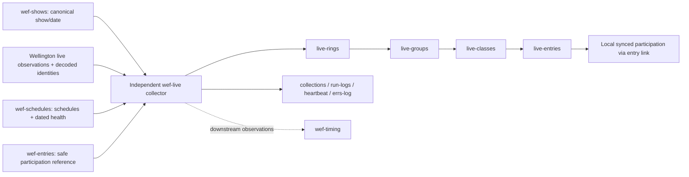

# Current alert delivery — not verified

**Version 2026.11.07.7 · November7,2026 8:00p.m. Eastern.** Owner-approved notification wiring deployed: `entry.js` plus new `records-alerts.js`; all25otherJS, four direct request headers/URLs, decoded pause, collection/link/cleanup logic and task unchanged. Five offline checks and author review passed (not independent).

**Normal delivery FAILED:** the existing local Codex resume route exited1 without acknowledgement during the8:00p.m. normal invocation. Connection-check alert `65a538cc-d259-4571-aa21-2079db3205af`; target Records chat `01a169bc-e58a-7de0-94c6-5d3931fcf745`. Destination readback showed no new test message/acknowledgement. Task exit0 is not delivery success. Collection completed independently; quiet policy unchanged. No manual sender/collector or fabricated failure.

Failure notifications run after the normal invocation finishes, using its existing reports; they do not interrupt collection. Status/parser failures are included despite old ok:true/Skipped report labels; stage/logging, non-warning collection issues and cleanup errors included. Routine date warnings and linker no-match checks stay log-only. Individual delivery receipts in runtime/records-alert-*.json distinguish Started/Delivered/Failed. Legacy in-stage alert flags are not rewritten; these new end-of-invocation delivery receipts are separate. The first normal invocation makes one explicit connection check; it is never labelled a real collection failure and is not repeated automatically.

**Stop:** verification halted after the failed normal delivery. No transport retry/repair/new route or manual chat message performed. Future genuine failures remain wired to this unverified route; do not describe immediate or successful coordinator delivery as working. Owner decision required before correcting the failed route. Existing known trouble unchanged. [Evidence and acceptance](evidence/records-alerts-20261107/acceptance.json); [review](evidence/records-alerts-20261107/review.md); [installed hashes](evidence/records-alerts-20261107/deployed.json).

# Current release — four direct Wellington feeds

**Version 2026.11.07.6 · Deployed November 7, 2026 at 7:13 p.m. Eastern.** Owner-approved narrow request correction. Status verified by one normal scheduled run; groups/rings/class-details scheduled verification remains pending.

The four active public feeds now use direct Wellington URLs and exactly these explicit headers: `Accept: application/json`, `Cache-Control: no-cache`, the approved iPhone Safari User-Agent, and `Sec-Fetch-Site: cross-site`. Status uses `sglapi.wellingtoninternational.com/homepage/getLiveClassStatus`; groups, rings and live-class-details use `sgl.wellingtoninternational.com` at their existing paths/query parameters. This supersedes older all-four-proxy descriptions below. No cookie/token or extra browser headers are supplied by Live. Node may supply normal transport defaults.

Decoded `/classes/{id}` remains proxy-defined and **paused**. Only `activity.js` and `source.js` changed; the other24JS, shared source reader, registered task, cadence, status decisions/parsing, stage4–6 collection/save logic, empty-only linker, relationships and delete-only cleanup remain unchanged. No manual runs, record repairs or new observers.

Nine focused offline checks passed; author review passed (not independent). Exact baseline/candidate/diff, review receipt and installed26JS hashes are in [direct-four-headers evidence](evidence/direct-four-headers-20261107/). Normal scheduled acceptance remains separate from Decoder diagnostic proof. Existing known trouble/alert gaps remain unchanged.

**Normal-run proof:** November7 **7:15 p.m. Eastern**, status run `d602e778-0b69-45fb-b867-e41990d67d2d` returned **true**, with zero stage/logging errors. Existing date-mismatch warning recorded: Shows priority0 isNovember8, today isNovember7. Existing rule kept detailed collection idle and next status due8:15p.m. Three direct detail feeds remain **unverified through scheduled collection** until a naturally eligible day0 window. No forced runs/date changes. [Acceptance](evidence/direct-four-headers-20261107/acceptance.json).

# Current release — corrected w-shows / w-days references

**Version 2026.11.07.5 · Locked 2026-11-07T10:26:13-05:00 · America/New_York.** Narrow owner correction deployed and verified; no extra workflow changes.

- Linker now uses the existing synced **w-shows**, **w-days** and unchanged **wef-data.schedules**. The new `w-shows`/`w-days` fields on five Live tables point to those exact native targets. Former filled `show`/`show-day` fields remain intact as historical references; no destructive retargeting or record migration.
- **Class↔group is confirmed:** active native relationship is **live-classes.groups ↔ live-groups.live-classes**. Both directions are populated (sampleclass200031204/group200028523). No new relationship, duplicated field or class/group code change was needed.
- Empty links remain empty when there is no exact eligible match. Their individual logs now recommend **“No retry recommended until source data changes.”** This is an informational recommendation, not a new retry cache or eligibility gate. Misses use already loaded data; no individual source/network retries are attempted for them. Existing empty-only and Dropped-schedule rules remain unchanged.
- **Stages4–6, Data schedules, source requests, cadence and cleanup are unchanged. Decoded requests remain paused.** Existing null-as-empty handling remains unchanged. Only three existing configuration/advisory files changed;23otherJS/task preserved.10necessary correctly targeted fields were added without manual record writes.

**Verification:**17offlinechecks and author code review passed (not independent review). Normal **10:15 and10:21 Eastern** collection/link passes completed without stage/logging failures and with0decodedrequests. The first filled **1,936 w-reference fields** across968existing records;the second changed0records. All968records and5,197priorpopulatedforwardfields were retained;423trip business rows stayed frozen. Data links stayed961. Seven existing Dropped-only Data misses remained empty and individually logged. Class/group native backlinks verified before and after. No extra checks, tasks, source probes, manual runs or record repairs.

Evidence: [acceptance](evidence/w-shares-20261107/acceptance.json), [review](evidence/w-shares-20261107/review.md), [17checks](evidence/w-shares-20261107/offline.json), [deployed26JS](evidence/w-shares-20261107/deployed.json), [w-field targets](evidence/w-shares-20261107/schema-readback.json), [class/group pair](evidence/w-shares-20261107/class-group-schema.json), [locked baseline](evidence/w-shares-20261107/locked-baseline.json). Existing known-trouble/holds below remain. Older sections describe dated history where superseded. No revert was needed;the reviewed [code-only revert](evidence/w-shares-20261107/revert.ps1) retains all schema/data/validlinks.

# Current release — empty-only linker

**Version 2026.11.07.4 · Locked 2026-11-07T10:06:03-05:00 · America/New_York.** Owner-approved linker deployed and verified; unrelated work stays locked.

- **Stages 4–6 stay unchanged.** Groups, rings and live class details collect/save as before. Status uses Shows' published Eastern time and priority-0 date. Source URLs, headers, three-minute/hourly rules, task and cleanup remain unchanged.
- **Stage 7: `linker.js` runs after collection finishes.** It fills empty native fields only: `show` → synced **wef-shows.show**, `show-day` → synced **wef-shows.show-days**, and `data-schedules` → synced **wef-data.schedules** on all five Live tables. Fifteen missing fields were added; no records were manually written. Existing internal forward links are reused. Airtable maintains reciprocal links automatically. Populated forward fields are not audited, corrected or rebuilt. Old WEF Schedules links stay retained; the linker never reads/writes that target.
- **Exact saved keys only.** Use show/day/ring/group/class/trip IDs and Data's explicit ring/group/class keys, with source ring-ID mapped to ring-number. No names, invented IDs or forced joins. Existing Dropped-schedule exclusion stays. Missing/ambiguous matches remain empty and are individually logged; other links/collection continue. No new readiness gates, tasks or schedules.
- **Decoded-trip requests remain paused.** Empty native links on existing trips can be filled by the approved linker, but decoded identities, results, membership states and other business values remain frozen. No new decoded runner or automatic resume.
- **`completed:null` is handled as an empty list.** Original source evidence, ring record and other links remain. No null-format error, payload correction or waiting condition. Natural null occurrence is not claimed.

**Normal verification:** November 7 **09:51 and 09:57 Eastern** runs passed without stage/logging failures. Both collected35groups/71appearances,7rings,66classes and408live-detail rows; decoded requests0. First linker filled **2,897 empty fields on968 existing records**:968show,968day and961Data-schedule fields. All968priorrecords and2,300populatedforwardfields were retained. All423pausedtrip business records remained unchanged. The second linker wrote **zero fields/records**. Native heartbeat/run-log and one-per-skip errs-log readback confirmed both runs.17offlinechecks and author code review passed (not independent review).

**Seven known skips:** only Dropped Data schedule occurrences match retained groups **200028530 /200028533**, class **200031158**, and its two trips/twoentries. Seven `data-schedules` fields remain empty; show/day and existing native links remain. Each skip is logged, not guessed or repaired. These are not collection stops.

**Revert:** no rollout failure occurred. Reviewed [revert.ps1](evidence/linker-20261107/revert.ps1) restores only the three prior changed JS files and removes the new linker after the normal task finishes; intervening owner edits are protected. Retain added schema/data/valid links, never repair records or manually rerun. No new cleanup archives, observers, dependencies or runtime upgrades.

Evidence: [acceptance](evidence/linker-20261107/acceptance.json), [review](evidence/linker-20261107/review.md), [17offlinechecks](evidence/linker-20261107/offline.json), [deployed26JS](evidence/linker-20261107/deployed.json), [native field targets](evidence/linker-20261107/schema-readback.json), [locked baseline](evidence/linker-20261107/locked-baseline.json). Existing known-trouble/hold notes below remain; older releases are historical where superseded here.

# Current release — independent live details; decoded trips paused

**Version 2026.11.07.2 · Updated November 7, 2026.** Owner-approved pause and Shows-time reuse are deployed. General lock remains outside these completed changes.

- **Groups, rings and class-live-details continue independently.** Class details no longer call or wait for decoded `/classes/{id}`. Existing four-class concurrency, source snapshots, changed-only saves, logs, canonical day-0 and cadence remain.
- **Decoded-trip requests and live-trips collection/state updates are paused.** All 423 existing day-0 trip records, read-back fields and native links remained unchanged through two normal runs. Existing legacy live-entries continue receiving live observations on their existing trip-based keys; known entry/entity identity columns and native links are retained. New observations do not invent missing entity IDs. A future separate decoded lane is discussion only; no new worker/task or automatic resume was introduced. Existing approved cleanup remains active.
- **Status uses existing Shows data:** canonical show-days priority-0 date and `eastern-time (from show-times)` supply the date/window decision. No new table/field/request/freshness gate. Missing lookup retains the existing Eastern-clock fallback. Actual invocation timestamps/next-check scheduling still use the host clock. The live-status endpoint still supplies true/false; true/today inside05:00-19:00 collects3minutes, failedstatus retries3minutes, confirmedfalse/mismatcheddate/outsidewindow checks hourly.
- **`completed:null` is handled:** treat it as an empty completed-group list, save that empty value, preserve the ring record and its other links, and continue without an error. Keep the original null in source evidence. The deployed implementation matches the passing source-shaped offline test. No payload correction or wait for a natural null is required; this is not an open fix. A natural null occurrence is not claimed as observed.
- All four active feeds use the existing shared `wef-schedules-decoded.gombcg.workers.dev` proxy: homepage/getLiveClassStatus, ListAjax, LiveScoreWidget and getLiveClassData. Routes/headers/proxy and all other collectors were untouched by this release. `/classes/{id}` remains defined for reference, with no active caller in Live's class lane.

**Verification:** Six focused pause/live-only/null/link checks and nine Shows-time/retry checks passed; author review, not independent review. Normal **07:36 and07:39 Eastern** runs completed without collection/logging errors:36groups,74class appearances,7rings,69class detail requests per run,405then407live-entry rows,**zero decoded requests**.423trip IDs/selected fields/native links remained unchanged by Airtable GET comparison. Normal **07:42 Status** used published `2026-11-07 07:39:13`, canonicalNovember7 and livetrue to collect at3minutes. Current25JS/task readback matches. No manual collector/provider calls, record repairs or observers.

Evidence: [pause acceptance](evidence/pause-decoded-20261107/acceptance.json), [pause review](evidence/pause-decoded-20261107/review.md), [Shows-time acceptance](evidence/shows-time-20261107/acceptance.json), [current deployed hashes](evidence/shows-time-20261107/deployed.json). Older dated sections below are historical where superseded. Stage8publication and old24h retention holds, delete-only cleanup rules and known reporting limitations remain unchanged.

# Current release — live-trips only

**Version 2026.11.03.4 · Updated 2026-11-03T15:20:58-05:00.** Owner correction removes unnecessary separate trip-result/message/comment tables. The simplified collector is deployed. General lock remains; scheduled operation continues.

- **live-trips** (`tblhUd5DucnpkEall`) remains the sole new trip table. Day-0 decoded class-source collection, keys, identities and existing native class/ring/group/schedule/legacy links are preserved.
- Results now stay **directly on each trip**: placing, position, results-verified, class-status and results-json. Original source-json retains all source facts. Changed-only saves continue.
- Separate **live-trip-results, live-trip-messages and live-trip-comments were empty and deleted**, with their three obsolete cleanup controls removed. Collector has no reads/writes/dependency on those tables. Airtable converted their former reciprocal columns to empty plain text; no broken table links remain.
- Downstream results/messages/comments can reference the source trip-key. No new local child tables or messaging/comment workflow. Existing live-entries remains untouched and continues its existing collection.
- **Cleanup:** live-trips stays in new-show deletion. New calendar day clears eligible completed heartbeat/run-logs/errs-log; every3hours checks1000/500; no separate show-day action. Active/current/diff logs, action history and references stay protected. Delete only, no new schedule/observer. Records supplies alerts.

**85 offline checks passed; author review completed, not independent review.**25installed runtime hashes match candidate;21other JS and Windows task unchanged. Direct result fields and empty table/config removal were GET-read back. No manual collector/provider runs, business-record repairs or backfill. Source currentlyfalse, canonical day0November5; populated verification remains natural, not forced.

[Review](evidence/live-trips-simple-20261103/review.md) · [Deployment](evidence/live-trips-simple-20261103/deployed.json) · [Schema readback](evidence/live-trips-simple-20261103/schema-readback.json). Normal scheduled proof recorded separately. Stage8/old24hourholds and known conditional cleanup-reporting P2s remain unchanged.

**Normal scheduled verification:** November3 **3:21 and3:24p.m.Eastern** wakes completed exit0. Quiet collection/cleanup correctly skipped; exactly one live-trips cleanup control remains.25runtime hashes and task match. New class-source population remains naturally pending while live=false;85offline checks passed. [Acceptance](evidence/live-trips-simple-20261103/acceptance.json).

## Earlier dated documentation — historical where superseded above

# Current release — day-0 live-trips

**Version 2026.11.03.3 · Updated 2026-11-03T14:57:59-05:00.** Owner-approved addition deployed within wef-live. General lock remains; this approval changes only the documented trips/result/message/comment structure and its existing new-show cleanup integration.

## Collection

The existing classes lane projects **live-trips** from the decoded `/classes/{class-id}?show_id=...&customer_id=15&cgid=-1` response already fetched through `wef-schedules-decoded.gombcg.workers.dev`. No new endpoints, tasks, helpers, count/status/age gates or reverse Entries reads. UI live details supplement matching trips; unavailable/empty UI details do not suppress decoded source trips. Individual errors are logged and valid trips continue. Empty collections succeed. Existing Shows day-priority **0**, live-status/date cadence, three independent lanes and logging remain.

Each trip records show/day/class/ring and source trip ID/UUID, show-level entry-key, horse/rider/trainer/owner IDs and names, order/actual order, scratch/gone and source evidence. Missing source identities stay missing. Composite `trip-key` follows `customer|show|date|ring|class|entry|UUID` with numeric trip-ID fallback. `entry-key` is `show|entry`, allowing many class trips/riders across one horse's show entry. Existing **live-entries** records, keys, links and collection writes remain; retirement is not part of this release.

## Tables and links

| Table | Airtable table ID | Purpose |
| --- | --- | --- |
| live-trips | tblhUd5DucnpkEall | Individual day-0 source trips; native class/ring/group/available schedule and exact legacy-record links |
| live-trip-results | tblPIZYbHp8850uoA | Each trip's source result facts, scores/times/faults/placing and verification state |
| live-trip-messages | tblUbF9tygLGChbM4 | Messages directly related to an individual trip |
| live-trip-comments | tblg29QWHi5GB8p4X | Comments directly related to an individual trip |

Child tables link directly to their trip; parent reciprocal fields are **results, messages, comments**. Message/comment authoring and delivery belong to downstream owners; this collector does not invent or send them. Entity/show-entry source IDs/keys allow downstream linking without a new Live dependency on helper/Entries bases. Source show/date are direct fields; existing class/schedule links provide related context.

## Cleanup and protection

The four new tables are checked in existing **cleanup** controls and included in new-show deletion, child tables before trips. **New show clears all checked owned show records.** New calendar day clears eligible completed heartbeat/run-logs/errs-log; every 3 hours checks those log tables and deletes oldest500eligible at1000+. No separate new-show-day cleanup. Active/current/diff logs, permanent action history and reference/catalog tables remain protected. Delete only; no cleanup archives, new schedule or observer. Records supplies alerts. Existing source-evidence storage is unchanged.

## Verification

**85 offline checks PASS; author review PASS, not independent review.** Four table schemas,8trip links/reciprocals and4cleanup control rows were GET-read back. Installed25JS hashes match candidate;21existing JS and the entire scheduled task are unchanged. [Review](evidence/live-trips-20261103/review.md) · [Schema readback](evidence/live-trips-20261103/schema-readback.json) · [Deployment](evidence/live-trips-20261103/deployed.json).

Normal scheduled proof is recorded separately as available. Source currently reports live=false and Shows day0isNovember5; idle checks do **not** prove populated trip/result/link coverage. No manual runs, forced source/date, historical backfill or record repairs. New-show cleanup with populated new tables also awaits a natural event. Stage8publication and old24hretention remain held; existing two conditional cleanup-reporting P2s remain separate.

**Normal scheduled verification:** November3 **3:00 and3:03p.m.Eastern** completed exit0. Actual status check returnedfalse, no errors; heartbeat/run-log Skipped/completed read back. Following quiet wake and cleanup correctly skipped; four cleanup controls confirmed. New tables are empty pending natural day0activity; populated trip/result/native-link and new-show deletion coverage remain unverified. [Exact acceptance](evidence/live-trips-20261103/acceptance.json).

## Earlier dated documentation — historical where superseded above

**RELOCKED — November 3, 2026 · Version 2026.11.03.2.** The approved cleanup change is deployed and its edit exception is closed. Further code/workflow changes require explicit owner approval. Scheduled operations continue. Current rules, verification and limits: [README](README.md), [LOCK.md](LOCK.md); exact baseline: evidence/lock-20261103/baseline.json.

# Current approved cleanup revision

**Version2026.11.03.1 · Updated2026-11-03T09:05:12-05:00.** Owner-approved cleanup exception to the November2lock is deployed. Installed24JS hashes read back; only cleanup.js, airtable.js/retireCleanup and lanes.js's local cleanup-due evaluation changed. Existing Windows task, source polling cadence, schemas and other collectors are unchanged. Baseline and review: [release](evidence/cleanup-revision-20261103/TASK.md), [readback](evidence/cleanup-revision-20261103/deployed.json), [review](evidence/cleanup-revision-20261103/review.md).75offline checks PASS; author review, not independent.

- **New Eastern calendar day:** clear all completed eligible records from heartbeat/run-logs/errs-log at any count.
- **Every3hours:** inspect those three tables; at1000+ total records delete oldest500eligible completed records. Full calendar/show clears restart the3hour interval.
- **New show:** clear all records in checked owned live-entries/live-class-appearances/live-classes/live-groups/live-rings, regardless of show-id, and eligible completed records in the three logging tables.
- **New planning show-day:** no separate cleanup action.
- Protect incomplete/Running logs, current invocation and its diff children. Preserve checked-table controls, permanent cleanup-logs/action history, catalogs and references. **Delete only; no new cleanup archives or deleted-field backups.** Existing archives remain untouched.
- Same registered task evaluates local cleanup due state on quiet three-minute wakes. It does no provider/Airtable work or cleanup receipt write until due. No separate task/schedule/observer. Records supplies alerts; existing errs-log and local failure/stop evidence remain.

The general lock stays in force. Stage8publication and old24hretention remain disabled. Known two conditional cleanup-reporting P2s are unchanged. Normal scheduled proof and naturally occurring deletion branches are recorded separately; no manual runs, forced events or record repairs.

**Normal scheduled verification:** November3 **9:06 and9:09a.m.Eastern** completed exit0. Due three-hour check logged three below-threshold Skips (heartbeat231/run-logs498/errs-log1), zero deletions/archives/errors; repeat wake skipped cleanup without changing its checkpoint or action IDs. [Acceptance](evidence/cleanup-revision-20261103/acceptance.json). Natural new-calendar/new-show full clears and actual500deletion remain unverified operational branches, covered offline.

## Earlier dated documentation — historical where superseded above

**LOCKED — November 2, 2026 · documentation version 2026.11.02.13.** Further code/workflow changes require explicit owner approval. Normal scheduled collection, logs and delete-only cleanup continue. This is a documented freeze; no file permissions or Airtable permissions changed. See [LOCK.md](LOCK.md) for the exact baseline and remaining verification gaps.

# Current Live release — delete only

Version **2026.11.02.12** · Updated **2026-11-02T12:58:44-05:00**.

The owner explicitly approved corrections and redeployment. Installed source hashes and existing task definition were read back successfully. This supersedes prior archive-era cleanup and pending-deployment statements below; old dated evidence remains history.

- **New show:** delete nonmatching-show records in checked owned tables. No new cleanup archives or deleted-field backups.
- **New Eastern calendar day only:** check heartbeat/run-logs/errs-log. At1,000+ records delete the oldest500 completed eligible rows; protect active/current invocation rows. Same show/day performs no cleanup table inventory or deletion.
- **Logs:** cleanup-logs records table/action, start, completion, result, show IDs, deleted count and error. Old archive fields remain unused/zero for new actions. Local cleanup receipts contain action/count metadata only. Existing historical archives/catalogs are left untouched.
- **Cadence:** actual live-status checks and registered runs are hourly around the clock when live=false, priority-0 date differs from today, or outside05:00–19:00Eastern. True/date mismatch adds an errs-log warning. True/today inside that window collects every3minutes. The existing hidden task wakes every3minutes24h as a local dispatcher; not-due wakes do not call providers or Airtable and do not create collection logs.
- **Protected behavior:** independent lanes, IDs/links, changed-only saves, exact pre-delete target/value checks, canonical-show recheck, DELETE response/absence readback, active records and permanent catalogs. Stage8 publication and old24h retention remain disabled. Other collectors untouched.

**Verification:**81 offline checks PASS; author review and review-packet verification PASS, not independent review. All24 installed JS hashes match the reviewed candidate;20 existing JS files unchanged. Windows normalized task duration PT24H toP1D and omitted default StopAtDurationEnd=false; semantic readback matches. No manual run, record repair or observer. Scheduled proof is recorded separately in evidence/delete-only-20261102/acceptance.json when available. No claim that future new-show/new-day deletion or populated activity has already occurred. Two known conditional cleanup-reporting P2 findings remain documented in the review.

Evidence: [release task](evidence/delete-only-20261102/TASK.md), [review](evidence/delete-only-20261102/review.md), [installed readback](evidence/delete-only-20261102/deployed.json), [tests](evidence/delete-only-20261102/offline-final.json).

**Scheduled readback:** November2,1:00p.m.Eastern check `0de37502-dff3-4d90-8d06-66c4e487c709` completed with task exit0. Source live=false; heartbeat/run-log both Skipped/completed, no errors. Cleanup correctly Skipped with zero actions on unchanged show/day. Next actual hourly check is2:00p.m.; second hourly check and future event deletion remain unverified. See [acceptance](evidence/delete-only-20261102/acceptance.json).

## Prior dated documentation — historical only

# Cadence handoff — November 2, 2026, prepared only

Approved edit/test complete:71 offline checks and author review PASS for live-status/date hourly-versus-three-minute rules, with hourly checks overnight. Artifacts: evidence/live-cadence-20261102/{PREPARED.md,review.md,review-receipt.json,offline-final.json,task-prepared.xml,candidate/live-cadence.js,candidate/lanes.js}. No production JS/task change, provider call, manual collector run or Airtable write occurred. Next action is deployment approval for these two JS files and the existing task's24h dispatcher, followed by normal scheduled verification; no new task or schema. Earlier cleanup trigger revision and two reporting P2 findings remain separate and unchanged. Read README version2026.11.02.10 before continuing; do not represent offline proof as live acceptance.

# wef-live — cleanup release

**Version: 2026.11.02.7**  
**Updated: November 2, 2026, 9:34 a.m. Eastern.**

New-show cleanup and log-only quick cleanup are deployed in the existing hidden three-minute task, after the three collection lanes finish. Stage 8 publication stays on hold. The previous blanket stage-9 hold is superseded only for the two cleanup actions below; the old 24-hour retention path is not re-enabled.

- **New show:** read canonical default show ID directly from wef-shows. When it differs from cleanup's last handled show, archive and delete records not matching that new show in checked owned tables. First adoption reconciles existing old-show rows. A different day in the same show does not trigger this action.
- **Quick cleanup:** only checked heartbeat, run-logs and errs-log. At 1,000+ records, archive and delete the oldest 500 completed eligible records by Airtable creation time. Active/current invocation logs are protected. This is separate from the new-show rule, which may remove more than 500 old-show logs.
- **Control/latest state:** cleanup / tblZOqOQmpy0VgbUM. Records is the table count at action start; timestamps, result, old/new show IDs, archive/delete counts, archive file, error and run ID show the latest action.
- **Permanent action history:** cleanup-logs / tblnMYLtIBvObY1xQ, one record per table action. Archive path and SHA-256 are recorded and verified before deletion. All new-show snapshots preserve original fields/native links before any deletion. Catalogs, references, code-reviews, meta and cleanup-logs are never deletion targets.
- **Failure:** errs-log plus local cleanup-stop.json; collection continues, cleanup does not retry until owner decision. No observer or new scheduled task.

**Normal-run verification:** November 2 at 9:27 and 9:33 a.m. Eastern. All three lanes completed with zero stage/logging errors. First cleanup run 10dccc0a-592d-48e1-8556-814cb651ab0d archived/deleted **989 records** in eight successful table actions for new show **200000077**. Repeat cleanup 414fb3e2-10bb-44d8-99d7-e8debdd61dae made **zero actions/deletions**, preserving the eight catalogs, archive hashes and retained current-show logs. Collection's existing priority-0 date remains November 5; this release does not change the date rule. Source returned no current live rows in these runs.

Initial bulk cleanup took **207.402 seconds**, spanning the 9:30 tick; there was no 9:30 collection invocation. Repeat cleanup took **2.504 seconds**. Task definition is unchanged. **49 offline checks PASS**; review is author review, not independent. Natural 1,000/500 threshold behavior and a future newly occurring canonical show transition remain unverified operational branches. No manual run, record repair, source/provider call or forced show change was used.

[Acceptance and exact six lane run IDs](evidence/cleanup-20261102/acceptance.json) · [Release](evidence/cleanup-20261102/release.md) · [Author review](evidence/cleanup-20261102/review.md).

## Previous dated documentation

The material below is preserved history; conflicting hold/retention/status claims are superseded by this release for its stated scope.

## Day-0 membership release — November 1, 2026, 12:22 Eastern

Documentation version: **2026.11.01.5**. Deployed through the unchanged hidden three-minute task, 05:00–19:00 America/New_York. Normal **12:24 and 12:27 Eastern** invocations verified: 25 Active groups / 43 Active class appearances, with both retained groups progressing Absent to Dropped. All 267 existing records and 987 checked durable links were preserved; 43 appearance IDs stayed stable and 86 reciprocal links passed. No stage/logging failures; five unresolved source identities remain individually logged. Offline author checks: 31 PASS; review is author review, not independent review. [Exact acceptance](evidence/day0-membership-20261101/acceptance.json).

Live reads the default show and its `wef-shows.show-days.day-priority = 0`. `live-groups.record-status` and the new `live-class-appearances` table label source presence: Active; Absent after one complete missing observation; Dropped after the next; Active on return. Failed/incomplete inventories do not advance absence. Competition status, including Completed, remains separate. False/failed live status, Completed groups, detail-availability, membership state, entry totals and source age do not gate collection. Missing/ambiguous show/day identity is logged rather than invented.

The inspected payload contains 25 groups and 43 group-class appearances (41 unique class details). Counts are dynamic, not limits. Appearance key is show|date|group|class; links point to existing groups/details. Existing class/entry keys and records are not rekeyed, duplicated or removed. Historical links are retained. States apply only to day 0; other days are untouched.

Stages 8 publication and 9 archiving/cleanup remain **ON HOLD**. Logs, per-lane timings, changed-only saves and errs-log-only reporting remain. No manual collector/provider run, record repair, task/cadence/dependency change or observer. Earlier conflicting design/status sections below are historical. [Release evidence](evidence/day 0-membership-20261101/TASK.md), [author review](evidence/day 0-membership-20261101/review.md), [deployment](evidence/day 0-membership-20261101/deployed.json).

## Current release - November 1, 2026, 09:54 Eastern

Three-lane collection is deployed through the existing hidden task, every three minutes from 05:00 to 19:00 America/New_York. Owner explicitly permits errs-log-only failures for now; immediate Records-chat delivery remains deferred. Stages 8 (cross-base publication) and 9 (retirement/cleanup, including log cleanup) are ON HOLD and are not invoked by the new entry path. No prior stop/evidence file was cleared; no records were repaired or removed. Older publication/retirement sections below are historical and do not authorize resuming those paths.

Two populated normal invocations at **09:51 and 09:54 Eastern** completed all three lanes without stage or logging failures. Latest coverage: 25 groups, 5 rings, 41 class records and 145 entries. Six unresolved trip identities are recorded individually in errs-log; valid records continue. Source identity completeness is therefore Partial, not a claim those six identities were resolved. Normal source collection/save times at 09:54: Groups 0.65s/2.36s, Rings 0.12s/0.80s, Class details 3.68s/3.70s; core lane totals 3.27-11.14s. These totals end before final log writes; Windows task completion/result separately confirms the full invocation finished before the next trigger.

Changed-only repeat proof: 22 group records, 3 ring records and 165 class/entry records were successfully recollected without business writes; last-success coverage advanced and last-changed was preserved. All changed-field reports remain in run-logs and the lane receipt. Heartbeat/run-logs and six individual errs-log rows were read back for both populated invocations. Exact IDs, scopes, receipt hashes and limits: [normal-run acceptance](evidence/three-lanes-20261101/normal-run-acceptance.json); [release](evidence/three-lanes-20261101/release.md). No manual runs, source calls, forced failure, observers or record repairs. Rollback was not needed; saved baseline and rollback script remain available. Natural whole-stage failure and future day rollover under this release were not forced or claimed verified.

## Day-priority and overlap validation — October 31, 2026

Data publication requires the exact canonical `show-days.day-priority = 0` before inventory and dispatch; Live collection remains TODAY. Existing approved `live-observation-json` mapping preserves verified zero/false and leaves Data acquisition fields/native links intact as fallback. No runtime replacement was needed: installed guard reviewed, 43 targeted publication checks passed. Two existing normal runs at 07:56 and 08:02 Eastern verified 57 Data overlay writes with links/logs preserved. Operational result remains Partial due publication budget/identity issues and the separate blocked log-retention stop; no repairs or stops cleared. External consumer effective selection is not proved by overlay writes. [Exact evidence and limits](evidence/day-priority-precedence-20261031/release.md).

## Current Live status — 30 October 2026, 13:03 Eastern

The approved journal/count, cursor and exact-group corrections are implemented, reviewed and deployed. [Release and task evidence](evidence/publication-continuation-20261030/release.md), [independent review](evidence/publication-continuation-20261030/review.md), [deployed hash](evidence/publication-continuation-20261030/deployed.json), [first normal receipt](evidence/publication-continuation-20261030/first-normal-skip.json).112 offline tests pass; independent review includes real-journal restart/failure and deadline cases. Only publication.js changed;18 other runtime files are preserved.

- **Completed:** journal-save failures are logged with accurate remaining counts; unsafe writes without durable intent are deferred, not dispatched. Other safe records/lanes, collection and future invocations continue. Pending intents survive failures and reconcile before retry. Outcome/log failures do not create a global halt. No immediate retry loops.
- **Completed:** first budget-deferred item remains the next cursor; attempted writes including uncertain responses respect the unchanged cap. Exact known show/date/ring/group/native links are filtered before uniqueness, resolving the six false ambiguities. Actual multi-group or duplicate exact matches remain logged and withheld. No new matching rules, fallbacks, fields or budget/freshness relaxation.
- **Normal execution verified:** run6a729be2-fbb4-481b-803b-b6a70f197e6b at13:02Eastern completed safely,0 publication writes,0 errors, retention Success. All18 source groups were completed; both publication lanes correctly Skipped.
- **Only remaining acceptance blocker:** no current populated activity. Two populated postdeployment runs plus ring6 and the six exact class-occurrence writes cannot be proved from skipped runs. Existing collector checks continue every3minutes; inspect saved evidence within authorized work/on request. No manual source runs, repairs, forced joins or observers. Offline injected failures are not claimed as production events.
- **Preserved:** prior24-hour log-retention acceptance, archive catalogs and links, source authority, independent lanes, Entries linking-only, existing Monday review. All business observers remain removed. Scope/code may be locked to this reviewed release; populated operational acceptance remains pending without adding new work.

Earlier checkpoints below are historical where superseded. The prior failed-gate approval request was superseded by the owner's explicit direction to correct these paths.

## Current publication blocker — 30 October 2026, 12:45 Eastern

Publication is not complete. The has_JSON and concurrent-acquisition corrections now have normal-run proof. Deferred counts still underreport when journal-save EPERM escapes the item loop. One eligible Data ring remains70m16s behind its fresh source because an unprocessed budget-boundary item advances the cursor. Six occurrence errors are false ambiguities: each has one exact source-group match; class200030671 remains genuinely multi-group. Prior missing trip200399568 is resolved. See [exact evidence and smallest corrections](evidence/publication-fixes-20261030/current-blocker-20261030.md). This failed verification gate permits no further code patch/retry without separate approval. No observers or workflow changes.

## Current release and scope-lock status — 30 October 2026

Owner approved exactly three publication corrections in Records. They are implemented, independently reviewed, offline-tested (99 PASS) and deployed at 11:42:28 Eastern. [Release/task evidence](evidence/publication-fixes-20261030/release.md), [review](evidence/publication-fixes-20261030/review.md), [exact runtime hashes](evidence/publication-fixes-20261030/deployed.json), [two-run acceptance summary](evidence/publication-fixes-20261030/acceptance-summary.json). Only publication.js and the collector summary changed;17 other Live runtime JS files remain at the protected baseline, including retention and class-error/audit behavior.

- **Completed corrections:** actual has_JSON spelling with true/false/missing preserved; accurate deferred and separate uncertain counts with readback-before-retry; stable identity/matching/link/overlay validation that permits unrelated acquisition metadata updates. Full row audits, one-field external PATCH, original freshness and budgets remain intact.
- **Verified normal runs:** 3d7a24cd-ed6d-4c5f-b0ba-e1ec503c0dbe at11:44 and c8d1fe08-1c80-4097-a1f5-79120c1d258b at11:47 Eastern each collected196 entries. Schedules35+35 writes; Data37+38;145 archived/current readbacks preserve identity/native links and original freshness. Data deferred230 in each; uncertain1 then0 with NotApplied reconciliation before continuation. Both business outcomes remain Partial, not full coverage.
- **Pending acceptance:** natural has_JSON publication into a Data group and positive concurrent-metadata exercise were not encountered in this two-run pair; both behaviors have independent offline regression proof. Full timely publication remains unproved due existing budgets/withheld matches. Same-date rollover and multi-group natural proof remain separate. Inspect saved evidence during authorized work/on request; no forced runs or guessed joins.
- **Complete and protected:** completed-log24-hour retention accepted separately on b7a9e822-461a-42e2-bf25-dd601a268b1e and853114e5-fe5b-4c97-8999-ba0133a0a38c (1,424 archived/deleted, seven show catalogs and protected baseline retained). This is not publication proof.
- **Continuing scope:** independent TODAY Live observations using canonical Shows and current Schedules references; Live tables plus approved single-field Schedules/Data overlays. No reverse Entries dependency or acquisition ownership transfer. Existing three-minute collector, recurring archives, logs and Monday review continue.
- **Removed:** all business observers; do not recreate/replace hourly verify-live-natural-same-date-rollover, daily watch-wef-default-show-changes or wef-running-lanes-october-15-observation. Records context bookkeeping is separate. No task/cadence changes or record repairs.
- **Lock readiness / next action:** reviewed scope/code baseline can be locked with pending acceptance explicitly recorded; full operational lock/acceptance cannot yet be claimed. A scope/code lock never disables collectors or independently approved work. No new corrections are authorized by verification; actual new failed gates retain the owner approval boundary. Existing Airtable review record is dated pre-fix evidence owned administratively by Records; this release receipt is local and no tracker was created.

Earlier status below is historical wherever superseded by this checkpoint.

## Approved 24-hour log retention — 30 October 2026

Owner approved recurring archival/removal of completed heartbeat, run-logs and errs-log records older than24hours. This narrow release does not fix publication defects or change cadence/source collection. Existing normal entry workflow calls retention only after collection ok=true (Partial class/publication outcomes can still be ok=true); failed collection skips it. No manual runs/record repairs.

Retention accepts terminal Success/Skipped/Partial/Failed completion older than24hours; active/incomplete/current invocation and non-run control rows are preserved. Error rows additionally require older completed parent evidence from existing run-logs or saved local receipts. At most250 rows per table per invocation, with four-minute request deadline and a60-second reserve before starting another table; initial backlog drains across normal runs.

Exact immutable gzip batches are verified before deletion. Three fixed collections rows (`log-archive|heartbeat`, `log-archive|run-logs`, `log-archive|errs-log`, source-kind log-archive-catalog) point to immutable chained manifests, retaining previous references/hashes and full original row IDs/fields. Existing seven show archive catalogs and business collections are untouched. Manifest row-count counts archived records. No local archive TTL/purge is introduced.

Every deletion batch rereads unchanged eligible rows, validates exact DELETE acknowledgements and verifies absence. Durable runtime/log-retention-stop.json is created before work, removed only on successful completion or safe deferral before a new table, and retained on failure/interruption. That marker blocks retention without stopping independent collection; no automatic retry/repair of uncertain deletion. Failure requires owner review/approval. Current run logs/heartbeat summarize retention and retain archive descriptions. Local receipts/logs and publication journals/control state are never deleted.

Evidence: evidence/log-retention-20261030/{baseline.json,review.md,tests.txt,deployed.json}.91offline tests passed; independent11retention tests passed. Normal-run acceptance BLOCKED: first postdeployment10:41run failed with source ListAjax HTTP504; retention correctly skipped, no log deletion. Two successful normal retention runs remain unverified (evidence/log-retention-20261030/release.md). Existing3P2publication findings and populatedPartial acceptance remain separate.

## Current operating checkpoint — 30 October 2026

Read [module AGENTS](AGENTS.md), [current README](README.md) and [canonical owner block](../docs/coordination/wef-owner-operating-instructions.md) first. README's current operating reference supersedes conflicting historical paragraphs below. Live owns independent TODAY observations and approved one-field overlays only; Shows is canonical, Data acquisition/Season retention remain with LOCAL Season coordinator, Entries linking-only, Schedules still running. Three-minute collection and per-run recurring archive safeguards are unchanged.

Documentation-only task: canonical block and four installed Operating Skills0.2.0 files actually read; no runtime changes/fixes. Review remains FAIL3P2 / tests80PASS / populatedPARTIAL; record rec5fLj3xEqkYBpxA in tbl1jEtJusopJGC6O/appgzosUcVqA4vZdf readback confirmed by Records. Records confirmed automation `wef-live-monday-code-review` ACTIVE/readback verified, targeting this chat, Mondays 10:00 America/New_York, first November 2, 2026, bounded to 20 minutes. Routine record `recYUERW7D8RF2OXS` in the same code-reviews table remains Pending first review; prior release review stays distinct. Next action: the configured periodic review, not an early/manual collector run. No independent automation creation. Preserve all failure/approval boundaries. No compaction executed or claimed.

## Code-review procedure — 30 October 2026

Review material Live changes before deployment and review observed behavior/verification failures against the exact deployed baseline. Use the explicitly requested code-review skill at C:/Users/gombc/.agents/skills/code-review/SKILL.md. Record release/hash manifest, reviewer/date/scope, actionable severity/file/symbol/trigger/consequence/smallest correction, tests actually inspected/run, scheduled evidence separately, gate-specific PASS/FAIL/PARTIAL/BLOCKED and exact next authorized action. Offline PASS never establishes scheduled acceptance.

Do not rerun an unchanged release review on every invocation or create review timers/monitors. Reviews authorize no fixes, deployment, schema/business-data/task/cadence/source requests, manual collection or repairs. Applicable explicit approval is required for corrective work. Preserve module ownership and existing failure boundaries. For the October 30 review request, Records alone owns Airtable review schema/record writes and readback; Live supplies its report for base appgzosUcVqA4vZdf. This procedure does not reopen migration, retirement or ownership.

## Approved Live publication v1 — 29 October 2026 (scope v1.7)

Live independently collects TODAY observations. Entries is linking-only and is neither read nor written by Live; CWF has no role. Shows remains canonical show/day authority. Source collection, schedule links, logs, three-minute cadence and recurring verified archive-before-delete retirement are preserved.

The narrow approved exception lets Live GET existing destinations and PATCH only `live-observation-json` on Schedules rings/schedules and Data rings/groups/classes/schedules/trips. Seven multiline fields were created and read back. Live owns this overlay, exact matching and its durable audit. Schedules and Data retain their independent collection, fields, keys, records, native links and lifecycle. No sibling runtime, sync, task or record repairs are included.

Only validated observations within six minutes of their original receipt (one minute future tolerance) may publish. Empty/missing/stale detail does not clear or renew overlays. Class counters require successful class detail; ambiguous multi-group occurrences are withheld. Trips require exact dated identity and supported source provenance. Lanes run independently with bounded requests; uncertain writes retain durable intent and require readback on a later normal invocation. Source/retirement safety stops remain unchanged.

Publication audit files retain full source evidence, destination before/proposed-after, intent, outcome and readback. Existing logs also report lane results and separate publication errors. Original acquisition fields and links are never publication writes. Entries has no new enrichment assignment.

Deployment and review evidence: `evidence/publication-v1-20261029/deployed.json`, `review.md`, `tests.txt` (80 passing offline tests). Two NEW normal runs at 20:29 and 20:32 Eastern passed with empty activity, both lanes Skipped, matching logs and no errors. All baseline destination IDs/keys/native links and seven archive catalogs/hashes are preserved; only Data-owned last-success timestamps advanced. Acceptance remains PARTIAL: two naturally populated runs with PATCH/readback and repeat behavior are still required. Old v1.6 runs do not count. No manual runs or seeded proof.

Earlier locks and descriptions below remain historical except for this explicitly approved publication addition.

## LOCKED - wef-live approved scope v1.6 - 29 October 2026

Owner directs this module to remain locked to its latest approved implementation. This scope lock does not stop the three-minute collector. Preserve independent TODAY source collection and identity validation, Shows/Schedules reference reads, logging, existing links/timestamps, verified recurring archive/catalog retirement and current/future protections.

CURRENT dependency correction: Live does not read, qualify or wait for Entries. Its v1.6 reverse-read removal was separately approved, deployed19:33:37Eastern and verified by normal19:35/19:38runs (evidence/no-entries-read-20261029/release.md). Entries' separately approved linking-only restoration also removed its added Live reader and enrichment. Therefore neither current collector reads the other. Keep existing sync tables/native links/historical evidence intact; their presence does not create an active dependency. No Live preparation, enrichment reader, comparison work or new cross-module contract is pending.

Both v1.6 normal Live runs were empty activity; populated link preservation is offline-tested, not naturally proved. Preserve this limit; do not reopen work or manufacture activity to fill it. Separately approved v1.4 recurring retirement remains: verified archives/catalogs before eligible removal on successful valid empty/skipped runs; failed/partial/unresolved inputs do not authorize cleanup; current/future protected.

Reopen only for a verified defect or explicitly approved requirement. Defect investigation does not itself authorize fixes/deployment/task/schema/sync changes or record repairs. Consumer owners own their future reads; no future Entries input is implicitly assigned here. Older v1.5/Entries-read wording below is historical, superseded and not an active assignment. No runtime changes are made by this documentation lock.

## Reverse dependency removed - 29 October 2026 (v1.6)

Live independently collects observations; the current restored Entries collector does not read Live. Live no longer reads the Entries reference, inspects its publication, or qualifies its schedule/participation results. The Airtable adapter rejects Entries reads and metadata discovery; the unused Entries base setting is removed. The existing sync/table/link fields remain intact to preserve native links and history, not as a collection dependency.

For collected observations, existing native entry links and original verification/check timestamps are omitted from writes and preserved. Previously current participation qualification is marked historical because Live no longer validates it. New observations do not create Entries links. Source identity validation, class/ring/group schedule links, class-error logging and recurring verified archive retirement are unchanged. Entries owns current downstream qualification. No manual runs, record repairs or source sync changes.

58 offline tests passed, including populated repeat collection with Entries reads forbidden, exact link/timestamp preservation, unresolved classes, logging and archive/retirement safeguards. Deployment: 19:33:37 Eastern through the existing scheduled task path. Two normal runs at 19:35 and 19:38 Eastern passed: matching Success logs, no errors, unchanged archive catalog and verified file hashes. Evidence: evidence/no-entries-read-20261029/release.md. Both were empty activity; populated behavior remains offline-tested.

## Prior v1.5 inspection - superseded by v1.6 above

**Entries reads wef-live for downstream linking. Live owns independent observation collection.** Entries is linking-only, not a collector, lane-comparison or tenant-selection engine. CWF is not a core input, dependency or acceptance requirement. Season is retention-only and never a current collection gate.

Implementation distinction: Entries collector.js now invokes live-input.js and allows GETs of Live live-entries, live-classes and collections. Live collector.js still reads the older wef-entries.entries reference and calls participation.resolve. This remaining reverse dependency is existing compatibility behavior, not the intended ownership direction. It was not removed by this documentation update; removing it requires separately approved code work preserving links. No populated downstream acceptance is claimed here.

Health checked 29 October at 19:30 Eastern: normal 19:26 and 19:29 runs completed Success, with matching heartbeat/run-logs and no error rows or logging errors. Three-minute cadence remains. All seven old-show archive catalogs are Retired; hashes and exact fields/links verified for 550 archived records. No show 200000075 observations remain active. Current activity is empty; no duplicate retirement occurred.

## 29 October 2026 - v1.4: old-data retirement on successful empty/skipped runs

Owner explicitly approved removing the populated-activity prerequisite. After a valid canonical scope and successful collection outcome (including empty or skipped activity), Live archives and retires eligible older owned observations and operational collections. Partial/unresolved/failed runs still do not authorize retirement. Current scope and future dates remain protected; an upcoming selected date cannot retire today. All snapshots and permanent archive-catalog rows are verified before deletion; entries precede classes/groups/rings and operational collections are last. Catalog rows remain in collections with old show/date, counts, file path, hash and cleanup result. Exact delete acknowledgment IDs are required. Failures stop the retirement attempt without alternate/manual retries.

This supersedes earlier statements that empty or skipped runs always retain old rows. Existing native link values and record IDs are retained in exact archives; removing active records necessarily removes their active reciprocal links. Synced source references are not edited or deleted. Cadence and source collection remain unchanged. 62 offline tests passed; deployed through the existing scheduled-task file path. Two normal runs at 19:08 and 19:11 Eastern passed: 550 older records archived/retired, seven catalogs retained, exact archive fields/links verified, then no repeat deletion. See evidence/retirement-20261029/release.md.

# wef-live workflow handoff

Version: 1.6
Date: 29 October 2026 (America/New_York)

## Existing reverse reference - prior implementation evidence — 29 October 2026

Approved simplification: the existing read-only Entries reference now syncs schedule-link-status, schedule-link-basis, group-link-status, link-issues and source-json. Automatic sync and editing restrictions are unchanged. Source reference view exposes only the existing twelve plus these five fields; no records were repaired or collectors manually invoked.

Live consumes the producer's accepted mapping rather than rereading source schedules/show-collection or comparing the entire source/synced dataset. It retains exact scoped identity, uniqueness, active/successful status, local schedule-key availability and prior-link preservation. Both original sourceAsOf and last-seen must agree and be within 30 minutes, retaining the existing one-minute future-clock tolerance. Publication/heartbeat times cannot renew freshness. Missing evidence or any newer applicable unfinished/failed attempt prevents current qualification. Ordinary class-date mapping requires one schedule; observed-group mapping additionally requires linked group status, matching group ID and same-revision evidence. Live does not infer group eligibility from class-date association.

Live ring/group/class schedule links, collection, archive protection and all three logging tables are unchanged. Missing/stale/unresolved references preserve prior links as historical and record issues while observations continue. The checks described in older release sections below are historical where superseded by this consumer contract.

Verification: 54 tests passed. Normal 13:50 and 13:53 Eastern runs completed Success with matching heartbeat/run-logs, no errors, verified archives and all 397 records/links unchanged. Both had empty live activity; fresh populated qualification remains offline-tested rather than naturally demonstrated. See evidence/entries-contract-20261029/release.md.

## Tenant-code removal — 29 October 2026

Approved Live-only implementation: runtime comparison, uniqueness and overlap-lock helpers now live in `runtime-utils.js`; verified archive creation now lives in `archive.js`. Their behavior is preserved from the deployed baseline, with tenant lock-error labels renamed for Live. Runtime and verification imports no longer load tenant modules. The unmatched-participation explanation now says “No available validated entry reference.” Existing identity matching, links, archive protection, cadence and upstream collectors are unchanged.

All 49 existing tests and three focused dependency/utility tests passed. Two normal scheduled runs at 13:11 and 13:14 Eastern completed successfully; heartbeat/run-logs agreed, errors were absent, verified archives were readable, and all 397 business records and links were unchanged. Both were no-live-activity outcomes; populated collection behavior is covered offline, not newly demonstrated by these runs. See `evidence/tenant-decoupling-20261029.md` for exact acceptance. Earlier documentation-only statements below describe the prior correction, not this separately approved implementation.

## Workflow correction — CWF removed

CWF is removed from all workflow responsibilities, collection parameters, dependencies, linking requirements and acceptance checks. Shows supplies authority; schedules and Data collect their owned sources; the local Season coordinator owns Data collection/retention and Season stewardship. Entries is linking-only, reading accepted participation/schedule evidence and Live observations without source acquisition. Season is not a current collection gate. Live independently collects current observations. Tenant filtering is downstream and does not control collection. No tenant-specific feed or consuming run is a prerequisite for core acceptance. Historical evidence remains intact in its original files but is not a current workflow requirement.

This update changes documentation only. It does not claim that deployed code has been changed or audited for remaining references. Code, Airtable, existing records and scheduled tasks are unchanged.

The minimal proposed Entries schedule association uses exact show/class/date only when exactly one active schedule matches. Ambiguous matches remain unresolved; do not fan out to groups. Verified group eligibility is separate and retains its own source-evidence requirements. This proposal does not change the existing Live reader or authorize its migration.

## Proposed canonical readiness gate - 29 October 2026

**Planning only; not implemented or operationally verified.** wef-shows remains the sole canonical show authority and owns new/default show discovery. The proposed contract has Shows publish dated counts/readiness derived from Season-owned Data verified evidence. Live consumes that publication; it must not independently rediscover shows. Publication schema, count policy, coverage, freshness/revision rules and consumer gating still need agreement and proof. This section authorizes no code, schema, record, task or source changes.

Current Live behavior remains unchanged: three-minute canonical authority checks, TODAY guard, live-status check, completed-group gate and successful empty-response handling. There is no implemented Shows dated readiness gate and no producer-revision-driven suppression/resumption policy.

### Required before Live may skip covered source polling

1. Shows must expose explicit accepted **complete dated evidence with count zero**, matching customer/show/date, with an approved count policy, declared coverage and a fresh valid evidence revision. These are semantic requirements, not invented Airtable field names. Absence of a record or value is never zero.
2. Coverage must support the exact Live acquisition being suppressed. Live covers all TODAY activity, independently of downstream tenant slices. Zero filtered entries, zero trips or no competition classes cannot suppress the whole live workflow. Schooling/classless attendance or live activity of unknown coverage must remain unknown. If the evidence covers competition entries only, it cannot authorize skipping uncovered rings/groups or schooling activity.
3. Missing, stale, partial, error, ambiguous or mismatched evidence must never become a zero-day skip. Fall back to existing approved collection behavior and its existing guards; do not declare empty success from invalid readiness.
4. Separate lightweight canonical context/readiness rechecks from costly source polling. Agree the producer refresh and consumer recheck policies, revision invalidation and correction handling. Later entries, corrected counts, changed default/date, expired evidence or withdrawn readiness must release the readiness suppression at the approved next check; existing collection guards still apply. No permanent day shutdown. No cadence change is authorized.
5. A readiness skip must retain heartbeat/run-log visibility and record the reason, evidence scope/revision and covered acquisition skipped, while preserving observations and links. A skip is not permission for cleanup or proof of fresh live observations. Historical labeling and verified archive-before-delete rules remain independent.
6. After separate implementation approval, test accepted zero, positive/revised counts, missing/stale/partial/error evidence, wrong scope, ambiguous authority and incomplete schooling/classless coverage. Then verify normal scheduled skip and resumption behavior, record/link preservation and repeat behavior. No seeded production records, forced revisions, manual runs or record repairs to manufacture proof.

Ownership/dependencies: Shows publishes canonical authority/readiness; Season/Data supplies verified complete evidence and coverage; the coordinator settles the cross-owner count/revision/recheck contract; Live implements only its consumer gate after approval. No existing reader switches or collector replacements are authorized. Until these requirements are satisfied, readiness-based suppression remains unavailable.

Keep this proposed gate separate from same-date old-show deletion (implemented, natural deletion proof pending), populated new-show link/sync-lag acceptance, historical class 200030429 identity issue, natural multi-group proof and the unchanged timing-input boundaries. Documentation updated from the agreed planning exchange, not a fresh operational check.

## Rollover update - 29 October 2026

Old-show/date observations now receive scope-status historical after canonical authority validation, including empty/upcoming runs. Prior current participation labels become historical; native links and observation evidence are retained. Same-date other-show retirement selection and deletion guard are implemented with existing verified archive protection and populated clean-run gates. This supersedes the implementation-gap statement below, but natural same-date deletion acceptance remains open. Normal 08:26 and 08:29 Eastern runs verified historical labeling of 397 rows, preserved IDs/data/links and repeat no-op; 49 offline tests passed. See [rollover evidence](evidence/rollover-labeling-20261029.md). Populated new-show links, sync-lag behavior, natural same-date deletion and all-owner rollover acceptance are not claimed.

Confirmed empty live responses now complete successfully without business cleanup; see [empty-response evidence](evidence/empty-response-20261029.md). Subsequent rollover authorization adds historical labeling to those runs. Three-minute cadence remains unchanged.

### Coordinator acceptance handoff

- Normal run `d0db13e4-9987-4935-b080-6825a909c778`, 08:26:14–08:27:16 Eastern: archived and labeled 5 rings, 31 groups, 56 classes and 305 entries historical. Two formerly current participation labels became historical. Heartbeat and run-logs Success; no collection/logging errors or errs-log rows.
- Repeat `bb35e0f3-92f0-4151-8c70-f8773814ffe7`, 08:29:13–08:29:33 Eastern: Success, no repeat labeling archives, unchanged record IDs/source data/native links. No business deletions in either run.
- **Same-date old-show deletion still needs natural proof.** The code and offline deletion/archive guards are tested, but no qualifying same-date old-show records and populated new-show run were available. At a natural qualifying run, verify the exact old-show rows, archive hash/content, deletion outcome and retained current-show records/links. Do not seed records, trigger a run or repair records to obtain proof.
- Remaining gates are separate: populated new-show links; sync-lag handling; cross-owner rollover acceptance; historical class 200030429 identity issue; natural participation-specific multi-group proof. This handoff does not authorize fixes or change timing-input boundaries.

This coordinator update uses the saved verification above; it is documentation and communication only, with no new code/Airtable changes or collector runs.

## Operational update - 25 October 2026

Owner changed wef-live-collector to every three minutes (PT3M); hidden launcher retained. Owner also approved one heartbeat row per invocation: new row keyed by run ID, stamped started/checked-at with Running before source work, then the same row receives completed/checked-at and terminal result. Existing legacy heartbeat row is preserved. This supersedes the older five-minute cadence and latest-row-only heartbeat description below. Startup/final heartbeat failures remain isolated from collection. 43 offline tests passed; normal-run evidence is in evidence/heartbeat-per-invocation-20261025.md.

errs-log also now has err-class, err-trip and err-group. Each error gets a separate record/JSONL line; known IDs only, ambiguous groups blank. Prior errors were not repaired. See evidence/error-identifiers-20261025.md.

Prepared 24 October 2026. Operational evidence verified through the 13:12 ET scheduled run, completed 13:13:05 ET. This is a handoff document, not authorization for further changes.

Updated 24 October 2026 with historical upstream acceptance evidence and the agreed live-to-timing planning boundaries. The tenant-consumer acceptance requirement is superseded by the 29 October correction above. This documentation update did not refresh live operational status or run any collectors.

Further updated 24 October 2026 with the saved timing-payload investigation and assigned natural-rollover acceptance gaps. Findings below are retained-evidence findings, not a fresh operational check or implementation approval.

## Status and responsibility

The independent TODAY-only live collector is deployed. The participation-link contract passed 40 offline tests, independent review, and two normal scheduled runs. Existing native links were preserved. No manual collector runs or record repairs were used.

Own only wef-live: live observations, local reference links, archives, collections and operational logs. Shows supplies canonical show/date authority; schedules supplies schedule identity and dated collection health; entries links accepted Data/Season participation identities to schedules and local records; it does not independently acquire source entries. Tenant consumers are downstream and do not control collection. Do not edit those collectors or the shared decoding/source modules as part of live work.

Timing is a downstream consumer, not implemented here. It must distinguish current validated observations from retained historical data. Live does not infer timing predictions, official result readiness or participation group eligibility.

## Where it runs

- Checkout and deployed task directory: `C:\Users\gombc\OneDrive - Sport Dog Food\github\repos\ringstatus\wef-live`.
- Windows task: `wef-live-collector`, every five minutes, hidden WScript launcher -> `run-hidden.vbs` -> `run.ps1` -> `entry.js`. It is not a Codex heartbeat.
- Task inspection at handoff: Ready, last trigger 13:12:12 ET, last result 0, next trigger 13:17:11 ET. This is a dated observation, not a permanent status claim.
- Source checkout HEAD: `28ddf2815d487dbb28144dde34452fdcb38a72d3`. Deployed working files include changes beyond HEAD; use [deployment file hashes](evidence/participation-deployment.json), not HEAD alone, to identify this release. No commit was made for this work.
- Private environment file: `runtime/collector.env`. Never print or copy its credentials into a handoff.

**Documentation warning:** `README.md` contains superseded task-disabled, halt-file and original test-count statements. Current `entry.js` retains older halt receipts as history but does not use them to stop future scheduled execution. Use this handoff, current code and dated evidence below for present behavior.

## Airtable and ownership

| Base | ID | Use by live |
|---|---|---|
| wef-live | appgzosUcVqA4vZdf | Own destination |
| wef-shows | appCaSmL819KK7UFJ | Read canonical shows |
| wef-schedules | appUq5Qz9kARqFija | Read schedules and show-collection health |
| wef-entries | appSxF4pYMBaxpTZd | Receive restricted native entry sync |

[Open wef-live](https://airtable.com/appgzosUcVqA4vZdf).

Owned tables: `live-rings`, `live-groups`, `live-classes`, `live-entries`, `collections`, `run-logs`, `heartbeat`, `errs-log`. Exact field definitions/native links are in `schema.js`; table and field IDs are in `evidence/schema-configured.json`.

Read-only native reference tables:

- `wef-schedules.schedules` (`tblGPXIUnD0sfTEIX`). Groups/classes link to local synced schedule records.
- `wef-entries.entries` (`tblfj77GmXxuiAoB4`). Live entries link through the native `entry` field to these local synced records.
- Entry source view: `wef-live-reference` (`viwRwdJi7CR0zBMEL`) in source entries table `tblqkWmrsYMs2hyQ6`.
- Explicit safe entry fields: entry-key, show-id, date, entry-id, class-id, horse-id, rider-id, status, schedule-key, schedule-keys, last-seen, observation-status. Source editing remains Off; sync is automatic. No private follows or collection provenance are exported.

## Collection and continuation

Read the canonical default show and selected date from shows; require fresh authority and a match to the current New York date before TODAY collection. An upcoming selected date is not live activity today. Do not replace this with independent show discovery.

`source.js` defines public ListAjax, LiveScoreWidget and getLiveClassData sources. Exact class/trip identities use `wef-schedules-decoded.gombcg.workers.dev/classes/...` through the existing shared `lib/wef-source-read` module. These are runner inputs, not permission for manual source calls.

Five-minute checks continue. If live status is false or all nonempty TODAY groups are completed, detailed collection is skipped and the skip is logged. Empty collections are valid outcomes, not failures by themselves.

Class/source identity errors retain affected observations and links, log the error and allow other classes to continue. An unresolved class is not current validated data merely because the overall run completed. Logging failures are isolated from collection, with local evidence where writable. Mandatory archive/data-integrity failures may still fail a run; subsequent scheduled invocation is not permanently halted by that receipt.

Prior-state/source archives are compressed, hashed and verified before relevant updates/retirement. Unresolved class/participation errors prevent retirement. Do not bypass archive-before-delete protection.

## Participation-link contract

- Stable participation identity: `show|date|entry|class`; preserve existing schedule stage-keys.
- Exact show/date/entry/class/horse/rider IDs must agree. No name-based matching or historical identity substitution.
- Require active participation, `observation-status=successful`, and source observation `last-seen` within 30 minutes.
- `schedule-keys` is sorted, unique JSON. Singleton scalar `schedule-key` must agree; multiple keys require blank scalar. Scalar fallback applies only when the plural field is absent, not when it is present but empty/malformed.
- Require complete fresh dated `show-collection` health, using completion time rather than schedule changed-at. Compare full active source/local stage-key sets for the date; listed keys must each resolve uniquely to active matching schedules. Dropped rows are historical, not eligible.
- Consume participation schedules through the existing synced entry reference. No redundant live-entry schedules link. Do not infer that every class group is eligible for every trip.
- `participation-link-status`: current, historical, unresolved or unmatched. A failed check preserves a previous native link as historical; a rejected candidate without a prior link is unresolved; observations without an available validated entry reference are unmatched.
- Audit fields: `participation-link-reason`, `participation-checked-at`, `participation-verified-at`. A failed check does not erase the prior verified timestamp. Consumers must require current status and appropriate freshness, not timestamp presence alone.

Implementation: `participation.js`, integrated by `collector.js`; error delivery is in `entry.js`. Destination write restrictions/read targets are in `airtable.js`. Metadata setup is `configure.js`; do not rerun setup merely to inspect status.

## Verified scheduled evidence

| Run (24 October, ET) | Run ID | Participation result |
|---|---|---|
| 13:07:13-13:08:03 | d66f6c2e-6dd4-4ea8-b93d-ffb5699e840e | Both TODAY links current; six existing links preserved |
| 13:12:13-13:13:05 | 5257eecc-cbfe-4cb6-93bc-e37e3856b472 | Same result; verification timestamps refreshed |

Each run collected 5 rings, 26 groups, 59 classes and 287 live entries. Both had `ok=true`, no participation errors and no logging errors. Airtable run-logs/heartbeat recorded **Partial**, because the separate class identity error below remained. Do not describe overall collection as error-free.

- [Run 1 evidence](evidence/participation-run-1.json)
- [Run 2 evidence](evidence/participation-run-2.json)
- [Release explanation](evidence/participation-link-release.md)
- [Transition evidence](evidence/participation-transition.json): before the upstream fields populated, links became historical, errors reached errs-log and collection continued.
- [Saved automatic/read-only sync settings](evidence/participation-sync-settings.png)
- Prior continuation baseline: `evidence/logging-isolation-release.md`, `logging-isolation-run-1.json`, `logging-isolation-run-2.json`.

## Historical upstream evidence — not a tenant dependency

The earlier upstream release evidence is retained at [release](../wef-entries/evidence/multiple-schedules-20261024/release.md), [pair 1](../wef-entries/evidence/multiple-schedules-20261024/run-pair-1.json), [pair 2](../wef-entries/evidence/multiple-schedules-20261024/run-pair-2.json), and [repeat comparison](../wef-entries/evidence/multiple-schedules-20261024/repeat-comparison.json). These are historical records only. Their tenant-consumer checks do not define current collection scope, dependencies or acceptance requirements.

That evidence demonstrated plural-field transport with naturally available singleton records. It does not prove the new independent Entries matcher or participation-specific multi-group eligibility. Current acceptance must use independent producer evidence and normal scheduled behavior, without a tenant-specific consuming run.

## Agreed timing-input boundaries - accepted for plan

These boundaries describe existing supply and proposed normalization, not authorization to add fields or implement timing. [model.js](model.js) and [schema.js](schema.js) define current mappings.

| Classification | Supply and limits |
|---|---|
| Current ring fields | `current-group`, `next-group`, `completed-groups`: source-reported group links, not inferred actual start/end times. |
| Current group fields | `status`, `is-live`, `has-json`, `estimated-start-time`, `total`, `gone`, `jo-total`, `jo-gone`, `r2-total`, `r2-gone`. These preserve source status/counts and estimates. |
| Current class fields | `total` is live row count; `gone`, `jo-gone`, `r2-gone` count IDs in the respective source lists; `current-trip-id` is source-reported. Separate class JO/R2 totals are not currently exposed. Do not treat counts from different phases as interchangeable. |
| Current trip fields | Exact source identities and native links; `order-of-go`, `actual-order`, `scratch`, `gone`, `position`. Position maps `ActualPos`, falling back to `Pos`; this is not verified official placing. |
| Raw-only values | `source-json.identity.estimated_go_time`; raw live phase start/done values such as `r1_start`, `r1_done`, `jo_start`, `jo_done`; source score/time/place values. Retention does not validate their business semantics. |
| Proposed normalization | Expose `estimated_go_time` explicitly as a source estimate with raw value and provenance preserved. It is not a collector prediction or actual start. No normalized field name or schema change is approved here. |
| Unknown / unverified | Authoritative current source clock; actual group/class start and end anchors; complete phase timestamp/count semantics, including blanks/zeros; verified official-results readiness. |

Retained [class 200030399 payload](runtime/history/class-200030399/551d561fb987eee4c4f88673638121b9d59e8a056aa7423a6a9e474d2e7f2cb7.json.gz), referenced by the 13:07 live run, actually contains `estimated_go_time` values such as `09:03:00`, GMT-labelled `jo_start` values, blank phase start/done fields, and `curr_updated_at = "24oct2026 13:27:24"` without an explicit timezone. GMT-labelled values can be parsed, but their phase meaning, applicability and blank/zero semantics remain unvalidated. This archive does not establish a reliable current source clock, actual group/class anchors or official-results readiness. Do not convert time-only values into absolute timestamps by guessing a date or timezone.

Keep the three clocks distinct:

- Live `last-seen`: collector observation time. A recent observation is not proof the upstream content changed recently.
- `source-updated-at`: retained upstream update label, potentially old or lacking timezone semantics; not a current clock.
- Timing evaluation clock: owned by timing. Show `selected_date` selects scope; it does not replace that clock or independently mean TODAY.

For a Partial run, timing may consume only validated, fresh observations within the relevant show/date/class scope. Use per-class collection/error evidence; do not promote an unresolved class's retained data to current merely because another class succeeded. Participation-dependent calculations must require `participation-link-status=current`, appropriate freshness and the reason/checked-at/verified-at audit fields. The two live runs above establish actual current-link proof for the two TODAY records, not universal readiness for all classes.

Live supplies observations, raw evidence and validated identity links. Timing owns phase-consistent remaining counts, effective order, entries ahead, waits, pace, projections, countdowns, drift/conflicts, freshness/unavailable reasons, provenance and condition-transition events. Results owns official score/fault/time/placing, readiness, corrections and history. `Completed`, `gone`, raw scores or source `place` alone do not establish results readiness. Messaging owns recipients, consent, templates, delivery deduplication and outcomes. These downstream responsibilities are planning boundaries, not implementation acceptance or approval on those owners' behalf.

## Saved timing findings - read-only investigation

The saved-only review inspected 913 class snapshots across 91 classes. Counts here are occurrences across archived snapshots, not unique entries, and describe that review inventory only. No source calls, collector runs or data changes were used.

| Field | Observed coverage / format | Safe use and limit |
|---|---|---|
| `identity.estimated_go_time` | 4,832 `HH:mm:ss` values; 1,967 were `00:00:00`. Estimates changed across snapshots for 270 exact scoped trip keys. No malformed time formats found in this inventory. | Conditionally usable as a nonzero source wall-clock estimate. Class payload supplies show/date context, not a timezone for this field. `00:00:00` is unavailable/ambiguous, not established midnight. No absolute countdown from this field yet. |
| `live.jo_start` | 527 nonblank GMT-labelled occurrences covering 197 class/trip identities. Parsed dates matched payload calendar dates; nonblank values were stable across retained snapshots for the same scoped trip. | Parseable source-reported timestamp candidate. Date/offset syntax does not certify an actual phase-start meaning. No inferred actual group/class anchors. |
| `live.r1_start`, `r1_done`, `jo_done` | All 4,857 live-row occurrences blank. | Unavailable actual start/end evidence. |
| `live.r1_cd`, `jo_cd` | All 4,857 live-row occurrences blank. No live-row `r2_start`/`r2_done` fields observed. | Unavailable source countdown. |
| `curr_updated_at` / `source-updated-at` | Unzoned date-time labels; some unchanged while decoded estimates changed. | Raw provenance only, not current source clock or update time for every decoded identity field. |
| `time_one/two/three`, faults, scores, placing | Numeric result-like values with many zeros; live `Score` also includes `DNS` and `EL`. | Not clock anchors. Preserve zero/status distinctions; results owns units, semantics and readiness. |

Exact-trip example: show 200000075, class 200030399, trip 200398698. In the [earlier snapshot](runtime/history/class-200030399/17857b63e36a9192d33d8a6b2181974a2a052d79884a3d337d41db935af2ed40.json.gz), Gone became 1 while jo_start remained blank. A [subsequent snapshot](runtime/history/class-200030399/7d71c1ab251f632e9a6c32d747c710bbd8366fff6f53b0771cdc82d4469394ef.json.gz) supplied `Sat, 24 Oct 2026 13:02:40 GMT` and JO-list membership. The estimate later changed from 08:48:00 to 08:45:00 and result-like durations populated in the [later retained snapshot](runtime/history/class-200030399/551d561fb987eee4c4f88673638121b9d59e8a056aa7423a6a9e474d2e7f2cb7.json.gz). Match by exact trip ID and validated enclosing class/show/date, never names or capture date alone. These are separate observations, not one synchronized event.

Phase ambiguity: 10 archived occurrences had jo_start without JO-list membership; 29 had JO-list membership with blank jo_start. JO timestamp, JO counts, Gone, and R2 qualification/upcoming flags cannot substitute for each other. Re-entry/attempt semantics remain unestablished. Twenty-nine live-row occurrences lacked matching decoded trip identity and must be excluded from identity-dependent calculations. These counts do not identify a new production incident or override existing unresolved-class handling.

Additional source evidence: decoded `class.results_verified` is actually present, with both 0 and 1 observed (800 and 113 snapshot occurrences). The [class 200030013 archive](runtime/history/class-200030013/84ba6b18e2166b31bff321fefb04903fb08c4ac2b3319692fd752ab5bd9ee52a.json.gz) contains 1. This is an explicit raw source verification flag available to the results workflow, not a normalized live readiness field or proof of current publication/correction readiness. This supplements the earlier unknown-readiness statement; Completed/Gone still do not imply results-ready.

**Smallest optional normalization recommendation:** one read-time parser owned by timing, using existing `source-json.live`, `source-json.identity`, validated identity links and existing observation/source timestamps. No new Airtable fields, duplicate clock or live collector changes are required by this recommendation. Return a parsed value or null, a quality/unavailable reason and the exact raw-field provenance; preserve raw values. Keep estimates wall-clock-only until date/timezone anchoring is agreed. Explicit-zone phase timestamps remain source-reported candidates with unverified phase meaning. Reject missing, malformed or conflicting inputs without guessing. Actual phase durations, phase-based pace/countdowns and inferred actual class/group starts/ends remain unavailable where this evidence is insufficient.

If separately approved, acceptance must cover blank/zero/malformed values, timezone/date boundaries, changing estimates, phase-list disagreements and unresolved identities, followed by two normal scheduled runs preserving raw values and links. Fixture success is not natural source-semantic proof. No manual runs, seeded records or forced source changes.

## Natural default-show rollover - acceptance still open

Authority: [rollover acceptance assignments](../docs/coordination/wef-rollover-acceptance-assignments-20261024.md). This records responsibilities and known gaps only; it authorizes no implementation. wef-records-coordinator owns cross-consumer acceptance tracking.

Live's accountable scope:

- **TODAY guard:** source-selected date must match the configured America/New_York day. That configuration is not evidence of source timezone or UTC offset; both remain unknown. Missing/stale/ambiguous authority must not be treated as valid empty activity.
- **New-show sync lag:** verify new-show schedule/participation readiness and preserve existing links while references lag. Prove current versus historical labeling on the actual transition, not merely repeated same-show runs.
- **Archive/preservation and retirement:** verify archived prior state and native-link preservation. Current date-only retirement covers earlier dates, not rows for another show on the same date; this is an identified acceptance/implementation gap, not a completed fix. Retirement also requires clean source/identity/participation checks.

Cross-owner dependencies remain separate: shows tracks non-atomic default publication and returned identity checks; schedules owns its same-machine verified archive dependency and upstream retirement effects without a downstream acknowledgment gate; entries owns current-show filtering of retained prior-show participation, dated health/parity and sync-lag handling. Live must not implement changes in those owners' areas under this handoff.

Required natural proof: exact old/new customer/show keys; producer publication run IDs/times and canonical default cardinality; independent schedules/entries/live run IDs/times; relevant-date source/local sync readiness; scoped complete/Partial/failed outcomes; archived old state and preserved record/helper/private links; actual retirement effects, including same-date other-show rows. Observe two normal repeats where repeat acceptance is required. Do not trigger collectors, seed a default, force sync/convergence or repair records to obtain proof.

**No all-four natural new-default rollover has been established.** Repeated same-show runs, historical ESP Fall II archives and producer rollover fixtures are not that proof. This gap is distinct from class 200030429 and from missing participation-specific multi-group eligibility.

## Remaining issues and next-owner instructions

1. **Existing unresolved source identity:** class `200030429`, trip `200398240`, error `No decoded identity for trip 200398240`. Last verified in both runs above. Existing observations/links preserved; errs-log populated; other classes continue. No fix is authorized by this documentation request. Investigate retained evidence first if requested; never substitute historical decoded identity as current proof.
2. **Natural multi-group proof unavailable:** reader handles valid plural arrays and fixtures pass, but entries has no proven participation-specific multi-group source mapping. Producer currently uses unique singleton eligibility and rejects ambiguity. Do not claim natural multi-group acceptance or guess group membership.
3. **Natural rollover acceptance open:** actual all-four new-default transition, sync-lag preservation and retirement behavior are unproven; same-date other-show retirement is a distinct known gap. Follow the ownership and evidence requirements above, without manufacturing a rollover.
4. **Timing semantics still bounded:** raw timestamp/estimate findings do not establish actual phase anchors, a source clock or results publication readiness. The read-time parser is a recommendation only, not implemented or authorized here.
5. **Next status check:** read task state, normal receipts, heartbeat/run-logs/errs-log and participation audit fields. Compare timestamps and local link IDs against the evidence above. This handoff update is documentation only and does not claim a fresh status check.

Normal receipts: `runtime/last-run.json` and `runtime/<run-id>.json`; source/prior-state archives: `runtime/history/`; local errors: `runtime/errs-log.jsonl`; launcher output: `runtime/collector-YYYY-MM-DD.log`.

Offline test command (does not run the collector): `node --test wef-live/test/collector.test.js wef-live/test/entry.test.js wef-live/test/participation.test.js` from repository root. Forty tests passed for this release; do not treat tests as a replacement for required scheduled proof.

**Operating boundaries:** Codex is not the runner. Never invoke `entry.js`, `run.ps1`, a task trigger or alternative production endpoints to obtain proof. No record repairs. A failed verification does not authorize another patch; obtain fresh edit authorization for corrections. Preserve unrelated working-tree changes and other collectors. A handoff file or thread link does not itself transfer credentials or authorize messaging another chat.
