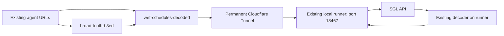

# Verified permanent proxy baseline — 6 November 2026

**Approved update:** [automatic schedule/class-detail fallback](AUTOMATIC-FALLBACK.md) now supplements this permanent local-first path. The restoration proof below predates fallback activation; use the linked release record for the current fallback behavior and version. The local runner/tunnel remain unchanged.

## Change boundary

Owner requested that this verified setup be frozen. Preserve the existing agent URLs, permanent tunnel, runner and decoder. Changes require explicit owner approval, preview testing and live verification before acceptance. This is a documented operating boundary, not a filesystem lock. Read-only monitoring continues. Do not run collectors manually or change credentials as a diagnostic shortcut.

## Working path

This diagram covers the verified schedule and class-detail routes. It does not assert that every broad-tooth route uses the decoder. The previously inspected ringstatus-proxy service binding points to broad-tooth-b8ed; ringstatus-proxy was not retested in this release.

- Worker: `wef-schedules-decoded`; deployed version `25310435-3dda-4d8b-912f-bbbca5a62e53`.
- Permanent origin: `https://wef-decoder-runner.ringstatus.com`.
- Named tunnel: `40872293-3d69-489b-b1e8-a54f2513ede3`.
- Existing Windows tasks: `wef-decoder-named-tunnel` and `wef-decoder-runner-relay`.
- Source files: `shared-worker.mjs`, `runner-relay.mjs`, `worker.js`, `public-live.mjs` in this directory. Installed runner files: `wef-data/runtime/wef-decoder-runner/` from repository root.
- Deployment uses the existing `wrangler.jsonc`. No new Worker, dependency, credential or agent URL was introduced by the restoration.

## Confirmed cause of empty direct Cloudflare responses

Cloudflare automatically adds `CF-Worker: gombcg.workers.dev` to direct Worker fetches. A destination echo confirmed it on the wire. Deleting it in Worker code did not keep it removed: Cloudflare added it back.

With the same local token, cookies, URL and other headers, adding only this header changed a populated 7-ring response into HTTP 200 with literal `{}`. Removing only that header restored 7 rings. This proves a sufficient trigger; SGL's internal rule and any other restrictions remain unknown. It does not prove expired credentials, throttling or an IP-only block.

The runner constructs a new outbound request rather than forwarding inbound headers. Its outgoing echo contained no CF-Worker header. Actual remote preview through a temporary tunnel returned 7 decoded rings three times. The temporary preview and tunnel were stopped afterward; production uses the existing permanent tunnel.

Evidence: [header isolation](evidence/cloudflare-direct-preview-20261106/cf-worker-header-isolation.json), [failed header removal](evidence/cloudflare-direct-preview-20261106/cf-worker-removal-preview-safe.json), [successful isolated preview](evidence/cloudflare-direct-preview-20261106/isolated-runner-tunnel-safe.json).

## Anonymous token renewal

The runner calls `/utilities/get-config` locally with existing cookies and the tested browser headers. It reads `_t`, checks `anon=true` and a future expiry, and caches the token in memory. It renews when no cached token exists or fewer than 24 hours remain. Concurrent renewal requests share one pending renewal. It does not renew on every schedule/class request and does not expose the token to agents. Restarting the runner clears the in-memory cache.

`wef-data/source-reader.js` importing the decoder directly is a different execution path; it does not automatically inherit this relay's renewal. This restoration does not prove every collector has migrated to the hosted proxy.

## Live acceptance

Verified 6 November, 5:29–5:30 p.m. America/New_York, two rounds separated by 20 seconds. Both hosts returned HTTP 200 and usable decoded content on both rounds:

| Host | Request | Result |
| --- | --- | --- |
| `wef-schedules-decoded.gombcg.workers.dev` | `/schedule?date=2026-11-06&show_id=200000077&customer_id=15` | 7 rings, resolved class IDs |
| `broad-tooth-b8ed.gombcg.workers.dev` | same schedule parameters | 7 rings, resolved class IDs |
| `wef-schedules-decoded.gombcg.workers.dev` | `/classes/200031233?show_id=200000077&customer_id=15&cgid=-1` | class 200031233, 8 trips with entry IDs |
| `broad-tooth-b8ed.gombcg.workers.dev` | same class-detail parameters | class 200031233, 8 trips with entry IDs |

Seven is the source's observed ring count, not a hard-coded requirement. These are diagnostic request checks, not collector or scheduled workflow proof. No collectors ran.

Release evidence: [live checks](evidence/permanent-runner-release-20261106/live-verification.json), [running tasks and listener](evidence/permanent-runner-release-20261106/runtime-state.json), [source hashes](evidence/permanent-runner-release-20261106/baseline-safe.json), [release record](evidence/permanent-runner-release-20261106/release.md). The baseline file's `localSharedSourceInLiveBundle=false` is a failed literal-text comparison against a bundled artifact, not evidence of behavioral divergence; the live bundle was inspected and the local source subsequently redeployed.

## Known limits and recovery boundary

- Before restoration, the tunnel task was running but the relay task was stopped, with last result `0xC000013A`. Why it stopped remains unknown. Starting the existing task restored service. Do not invent a cause or replace the setup on that evidence.
- The existing relay task has restart count 99 and no execution time limit. This does not establish long-term unattended reliability or automatic recovery after every interruption.
- The decoder still accepts upstream `{}` and marks it decoded. The earlier code review confirmed this defect; it was not repaired by this deployment. A decoded marker or HTTP 200 alone is not usable-data proof. See the [review](evidence/cloudflare-direct-preview-20261106/code-review/review.md).
- Existing `/health` checks source response, show identity, date and a rings array; it does not require exactly eight rings. See [monitoring responsibility and cadence](SHOW-TIME-HEALTH.md). Documentation does not itself add alerts or new checks.
- For a future outage, inspect the existing task states, listener, tunnel and source response before proposing a change. Restart, repair, deployment or credential changes require the applicable owner authorization; failed workflow rules still apply.

No secret values belong in this document or evidence. Preserve unrelated working-tree edits.
